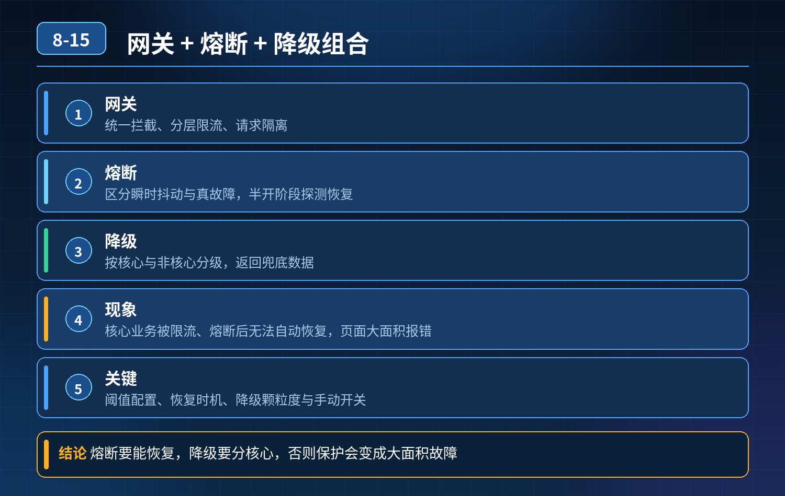

    网关+熔断+降级组合，大促流量暴涨后核心业务被限流、熔断无法恢复，页面大面积报错

## 第 08-15 题　网关+熔断+降级组合，大促流量暴涨后核心业务被限流、熔断无法恢复，页面大面积报错

**候选人浅层回答：** 网关统一拦截请求，熔断组件切断故障服务，搭配降级返回兜底数据，架构就能稳定运行。

## 核心拆解一句话结论

本题考察对底层原理和线上实战能力的综合理解，不能只停留在背结论。

## 连环追问

大促流量突增 4 倍，出现这些现象：网关转发瓶颈、请求排队；下游超时，熔断频繁触发且很难自动恢复；降级粗糙，核心、非核心业务一起被限制，核心功能不可用。

1. 网关如何实现流量分层、请求隔离？
2. 熔断怎么区分瞬时抖动和真正永久故障？
3. 降级策略怎么精准区分核心业务和非核心业务？
4. 故障恢复阶段，探活、恢复流量的渐进规则怎么设计？

## 一、事故根因总结

简单的 “网关限流 + 熔断 + 降级” 是很容易踩坑的低配方案，这个故障本质是 4 个问题叠加：

1. 流量没有分层隔离：核心下单、支付流量和商品推荐、日志上报、后台查询等非核心流量混在一起；资源争抢，一压全部受限。
2. 网关自身没有做容量保护：网关本身也是服务，没有线程池隔离、排队超时、单机限流；网关队列堆积，请求在网关层就堵死，传导到下游。
3. 熔断策略只看失败率，不区分抖动和持续故障：瞬间流量冲击带来的少量超时就直接熔断；半开恢复机制不合理，探活流量、恢复节奏没有渐进控制，容易反复熔断（熔断震荡）。
4. 降级是全局一刀切：没有业务优先级，限流、降级规则不区分链路等级；资源紧张时优先牺牲的应该是非核心功能，而不是核心下单链路。

扩容加节点只是治标，流量峰值来临时，如果防护策略本身是错的，扩容只会让故障传导更广。

## 二、三层防御体系（网关层 → 服务调用层 → 业务降级层）

第一层：网关层：流量染色、分层隔离、网关自我保护网关是第一道闸门，同时网关本身要防被打挂：

1. 流量染色，按业务优先级分组 把请求划分等级：P0 核心链路（下单、支付、扣库存）、P1 重要链路（订单查询）、P2 非核心（推荐、统计、埋点、后台导出）。 独立线程池、独立限流配额；资源紧张时，优先丢弃、限制 P2 流量，保障 P0 流量配额。
2. 网关自身保护 设置网关连接数、排队队列上限、网关侧超时；队列满了直接拒绝低优先级流量，避免网关内部队列无限堆积。
3. 维度限流：按用户、渠道、接口、业务等级分开限流，而不是全局一个 QPS阈值。

第二层：服务间熔断：区分抖动 / 持续故障，渐进式半开探活熔断不能只简单统计失败率，要结合两个维度：慢调用比例 + 异常比例

1. 瞬时抖动（比如偶尔一个包超时）：短时间的少量失败，不触发熔断，依靠重试（有限次数、快速重试）消化；
2. 持续故障：连续一段时间失败 / 慢调用占比达到阈值，才进入熔断打开状态；
3. 半开恢复设计（重点解决无法自动恢复、反复熔断）： 熔断冷却期结束后，不是直接全量放开流量，只放一小部分试探流量；

- 探活成功：逐步放大流量，缓慢恢复，而不是一次性全开；
- 探活失败：立刻重回熔断状态，重置冷却时间； 同时配合超时、线程池 / 信号量隔离，避免单个慢依赖耗尽本服务线程。

第三层：业务降级：按优先级柔性兜底，禁止一刀切降级的核心原则：保核心，砍次要

4\. 降级开关绑定业务等级：资源不足时，优先关闭 P2 非核心功能； 例：下单链路，下单、扣库存、支付是核心；商品推荐、积分通知、短信异步推送是可降级项。

5\. 降级方式区分：

- 返回缓存兜底数据（商品详情）；
- 同步转异步：非强通知放到 MQ 后台处理；
- 直接静默丢弃埋点、统计流量；
- 友好提示，而不是统一 500 报错；

6\. 拒绝 “一触发熔断，整个接口全部降级”，支持接口内部分段降级，保留核心逻辑。

## 三、补充配套机制

1. 超时分层：网关超时、Feign 调用超时、MQ 消费超时层层设置，上游超时 \<下游超时，避免超时连锁嵌套；
2. 监控维度：不仅监控 QPS、异常率，还要监控排队长度、线程池使用率、半开状态、降级命中数；
3. 压测演练：压测时模拟流量突增、下游故障，验证熔断恢复、降级优先级是否符合预期；
4. 故障预案：支持动态调整优先级，紧急情况下可以一键关停全部非核心流量。

<strong>追问：</strong>本题考察核心是什么？

<strong>参考答案：</strong>普通开发只理解组件功能：网关限流、熔断、降级是三个独立功能。

高阶工程师理解故障是链式传导：

1. 网关本身存在瓶颈，网关也需要保护，网关不是无限转发的黑盒；
2. 熔断不是越快切断越好，要区分瞬时抖动和持续故障，防止雪崩震荡；
3. 降级的灵魂是业务优先级，防护的目标是保住核心链路可用；
4. 恢复比熔断更考验设计：流量恢复必须渐进、灰度试探，避免恢复瞬间再次打垮下游。

<strong>核心思想：</strong>流量防护不是简单加注解配规则，是一套分级隔离、优先保障核心、故障可切断、恢复可渐进的全链路风控体系。

## 连环追问要点整理

1. 底层核心原理是什么？为什么这么设计？
2. 线上出现相关故障如何快速止损、定位根因？
3. 高并发场景下有哪些坑点，性能、一致性、可用性如何权衡？

## 面试回答完整话术

  - **一句话结论**：本题考察对底层原理和线上实战能力的综合理解，不能只停留在背结论。
  - **连环追问**：大促流量突增 4 倍，出现这些现象：网关转发瓶颈、请求排队；下游超时，熔断频繁触发且很难自动恢复；降级粗糙，核心、非核心业务一起被限制，核心功能不可用。
  - **一、事故根因总结**：简单的 “网关限流 + 熔断 + 降级” 是很容易踩坑的低配方案，这个故障本质是 4 个问题叠加：
  - **二、三层防御体系（网关层 → 服务调用层 → 业务降级层）**：第一层：网关层：流量染色、分层隔离、网关自我保护网关是第一道闸门，同时网关本身要防被打挂：
  - **三、补充配套机制**：超时分层：网关超时、Feign 调用超时、MQ 消费超时层层设置，上游超时 \<下游超时，避免超时连锁嵌套；
  - **收尾**：线上问题按「先止损保可用性 → 再定位根因 → 最后从架构规范层面根治」三段论闭环。

## 追问：本题考察核心是什么？

###  高级工程师要分清：

1. **不能只停留在背结论**：要能回答「为什么这样设计、不这样会怎样、线上踩坑怎么排查」；
2. **具备止损→定位→根治三段论**：先止血保业务，再定位根因，最后从架构与规范层面根治；
3. **给出工程取舍**：性能、一致性、可用性三者权衡，说清代价与适用场景。

  核心思想：这道题考察原理理解 + 线上实战 + 架构思维，真正的工程答案是「现象 → 根因 → 止损 → 定位 → 根治」五段式闭环。

