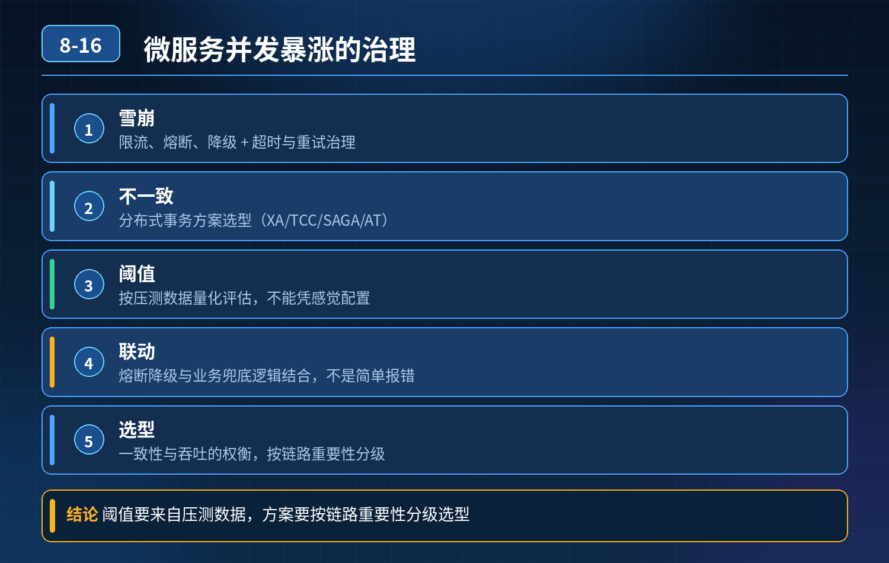

    微服务并发暴涨，服务雪崩、分布式数据不一致如何解决

## 第 08-16 题　微服务并发暴涨，服务雪崩、分布式数据不一致如何解决

**候选人浅层回答：** 用 Nacos 做注册中心，Seata 管理分布式事务，Sentinel加注解实现限流熔断。

## 核心拆解一句话结论

本题考察对底层原理和线上实战能力的综合理解，不能只停留在背结论。

## 连环追问

1. 限流阈值要怎么量化评估，凭感觉配置吗？
2. 熔断、降级策略怎么和业务逻辑联动，不是简单直接报错？
3. XA、TCC、SAGA、AT 模式的分布式事务分别适合什么场景，落地成本和风险是什么？
4. 全链路幂等怎么设计防止重复提交、重复回调？
5. 服务雪崩如何做多级兜底防护，只靠设置超时时间够不够？

## 一、底层核心认知

微服务分布式环境下，网络不可靠、调用链变长、依赖变多。 超时、抖动、调用失败是常态；高可用不是消灭故障，而是故障发生时，控制爆炸范围、保障核心链路可用、保证数据最终一致。 只引入组件、加注解只是脚手架使用，没有理解背后的防护体系，很容易线上出重大故障。

## 二、三层核心体系：雪崩防护（限流 + 熔断 + 降级）、幂等防重、分布式事

务第一层：流量防护体系，防止雪崩（Sentinel 核心落地思路）

1\. 限流：阈值量化，拒绝无效流量 阈值不能拍脑袋，基于压测结果、单机最大承载 QPS、机器数量、峰值预留水位来设置； 限流维度：接口维度、用户 ID、IP、来源渠道； 限流策略：直接拒绝、排队等待、漏桶 / 令牌桶； 区分核心接口和非核心接口：核心链路预留配额，非核心接口严格限流，不抢占资源。

2\. 熔断：切断故障依赖，防止连锁阻塞 统计调用失败率、慢调用比例，超过阈值触发熔断；熔断后不再发起远程调用； 半开状态试探：熔断一段时间后放少量流量探测依赖是否恢复，恢复正常则关闭熔断。

3\. 降级：业务友好兜底，不是一刀切报错 降级分多种方案，和业务绑定：

1\. 静态兜底数据：商品详情、公告等返回缓存默认数据；

2\. 关闭非强依赖的次要功能：比如下单时关闭推荐、积分通知；

3\. 异步化：同步调用转为 MQ 异步处理，先给用户返回成功，后台慢慢消费；

4\. 柔性提示：给用户友好提示，而不是 500 异常。

多级防护顺序：网关层粗限流 → 服务层细粒度限流熔断 → 内部降级兜底；超时时间只是最基础的底线，不能作为唯一手段。

配合线程池隔离、信号量隔离，避免一个慢依赖耗尽本服务线程资源。

5\. 第二层：全链路幂等，解决重复调用问题分布式场景，重试、MQ 重复投递、前端重复提交、回调重复推送，都会造成重复扣库存、重复扣款；幂等是分布式一致性的基础。 常见实现方案：

1\. 唯一业务单号（订单号、支付流水号）作为幂等 Key，数据库唯一索引；

2\. 状态机控制：只允许状态正向流转，重复操作直接忽略；

3\. 分布式幂等表 / Redis 记录处理标识；

4\. MQ 消费端必须保证幂等。 原则：任何支持重试的接口，都必须做幂等。

第三层：分布式事务选型，解决数据一致性先记住选型核心：优先最终一致性，尽量不用强一致方案，业务能异步解耦就不用分布式事务。

- AT（Seata 默认）：无侵入，基于 undo_log；适合大多数 Java 业务；代价：全局锁，高并发场景容易锁等待，不适合超高并发扣减库存场景；
- TCC：Try-Confirm-Cancel，业务代码侵入强；性能高；适合资金、库存等高一致性要求的核心场景，开发成本高，需要处理空回滚、悬挂；
- SAGA：长事务、流程长的场景，比如订单履约、售后流程；本地事务 + 补偿，无全局锁；适合长链路业务；
- XA：数据库层面两阶段提交，强一致；性能差、数据库锁时间长，互联网业务极少使用。 落地建议： 简单业务优先 AT；资金库存核心场景 TCC；长履约流程 SAGA；能拆成 MQ 异步最终一致，优先 MQ。

## 三、整套链路的标准落地顺序

1. 网关：路由、全局限流、黑名单；
2. 服务间调用：Feign/Dubbo 配置合理超时、线程隔离、Sentinel 限流熔断；
3. 所有对外接口、MQ 消费者、回调接口：统一幂等；
4. 跨服务数据变更：评估一致性要求，选择对应的分布式事务方案；
5. 监控告警：QPS、失败率、慢调用、熔断状态、事务状态持续监控；
6. 预案：故障演练，验证降级、熔断、补偿脚本是否可用。

<strong>追问：</strong>本题考察核心是什么？

<strong>参考答案：</strong>初级开发只是会整合组件，知道 Sentinel、Seata 这些名字，只会复制注解。高阶后端要具备风险架构思维：

1. 分清各个组件解决什么问题、有什么代价、边界在哪里；
2. 限流阈值、熔断条件不是凭经验，要基于压测、容量水位量化；
3. 降级是业务层面的柔性设计，不是单纯抛出异常；
4. 理解不同分布式事务模型的取舍，明白强一致的性能代价，优先最终一致性；
5. 明白雪崩是链式传导，需要网关、服务、线程隔离、熔断降级多层防护；
6. 知道幂等是分布式一切重试机制的前提，没有幂等，重试就是灾难。

<strong>核心思想：</strong>微服务高可用，不是注册中心 + 分布式事务框架 + 限流组件的简单堆砌，而是一套流量管控、故障隔离、柔性降级、幂等保障、事务补偿的风险闭环体系。

## 连环追问要点整理

1. 底层核心原理是什么？为什么这么设计？
2. 线上出现相关故障如何快速止损、定位根因？
3. 高并发场景下有哪些坑点，性能、一致性、可用性如何权衡？

## 面试回答完整话术

  - **一句话结论**：本题考察对底层原理和线上实战能力的综合理解，不能只停留在背结论。
  - **连环追问**：熔断、降级策略怎么和业务逻辑联动，不是简单直接报错？
  - **一、底层核心认知**：微服务分布式环境下，网络不可靠、调用链变长、依赖变多。 超时、抖动、调用失败是常态；高可用不是消灭故障，而是故障发生时，控制爆炸范围、保障核心链路可用、保证数据最终一致。 只引入组件、加注解只是脚手架
  - **二、三层核心体系：雪崩防护（限流 + 熔断 + 降级）、幂等防重、分布式事**：务第一层：流量防护体系，防止雪崩（Sentinel 核心落地思路）
  - **三、整套链路的标准落地顺序**：服务间调用：Feign/Dubbo 配置合理超时、线程隔离、Sentinel 限流熔断；
  - **收尾**：线上问题按「先止损保可用性 → 再定位根因 → 最后从架构规范层面根治」三段论闭环。

## 追问：本题考察核心是什么？

###  高级工程师要分清：

1. **不能只停留在背结论**：要能回答「为什么这样设计、不这样会怎样、线上踩坑怎么排查」；
2. **具备止损→定位→根治三段论**：先止血保业务，再定位根因，最后从架构与规范层面根治；
3. **给出工程取舍**：性能、一致性、可用性三者权衡，说清代价与适用场景。

  核心思想：这道题考察原理理解 + 线上实战 + 架构思维，真正的工程答案是「现象 → 根因 → 止损 → 定位 → 根治」五段式闭环。

