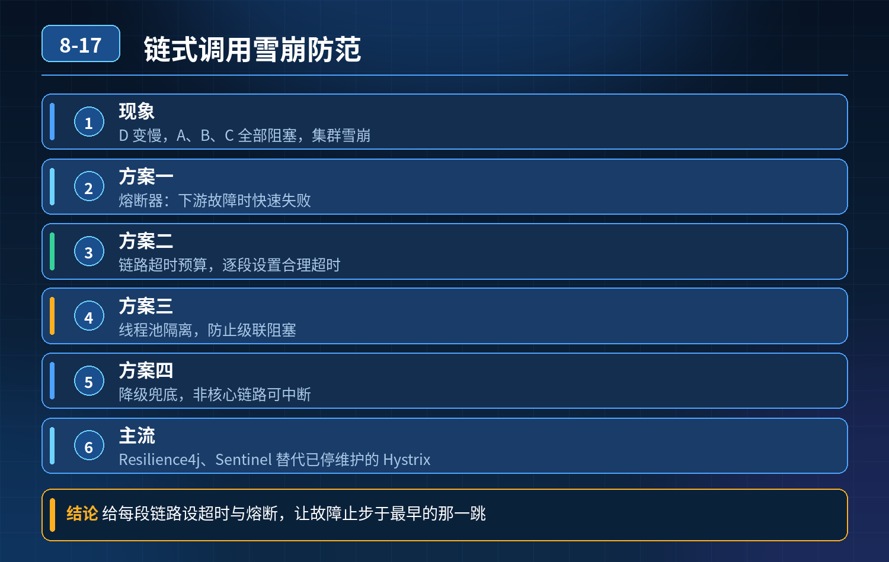

    A→B→C→D 链式调用，D 变慢导致 A、B、C 全部阻塞、集群雪崩，如何防范

## 第 08-17 题　A→B→C→D 链式调用，D 变慢导致 A、B、C 全部阻塞、集群雪崩，如何防范

**候选人浅层回答：** 使用 Hystrix 熔断器 + 服务降级就能防止雪崩。

## 核心拆解一句话结论

<strong>核心思想：</strong>防止链式雪崩，顺序是：缩短同步链路 → 资源隔离阻断传染 →合理超时 + 精细化熔断降级 → 监控动态应急，不是上来就加熔断器。

## 连环追问

1. Hystrix 已经停止维护，现在主流方案是什么？
2. 线程池隔离和信号量隔离分别适合什么场景，怎么选择？
3. 熔断器参数如何合理配置？半开阶段如何安全恢复？
4. 只打开熔断器、使用默认配置，为什么线上依然会雪崩？

## 参考答案

事故根因链式同步调用是雪崩的高发场景：D 变慢 → C 的调用线程被持续占住、堆积耗尽 → B 调用 C 的线程耗尽 → A 调用 B 的线程耗尽。所有服务的工作线程被慢调用卡死，新请求进不来，整个链路瘫痪。 熔断只是其中一环，单纯配熔断、用默认参数，无法根治；核心是隔离，切断资源传染链路。 现在生产主流替代方案：Sentinel（阿里）、Resilience4j，Hystrix 早已停止维护，新项目不推荐。
四层防护体系（依赖治理、资源隔离、熔断降级、监控动态管控）第一层：依赖与调用链路治理（治本优先）
1. 尽量缩短同步长链路，同步改异步 A→B→C→D 这种串行长同步链路本身风险极高。非强实时场景，通过 MQ 异步解耦，打破同步等待链，从根源消除链式阻塞。
2. 依赖梳理，强弱依赖区分 区分强依赖（必须成功才能执行业务）、弱依赖（可降级，比如推荐、埋点、日志）。弱依赖直接做异步、优先降级，不要占用核心同步线程。
3. 合理设置逐级超时，上游超时 \< 下游超时 超时是底线兜底。例如 D:200ms，C:300ms，B:400ms，A:500ms。防止上游等待时间比下游更长，请求层层堆积。
超时不能统一写一个很大的值。
第二层：资源隔离（雪崩最核心手段，区分线程池隔离 / 信号量隔离）隔离目标：一个慢依赖，只消耗它自己的配额，不侵占本服务其他接口、其他依赖的线程资源
- 线程池隔离（ThreadPool） 给每一个下游依赖分配独立线程池。调用 D 的请求走独立线程池，哪怕 D 拖慢、线程堆满，服务本身处理别的请求、别的依赖的线程不受影响。 适用：远程 HTTP/RPC 调用，IO 阻塞型调用；开销更大，有线程切换成本。
- 信号量隔离（Semaphore） 不新开线程，限制并发数量，复用服务本身线程；只控制并发上限。 适用：本地代码逻辑、内存计算、短耗时调用；Dubbo 默认常用信号量。
避坑：如果没有隔离，同一个服务所有接口共用一个线程池，只要一个下游变慢，整个服务直接堵死，熔断还没触发就已经挂了。
第三层：熔断、降级、重试策略精细化配置
4\. 熔断统计维度：慢调用比例 + 异常比例，不只看报错；短时间少量超时抖动不轻易熔断。
5\. 半开恢复机制（重点） 冷却结束进入半开，少量试探流量去访问 D：
- 探活成功：逐步放量，灰度恢复，不要一次性全开；
- 探活失败：立刻重回熔断，重置冷却窗口，防止反复震荡。
6\. 重试管控：长链路禁止无限制重试；重试次数限制、间隔拉长，只对幂等接口重试；避免重试放大流量压垮 D。
7\. 降级预案：熔断触发后返回兜底，而不是空等报错；弱依赖直接降级。
第四层：监控、动态规则、容量保护
1. 监控指标不只看报错：重点监控线程池队列堆积、等待时长、活跃并发、慢调用数量、半开状态；队列堆积是雪崩前置信号，早于熔断告警。
2. 规则动态推送：Sentinel 支持运行时动态调整限流、熔断阈值，故障时快速干预，不需要重启服务。
3. 全链路压测：模拟下游 D 缓慢、超时场景，验证隔离、熔断是否生效，检验默认参数是否扛得住峰值。
简单总结两者选型
- 外部远程调用、容易 IO 阻塞 → 优先线程池隔离，物理隔离资源，防护最强；
- 轻量本地逻辑、追求性能，能接受风险 → 信号量隔离。
<strong>追问：</strong>本题考察核心是什么？
<strong>参考答案：</strong>初级开发者只记住 “熔断器” 这个名词，把熔断当成雪崩的万能解药，不知道隔离才是第一道屏障，不懂隔离方案取舍，直接使用框架默认参数。高阶工程师理解：
1. 雪崩本质是资源耗尽、故障沿着调用链传染；熔断是止损，隔离是阻断传染；
2. 清楚 Hystrix 停更现状，了解业界主流组件；
3. 懂得线程池隔离、信号量隔离的适用边界、性能代价；
4. 理解半开恢复的灰度思想，知道恢复比熔断更容易二次踩坑；
5. 架构优先思路：优先缩短同步链路、异步解耦，防护组件只是兜底手段。

## 连环追问要点整理

1. 底层核心原理是什么？为什么这么设计？
2. 线上出现相关故障如何快速止损、定位根因？
3. 高并发场景下有哪些坑点，性能、一致性、可用性如何权衡？

## 面试回答完整话术

  - **一句话结论**：<strong>核心思想：</strong>防止链式雪崩，顺序是：缩短同步链路 → 资源隔离阻断传染 →合理超时 + 精细化熔断降级 → 监控动态应急，不是上来就加熔断器。
  - **连环追问**：Hystrix 已经停止维护，现在主流方案是什么？
  - **参考答案**：事故根因链式同步调用是雪崩的高发场景：D 变慢 → C 的调用线程被持续占住、堆积耗尽 → B 调用 C 的线程耗尽 → A 调用 B 的线程耗尽。所有服务的工作线程被慢调用卡死，新请求进不来，整个链
  - **收尾**：线上问题按「先止损保可用性 → 再定位根因 → 最后从架构规范层面根治」三段论闭环。

## 追问：本题考察核心是什么？

###  高级工程师要分清：

1. **不能只停留在背结论**：要能回答「为什么这样设计、不这样会怎样、线上踩坑怎么排查」；
2. **具备止损→定位→根治三段论**：先止血保业务，再定位根因，最后从架构与规范层面根治；
3. **给出工程取舍**：性能、一致性、可用性三者权衡，说清代价与适用场景。

  核心思想：这道题考察原理理解 + 线上实战 + 架构思维，真正的工程答案是「现象 → 根因 → 止损 → 定位 → 根治」五段式闭环。

