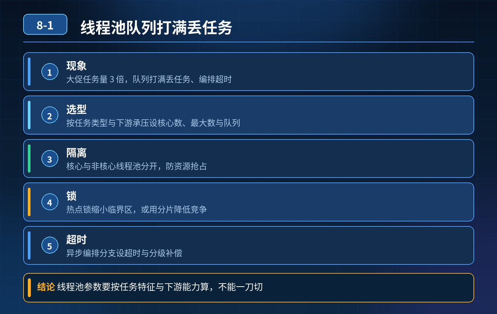

    订单异步处理系统，大促任务量突增 3 倍，线程池队列打满丢任务、锁阻塞、编排超时、非核心抢占资源

## 第 08-1 题　订单异步处理系统，大促任务量突增 3 倍，线程池队列打满丢任务、锁阻塞、编排超时、非核心抢占资源

**候选人浅层回答：** 线程池调大一点，再加分布式锁保证安全。

## 核心拆解一句话结论

线程池没有按业务链路拆分，共用同一个线程池 核心订单状态更新、短信通知、埋点日志全部跑在同一个池子里；

## 连环追问

1. 线程池参数怎么选型，避免 OOM 同时不浪费机器资源？
2. 热点锁竞争剧烈时，怎么兼顾数据安全和吞吐量？
3. CompletableFuture 这类异步编排分支超时，如何分级补偿，不拖垮整条核心链路？
4. 非核心通知类任务，怎么资源隔离，防止抢占核心订单处理线程？

## 参考答案

事故根因汇总单纯调大核心线程数只是治标，这组故障是 4 类问题叠加：
2. 队列无上限 / 上限过小，拒绝策略选型错误 队列太小容易丢任务；队列无界LinkedBlockingQueue，流量暴涨会持续往队列塞任务，内存持续上涨最终 OOM。
3. 热点锁粗粒度，串行化严重 订单维度、商品维度热点锁范围太大，大量线程卡在锁等待，线程池线程被卡死，无法处理新任务，看起来线程数很大但有效吞吐极低。
4. 异步编排缺少超时、取消、隔离机制 异步编排是链式依赖，某个分支（比如短信推送）超时阻塞，主线程一直 await 等待，整条任务链路挂起；没有单独的超时控制、分支独立降级、失败补偿。

## 三层防御体系

第一层：线程池资源隔离，精细化参数设计（第一道防线）核心原则：按业务优先级拆分独立线程池，核心池、非核心池分开

- 核心池：订单状态变更、库存回滚、支付回调；线程数、队列配额优先保障，拒绝策略不能直接丢弃（使用 CallerRunsPolicy 或者持久化到消息队列）
- 非核心池：短信、推送、埋点、日志统计；独立线程池，容量更小、可以限流、允许降级丢弃 参数选型思路：
- CPU 密集型：核心线程 ≈ CPU 核心数；
- IO 密集型（数据库、RPC、Redis，订单异步场景大多是 IO 密集）：核心线程可以设为 CPU2 ~ CPU4，但不能无限放大；
- 队列：有界队列，设置合理上限；禁止无界队列；
- 拒绝策略：区分任务重要度：
- 核心任务：拒绝时不丢弃，转入 MQ 持久化，后续重试；
- 非核心任务：直接丢弃或者降级，记录日志告警。

重点：线程池参数不能拍脑袋，由压测得出，观测指标：队列长度、线程活跃数、任务等待时间、拒绝次数。

第二层：锁优化，降低竞争，在安全和吞吐之间平衡热点锁是高并发异步系统常见瓶颈，优化思路依次递进：

1. 缩小锁粒度：不要锁整个商品，只锁单条订单；
2. 锁分段（分片锁）：热点商品拆成分片，分散锁竞争；
3. 读写分离：读不加锁，使用版本号 / 乐观锁（CAS），写的时候才竞争锁；优先乐观锁，减少阻塞；
4. 本地缓存 + 兜底锁：把高频读数据放缓存，减少进入锁区域的次数；
5. 避免在锁内部做 RPC、DB 慢查询，锁内只做内存状态判断，IO 操作移出锁范围。

误区：不是锁越多越安全，粗粒度排他锁会直接把并发系统变回串行。

第三层：异步编排的超时、分支隔离、分级补偿（兜底防线）针对 CompletableFuture 异步编排这类场景：

1. 每个独立分支单独设置超时时间 不能整条链路统一等待；短信、通知这类弱依赖分支超时，不能阻塞主订单流程；超时后主动 cancel 分支任务。
2. 强弱依赖拆分 编排的时候区分：强依赖（订单状态更新）、弱依赖（推送通知）；弱依赖分支失败 / 超时，不影响主任务结果，单独记录失败日志。
3. 分级补偿策略

- 核心任务失败：落失败表、定时重试（有限次数、退避重试），人工告警兜底；
- 非核心任务失败：只打日志，允许丢失，不重试、不阻塞主链路；

4\. 编排链路加全链路埋点，记录每个分支耗时、成功失败状态，快速定位卡住的分支。

额外配套机制

1. 异步任务优先 MQ 解耦兜底：线程池适合短时间、可控的异步；大促峰值流量，上游先进入 RocketMQ/Kafka，线程池作为消费者池，而不是直接接收突发流量；
2. 监控指标：线程池队列堆积、拒绝次数、锁等待时长、future 分支超时数量；队列堆积是前置告警信号；
3. 限流：非核心任务池单独限流，防止抢占资源。

<strong>追问：</strong>本题考察核心是什么？

<strong>参考答案：</strong>初级开发者只会创建线程池、synchronized / 分布式锁、写CompletableFuture 编排代码，把 API 当成高并发方案。高阶工程师理解：

1. 线程池的本质是资源配额控制器，而不是开更多线程；线程越多不代表吞吐越高，锁阻塞、IO 等待下大量线程只会加剧上下文切换和阻塞；
2. 资源隔离是稳定性前提，核心和非核心任务必须物理隔离；
3. 锁的代价是并发度，热点场景优先乐观锁、分片、缩小范围，而不是简单加锁；
4. 异步编排最大坑是链式阻塞，弱依赖分支必须独立超时、独立降级；
5. 异步系统不能只依赖内存线程池，必须有持久化消息、失败表做补偿兜底。

<strong>核心思想：</strong>并发稳定性，不是会写并发 API，而是控制资源边界、隔离故障域、拆分依赖、做好失败补偿，防止一个慢分支拖垮整个异步链路。

## 连环追问要点整理

1. 底层核心原理是什么？为什么这么设计？
2. 线上出现相关故障如何快速止损、定位根因？
3. 高并发场景下有哪些坑点，性能、一致性、可用性如何权衡？

## 面试回答完整话术

  - **一句话结论**：线程池没有按业务链路拆分，共用同一个线程池 核心订单状态更新、短信通知、埋点日志全部跑在同一个池子里；
  - **连环追问**：线程池参数怎么选型，避免 OOM 同时不浪费机器资源？
  - **参考答案**：事故根因汇总单纯调大核心线程数只是治标，这组故障是 4 类问题叠加：
  - **三层防御体系**：第一层：线程池资源隔离，精细化参数设计（第一道防线）核心原则：按业务优先级拆分独立线程池，核心池、非核心池分开
  - **收尾**：线上问题按「先止损保可用性 → 再定位根因 → 最后从架构规范层面根治」三段论闭环。

## 追问：本题考察核心是什么？

###  高级工程师要分清：

1. **不能只停留在背结论**：要能回答「为什么这样设计、不这样会怎样、线上踩坑怎么排查」；
2. **具备止损→定位→根治三段论**：先止血保业务，再定位根因，最后从架构与规范层面根治；
3. **给出工程取舍**：性能、一致性、可用性三者权衡，说清代价与适用场景。

  核心思想：这道题考察原理理解 + 线上实战 + 架构思维，真正的工程答案是「现象 → 根因 → 止损 → 定位 → 根治」五段式闭环。

