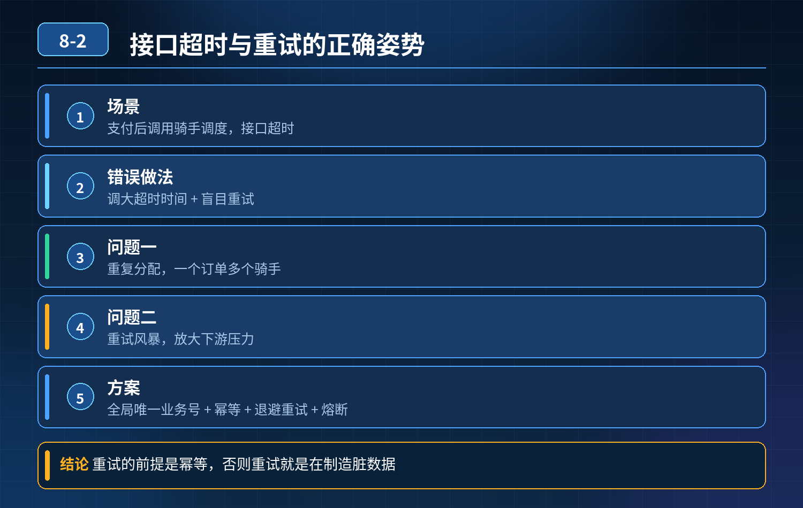

    接口超时与重试（订单分配骑手案例）

## 第 08-2 题　接口超时与重试（订单分配骑手案例）

**候选人浅层回答：** 背诵表面结论，没有深入到原理和线上场景。

## 核心拆解一句话结论

本题考察对底层原理和线上实战能力的综合理解，不能只停留在背结论。

## 场景复盘

订单支付后调用骑手调度服务分配骑手，接口超时；开发简单调大超时时间、加 3 次重试，引发两个致命问题：

1. 重复分配骑手：调度服务内部已经成功分配骑手，只是响应包网络延迟丢包 /处理慢，调用方收到超时，重试后再次分配，造成同一个订单多个骑手接单；
2. 重试风暴：调度本身负载很高，大量重试请求持续压过去，压力放大，诱发服务雪崩。

核心误区：超时 ≠ 调用失败；单纯调大超时、盲目加重试，是高并发分布式场景里典型的 “幽灵陷阱”。超时本质是结果不确定性：下游到底成功了还是没成功，调用方无法确定。

## 三层高分逻辑

第一层：先区分超时的结果不确定性 + 接口幂等（防重复业务）分布式调用超时，存在三种状态：成功、失败、未知。 分配骑手这类写接口，必须做幂等：

- 请求携带全局唯一业务标识（orderId 或者 requestId）；
- 调度服务收到请求，先查本地流水表：该订单是否已经分配；已分配直接返回成功，不再重复分配；幂等是重试的前提，没有幂等绝对不能开自动重试。

第二层：重试策略精细化治理，防止重试风暴不是所有异常都能重试，要做区分：

1. 可重试异常：连接失败、超时、限流；
2. 不可重试：参数错误、业务校验失败、订单状态非法，直接返回，禁止重试；
3. 重试参数：指数退避 + 随机抖动（jitter），不要固定间隔重试，避免同一时刻大量请求扎堆重试；
4. 重试上限：控制最大重试次数，不能无限重试；
5. 熔断限流：用 Sentinel/Hystrix，下游负载高、失败率超过阈值直接熔断，快速失败，切断重试流量，保护下游，避免雪崩。

重点：超时时间不能一味调大。超时要根据链路 RT、SLA 合理设置；超时太长会阻塞调用线程，堆积请求，造成调用方线程耗尽。

第三层：架构兜底，消除不确定性（根治方案）

1. 同步改异步：分配骑手这种非强同步链路，不要同步调用；订单服务发送 MQ消息给调度服务，调度消费处理；消息自带幂等，MQ 本身有重试、死信；
2. 状态机 + 对账补偿：订单流转状态：已支付→待派单→派单成功 / 派单失败；定时对账扫描处于 “待派单” 长期卡住的订单，人工或者补偿流程处理；
3. 监控：监控超时率、重试次数、下游负载、重复请求数，提前告警。

- 30

## 秒口述标准答案

接口超时不能简单调大超时时间、加重试。超时代表结果未知，首先接口必须基于唯一请求 ID 实现幂等，避免重试造成重复分配骑手；其次重试要区分异常类型，只对网络类瞬时异常重试，采用带随机抖动的指数退避策略，配合熔断，下游压力高的时候停止重试，防止重试风暴；最后优先把这类非核心同步调用改成 MQ 异步解耦，配合状态机和定时对账兜底，从架构上消除同步调用带来的不确定性。

## 连环追问要点整理

1. 底层核心原理是什么？为什么这么设计？
2. 线上出现相关故障如何快速止损、定位根因？
3. 高并发场景下有哪些坑点，性能、一致性、可用性如何权衡？

## 面试回答完整话术

  - **一句话结论**：本题考察对底层原理和线上实战能力的综合理解，不能只停留在背结论。
  - **场景复盘**：订单支付后调用骑手调度服务分配骑手，接口超时；开发简单调大超时时间、加 3 次重试，引发两个致命问题：
  - **三层高分逻辑**：第一层：先区分超时的结果不确定性 + 接口幂等（防重复业务）分布式调用超时，存在三种状态：成功、失败、未知。 分配骑手这类写接口，必须做幂等：
  - **秒口述标准答案**：接口超时不能简单调大超时时间、加重试。超时代表结果未知，首先接口必须基于唯一请求 ID 实现幂等，避免重试造成重复分配骑手；其次重试要区分异常类型，只对网络类瞬时异常重试，采用带随机抖动的指数退避策略
  - **收尾**：线上问题按「先止损保可用性 → 再定位根因 → 最后从架构规范层面根治」三段论闭环。

## 追问：本题考察核心是什么？

###  高级工程师要分清：

1. **不能只停留在背结论**：要能回答「为什么这样设计、不这样会怎样、线上踩坑怎么排查」；
2. **具备止损→定位→根治三段论**：先止血保业务，再定位根因，最后从架构与规范层面根治；
3. **给出工程取舍**：性能、一致性、可用性三者权衡，说清代价与适用场景。

  核心思想：这道题考察原理理解 + 线上实战 + 架构思维，真正的工程答案是「现象 → 根因 → 止损 → 定位 → 根治」五段式闭环。

