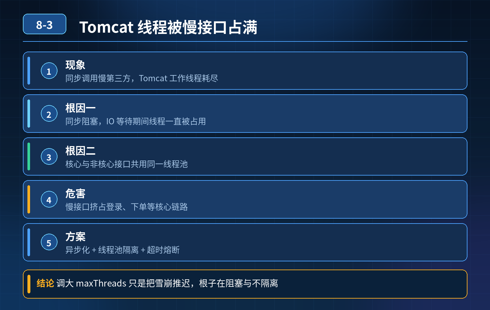

    Tomcat 线程被慢第三方接口占满，调高 maxThreads 只能临时缓解，反复打满，根因和解决方案

## 第 08-3 题　Tomcat 线程被慢第三方接口占满，调高 maxThreads 只能临时缓解，反复打满，根因和解决方案

**候选人浅层回答：** 第三方接口慢，把 Tomcat 最大线程调大，多一点线程扛请求。

## 核心拆解一句话结论

本题考察对底层原理和线上实战能力的综合理解，不能只停留在背结论。

## 场景描述

管理后台批量查询物流，同步调用第三方物流接口，第三方网络慢、响应时间长；大量请求进来后 Tomcat 工作线程被耗尽，登录、订单提交等核心接口全部阻塞超时。调高 Tomcat 最大线程数，短暂好转，流量上来又被打满。单点自测没问题，并发批量调用就服务不可用。问问题根源、如何解决。

<strong>候选人浅层回答：</strong>第三方接口慢，把 Tomcat 最大线程调大，多一点线程扛请求。

核心拆解 + 连环追问

1\. 根本原因核心：Tomcat 线程池是服务唯一的公共资源池，所有接口（核心接口 + 慢的批量物流查询）共用同一组工作线程；同步阻塞调用外部慢接口，线程长时间被占用不释放，耗尽公共线程池，引发线程池耗尽的雪崩，属于资源没有隔离。

1\. Tomcat 的工作线程是处理 HTTP 请求的线程，同步模式下，请求进来之后线程一直挂起等待第三方返回，在 IO 等待期间，线程什么都干不了，持续被占用。

2\. 所有接口共用同一个 Tomcat 线程池。非核心的批量物流查询，耗尽了全局线程，直接挤占登录、下单这类核心链路，这是最致命的问题。

3\. 调高maxThreads 只是增加资源上限，没有解决 “线程被长时间占用” 这个

根源。第三方接口 RT 越长，单位流量消耗的线程越多，流量上涨后依然会快速打满，治标不治本。

4\. 额外风险：线程数量越高，CPU 上下文切换、内存开销越大；线程过多会造成OS 层面调度压力，进一步恶化性能，甚至 OOM。

2\. 三层防御架构（面试标准答案）第一层：超时控制（基础兜底，必加）给所有第三方 HTTP 调用强制设置连接超时 + 读取超时，不能无限等待。

- 使用 RestTemplate/OkHttp/WebClient 设置 timeout；
- 慢请求到达超时时间直接失败，释放 Tomcat 线程，避免线程永久卡死。

只做超时还不够：大量请求同时触发超时，依然会瞬间占满线程。

第二层：资源隔离（核心方案，解决雪崩）把耗时高的批量物流查询，和核心业务接口做线程池隔离 方案可选：

1. 独立业务线程池：物流查询的外部调用，异步提交到单独的业务线程池，不占用 Tomcat 的 HTTP 工作线程。Tomcat 线程快速释放，只负责接收请求、提交任务；外部 IO 等待交给独立线程池。核心接口继续使用 Tomcat 主线程池，互不争抢资源。
2. 服务拆分：批量查询物流单独拆成独立服务，独立容器、独立 Tomcat 线程池，故障不会污染主管理后台。
3. 网关层流量隔离：在网关对不同接口做限流、分组。

核心目标：慢接口故障，不能吃掉核心接口的线程资源。

第三层：流量控制 + 熔断降级（防止打爆下游 + 自我保护）

1\. 限流：对批量物流查询接口做单机限流，限制并发请求数量，防止瞬间大量请求涌入；

2\. 熔断（Sentinel/Hystrix）：当第三方接口错误率 / 超时到达阈值，直接熔断，快速返回降级结果（如缓存旧物流信息），不再发起调用，保护线程资源；

3\. 缓存：物流查询结果做本地 / Redis 缓存，减少重复调用第三方接口，降低外部请求量；

4\. 降级策略：高峰期批量查询直接关闭，只保留单条查询，保障核心功能。

3\. 进阶改造：异步非阻塞模型（长期优化）使用 WebFlux（Reactor）或者异步 Servlet，将 IO 等待脱离 Tomcat 工作线程。

Tomcat 的 NIO/BIO 的区别：同步 Servlet 哪怕 NIO，写同步http 调用外部接口，依然会阻塞 Tomcat 线程；只有使用异步回调 / 响应式编程，IO 等待阶段归还 Tomcat 线程。

4\. 为什么单纯调大 maxThreads 不可取？

1\. 只是扩大资源上限，没有控制单个请求持有线程的时长；

2\. 第三方慢接口 RT=5s，100 并发就占用 100 个线程，调大到 200，200 并发又占满；

3\. 线程越多，内存占用、上下文切换开销上升，超过临界点吞吐量下降，甚至OOM；

4\. 没有隔离，慢接口依然能抢占核心接口资源，雪崩风险依旧存在。

面试完整话术根本问题是公共 Tomcat 线程池没有做业务隔离，慢的同步外部调用长时间占用全局 HTTP 线程，耗尽线程池，导致核心接口没有线程可用，引发服务雪崩。调高 maxThreads 只是扩大资源上限，没有解决线程长时间被阻塞占用的根本问题，流量上涨会再次打满，还会带来更高内存和 CPU 调度开销。

我们可以搭建三层防御： 第一层，强制超时：所有第三方调用设置连接和读取超时，避免线程永久阻塞； 第二层，资源隔离：将批量物流查询放到独立业务线程池，或者拆独立服务，慢接口不占用 Tomcat 的公共请求线程，核心接口资源不受挤占； 第三层，限流熔断 + 缓存降级：对批量查询接口限流，第三方超时错误率高时触发熔断，直接走缓存降级，减少对外调用。

长期优化可以改成异步非阻塞模型，IO 等待阶段释放 Tomcat 线程。 核心思想：不能靠无限扩容线程来扛慢 IO，要控制线程占用时长、隔离故障流量，避免非核心业务拖垮核心链路。

## 连环追问要点整理

1. 底层核心原理是什么？为什么这么设计？
2. 线上出现相关故障如何快速止损、定位根因？
3. 高并发场景下有哪些坑点，性能、一致性、可用性如何权衡？

## 面试回答完整话术

  - **一句话结论**：本题考察对底层原理和线上实战能力的综合理解，不能只停留在背结论。
  - **场景描述**：管理后台批量查询物流，同步调用第三方物流接口，第三方网络慢、响应时间长；大量请求进来后 Tomcat 工作线程被耗尽，登录、订单提交等核心接口全部阻塞超时。调高 Tomcat 最大线程数，短暂好转，流
  - **收尾**：线上问题按「先止损保可用性 → 再定位根因 → 最后从架构规范层面根治」三段论闭环。

## 追问：本题考察核心是什么？

###  高级工程师要分清：

1. **不能只停留在背结论**：要能回答「为什么这样设计、不这样会怎样、线上踩坑怎么排查」；
2. **具备止损→定位→根治三段论**：先止血保业务，再定位根因，最后从架构与规范层面根治；
3. **给出工程取舍**：性能、一致性、可用性三者权衡，说清代价与适用场景。

  核心思想：这道题考察原理理解 + 线上实战 + 架构思维，真正的工程答案是「现象 → 根因 → 止损 → 定位 → 根治」五段式闭环。

