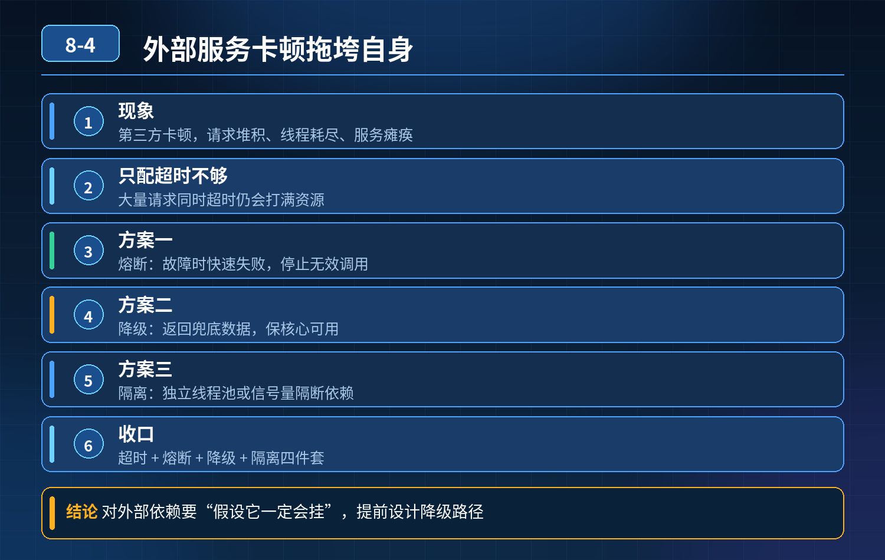

    第三方接口远程调用，外部服务卡顿拖垮自身服务，如何做服务保护、容错设计

## 第 08-4 题　第三方接口远程调用，外部服务卡顿拖垮自身服务，如何做服务保护、容错设计

**候选人浅层回答：** 只要设置超时时间就行。

## 核心拆解一句话结论

本题考察对底层原理和线上实战能力的综合理解，不能只停留在背结论。

## 连环追问

1. 只配超时够不够？大量请求同时打向缓慢第三方，短时间内大量请求同时超时，会不会依然打满线程池？
2. 什么是熔断、降级，和超时、重试的区别？什么时候触发熔断？
3. 重试怎么设计？哪些场景不能重试？重试带来的幂等问题如何解决？
4. 线程隔离有哪两种方案，各自优缺点？
5. 第三方回调异步场景（支付回调），和同步调用的容错策略有什么差异？
6. 除了代码层面，还有哪些观测、告警手段？

## 面试高分话术

问题根源是同步调用共用主线程池，没有资源隔离。第三方接口变慢会持续占用业务线程，流量持续进来，线程池耗尽，正常业务请求拿不到线程，造成服务雪崩。仅仅配置超时是不够的，超时只能释放单个请求的线程，高并发场景依然会瞬间耗尽线程池。

整体采用三层防御。第一层是基础的超时和有限重试，区分异常类型，非幂等接口禁止自动重试，避免资损。 第二层是核心保护：线程资源隔离 + 熔断降级。单独分配独立线程池处理第三方调用，和业务主线程隔离，外部故障不会侵占核心业务线程。当失败率、超时率达到阈值触发熔断，直接快速返回降级逻辑，不再持续调用第三方；熔断进入半开状态做健康探测。 第三层是监控告警与异步兜底。高并发场景优先 MQ 异步化，主线程不阻塞，任务异步消费，失败进入死信队列人工处理；同时全链路埋点监控 RT、错误率，提前告警。 资金类接口重点保证幂等，携带唯一流水号，优先依赖第三方异步回调，而不是同步阻塞等待结果。

## 连环追问要点整理

1. 底层核心原理是什么？为什么这么设计？
2. 线上出现相关故障如何快速止损、定位根因？
3. 高并发场景下有哪些坑点，性能、一致性、可用性如何权衡？

## 面试回答完整话术

  - **一句话结论**：本题考察对底层原理和线上实战能力的综合理解，不能只停留在背结论。
  - **连环追问**：只配超时够不够？大量请求同时打向缓慢第三方，短时间内大量请求同时超时，会不会依然打满线程池？
  - **面试高分话术**：问题根源是同步调用共用主线程池，没有资源隔离。第三方接口变慢会持续占用业务线程，流量持续进来，线程池耗尽，正常业务请求拿不到线程，造成服务雪崩。仅仅配置超时是不够的，超时只能释放单个请求的线程，高并发
  - **收尾**：线上问题按「先止损保可用性 → 再定位根因 → 最后从架构规范层面根治」三段论闭环。

## 追问：本题考察核心是什么？

###  高级工程师要分清：

1. **不能只停留在背结论**：要能回答「为什么这样设计、不这样会怎样、线上踩坑怎么排查」；
2. **具备止损→定位→根治三段论**：先止血保业务，再定位根因，最后从架构与规范层面根治；
3. **给出工程取舍**：性能、一致性、可用性三者权衡，说清代价与适用场景。

  核心思想：这道题考察原理理解 + 线上实战 + 架构思维，真正的工程答案是「现象 → 根因 → 止损 → 定位 → 根治」五段式闭环。

