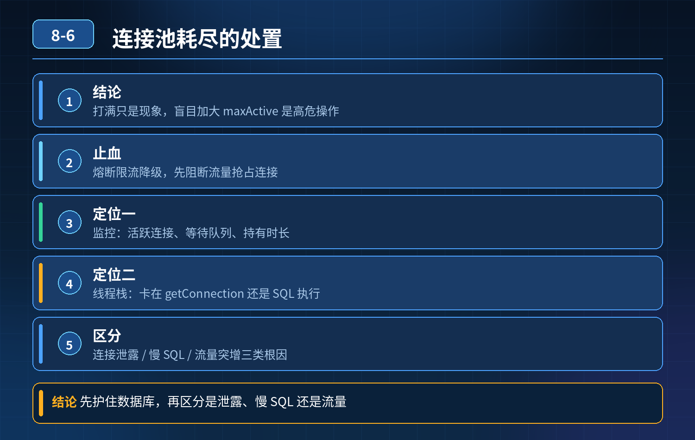

    数据库连接池耗尽、接口全超时卡住

## 第 08-6 题　数据库连接池耗尽、接口全超时卡住

**候选人浅层回答：** 背诵表面结论，没有深入到原理和线上场景。

## 核心拆解一句话结论

本题考察对底层原理和线上实战能力的综合理解，不能只停留在背结论。

## 一、先讲应急止血（分优先级，不是上来就改连接池）

1\. 优先熔断、限流、降级 把非核心接口直接降级，活动 / 查询类走缓存，阻断流量继续进来抢占连接；隔离故障接口、故障服务。

2\. 快速定位是连接泄露 / 慢 SQL / 流量突增

1\. 看连接池监控：活跃连接、等待队列、连接持有时长、等待获取连接的 QPS；

2\. 线程栈 dump：拿到业务线程，看线程卡在getConnection、还是卡在 SQL执行；

3\. 谨慎调整连接池参数 只有确认数据库负载（CPU、IO、锁）还有富余，确实

- ❌并发请求多，才小幅上调 max； 如果 DB CPU/IO 已经 95%+，绝对不能加大连接数；此时正确做法是降流量、杀慢会话；

4\. DB 侧操作：在 MySQL 里 show processlist /performance_schema 找到长会话、锁等待会话，kill 掉阻塞会话，快速释放连接。

## 二、面试官连环问题拆解

Q1：为什么 DB 负载已经顶满时，连接开越大越慢？

MySQL 单库的服务能力由 CPU、IO、锁、事务资源决定，最优连接数是一个窄区间。 连接代表并发工作会话：

- 连接少：资源闲置；
- 超过最优值：大量会话同时竞争锁、buffer、IO、CPU 时间片，上下文切换暴涨、行锁等待、事务互相阻塞，每个 SQL 的 RT 拉长，连接被长时间占用，连接池更快耗尽，形成恶性循环。

经典公式参考：最优连接数 ≈ CPU 核数 \* 2 + 磁盘IO 数量，不是越大越好。

Q2：连接数配置充足，但依然频繁打满，从哪几个方向定位根因？

分四大类根因，按排查顺序：

1. 连接泄露（代码层面） 拿到连接后异常分支没有 close；旧版 MyBatis、手动Connection、try-catch 里 return 提前退出，未走到释放；事务模板异常、异步线程持有连接。 排查：开启连接池泄漏检测（HikariCP leakDetectionThreshold）、线程栈、连接持有时长监控。
2. 慢 SQL & 长事务（最高频） 缺少索引、大表全表扫描、大事务（事务内包含网络调用、循环查询），连接被长时间 hold 住不归还；锁等待（行锁、gap 锁）互相阻塞。 排查：慢查询日志、performance_schema、锁等待监控、事务耗时监控。
3. 流量突增、热点、重试风暴 缓存大面积失效、缓存穿透，流量全部打到 DB；上游重试、Feign/RocketMQ 消费重试放大请求；热点商品、热点行被高频更新。

排查：QPS 曲线、缓存 miss 率、消息堆积量、上游报错重试日志。

4\. 中间件 / 框架配置坑

- 连接池 minIdle 过大，空闲连接不回收；
- 连接超时、查询超时设置太长，卡住的 SQL 久久不超时；
- 读写分离配置错误，大量流量跑到主库；
- 批量操作、循环查库没有分页，循环获取连接。

## 三、三层长效防御方案（面试高分结构）

第一层：事前预防

1. 连接池合理配置：HikariCP 优先；设置 leak 检测、connectionTimeout、maxLifetime；maxActive 按 DB 容量评估，不盲目拉满；
2. SQL 评审、索引检查、禁止长事务，事务里不调用外部 HTTP；
3. 缓存兜底、接口限流、熔断，防止流量直压 DB；
4. 监控告警：连接池活跃连接、连接等待数、连接持有时间、慢 SQL、锁等待、DB CPU/IO。

第二层：事中快速定位止血告警触发后标准流程：

1. 先看 DB 指标：CPU、IO、锁等待，判断是资源瓶颈还是单纯连接泄漏；
2. 应用 dump 线程栈，定位是卡在拿连接，还是卡在 SQL；
3. DB 侧抓 processlist，识别慢会话、锁阻塞链；
4. 优先限流、kill 阻塞会话；谨慎调整连接池；
5. 隔离故障实例，必要时切流量。

第三层：事后根治复盘

- 泄露：修复代码，增加连接泄漏检测；
- 慢 SQL：加索引、拆分 SQL、分页、归档历史数据；
- 长事务：拆事务，把外部调用移出事务；
- 流量冲击：补缓存、热点隔离、异步削峰；
- 压测验证容量水位，建立容量水位线。
- 精简口述版（面试直接说）连接池耗尽只是表象，不能上来就调大最大连接数。 如果数据库 CPU、IO 已经打满，盲目加大连接会带来更多锁竞争和上下文切换，RT 持续拉长，连接占用更久，加速雪崩。 排查分四类方向：第一是连接泄露，代码异常分支没有释放连接，可以打开 Hikari 的泄漏检测；第二是慢 SQL 和长事务、锁等待，长时间占用连接；第三是流量突增、缓存击穿穿透、重试风暴放大 DB 压力；第四是连接池参数、框架使用不当。 应急的时候优先限流降级、kill 阻塞 DB 会话，先阻断流量；只有确认数据库资源还有富余，才小幅上调连接。长期方案是控制事务大小、做好索引、缓存防护、完善监控，提前识别连接持有时间异常。

## 高频追问

Q：HikariCP 为什么不建议设置很大 maxPoolSize？ A：Hikari 本身高性能，但底层数据库的承载有上限，maxPoolSize 本质是发给 DB 的并发会话上限，超过 DB 最优并发，性能会断崖下跌。 Q：怎么区分是锁等待导致的慢，还是单纯无索引慢 SQL？ A：看show engine innodb status 里的锁等待信息，以及 performance_schema 的等待事件。 Q：连接泄露和慢 SQL 在监控上怎么区分？ A：泄露表现：活跃连接稳步上涨，即使 QPS 很低，连接也只涨不降；慢 SQL 是连接持有时间长，伴随 RT 上涨，QPS 上来时打满。

## 连环追问要点整理

1. 底层核心原理是什么？为什么这么设计？
2. 线上出现相关故障如何快速止损、定位根因？
3. 高并发场景下有哪些坑点，性能、一致性、可用性如何权衡？

## 面试回答完整话术

  - **一句话结论**：本题考察对底层原理和线上实战能力的综合理解，不能只停留在背结论。
  - **一、先讲应急止血（分优先级，不是上来就改连接池）**：1\. 优先熔断、限流、降级 把非核心接口直接降级，活动 / 查询类走缓存，阻断流量继续进来抢占连接；隔离故障接口、故障服务。
  - **二、面试官连环问题拆解**：Q1：为什么 DB 负载已经顶满时，连接开越大越慢？
  - **三、三层长效防御方案（面试高分结构）**：连接池合理配置：HikariCP 优先；设置 leak 检测、connectionTimeout、maxLifetime；maxActive 按 DB 容量评估，不盲目拉满；
  - **高频追问**：Q：HikariCP 为什么不建议设置很大 maxPoolSize？ A：Hikari 本身高性能，但底层数据库的承载有上限，maxPoolSize 本质是发给 DB 的并发会话上限，超过 DB 最优
  - **收尾**：线上问题按「先止损保可用性 → 再定位根因 → 最后从架构规范层面根治」三段论闭环。

## 追问：本题考察核心是什么？

###  高级工程师要分清：

1. **不能只停留在背结论**：要能回答「为什么这样设计、不这样会怎样、线上踩坑怎么排查」；
2. **具备止损→定位→根治三段论**：先止血保业务，再定位根因，最后从架构与规范层面根治；
3. **给出工程取舍**：性能、一致性、可用性三者权衡，说清代价与适用场景。

  核心思想：这道题考察原理理解 + 线上实战 + 架构思维，真正的工程答案是「现象 → 根因 → 止损 → 定位 → 根治」五段式闭环。

