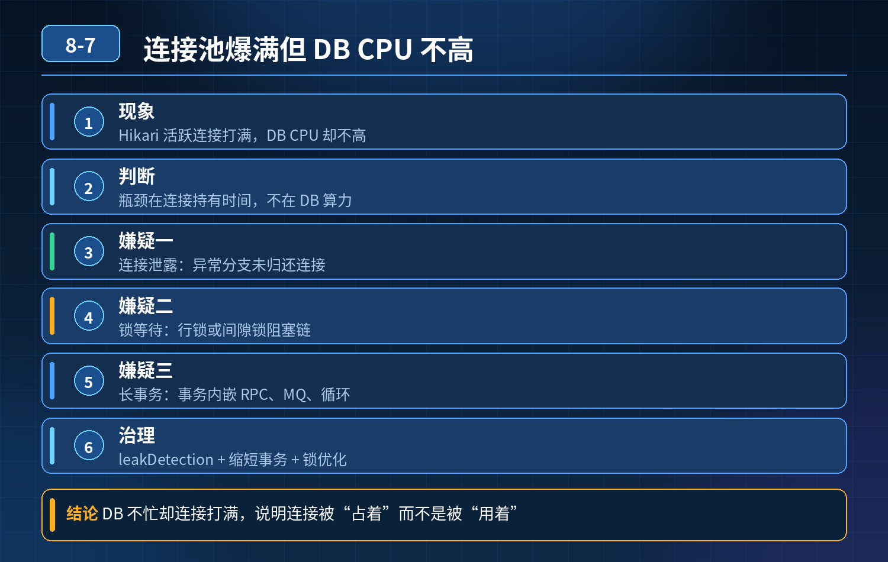

    大促订单系统连接池爆满、接口雪崩

## 第 08-7 题　大促订单系统连接池爆满、接口雪崩

**候选人浅层回答：** 背诵表面结论，没有深入到原理和线上场景。

## 核心拆解一句话结论

场景：大促订单接口大面积超时，Hikari 活跃连接打满，请求排队雪崩；

## 一、先梳理现象分层（面试官第一个问题）

DB CPU 不高，但是连接池很快爆满，说明瓶颈不在 DB 计算能力，而在连接持有时间过长、连接无法及时归还，三大嫌疑：

1. 连接泄露：代码分支异常，Connection 没有关闭，连接被永久占用，只增不减；
2. 锁等待 / 行死锁：SQL 本身执行很快，但是事务拿了行锁被别的事务阻塞，连接卡在等待锁；DB CPU 低，锁等待事件很高；
3. 长事务：事务里面嵌套 RPC、MQ、循环逻辑，事务迟迟不提交 / 回滚，连接一直持有。

区分手段：

- 连接泄露：QPS 降下来之后，活跃连接不会自动回落；即使没有流量，连接持续占用；打开leakDetectionThreshold，超时打印栈，直接定位代码行；
- 锁等待 / 死锁：show engine innodb status、performance_schema 的锁等待事件，能看到阻塞链，SQL 执行耗时很短，等待时间很长；会自动释放（死锁 InnoDB 会主动回滚其中一个事务）；
- 单纯长事务：没有锁阻塞，SQL 很快跑完，但事务迟迟不commit，事务耗时指标很高，流量降下来后，事务结束连接会归还。

## 二、连接池内部状态查看手段（面试官问题）

HikariCP 可以通过几种方式观测内部指标：

1. Micrometer 指标（生产首选）：hikaricp_connections_active、hikaricp_connections_idle、hikaricp_connections_pending、hikaricp_connections_creation、hikaricp_connections_leak；pending 队列上涨就是排队等待连接；
2. JMX MBean：HikariPoolMXBean，可以直接看活跃、空闲、等待队列；
3. 日志：开启 leakDetectionThreshold，检测连接泄露；
4. 线程 dump：业务线程栈，如果大量线程卡在pool.getConnection() →连接池耗尽排队；线程卡在 JDBC Statement/execute → 拿到连接之后卡在 DB 侧（SQL / 锁）。

注意：show processlist 看到的是MySQL 服务端连接，不是应用侧连接池的视图；应用侧连接池和 DB 连接不是一一对应，只能配合着看，不能单独用来判断泄露。

## 三、高频创建销毁连接、性能抖动问题 + Hikari 参数设计（重点得分项）

<strong>现象：</strong>高峰期空闲连接被回收，请求来了又新建连接，创建连接开销大，RT 抖动。 Hikari 核心参数：minimumIdle、maximumPoolSize、idleTimeout、maxLifetime参数原理

1. minimumIdle：最小空闲连接数，池子会尽量维持这么多空闲连接；

- 大促稳定流量场景：可以设置和 max 一样，固定池化，不再收缩，避免反复创建销毁；
- 流量波谷极低、资源紧张场景：调低 minimumIdle，释放数据库连接资源给其他服务；
- 坑：minimumIdle 太高，低峰期占用大量 DB 连接。

2\. idleTimeout：空闲多久之后，空闲连接会被回收；idleTimeout 必须比maxLifetime 小；

- 如果不想空闲连接被随便回收，idleTimeout 设置成 0（不回收空闲连接），适合流量持续很高的大促链路；

3\. maxLifetime：连接最大存活周期，到点强制销毁重建，规避 MySQL 侧wait_timeout 断开的无效连接；

- 经验：maxLifetime 要小于 MySQL 的wait_timeout（默认 8 小时），一般设置为 30 分钟～60 分钟；
- 不要设置太短（比如几十秒），否则连接频繁轮换，持续创建销毁，引发抖动。

结合业务并发模型怎么算 maxPoolSize不是拍脑袋配置：

单实例maxPoolSize ≈ 预估单实例DB 并发请求数 = QPS \* 单请求DB 耗时(s)举例子：单实例下单 QPS=200，单次 DB 平均持有连接时间 20ms 并发水位 ≈ 200 \* 0.02 = 4 预留缓冲，给到 10~15； 再乘以集群实例总数，总和不能超过 MySQL 实例合理并发上限（MySQL 最优并发一般几十级别）。

核心：maxPoolSize 是并发上限，不是越大越好；集群所有实例的连接总和要做全局控制，防止总和打爆 MySQL。

抖动问题解决方案

- 流量波动大、频繁伸缩：minimumIdle = maximumPoolSize，关闭空闲回收（idleTimeout=0），固定长连接池，消除连接创建销毁开销；
- 流量昼夜差异巨大：正常业务保留 idleTimeout，大促前动态修改配置，临时固定池子；
- maxLifetime 不要过小，避免批量同时过期，瞬间大量连接重建（可以加随机偏移，Hikari 内置了 2.5% 的抖动）。

## 四、完整应急流程（面试口述主线）

告警发现连接池爆满、接口雪崩：

1. 第一步：流量控制，网关限流、降级非核心查询、开启排队削峰，阻止请求持续涌入；
2. 第二步：看 DB 指标 CPU、锁等待、事务耗时；CPU 低优先怀疑锁等待、长事务、连接泄露；
3. 第三步：应用侧看 Hikari 指标：pending 排队数量、活跃连接、连接泄露告警；dump 线程栈定位线程卡在哪；
4. 第四步：DB 侧查 processlist、innodb 锁状态，定位阻塞会话，必要时 kill 阻塞会话快速释放连接；
5. 谨慎调整 maxPoolSize：只有确认是正常业务并发上涨、锁 / 长事务已经排除、DB 负载还有余量，才小幅上调；CPU 低但锁等待严重，加大连接只会加剧锁竞争；
6. 大促常态化优化：固定连接池、控制事务边界、禁止事务内 RPC、热点行限流、订单读写分离。

- 精简口述版本（面试直接讲）如果连接池打满，但数据库 CPU 不高，大概率不是计算瓶颈，优先三类：连接泄露、锁等待阻塞、长事务。区分方式：泄露的特征是流量降下来连接也不释放，可以打开 Hikari 的 leak 检测打印线程栈；锁等待可以看 InnoDB 锁状态，SQL 执行很快但是等待耗时很长；长事务则是事务周期过长，事务指标异常。 查看连接池内部状态优先用 Micrometer 埋点指标，看 pending 等待队列、活跃空闲连接；JMX 和线程 dump 辅助，show processlist 只能看数据库侧会话，不能直接判定应用泄露。 高峰期频繁创建销毁连接导致抖动，是空闲连接被回收了。Hikari 里 minimumIdle 控制最小空闲；大促流量平稳的链路，我们会把 minimumIdle 和 maxPoolSize 设成一样，idleTimeout 设 0，不再回收空闲连接，避免反复建连；maxLifetime 要小于 MySQL wait_timeout，避免无效连接，同时不要太短防止批量轮换抖动。 而 maxPoolSize 不能拍脑袋配，根据 Little 公式，单实例并发≈QPS 乘以单次 DB 持有连接时长，再叠加集群总和不能超过 MySQL 的最优并发水位。 应急上优先限流削峰，而不是直接加大连接数；锁阻塞场景加大连接只会加剧竞争，恶化雪崩。

## 高频追问

Q：Hikari 的 connectionTimeout 怎么配？ A：获取连接的最大等待时间，不能太长，建议 2~3s，排队太久直接快速失败，防止请求堆积。 Q：maxLifetime 为什么自带随机偏移？ A：防止大量连接同一时刻过期，瞬间集中新建连接造成尖刺抖动。 Q：读写分离场景，主库连接池和从库连接池参数一样吗？ A：不一样，主库写链路对锁更敏感，maxPoolSize 通常更小；从库查询链路可以适当放大，同时做好慢查询防护。

## 连环追问要点整理

1. 底层核心原理是什么？为什么这么设计？
2. 线上出现相关故障如何快速止损、定位根因？
3. 高并发场景下有哪些坑点，性能、一致性、可用性如何权衡？

## 面试回答完整话术

  - **一句话结论**：场景：大促订单接口大面积超时，Hikari 活跃连接打满，请求排队雪崩；
  - **一、先梳理现象分层（面试官第一个问题）**：DB CPU 不高，但是连接池很快爆满，说明瓶颈不在 DB 计算能力，而在连接持有时间过长、连接无法及时归还，三大嫌疑：
  - **二、连接池内部状态查看手段（面试官问题）**：HikariCP 可以通过几种方式观测内部指标：
  - **三、高频创建销毁连接、性能抖动问题 + Hikari 参数设计（重点得分项）**：minimumIdle：最小空闲连接数，池子会尽量维持这么多空闲连接；
  - **四、完整应急流程（面试口述主线）**：第一步：流量控制，网关限流、降级非核心查询、开启排队削峰，阻止请求持续涌入；
  - **高频追问**：Q：Hikari 的 connectionTimeout 怎么配？ A：获取连接的最大等待时间，不能太长，建议 2~3s，排队太久直接快速失败，防止请求堆积。 Q：maxLifetime 为什么自带随
  - **收尾**：线上问题按「先止损保可用性 → 再定位根因 → 最后从架构规范层面根治」三段论闭环。

## 追问：本题考察核心是什么？

###  高级工程师要分清：

1. **不能只停留在背结论**：要能回答「为什么这样设计、不这样会怎样、线上踩坑怎么排查」；
2. **具备止损→定位→根治三段论**：先止血保业务，再定位根因，最后从架构与规范层面根治；
3. **给出工程取舍**：性能、一致性、可用性三者权衡，说清代价与适用场景。

  核心思想：这道题考察原理理解 + 线上实战 + 架构思维，真正的工程答案是「现象 → 根因 → 止损 → 定位 → 根治」五段式闭环。

