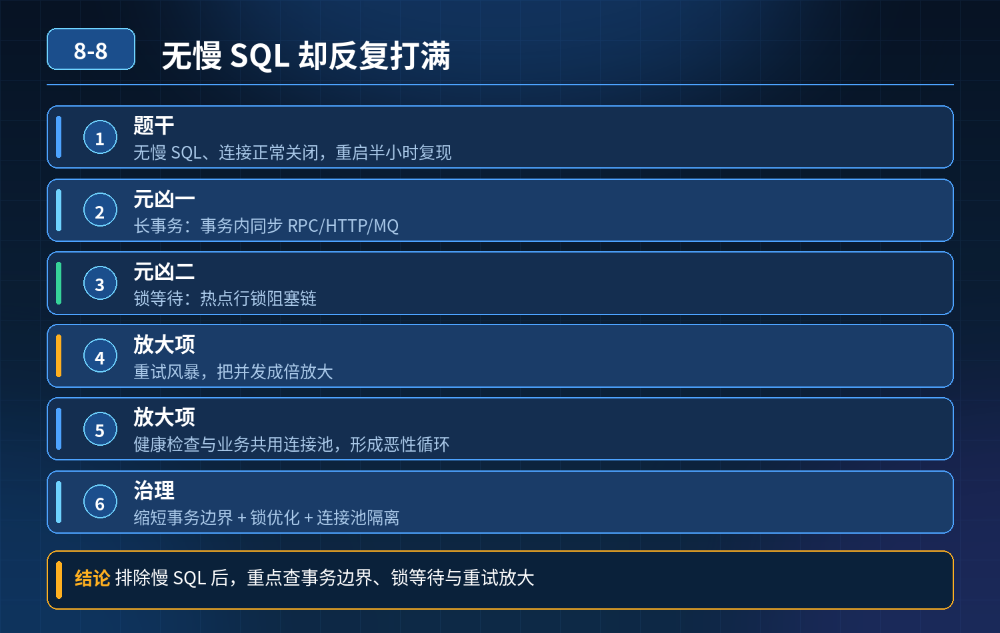

    场景题：无慢 SQL、连接正常关闭，高峰期连接池反复打满，重启半小时又复现

## 第 08-8 题　场景题：无慢 SQL、连接正常关闭，高峰期连接池反复打满，重启半小时又复现

**候选人浅层回答：** 背诵表面结论，没有深入到原理和线上场景。

## 核心拆解一句话结论

题干要点：下单查订单大面积超时，主库连接池打满，健康检查拿不到连接；

## 高频追问

Q：健康检查单独开连接池的意义是什么？ A：业务池耗尽时，健康检查还能正常连通 DB，K8s 不会误杀 Pod，避免 “重启 - 恢复 - 再打爆” 的循环雪崩，就是这个题里的经典坑。 Q：长事务除了 RPC，还有哪些容易忽略的场景？

A：事务内 sleep、大循环查询、等待锁、消费消息时事务迟迟不提交。 Q：如果已经出现大量锁等待阻塞链，是加大连接还是限流？ A：优先限流 + kill 阻塞会话，加大连接只会让更多事务进来抢锁，等待链更长。

## 连环追问要点整理

1. 底层核心原理是什么？为什么这么设计？
2. 线上出现相关故障如何快速止损、定位根因？
3. 高并发场景下有哪些坑点，性能、一致性、可用性如何权衡？

## 面试回答完整话术

  - **一句话结论**：题干要点：下单查订单大面积超时，主库连接池打满，健康检查拿不到连接；
  - **高频追问**：Q：健康检查单独开连接池的意义是什么？ A：业务池耗尽时，健康检查还能正常连通 DB，K8s 不会误杀 Pod，避免 “重启 - 恢复 - 再打爆” 的循环雪崩，就是这个题里的经典坑。 Q：长事务除了
  - **收尾**：线上问题按「先止损保可用性 → 再定位根因 → 最后从架构规范层面根治」三段论闭环。

## 追问：本题考察核心是什么？

###  高级工程师要分清：

1. **不能只停留在背结论**：要能回答「为什么这样设计、不这样会怎样、线上踩坑怎么排查」；
2. **具备止损→定位→根治三段论**：先止血保业务，再定位根因，最后从架构与规范层面根治；
3. **给出工程取舍**：性能、一致性、可用性三者权衡，说清代价与适用场景。

  核心思想：这道题考察原理理解 + 线上实战 + 架构思维，真正的工程答案是「现象 → 根因 → 止损 → 定位 → 根治」五段式闭环。

