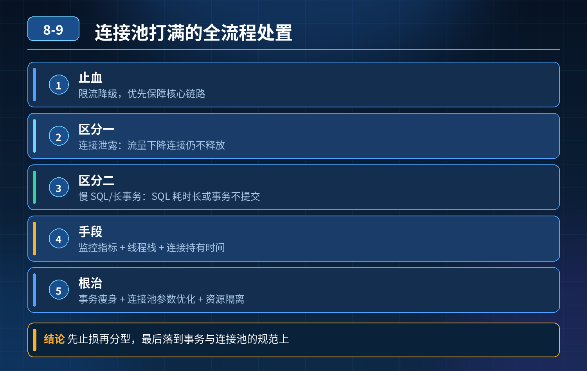

    数据库连接池打满，请求全部超时卡住，如何不停机止损、区分泄露/长事务慢 SQL、避免数据库连接雪崩、根治方案

## 第 08-9 题　数据库连接池打满，请求全部超时卡住，如何不停机止损、区分泄露/长事务慢 SQL、避免数据库连接雪崩、根治方案

**候选人浅层回答：** 背诵表面结论，没有深入到原理和线上场景。

## 核心拆解一句话结论

核心认知：连接池耗尽本质是连接借出速度 \> 归还速度。

## 候选人浅层回答

重启服务恢复，调大最大连接数，加上监控告警，不行就在 DB 侧 kill 连接。

## 连环追问汇总

1. 重启半小时又打满，反复重启不是办法，怎么办？
2. 连接泄露（拿连接不释放），怎么定位对应代码？
3. 怎么区分：连接泄露 VS 慢 SQL / 长事务占住连接不归还？
4. 盲目调大连接池上限，所有应用连接总和打爆数据库 max_connections，恶性循环怎么打破？
5. 核心链路不能停，不重启、不改代码，临时降级止损方案？
6. 分库分表、多数据源场景，多个连接池同时耗尽，排查优先级和兜底怎么做？

## 一、不停机应急止损（优先保核心业务，不重启）

目标：停止继续申领新连接，给已有连接留出归还窗口，防止数据库连接被整体打爆

1. 网关层限流 + 接口熔断 按接口做配额控制，直接挡住非核心流量：报表、导出、统计、日志查询、后台管理查询；只保留下单、支付这类强核心链路。减少新请求进来抢连接。
2. SQL 侧动态开关，降级重查询逻辑 大查询、分页超大、联表复杂查询直接降级返回缓存兜底数据，不再走 DB 查询，不再申领连接。
3. 动态摘除故障节点、流量切分 把该实例流量切走，故障实例不再新增请求；等连接慢慢释放、水位下降之后，再在这个节点采集连接栈、埋点日志定位问题。
4. 连接池内置超时兜底（平时提前配置） 核心参数：获取连接超时、连接归还校验、空闲连接回收。

- ❌ 不优先去数据库 kill 连接：强行 kill 会话，如果应用层没感知，连接池会认为连接还活着，会出现连接状态不一致、脏连接、事务异常。

## 二、快速区分两类最常见根因：连接泄露 VS 慢 SQL / 长事务

1. 慢 SQL / 长事务阻塞（最常见） 特征：连接正常借出，业务在执行 SQL 或者事务迟迟不 commit/rollback；连接是正常流程等待归还；在数据库 show processlist /performance_schema 里可以看到大量长时间 Running 的会话，SQL 语句明确。 触发：大查询、锁等待、行锁竞争、代码开启事务之后调用远程接口、sleep、循环处理，事务长时间悬空。
2. 连接泄露（代码缺陷） 特征：SQL 执行很快，但是代码分支异常，没有 close归还连接（try-catch 异常分支漏掉关闭、MyBatis / 框架使用不当、手动获取 Connection 忘记归还）；连接被借出后永久丢失，不会自动归还。 识别手段：连接池监控里，活跃连接持续上涨，但是 DB 侧会话没有长时间执行 SQL；配合连接池追踪：开启 HikariCP/PooledConnection 的 leakDetectionThreshold（连接泄露追踪），超时未归还自动打印堆栈，直接输出拿到连接的代码位置。

配置 leakDetectionThreshold 是定位泄露的关键手段，线上提前开启，不要故障了才想起。

## 三、为什么不能盲目调大连接数？

4\. 数据库本身有全局 max_connections。 每个应用实例连接池上限调高 → 集群多实例叠加 → 数据库总连接数打满。 后果：整个库所有业务拿不到连接，全局雪崩。 数据库最佳实践：数据库连接不是越多越好，CPU、IO、锁才是瓶颈，超过最优连接数之后，吞吐量不升反降。 公式思路：单库最优连接 ≈ CPU 核心数 \* 2~4。

## 连环追问要点整理

1. 底层核心原理是什么？为什么这么设计？
2. 线上出现相关故障如何快速止损、定位根因？
3. 高并发场景下有哪些坑点，性能、一致性、可用性如何权衡？

## 面试回答完整话术

  - **一句话结论**：核心认知：连接池耗尽本质是连接借出速度 \> 归还速度。
  - **候选人浅层回答**：重启服务恢复，调大最大连接数，加上监控告警，不行就在 DB 侧 kill 连接。
  - **连环追问汇总**：重启半小时又打满，反复重启不是办法，怎么办？
  - **参考答案**：核心认知：连接池耗尽本质是连接借出速度 \> 归还速度。单纯加大连接数是饮鸩止渴，会把压力传导到数据库，造成整个实例宕机。处理顺序：限流降级止损 → 区分故障类型定位 → 临时干预释放连接 → 参数优
  - **一、不停机应急止损（优先保核心业务，不重启）**：目标：停止继续申领新连接，给已有连接留出归还窗口，防止数据库连接被整体打爆
  - **二、快速区分两类最常见根因：连接泄露 VS 慢 SQL / 长事务**：慢 SQL / 长事务阻塞（最常见） 特征：连接正常借出，业务在执行 SQL 或者事务迟迟不 commit/rollback；连接是正常流程等待归还；在数据库 show processlist /pe
  - **收尾**：线上问题按「先止损保可用性 → 再定位根因 → 最后从架构规范层面根治」三段论闭环。

## 追问：本题考察核心是什么？

###  高级工程师要分清：

1. **不能只停留在背结论**：要能回答「为什么这样设计、不这样会怎样、线上踩坑怎么排查」；
2. **具备止损→定位→根治三段论**：先止血保业务，再定位根因，最后从架构与规范层面根治；
3. **给出工程取舍**：性能、一致性、可用性三者权衡，说清代价与适用场景。

  核心思想：这道题考察原理理解 + 线上实战 + 架构思维，真正的工程答案是「现象 → 根因 → 止损 → 定位 → 根治」五段式闭环。

