

    8. 高可用防护（限流、熔断、降级、线程池、连接池、超时重试）

## 第 1 题　订单异步处理系统，大促任务量突增 3 倍，线程池队列打满丢任务、锁阻塞、编排超时、非核心抢占资源

### 问题 1：使用线程池 + 并发锁 + 异步编排做订单异步处理，压测正常，大促出故障，怎么解决？

<strong>候选人浅层回答：</strong> 线程池调大一点，再加分布式锁保证安全。

### 连环追问

1. 线程池参数怎么选型，避免 OOM 同时不浪费机器资源？
2. 热点锁竞争剧烈时，怎么兼顾数据安全和吞吐量？
3. CompletableFuture 这类异步编排分支超时，如何分级补偿，不拖垮整条核心链路？
4. 非核心通知类任务，怎么资源隔离，防止抢占核心订单处理线程？

### 参考答案

事故根因汇总单纯调大核心线程数只是治标，这组故障是 4 类问题叠加：

1. 线程池没有按业务链路拆分，共用同一个线程池 核心订单状态更新、短信通知、埋点日志全部跑在同一个池子里；非核心任务堆积挤占核心任务资源；队列满了直接触发默认拒绝策略（AbortPolicy），任务直接丢弃，订单流程断了。
2. 队列无上限 / 上限过小，拒绝策略选型错误 队列太小容易丢任务；队列无界LinkedBlockingQueue，流量暴涨会持续往队列塞任务，内存持续上涨最终 OOM。
3. 热点锁粗粒度，串行化严重 订单维度、商品维度热点锁范围太大，大量线程卡在锁等待，线程池线程被卡死，无法处理新任务，看起来线程数很大但有效吞吐极低。
4. 异步编排缺少超时、取消、隔离机制 异步编排是链式依赖，某个分支（比如短信推送）超时阻塞，主线程一直 await 等待，整条任务链路挂起；没有单独的超时控制、分支独立降级、失败补偿。

### 三层防御体系

第一层：线程池资源隔离，精细化参数设计（第一道防线）核心原则：按业务优先级拆分独立线程池，核心池、非核心池分开

- 核心池：订单状态变更、库存回滚、支付回调；线程数、队列配额优先保障，拒绝策略不能直接丢弃（使用 CallerRunsPolicy 或者持久化到消息队列）
- 非核心池：短信、推送、埋点、日志统计；独立线程池，容量更小、可以限流、允许降级丢弃 参数选型思路：
- CPU 密集型：核心线程 ≈ CPU 核心数；
- IO 密集型（数据库、RPC、Redis，订单异步场景大多是 IO 密集）：核心线程可以设为 CPU2 ~ CPU4，但不能无限放大；
- 队列：有界队列，设置合理上限；禁止无界队列；
- 拒绝策略：区分任务重要度：
- 核心任务：拒绝时不丢弃，转入 MQ 持久化，后续重试；
- 非核心任务：直接丢弃或者降级，记录日志告警。

重点：线程池参数不能拍脑袋，由压测得出，观测指标：队列长度、线程活跃数、任务等待时间、拒绝次数。

第二层：锁优化，降低竞争，在安全和吞吐之间平衡热点锁是高并发异步系统常见瓶颈，优化思路依次递进：

1. 缩小锁粒度：不要锁整个商品，只锁单条订单；
2. 锁分段（分片锁）：热点商品拆成分片，分散锁竞争；
3. 读写分离：读不加锁，使用版本号 / 乐观锁（CAS），写的时候才竞争锁；优先乐观锁，减少阻塞；
4. 本地缓存 + 兜底锁：把高频读数据放缓存，减少进入锁区域的次数；
5. 避免在锁内部做 RPC、DB 慢查询，锁内只做内存状态判断，IO 操作移出锁范围。

误区：不是锁越多越安全，粗粒度排他锁会直接把并发系统变回串行。

第三层：异步编排的超时、分支隔离、分级补偿（兜底防线）针对 CompletableFuture 异步编排这类场景：

1. 每个独立分支单独设置超时时间 不能整条链路统一等待；短信、通知这类弱依赖分支超时，不能阻塞主订单流程；超时后主动 cancel 分支任务。
2. 强弱依赖拆分 编排的时候区分：强依赖（订单状态更新）、弱依赖（推送通知）；弱依赖分支失败 / 超时，不影响主任务结果，单独记录失败日志。
3. 分级补偿策略

- 核心任务失败：落失败表、定时重试（有限次数、退避重试），人工告警兜底；
- 非核心任务失败：只打日志，允许丢失，不重试、不阻塞主链路；

4. 编排链路加全链路埋点，记录每个分支耗时、成功失败状态，快速定位卡住的分支。

额外配套机制

1. 异步任务优先 MQ 解耦兜底：线程池适合短时间、可控的异步；大促峰值流量，上游先进入 RocketMQ/Kafka，线程池作为消费者池，而不是直接接收突发流量；
2. 监控指标：线程池队列堆积、拒绝次数、锁等待时长、future 分支超时数量；队列堆积是前置告警信号；
3. 限流：非核心任务池单独限流，防止抢占资源。

<strong>追问：</strong>本题考察核心是什么？

<strong>参考答案：</strong>初级开发者只会创建线程池、synchronized / 分布式锁、写CompletableFuture 编排代码，把 API 当成高并发方案。高阶工程师理解：

1. 线程池的本质是资源配额控制器，而不是开更多线程；线程越多不代表吞吐越高，锁阻塞、IO 等待下大量线程只会加剧上下文切换和阻塞；
2. 资源隔离是稳定性前提，核心和非核心任务必须物理隔离；
3. 锁的代价是并发度，热点场景优先乐观锁、分片、缩小范围，而不是简单加锁；
4. 异步编排最大坑是链式阻塞，弱依赖分支必须独立超时、独立降级；
5. 异步系统不能只依赖内存线程池，必须有持久化消息、失败表做补偿兜底。

<strong>核心思想：</strong>并发稳定性，不是会写并发 API，而是控制资源边界、隔离故障域、拆分依赖、做好失败补偿，防止一个慢分支拖垮整个异步链路。

<!-- 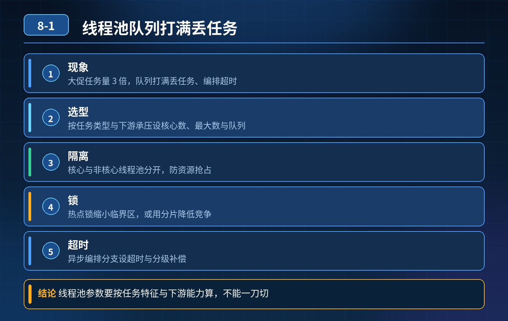 -->

## 第 2 题　接口超时与重试（订单分配骑手案例）

### 场景复盘

订单支付后调用骑手调度服务分配骑手，接口超时；开发简单调大超时时间、加 3 次重试，引发两个致命问题：

1. 重复分配骑手：调度服务内部已经成功分配骑手，只是响应包网络延迟丢包 /处理慢，调用方收到超时，重试后再次分配，造成同一个订单多个骑手接单；
2. 重试风暴：调度本身负载很高，大量重试请求持续压过去，压力放大，诱发服务雪崩。

核心误区：超时 ≠ 调用失败；单纯调大超时、盲目加重试，是高并发分布式场景里典型的 “幽灵陷阱”。超时本质是结果不确定性：下游到底成功了还是没成功，调用方无法确定。

### 三层高分逻辑

第一层：先区分超时的结果不确定性 + 接口幂等（防重复业务）分布式调用超时，存在三种状态：成功、失败、未知。 分配骑手这类写接口，必须做幂等：

- 请求携带全局唯一业务标识（orderId 或者 requestId）；
- 调度服务收到请求，先查本地流水表：该订单是否已经分配；已分配直接返回成功，不再重复分配；幂等是重试的前提，没有幂等绝对不能开自动重试。

第二层：重试策略精细化治理，防止重试风暴不是所有异常都能重试，要做区分：

1. 可重试异常：连接失败、超时、限流；
2. 不可重试：参数错误、业务校验失败、订单状态非法，直接返回，禁止重试；
3. 重试参数：指数退避 + 随机抖动（jitter），不要固定间隔重试，避免同一时刻大量请求扎堆重试；
4. 重试上限：控制最大重试次数，不能无限重试；
5. 熔断限流：用 Sentinel/Hystrix，下游负载高、失败率超过阈值直接熔断，快速失败，切断重试流量，保护下游，避免雪崩。

重点：超时时间不能一味调大。超时要根据链路 RT、SLA 合理设置；超时太长会阻塞调用线程，堆积请求，造成调用方线程耗尽。

第三层：架构兜底，消除不确定性（根治方案）

1. 同步改异步：分配骑手这种非强同步链路，不要同步调用；订单服务发送 MQ消息给调度服务，调度消费处理；消息自带幂等，MQ 本身有重试、死信；
2. 状态机 + 对账补偿：订单流转状态：已支付→待派单→派单成功 / 派单失败；定时对账扫描处于 “待派单” 长期卡住的订单，人工或者补偿流程处理；
3. 监控：监控超时率、重试次数、下游负载、重复请求数，提前告警。

- 30

### 秒口述标准答案

接口超时不能简单调大超时时间、加重试。超时代表结果未知，首先接口必须基于唯一请求 ID 实现幂等，避免重试造成重复分配骑手；其次重试要区分异常类型，只对网络类瞬时异常重试，采用带随机抖动的指数退避策略，配合熔断，下游压力高的时候停止重试，防止重试风暴；最后优先把这类非核心同步调用改成 MQ 异步解耦，配合状态机和定时对账兜底，从架构上消除同步调用带来的不确定性。

<!-- 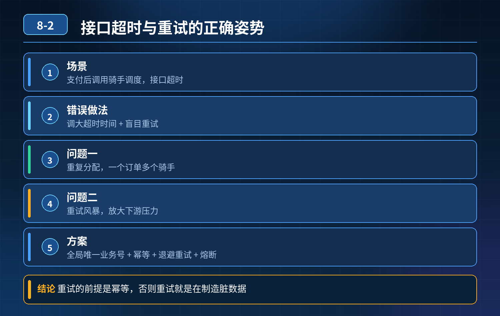 -->

## 第 3 题　Tomcat 线程被慢第三方接口占满，调高 maxThreads 只能临时缓解，反复打满，根因和解决方案

### 场景描述

管理后台批量查询物流，同步调用第三方物流接口，第三方网络慢、响应时间长；大量请求进来后 Tomcat 工作线程被耗尽，登录、订单提交等核心接口全部阻塞超时。调高 Tomcat 最大线程数，短暂好转，流量上来又被打满。单点自测没问题，并发批量调用就服务不可用。问问题根源、如何解决。

<strong>候选人浅层回答：</strong>第三方接口慢，把 Tomcat 最大线程调大，多一点线程扛请求。

核心拆解 + 连环追问

1. 根本原因核心：Tomcat 线程池是服务唯一的公共资源池，所有接口（核心接口 + 慢的批量物流查询）共用同一组工作线程；同步阻塞调用外部慢接口，线程长时间被占用不释放，耗尽公共线程池，引发线程池耗尽的雪崩，属于资源没有隔离。

1. Tomcat 的工作线程是处理 HTTP 请求的线程，同步模式下，请求进来之后线程一直挂起等待第三方返回，在 IO 等待期间，线程什么都干不了，持续被占用。

2. 所有接口共用同一个 Tomcat 线程池。非核心的批量物流查询，耗尽了全局线程，直接挤占登录、下单这类核心链路，这是最致命的问题。

3. 调高maxThreads 只是增加资源上限，没有解决 “线程被长时间占用” 这个

根源。第三方接口 RT 越长，单位流量消耗的线程越多，流量上涨后依然会快速打满，治标不治本。

4. 额外风险：线程数量越高，CPU 上下文切换、内存开销越大；线程过多会造成OS 层面调度压力，进一步恶化性能，甚至 OOM。

2. 三层防御架构（面试标准答案）第一层：超时控制（基础兜底，必加）给所有第三方 HTTP 调用强制设置连接超时 + 读取超时，不能无限等待。

- 使用 RestTemplate/OkHttp/WebClient 设置 timeout；
- 慢请求到达超时时间直接失败，释放 Tomcat 线程，避免线程永久卡死。

只做超时还不够：大量请求同时触发超时，依然会瞬间占满线程。

第二层：资源隔离（核心方案，解决雪崩）把耗时高的批量物流查询，和核心业务接口做线程池隔离 方案可选：

1. 独立业务线程池：物流查询的外部调用，异步提交到单独的业务线程池，不占用 Tomcat 的 HTTP 工作线程。Tomcat 线程快速释放，只负责接收请求、提交任务；外部 IO 等待交给独立线程池。核心接口继续使用 Tomcat 主线程池，互不争抢资源。
2. 服务拆分：批量查询物流单独拆成独立服务，独立容器、独立 Tomcat 线程池，故障不会污染主管理后台。
3. 网关层流量隔离：在网关对不同接口做限流、分组。

核心目标：慢接口故障，不能吃掉核心接口的线程资源。

第三层：流量控制 + 熔断降级（防止打爆下游 + 自我保护）

1. 限流：对批量物流查询接口做单机限流，限制并发请求数量，防止瞬间大量请求涌入；

2. 熔断（Sentinel/Hystrix）：当第三方接口错误率 / 超时到达阈值，直接熔断，快速返回降级结果（如缓存旧物流信息），不再发起调用，保护线程资源；

3. 缓存：物流查询结果做本地 / Redis 缓存，减少重复调用第三方接口，降低外部请求量；

4. 降级策略：高峰期批量查询直接关闭，只保留单条查询，保障核心功能。

3. 进阶改造：异步非阻塞模型（长期优化）使用 WebFlux（Reactor）或者异步 Servlet，将 IO 等待脱离 Tomcat 工作线程。

Tomcat 的 NIO/BIO 的区别：同步 Servlet 哪怕 NIO，写同步http 调用外部接口，依然会阻塞 Tomcat 线程；只有使用异步回调 / 响应式编程，IO 等待阶段归还 Tomcat 线程。

4. 为什么单纯调大 maxThreads 不可取？

1. 只是扩大资源上限，没有控制单个请求持有线程的时长；

2. 第三方慢接口 RT=5s，100 并发就占用 100 个线程，调大到 200，200 并发又占满；

3. 线程越多，内存占用、上下文切换开销上升，超过临界点吞吐量下降，甚至OOM；

4. 没有隔离，慢接口依然能抢占核心接口资源，雪崩风险依旧存在。

面试完整话术根本问题是公共 Tomcat 线程池没有做业务隔离，慢的同步外部调用长时间占用全局 HTTP 线程，耗尽线程池，导致核心接口没有线程可用，引发服务雪崩。调高 maxThreads 只是扩大资源上限，没有解决线程长时间被阻塞占用的根本问题，流量上涨会再次打满，还会带来更高内存和 CPU 调度开销。

我们可以搭建三层防御： 第一层，强制超时：所有第三方调用设置连接和读取超时，避免线程永久阻塞； 第二层，资源隔离：将批量物流查询放到独立业务线程池，或者拆独立服务，慢接口不占用 Tomcat 的公共请求线程，核心接口资源不受挤占； 第三层，限流熔断 + 缓存降级：对批量查询接口限流，第三方超时错误率高时触发熔断，直接走缓存降级，减少对外调用。

长期优化可以改成异步非阻塞模型，IO 等待阶段释放 Tomcat 线程。 核心思想：不能靠无限扩容线程来扛慢 IO，要控制线程占用时长、隔离故障流量，避免非核心业务拖垮核心链路。

### 考察核心

初级工程师第一反应就是调大线程数，只看资源容量，看不到资源隔离、故障域隔离。 高级工程师要意识到：

1. Tomcat 线程是宝贵的公共资源，慢 IO 同步调用是资源杀手；
2. 区分 “扩容资源” 和 “隔离资源”；
3. 多层防护体系：超时、隔离、限流熔断缓存；
4. 能识别雪崩链路：慢接口耗尽公共线程池，拖垮核心接口。

<strong>核心思想：</strong>线程池不是无限扩容就能解决慢 IO，故障隔离才是高并发高可用的核心。

<!-- 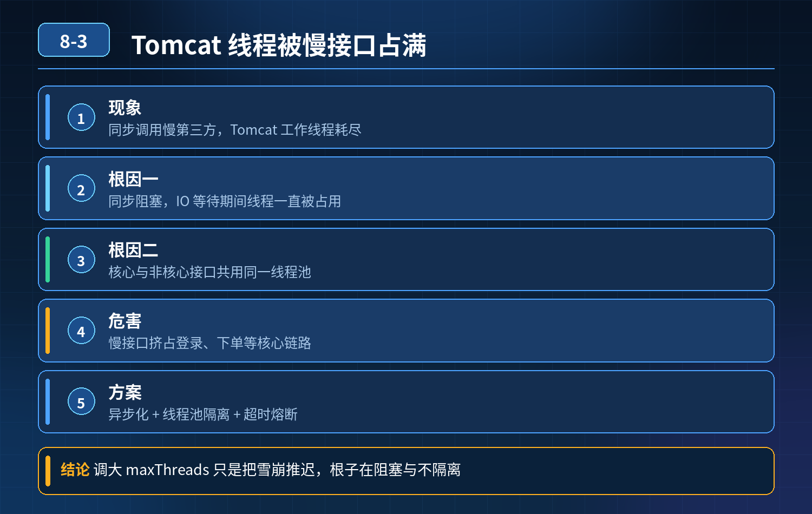 -->

## 第 4 题　第三方接口远程调用，外部服务卡顿拖垮自身服务，如何做服务保护、容错设计

### 问题

业务调用第三方支付、物流推送这类外部接口。对方服务卡顿、网络延迟高，我方请求阻塞等待，请求堆积、线程耗尽，整个服务瘫痪，内部正常业务也受影响。问题根源在哪？怎么避免外部接口拖垮自身服务？

<strong>候选人回答：</strong>只要设置超时时间就行。

### 连环追问

1. 只配超时够不够？大量请求同时打向缓慢第三方，短时间内大量请求同时超时，会不会依然打满线程池？
2. 什么是熔断、降级，和超时、重试的区别？什么时候触发熔断？
3. 重试怎么设计？哪些场景不能重试？重试带来的幂等问题如何解决？
4. 线程隔离有哪两种方案，各自优缺点？
5. 第三方回调异步场景（支付回调），和同步调用的容错策略有什么差异？
6. 除了代码层面，还有哪些观测、告警手段？

### 参考答案

### 问题根源

直接同步调用、共用业务主线程池，没有隔离保护。第三方接口一旦变慢，请求线程长时间被占用无法释放；流量持续涌入，线程池快速耗尽，新请求全部排队阻塞，整个服务线程资源耗尽，正常内部业务请求拿不到线程，服务雪崩。

只设置超时只能释放线程，但无法抵挡高并发下大量请求同时打到第三方，瞬间把线程池打满，超时只是 “止损”，不是隔离保护。

三层防御体系（核心）第一层：基础防护 — 超时 + 重试

1. 必须设置连接超时、读取超时（HttpClient/RestTemplate/OkHttp 都要配置），禁止无限等待。超时时间不能设置过大，根据业务 SLA 定义。

2. 有限制的重试机制：

1. 只对幂等接口重试（查询类、无副作用接口）；支付扣款这类非幂等写操作，绝对不能自动重试，防止重复扣款。

2. 重试策略：指数退避，不能立即无限重试；控制最大重试次数。

3. 重试前区分异常类型：网络异常、连接超时可以重试；业务返回业务错误码（参数错误、余额不足）不重试。

第二层：核心防护 — 线程隔离 + 熔断（Sentinel/Hystrix）

1. 线程隔离 两种方案：

1. 线程池隔离：单独开独立线程池专门用来调用第三方接口，和处理业务请求的

2. 主线程池分开。第三方慢只会耗尽这个独立线程池，主线程不受影响，内部业务正常跑。缺点：线程开销大。

2. 信号量隔离：限制并发调用第三方的请求总数，不新建线程，复用调用线程。

轻量，适合 IO 密集型；缺点：不支持超时中断。

生产对接第三方，优先线程池隔离，安全性更高。

3. 熔断机制 持续大量调用失败 / 超时，达到阈值后打开熔断开关，短时间内直接拒绝调用第三方，快速返回降级结果，不再继续请求外部接口，保护我方服务，同时减轻第三方压力。

1. 熔断半开状态：熔断一段时间后，放少量请求试探第三方是否恢复；成功则关

2. 闭熔断，失败继续保持熔断。

3. 降级策略 熔断触发后的兜底逻辑：

1. 读接口：返回缓存的旧数据；

2. 消息推送 / 物流通知：降级为丢入 MQ 异步排队，后台慢慢重试；

3. 非强依赖第三方：直接返回默认成功，后续异步补偿。

超时是单次保护；线程隔离是资源隔离；熔断是高失败率下的快速止损。三者配合，缺一不可。

4. 第三层：观测与兜底补偿

1. 监控埋点：采集第三方接口的 RT、错误率、并发量，设置告警。一旦超时率、错误率飙升，提前告警，不等雪崩。

2. 异步化改造（强推荐，支付这类场景首选） 同步调用容易卡线程。改成：业务落库成功，把调用第三方任务丢入 MQ，消费者单独线程池消费、调用第三方。

主线程立刻返回，主线程完全不阻塞。

1. 失败消息可以重试，死信队列兜底，人工处理最终失败任务。
2. 支付场景：支付结果由第三方异步回调通知我方，不要轮询、不要同步阻塞等待支付结果。
3. 幂等控制 调用第三方请求携带唯一业务流水号；第三方支持幂等，避免重试造成重复下单 / 扣款。

不同场景选型

- 强同步、低并发：线程池隔离 + 超时 + 熔断降级
- 高并发、允许最终一致性（推送、通知）：MQ 异步解耦，主线程不阻塞
- 支付等资金场景：优先异步回调，做好幂等、流水状态机，记录每一步状态，失败人工对账补偿

### 面试高分话术

问题根源是同步调用共用主线程池，没有资源隔离。第三方接口变慢会持续占用业务线程，流量持续进来，线程池耗尽，正常业务请求拿不到线程，造成服务雪崩。仅仅配置超时是不够的，超时只能释放单个请求的线程，高并发场景依然会瞬间耗尽线程池。

整体采用三层防御。第一层是基础的超时和有限重试，区分异常类型，非幂等接口禁止自动重试，避免资损。 第二层是核心保护：线程资源隔离 + 熔断降级。单独分配独立线程池处理第三方调用，和业务主线程隔离，外部故障不会侵占核心业务线程。当失败率、超时率达到阈值触发熔断，直接快速返回降级逻辑，不再持续调用第三方；熔断进入半开状态做健康探测。 第三层是监控告警与异步兜底。高并发场景优先 MQ 异步化，主线程不阻塞，任务异步消费，失败进入死信队列人工处理；同时全链路埋点监控 RT、错误率，提前告警。 资金类接口重点保证幂等，携带唯一流水号，优先依赖第三方异步回调，而不是同步阻塞等待结果。

### 考察核心

初级工程师只想到加超时，不懂线程隔离，分不清熔断降级，不知道重试的幂等风险，不会异步解耦方案。 高级工程师要体现：

1. 理解雪崩的底层原理（线程池资源耗尽）；
2. 区分超时、重试、隔离、熔断各自作用，不是简单概念背诵；
3. 线程池隔离 vs 信号量隔离选型；
4. 幂等、重试边界；
5. 知道异步 MQ 是高并发第三方调用更优的架构方案；
6. 具备业务风险意识，资金场景特殊处理。

<strong>核心思想：</strong>外部第三方不可控，不能把外部服务的风险传导到自己核心服务，资源隔离是第一道防线。

<!-- 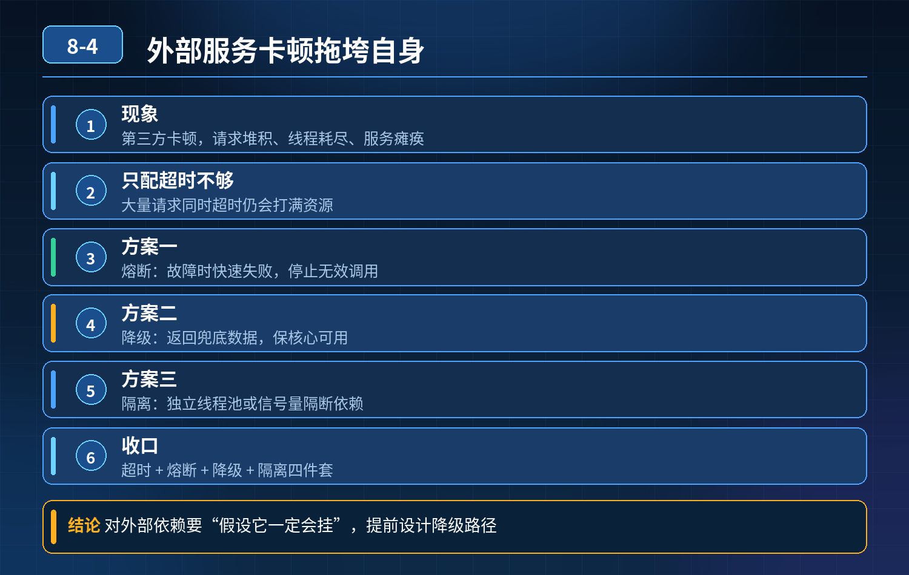 -->

## 第 5 题　数据库连接池盲目调大 maxSize 事故

<strong>举例说明：</strong>把 maxPoolSize 从 50 直接改成 200 后，数据库瞬间建立 200 条活跃连接，每个连接都在争抢 CPU 时间片与 Buffer Pool，上下文切换激增，原本 30ms 的查询变成 300ms，整站吞吐不升反降。

### 场景复盘

<strong>现象：</strong>高峰期偶尔超时，怀疑连接池不够，直接把应用连接池最大连接从 50改成 200；上线后 DB 连接爆满、CPU 拉满、整体瘫痪。

<strong>候选人回答：</strong>连接数太大，调小就行。

<strong>面试官追问：</strong>连接池原理、数据库合理连接上限、连接过多为什么性能反而下跌、怎么科学设计连接池。

核心认知：数据库连接不是越多越快。连接本质是数据库侧的昂贵资源，每个连接对应一个后台线程；连接超过数据库最优阈值后，上下文切换、锁竞争、IO 争抢会急剧恶化，吞吐量不升反降，这是典型的 “盲目扩容资源导致雪崩”。

四层高分体系第一层：理解数据库侧的连接上限与瓶颈MySQL 一个连接对应一个服务线程（one-thread-per-connection 模型）。

- 少量连接：CPU、IO 资源充足，并发提升，吞吐量上升；
- 连接超过最优值：大量线程同时就绪，操作系统频繁线程上下文切换，CPU 在内核态消耗暴涨；同时事务、锁、Buffer Pool、IO 资源争抢加剧；
- 超过max_connections：数据库直接拒绝新连接。

MySQL 最优连接经验公式： 最优连接数 ≈ CPU 核数 * 2 + 磁盘IO 数（SSD可以适当高一点，机械盘更低）。 比如 8 核 SSD 库，合理活跃连接一般也就 20～40 左右，不是几百。

误区：应用侧连接池 max 设置很大，所有实例连接加起来，总和远超数据库承载上限。多个服务实例共享同一个 DB，总连接是所有实例连接池之和，很多人只看单实例，忽略总和。

第二层：应用连接池本身的原理与参数以 HikariCP 为例：

- maxPoolSize：不是越大越好，它的作用是控制本实例最多持有多少活跃连接；
- 连接池解决的是连接复用，避免频繁创建销毁 TCP 连接；它只是 “资源闸门”，不是提升数据库并发能力的魔法；
- 当业务是大量慢 SQL、长事务的时候，连接会被长期占用；此时单纯加大maxPoolSize，只会让更多请求拿到连接，一起跑慢 SQL，放大锁竞争和 IO 压力，不是解决慢的根源。

本次事故根因： 超时本质是SQL 慢、长事务、DB 本身吞吐瓶颈，不是连接不够；加大连接上限，等于放开闸门，大量并发请求同时冲进数据库，压垮 DB。

第三层：连接池配套参数治理（不能只看 max）

1. connectionTimeout：获取连接的等待超时；队列排队超时快速失败，避免请求堆积；
2. idleTimeout、maxLifetime：回收空闲连接，防止僵死连接；
3. 监控指标：活跃连接数、等待连接的排队队列长度、连接获取耗时、连接创建次数；判断是不是真的连接不够：看排队等待获取连接的请求占比；如果排队很少，RT 高是 SQL 慢，不是连接池小。

第四层：架构层面分流兜底（治本方案）

1. 读写分离：读流量走从库，减轻主库连接压力；
2. 缓存拦截热点读，减少落到 DB 的请求；
3. 限流熔断：数据库慢的时候，入口限流，不让流量持续灌入；
4. 慢 SQL 治理、缩短事务时长，减少连接持有时间；这才是解决 “连接被占住、拿不到连接” 的根本手段；
5. 分片分库：把压力分散到多个数据库实例，分散连接总数。

- 30

### 秒口述标准答案

这个事故的根因是混淆了 “连接不足” 和 “数据库处理慢”。数据库连接不是越多越好，MySQL 一个连接对应一个后台线程，连接超过 CPU 和 IO 的最优阈值后，线程上下文切换、锁和 IO 争抢会导致 CPU 飙升，吞吐量下降。首先要先判断是不是真连接不足，看连接池排队指标；如果是慢 SQL、长事务占用连接，单纯调大 maxPoolSize 只会把更多请求送入数据库压垮它。连接池要四层管控：先评估数据库实例合理总连接上限，所有应用实例连接总和不能超标；其次合理设置 HikariCP 参数并监控排队指标；然后治理慢 SQL、缩短事务，降低连接持有时长；最后配合缓存、读写分离、限流做架构分流。

### 高频追问

Q：HikariCP 为什么默认 max 不大？ A：Hikari 设计理念就是少而精，数据库能高效处理的并发连接本身有限，它鼓励排队快速失败，而不是大量连接打满 DB。 Q：多个微服务连同一个 MySQL，怎么管控总连接？ A：统一规划配额，每个实例连接池上限加起来远小于数据库 max_connections；接入数据库代理（ProxySQL）统一管控、限流、熔断。 Q：高峰期连接池排队超时，怎么快速区分是连接池小，还是 SQL 慢？ A：监控两个指标：连接等待耗时、活跃连接利用率。活跃连接打满、排队持续上涨，同时 SQL 本身很快，才适合小幅上调；活跃连接早就满了，并且大量 SQL 执行 RT 很高，就是 DB 侧瓶颈，不能加大连接。

<!--  -->

## 第 6 题　数据库连接池耗尽、接口全超时卡住

<strong>核心结论：</strong>连接池打满只是现象，盲目加大 maxActive 是高危临时操作，很多场景会恶化问题。数据库 CPU、IO 已经跑满时，连接越多，上下文切换、锁竞争、事务排队越严重，整体吞吐量反而下降，雪崩更快。

### 一、先讲应急止血（分优先级，不是上来就改连接池）

1. 优先熔断、限流、降级 把非核心接口直接降级，活动 / 查询类走缓存，阻断流量继续进来抢占连接；隔离故障接口、故障服务。

2. 快速定位是连接泄露 / 慢 SQL / 流量突增

1. 看连接池监控：活跃连接、等待队列、连接持有时长、等待获取连接的 QPS；

2. 线程栈 dump：拿到业务线程，看线程卡在getConnection、还是卡在 SQL执行；

3. 谨慎调整连接池参数 只有确认数据库负载（CPU、IO、锁）还有富余，确实

- ❌并发请求多，才小幅上调 max； 如果 DB CPU/IO 已经 95%+，绝对不能加大连接数；此时正确做法是降流量、杀慢会话；

4. DB 侧操作：在 MySQL 里 show processlist /performance_schema 找到长会话、锁等待会话，kill 掉阻塞会话，快速释放连接。

### 二、面试官连环问题拆解

Q1：为什么 DB 负载已经顶满时，连接开越大越慢？

MySQL 单库的服务能力由 CPU、IO、锁、事务资源决定，最优连接数是一个窄区间。 连接代表并发工作会话：

- 连接少：资源闲置；
- 超过最优值：大量会话同时竞争锁、buffer、IO、CPU 时间片，上下文切换暴涨、行锁等待、事务互相阻塞，每个 SQL 的 RT 拉长，连接被长时间占用，连接池更快耗尽，形成恶性循环。

经典公式参考：最优连接数 ≈ CPU 核数 * 2 + 磁盘IO 数量，不是越大越好。

Q2：连接数配置充足，但依然频繁打满，从哪几个方向定位根因？

分四大类根因，按排查顺序：

1. 连接泄露（代码层面） 拿到连接后异常分支没有 close；旧版 MyBatis、手动Connection、try-catch 里 return 提前退出，未走到释放；事务模板异常、异步线程持有连接。 排查：开启连接池泄漏检测（HikariCP leakDetectionThreshold）、线程栈、连接持有时长监控。
2. 慢 SQL & 长事务（最高频） 缺少索引、大表全表扫描、大事务（事务内包含网络调用、循环查询），连接被长时间 hold 住不归还；锁等待（行锁、gap 锁）互相阻塞。 排查：慢查询日志、performance_schema、锁等待监控、事务耗时监控。
3. 流量突增、热点、重试风暴 缓存大面积失效、缓存穿透，流量全部打到 DB；上游重试、Feign/RocketMQ 消费重试放大请求；热点商品、热点行被高频更新。

排查：QPS 曲线、缓存 miss 率、消息堆积量、上游报错重试日志。

4. 中间件 / 框架配置坑

- 连接池 minIdle 过大，空闲连接不回收；
- 连接超时、查询超时设置太长，卡住的 SQL 久久不超时；
- 读写分离配置错误，大量流量跑到主库；
- 批量操作、循环查库没有分页，循环获取连接。

### 三、三层长效防御方案（面试高分结构）

第一层：事前预防

1. 连接池合理配置：HikariCP 优先；设置 leak 检测、connectionTimeout、maxLifetime；maxActive 按 DB 容量评估，不盲目拉满；
2. SQL 评审、索引检查、禁止长事务，事务里不调用外部 HTTP；
3. 缓存兜底、接口限流、熔断，防止流量直压 DB；
4. 监控告警：连接池活跃连接、连接等待数、连接持有时间、慢 SQL、锁等待、DB CPU/IO。

第二层：事中快速定位止血告警触发后标准流程：

1. 先看 DB 指标：CPU、IO、锁等待，判断是资源瓶颈还是单纯连接泄漏；
2. 应用 dump 线程栈，定位是卡在拿连接，还是卡在 SQL；
3. DB 侧抓 processlist，识别慢会话、锁阻塞链；
4. 优先限流、kill 阻塞会话；谨慎调整连接池；
5. 隔离故障实例，必要时切流量。

第三层：事后根治复盘

- 泄露：修复代码，增加连接泄漏检测；
- 慢 SQL：加索引、拆分 SQL、分页、归档历史数据；
- 长事务：拆事务，把外部调用移出事务；
- 流量冲击：补缓存、热点隔离、异步削峰；
- 压测验证容量水位，建立容量水位线。
- 精简口述版（面试直接说）连接池耗尽只是表象，不能上来就调大最大连接数。 如果数据库 CPU、IO 已经打满，盲目加大连接会带来更多锁竞争和上下文切换，RT 持续拉长，连接占用更久，加速雪崩。 排查分四类方向：第一是连接泄露，代码异常分支没有释放连接，可以打开 Hikari 的泄漏检测；第二是慢 SQL 和长事务、锁等待，长时间占用连接；第三是流量突增、缓存击穿穿透、重试风暴放大 DB 压力；第四是连接池参数、框架使用不当。 应急的时候优先限流降级、kill 阻塞 DB 会话，先阻断流量；只有确认数据库资源还有富余，才小幅上调连接。长期方案是控制事务大小、做好索引、缓存防护、完善监控，提前识别连接持有时间异常。

### 高频追问

Q：HikariCP 为什么不建议设置很大 maxPoolSize？ A：Hikari 本身高性能，但底层数据库的承载有上限，maxPoolSize 本质是发给 DB 的并发会话上限，超过 DB 最优并发，性能会断崖下跌。 Q：怎么区分是锁等待导致的慢，还是单纯无索引慢 SQL？ A：看show engine innodb status 里的锁等待信息，以及 performance_schema 的等待事件。 Q：连接泄露和慢 SQL 在监控上怎么区分？ A：泄露表现：活跃连接稳步上涨，即使 QPS 很低，连接也只涨不降；慢 SQL 是连接持有时间长，伴随 RT 上涨，QPS 上来时打满。

<!-- 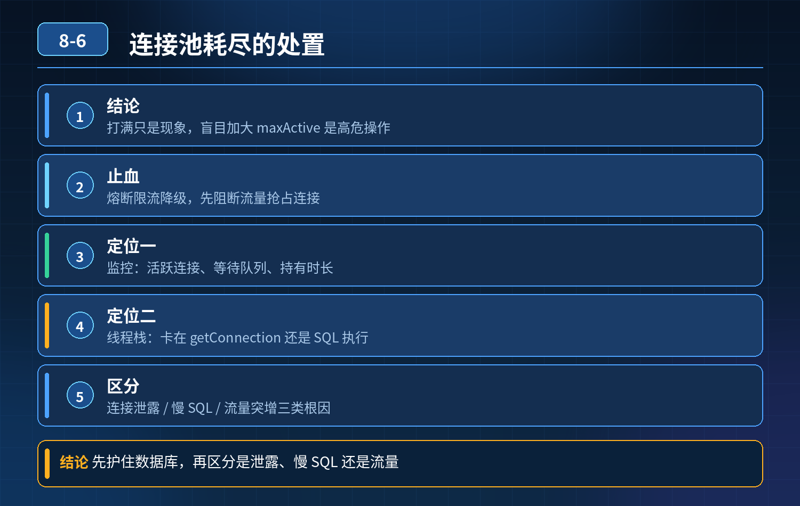 -->

## 第 7 题　大促订单系统连接池爆满、接口雪崩

场景：大促订单接口大面积超时，Hikari 活跃连接打满，请求排队雪崩；加 maxPoolSize 后 DB CPU 不高，但连接池依然快速占满；追加问题：区分泄露 / 死锁 / 长事务、连接池监控手段、频繁创建销毁连接抖动、Hikari 参数落地选型。

### 一、先梳理现象分层（面试官第一个问题）

DB CPU 不高，但是连接池很快爆满，说明瓶颈不在 DB 计算能力，而在连接持有时间过长、连接无法及时归还，三大嫌疑：

1. 连接泄露：代码分支异常，Connection 没有关闭，连接被永久占用，只增不减；
2. 锁等待 / 行死锁：SQL 本身执行很快，但是事务拿了行锁被别的事务阻塞，连接卡在等待锁；DB CPU 低，锁等待事件很高；
3. 长事务：事务里面嵌套 RPC、MQ、循环逻辑，事务迟迟不提交 / 回滚，连接一直持有。

区分手段：

- 连接泄露：QPS 降下来之后，活跃连接不会自动回落；即使没有流量，连接持续占用；打开leakDetectionThreshold，超时打印栈，直接定位代码行；
- 锁等待 / 死锁：show engine innodb status、performance_schema 的锁等待事件，能看到阻塞链，SQL 执行耗时很短，等待时间很长；会自动释放（死锁 InnoDB 会主动回滚其中一个事务）；
- 单纯长事务：没有锁阻塞，SQL 很快跑完，但事务迟迟不commit，事务耗时指标很高，流量降下来后，事务结束连接会归还。

### 二、连接池内部状态查看手段（面试官问题）

HikariCP 可以通过几种方式观测内部指标：

1. Micrometer 指标（生产首选）：hikaricp_connections_active、hikaricp_connections_idle、hikaricp_connections_pending、hikaricp_connections_creation、hikaricp_connections_leak；pending 队列上涨就是排队等待连接；
2. JMX MBean：HikariPoolMXBean，可以直接看活跃、空闲、等待队列；
3. 日志：开启 leakDetectionThreshold，检测连接泄露；
4. 线程 dump：业务线程栈，如果大量线程卡在pool.getConnection() →连接池耗尽排队；线程卡在 JDBC Statement/execute → 拿到连接之后卡在 DB 侧（SQL / 锁）。

注意：show processlist 看到的是MySQL 服务端连接，不是应用侧连接池的视图；应用侧连接池和 DB 连接不是一一对应，只能配合着看，不能单独用来判断泄露。

### 三、高频创建销毁连接、性能抖动问题 + Hikari 参数设计（重点得分项）

<strong>现象：</strong>高峰期空闲连接被回收，请求来了又新建连接，创建连接开销大，RT 抖动。 Hikari 核心参数：minimumIdle、maximumPoolSize、idleTimeout、maxLifetime参数原理

1. minimumIdle：最小空闲连接数，池子会尽量维持这么多空闲连接；

- 大促稳定流量场景：可以设置和 max 一样，固定池化，不再收缩，避免反复创建销毁；
- 流量波谷极低、资源紧张场景：调低 minimumIdle，释放数据库连接资源给其他服务；
- 坑：minimumIdle 太高，低峰期占用大量 DB 连接。

2. idleTimeout：空闲多久之后，空闲连接会被回收；idleTimeout 必须比maxLifetime 小；

- 如果不想空闲连接被随便回收，idleTimeout 设置成 0（不回收空闲连接），适合流量持续很高的大促链路；

3. maxLifetime：连接最大存活周期，到点强制销毁重建，规避 MySQL 侧wait_timeout 断开的无效连接；

- 经验：maxLifetime 要小于 MySQL 的wait_timeout（默认 8 小时），一般设置为 30 分钟～60 分钟；
- 不要设置太短（比如几十秒），否则连接频繁轮换，持续创建销毁，引发抖动。

结合业务并发模型怎么算 maxPoolSize不是拍脑袋配置：

单实例maxPoolSize ≈ 预估单实例DB 并发请求数 = QPS * 单请求DB 耗时(s)举例子：单实例下单 QPS=200，单次 DB 平均持有连接时间 20ms 并发水位 ≈ 200 * 0.02 = 4 预留缓冲，给到 10~15； 再乘以集群实例总数，总和不能超过 MySQL 实例合理并发上限（MySQL 最优并发一般几十级别）。

核心：maxPoolSize 是并发上限，不是越大越好；集群所有实例的连接总和要做全局控制，防止总和打爆 MySQL。

抖动问题解决方案

- 流量波动大、频繁伸缩：minimumIdle = maximumPoolSize，关闭空闲回收（idleTimeout=0），固定长连接池，消除连接创建销毁开销；
- 流量昼夜差异巨大：正常业务保留 idleTimeout，大促前动态修改配置，临时固定池子；
- maxLifetime 不要过小，避免批量同时过期，瞬间大量连接重建（可以加随机偏移，Hikari 内置了 2.5% 的抖动）。

### 四、完整应急流程（面试口述主线）

告警发现连接池爆满、接口雪崩：

1. 第一步：流量控制，网关限流、降级非核心查询、开启排队削峰，阻止请求持续涌入；
2. 第二步：看 DB 指标 CPU、锁等待、事务耗时；CPU 低优先怀疑锁等待、长事务、连接泄露；
3. 第三步：应用侧看 Hikari 指标：pending 排队数量、活跃连接、连接泄露告警；dump 线程栈定位线程卡在哪；
4. 第四步：DB 侧查 processlist、innodb 锁状态，定位阻塞会话，必要时 kill 阻塞会话快速释放连接；
5. 谨慎调整 maxPoolSize：只有确认是正常业务并发上涨、锁 / 长事务已经排除、DB 负载还有余量，才小幅上调；CPU 低但锁等待严重，加大连接只会加剧锁竞争；
6. 大促常态化优化：固定连接池、控制事务边界、禁止事务内 RPC、热点行限流、订单读写分离。

- 精简口述版本（面试直接讲）如果连接池打满，但数据库 CPU 不高，大概率不是计算瓶颈，优先三类：连接泄露、锁等待阻塞、长事务。区分方式：泄露的特征是流量降下来连接也不释放，可以打开 Hikari 的 leak 检测打印线程栈；锁等待可以看 InnoDB 锁状态，SQL 执行很快但是等待耗时很长；长事务则是事务周期过长，事务指标异常。 查看连接池内部状态优先用 Micrometer 埋点指标，看 pending 等待队列、活跃空闲连接；JMX 和线程 dump 辅助，show processlist 只能看数据库侧会话，不能直接判定应用泄露。 高峰期频繁创建销毁连接导致抖动，是空闲连接被回收了。Hikari 里 minimumIdle 控制最小空闲；大促流量平稳的链路，我们会把 minimumIdle 和 maxPoolSize 设成一样，idleTimeout 设 0，不再回收空闲连接，避免反复建连；maxLifetime 要小于 MySQL wait_timeout，避免无效连接，同时不要太短防止批量轮换抖动。 而 maxPoolSize 不能拍脑袋配，根据 Little 公式，单实例并发≈QPS 乘以单次 DB 持有连接时长，再叠加集群总和不能超过 MySQL 的最优并发水位。 应急上优先限流削峰，而不是直接加大连接数；锁阻塞场景加大连接只会加剧竞争，恶化雪崩。

### 高频追问

Q：Hikari 的 connectionTimeout 怎么配？ A：获取连接的最大等待时间，不能太长，建议 2~3s，排队太久直接快速失败，防止请求堆积。 Q：maxLifetime 为什么自带随机偏移？ A：防止大量连接同一时刻过期，瞬间集中新建连接造成尖刺抖动。 Q：读写分离场景，主库连接池和从库连接池参数一样吗？ A：不一样，主库写链路对锁更敏感，maxPoolSize 通常更小；从库查询链路可以适当放大，同时做好慢查询防护。

<!-- 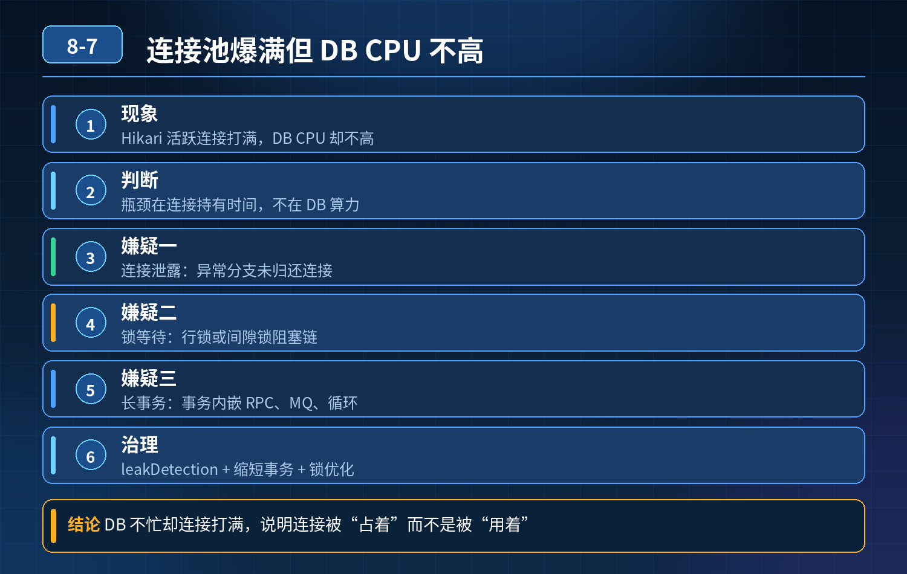 -->

## 第 8 题　场景题：无慢 SQL、连接正常关闭，高峰期连接池反复打满，重启半小时又复现

题干要点：下单查订单大面积超时，主库连接池打满，健康检查拿不到连接；重启临时恢复，半小时复现；没有慢 SQL、代码都 close 连接。考察：连接资源全生命周期治理、三层防御。

第一步：先定位这个场景的根因（核心得分）排除了慢 SQL、排除了简单连接泄露（所有分支都 close），这种反复打满，最常见两类元凶：

1. 长事务 / 事务边界不合理（最高概率） SQL 本身执行很快，但事务开启之后，里面同步调用 RPC、HTTP、MQ 发送、循环业务逻辑，迟迟不 commit/rollback。 连接在事务开启时拿到，事务提交才归还。SQL 毫秒级，但是事务持有连接几十 ms 甚至几百 ms。 流量一上来，连接持有 RT 被拉长，并发水位公式 并发=QPS*持有时间 直接放大，池子快速耗尽。

特征：重启后池子是空的，能扛一会儿；流量持续进来，慢慢被占满；单独看每一条 SQL 都很快，事务耗时指标很高。

1. 锁等待（行锁 /gap 锁阻塞链） SQL 本身快，但是争抢热点行锁，事务卡在锁等待阶段，连接一直占着不放。 CPU 不高、SQL 无慢查询，但是 InnoDB 锁等待事件持续堆积；一个热点行被阻塞，后续请求排队，批量占满连接。

特征：有阻塞链，kill 阻塞会话可以临时缓解，热点更新流量一来又复现。

次要备选原因（也要提）：

- 重试风暴：上游报错自动重试、MQ 消费重试，相同业务请求成倍放大 DB 并发；
- 健康检查 / 框架定时任务也共用同一个连接池：业务打满之后，健康检查拿不到连接，服务被 k8s 反复驱逐，恶性循环；
- 读写分离滥用：本该走从库的查询，错误打到主库连接池。

区分判断：

- 看监控：事务平均耗时 vs SQL 执行耗时，差距巨大 → 长事务；
- 看 InnoDB status、performance_schema 锁等待 → 锁竞争；
- 看上游请求量、重试次数、MQ 堆积 → 重试放大流量。

第二步：

<strong>面试官追问：</strong>怎么从根源避免连接池耗尽？是不是 max 越大越安全？

一句话结论：maxPoolSize 是并发上限保护，不是扩容手段；越大不等于越安全，超过 DB 最优并发会触发锁竞争、上下文切换，雪崩更快。 高手思路不是调参数，而是三层防御体系（视频里的核心框架）：第一层：事前约束（从源头减少连接持有时长、减少无效请求）

1. 严格管控事务边界：事务里面禁止外部调用（RPC/HTTP）；事务只包裹 DB 操作；先查外部、再开事务、快速提交；
2. 热点行隔离：库存、订单热点行做单行限流、排队，避免锁排队链式阻塞；
3. 流量分层、读写分离：查询走从库，主库只留给写；非强一致查询走 Redis 缓存；
4. 代码规范评审：禁止循环内多次获取连接；统一事务模板；
5. 重试策略收敛：指数退避、最大重试次数、熔断，杜绝重试风暴。

第二层：池内保护（连接池本身的防护，隔离故障，快速失败）

1. 合理设置 connectionTimeout（获取连接等待超时）：不能设置很长，排队拿不到连接直接快速失败，防止请求堆积、线程堆积；
2. 开启连接泄漏检测 leakDetectionThreshold，提前告警；
3. 隔离池！ 重点：核心写、查询、定时任务、健康检查，分开不同连接池，不要共用一个。 本题坑点：业务把健康检查和下单共用一个池，业务打满之后，健康检查拿不到连接，k8s 杀 Pod，重启短暂释放连接，半小时再次打满，循环故障。
4. 参数合理计算：用 Little 公式预估并发，集群所有实例连接总和控制在 MySQL最优连接区间内。

第三层：流量侧兜底熔断、限流、削峰（最外层防线）连接池本质是最后一道缓冲，不能靠它扛无限流量：

- 网关 / 应用层限流：下单接口令牌桶，超过阈值直接拒绝；
- 降级：查询订单走缓存，关闭非核心统计、附加查询；
- 大促削峰：延时消息排队下单，削峰填谷，削掉瞬时尖刺；
- 告警前置：监控 pending 等待连接数，而不是等活跃连接 100% 才告警。

第三步：这个场景标准应急流程（口述串起来）

5. 先隔离：把健康检查、定时任务切独立连接池，避免核心业务占满之后，健康检查失效导致 Pod 反复重启；

6. 看指标区分：事务耗时、锁等待、上游重试量；

7. 若是长事务：紧急开关降级，把事务里的外部调用剥离到事务外异步处理；

8. 若是热点锁：热点行限流、队列串行更新；kill 阻塞会话临时止血；

9. 限流入口流量，阻止持续请求灌入；

10. 谨慎调 max：确认不是锁 / 长事务、DB 负载还有余量才小幅上调；锁场景上调 max 只会加剧竞争；

11. 事后压测：按照真实事务持有 RT，重新评估连接池容量水位。

- 面试精简口述版（直接背诵）这个场景，没有慢 SQL、连接都正常关闭，重启半小时又复现，优先怀疑长事务或者热点行锁阻塞。 长事务的特征是 SQL 本身很快，但事务里面包含 RPC 调用，连接持有时间被拉长，放大并发压力；锁等待是 SQL 快，但争抢行锁卡在等待阶段。 max 连接数并不是越大越安全，它只是上限保护，超过数据库最优并发，锁竞争加剧，会加速雪崩。 根源治理我会用三层防御： 第一层事前约束，严控事务边界，事务里面不放远程调用，读写分离、热点隔离，收敛重试； 第二层连接池内部防护，最重要是资源隔离，健康检查、定时任务、核心业务分开独立连接池，避免一个链路耗尽资源拖垮服务，同时设置合理的获取连接超时，快速失败； 第三层流量层，限流、降级、削峰，不让无限流量冲进数据库。 告警也不能等连接打满，要监控连接等待队列，提前发现风险。

### 高频追问

Q：健康检查单独开连接池的意义是什么？ A：业务池耗尽时，健康检查还能正常连通 DB，K8s 不会误杀 Pod，避免 “重启 - 恢复 - 再打爆” 的循环雪崩，就是这个题里的经典坑。 Q：长事务除了 RPC，还有哪些容易忽略的场景？

A：事务内 sleep、大循环查询、等待锁、消费消息时事务迟迟不提交。 Q：如果已经出现大量锁等待阻塞链，是加大连接还是限流？ A：优先限流 + kill 阻塞会话，加大连接只会让更多事务进来抢锁，等待链更长。

<!-- 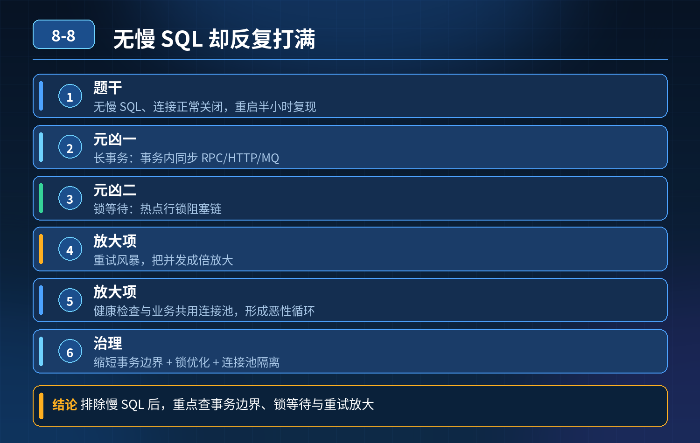 -->

## 第 9 题　数据库连接池打满，请求全部超时卡住，如何不停机止损、区分泄露/长事务慢 SQL、避免数据库连接雪崩、根治方案

### 候选人浅层回答

重启服务恢复，调大最大连接数，加上监控告警，不行就在 DB 侧 kill 连接。

### 连环追问汇总

1. 重启半小时又打满，反复重启不是办法，怎么办？
2. 连接泄露（拿连接不释放），怎么定位对应代码？
3. 怎么区分：连接泄露 VS 慢 SQL / 长事务占住连接不归还？
4. 盲目调大连接池上限，所有应用连接总和打爆数据库 max_connections，恶性循环怎么打破？
5. 核心链路不能停，不重启、不改代码，临时降级止损方案？
6. 分库分表、多数据源场景，多个连接池同时耗尽，排查优先级和兜底怎么做？

### 参考答案

核心认知：连接池耗尽本质是连接借出速度 > 归还速度。单纯加大连接数是饮鸩止渴，会把压力传导到数据库，造成整个实例宕机。处理顺序：限流降级止损 → 区分故障类型定位 → 临时干预释放连接 → 参数优化 + 代码根治 + 架构防护三层闭环。

### 一、不停机应急止损（优先保核心业务，不重启）

目标：停止继续申领新连接，给已有连接留出归还窗口，防止数据库连接被整体打爆

1. 网关层限流 + 接口熔断 按接口做配额控制，直接挡住非核心流量：报表、导出、统计、日志查询、后台管理查询；只保留下单、支付这类强核心链路。减少新请求进来抢连接。
2. SQL 侧动态开关，降级重查询逻辑 大查询、分页超大、联表复杂查询直接降级返回缓存兜底数据，不再走 DB 查询，不再申领连接。
3. 动态摘除故障节点、流量切分 把该实例流量切走，故障实例不再新增请求；等连接慢慢释放、水位下降之后，再在这个节点采集连接栈、埋点日志定位问题。
4. 连接池内置超时兜底（平时提前配置） 核心参数：获取连接超时、连接归还校验、空闲连接回收。

- ❌ 不优先去数据库 kill 连接：强行 kill 会话，如果应用层没感知，连接池会认为连接还活着，会出现连接状态不一致、脏连接、事务异常。

### 二、快速区分两类最常见根因：连接泄露 VS 慢 SQL / 长事务

1. 慢 SQL / 长事务阻塞（最常见） 特征：连接正常借出，业务在执行 SQL 或者事务迟迟不 commit/rollback；连接是正常流程等待归还；在数据库 show processlist /performance_schema 里可以看到大量长时间 Running 的会话，SQL 语句明确。 触发：大查询、锁等待、行锁竞争、代码开启事务之后调用远程接口、sleep、循环处理，事务长时间悬空。
2. 连接泄露（代码缺陷） 特征：SQL 执行很快，但是代码分支异常，没有 close归还连接（try-catch 异常分支漏掉关闭、MyBatis / 框架使用不当、手动获取 Connection 忘记归还）；连接被借出后永久丢失，不会自动归还。 识别手段：连接池监控里，活跃连接持续上涨，但是 DB 侧会话没有长时间执行 SQL；配合连接池追踪：开启 HikariCP/PooledConnection 的 leakDetectionThreshold（连接泄露追踪），超时未归还自动打印堆栈，直接输出拿到连接的代码位置。

配置 leakDetectionThreshold 是定位泄露的关键手段，线上提前开启，不要故障了才想起。

### 三、为什么不能盲目调大连接数？

4. 数据库本身有全局 max_connections。 每个应用实例连接池上限调高 → 集群多实例叠加 → 数据库总连接数打满。 后果：整个库所有业务拿不到连接，全局雪崩。 数据库最佳实践：数据库连接不是越多越好，CPU、IO、锁才是瓶颈，超过最优连接数之后，吞吐量不升反降。 公式思路：单库最优连接 ≈ CPU 核心数 * 2~4。

### 四、分场景根治方案

场景 1：长事务 + 慢 SQL 抢占连接

1. 强制设置事务超时时间，事务超过阈值自动回滚释放连接；
2. 慢 SQL 拦截：SQL 防火墙、预校验，超长执行 SQL 直接拒绝；
3. 禁止事务内调用 RPC、MQ、文件 IO、sleep；事务范围尽量最小化；
4. SQL 优化：加索引、拆分大 SQL、避免锁范围过大；大查询走只读从库、离线数仓，不要压主库。

场景 2：代码连接泄露

1. 规范：使用 try-with-resources 自动关闭连接、Statement、ResultSet；
2. 框架层面统一封装 DB 工具类，禁止手动获取 Connection；
3. 连接泄露检测告警：HikariCP leakDetectionThreshold，建议设置 2~5s，一旦捕获立刻告警输出堆栈；
4. 代码 Review 重点：异常分支、if/else 分支、return 提前退出场景，是否漏掉资源关闭。

场景 3：流量突增冲垮连接池（无泄露、无慢 SQL）

1. 读写分离：读请求切从库，主库连接留给写事务；
2. 热点数据缓存化，Redis 兜底，减少 DB 访问；
3. 排队限流，令牌桶，削峰，防止瞬间并发打爆连接池；
4. 连接池大小按压测结果设置，而不是凭感觉。

场景 4：分库分表、多数据源同时耗尽排查优先级：主库 > 从库；交易核心数据源 > 统计、后台数据源。

- 先把后台、统计类数据源直接熔断降级；
- 逐个数据源看活跃连接、泄露日志、慢会话；
- 多数据源连接池独立配置、独立监控，不要共用一套参数；一个池子故障不要传染其他数据源。

### 五、三层长效防护体系

第一层：事前监控预警，不等打满监控指标：活跃连接数、等待获取连接排队数、连接泄露告警、SQL 执行时长、事务持续时长、数据库总连接水位。 告警阈值：活跃连接达到 70% 水位就告警，而不是 100% 耗尽。

第二层：连接池参数兜底配置（Hikari 示例思路）

- maximumPoolSize：压测后确定，保守设置，不要拉满；
- connectionTimeout：获取连接超时，防止请求无限排队卡死；
- leakDetectionThreshold：泄露追踪；
- idleTimeout：空闲连接自动回收；
- maxLifetime：连接生命周期，定期淘汰旧连接，避免 DB 侧已经断开的脏连接留在池里。

第三层：架构隔离兜底

1. 读写分离，读压力剥离；
2. 核心库、非核心库物理隔离；
3. 大报表、离线统计走定时同步到数仓，不走在线数据库；
4. 服务熔断：数据库异常时快速失败，不堆积请求排队，避免请求堆积持续消耗连接。

### 考察核心

初级工程师：连接不够 → 加大连接、重启、杀会话，治标不治本，容易引发数据库雪崩。 高级工程师思路：

1. 知道连接池耗尽分泄露和慢 SQL 长事务两类，有办法区分定位；
2. 深刻理解：应用连接池上限和数据库全局连接是联动的，盲目上调会引发更大范围故障；
3. 故障优先限流降级、摘流，有不停机的应急手段，而不是只会重启；
4. 整套闭环：应急止损 → 定位泄露 / 慢 SQL → 代码规范、参数兜底、读写分离架构改造，从源头降低风险。

<!-- 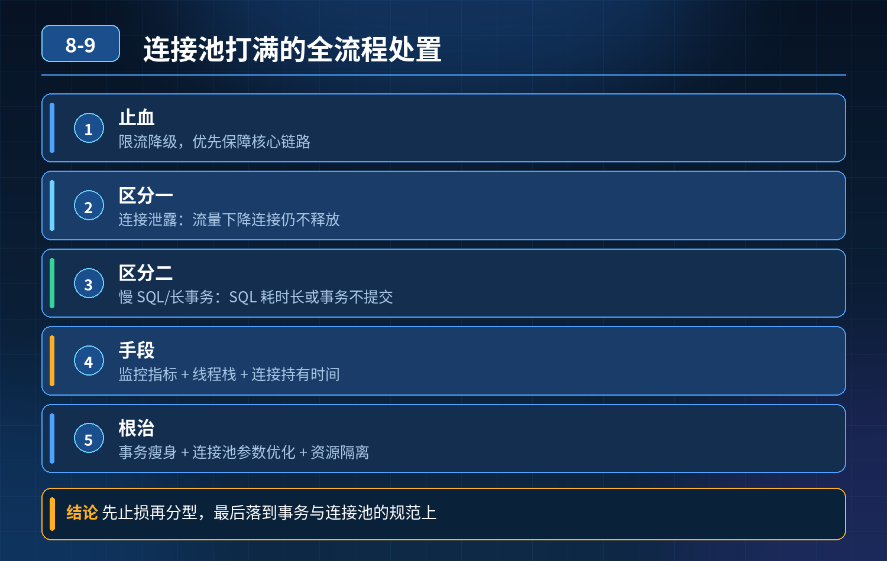 -->

## 第 10 题　数据库连接池核心连接数怎么计算

### 场景复盘

面试官提问：连接池核心 10、最大 20 是怎么来的？依据是什么？SQL 长短查询怎么判断？调到 50 吞吐量会不会翻倍？连接数太大有什么副作用？ 候选人只会背经验值，没有推导逻辑。

核心认知：连接池不是越大越好，MySQL 的连接是昂贵资源；最优连接数和单 SQL 执行时长、目标 TPS、数据库 CPU 能力强相关，不是固定 10/20。

### 三层体系

第一层：理论计算公式（IO 密集型数据库场景）经典公式： 最优连接数 ≈ TPS × SQL 平均执行时长(秒) 举例： 目标 TPS=200，单条 SQL 平均耗时 20ms（0.02s） 200 × 0.02 = 4，理论 4 个连接就可以扛住。 如果是慢查询，单 SQL 耗时 200ms，同样 TPS200：200 ×

0. 2 = 40。

理解：一条连接同一时刻只能跑一条 SQL；SQL 等待时间越长，需要更多连接来并发 “填住等待空隙”。 短查询（ms 级）：不需要很多连接；长查询（几百 ms+）才需要更大连接池。

区分业务：

- 短查询（OLTP 交易）：平均耗时 < 50ms，最优连接数一般很小，8~20 区间很常见；
- 长查询（报表、统计、大 join）：耗时几百 ms~ 秒级，需要更多连接，但长查询本身应该隔离到从库，不能和核心交易共用连接池。

第二层：上限约束（为什么不能无脑加大，拉到 50 吞吐量不会翻倍）MySQL 单实例有天然瓶颈：

1. 每个连接都有内存开销（线程栈、会话缓存、事务上下文），连接越多内存占用越高；
2. 连接过多，CPU 会大量消耗在线程上下文切换、锁竞争、事务调度，超过临界点后，连接越多，吞吐量反而下降，响应时间暴涨；
3. MySQL 全局参数 max_connections 是数据库侧总上限，要预留连接给 DBA运维、备份、监控，不能全部给业务。

所以：连接池最大连接数，要同时满足两个约束：业务公式算出的值、数据库能承载的安全上限。 一个经验结论：MySQL 单库，稳定 OLTP 场景，通常并发连接超过 30~60 之后收益快速衰减，很多时候加到 50 不仅不翻倍，还会雪崩。

第三层：工程落地配置策略（HikariCP 为主，SpringBoot 默认）HikariCP 的核心两个参数：

- minimumIdle（空闲保活，核心连接）：不建议盲目设置很大，Hikari 推荐直接设和 maximumPoolSize 一致；很多人设置 10 只是保活，不是并发上限。
- maximumPoolSize（最大连接）：按压测标定，而不是公式直接写死；公式只是初始参考值，最终以压测拐点为准。

配套观测指标（判断是长查询还是短查询、连接池是否合理）：

1. 连接池排队等待时长（最关键！如果大量线程排队拿连接，说明池子偏小）

2. 数据库端：Threads_running（正在运行的活跃连接，不是 sleep 连接）

3. 慢查询日志、平均 SQL 耗时、99 分位耗时

4. CPU、iowait落地流程：

1. 先统计线上 SQL 平均耗时、目标 TPS，用公式算出初始值；

2. 压测爬坡，找到吞吐量拐点；拐点就是最优最大连接；

3. 核心交易和报表查询隔离连接池、隔离库，长查询绝对不能挤占交易连接；

4. 监控排队告警，动态调整，不要写死。

- 30

### 秒口述标准答案

连接数不能直接抄 10、20。理论上可以用 TPS 乘以单 SQL 平均执行时长估算初始值；短查询耗时低，需要的连接很少，长查询才需要更多连接。但连接数有天花板，超过最优值之后，线程上下文切换、锁竞争加剧，吞吐量不会跟着翻倍，甚至下降，还会消耗大量数据库内存。最终不能只靠公式，要压测找到吞吐量拐点；同时要区分长短查询，报表长查询单独隔离，不和核心交易共用连接池；日常看连接池排队时间、数据库活跃运行线程来判断配置是否合理。

### 高频追问

Q：HikariCP 为什么不建议把 minimumIdle 设置很大？ A：Hikari 设计思想是尽量少空闲连接，minimumIdle 大了会维持一堆闲置连接占用数据库资源，推荐 minimumIdle = maximumPoolSize。 Q：Threads_connected 和 Threads_running 的区别？ A：Threads_connected 是所有已经建立的连接（大量 sleep 空闲）；Threads_running 是正在执行 SQL 的活跃连接，这个才是压力指标。 Q：如果看到连接池排队很久，加大 max 就一定解决吗？ A：不一定。排队根源如果是慢 SQL 锁等待、数据库 IO 瓶颈，加大连接只会雪上加霜

<!-- 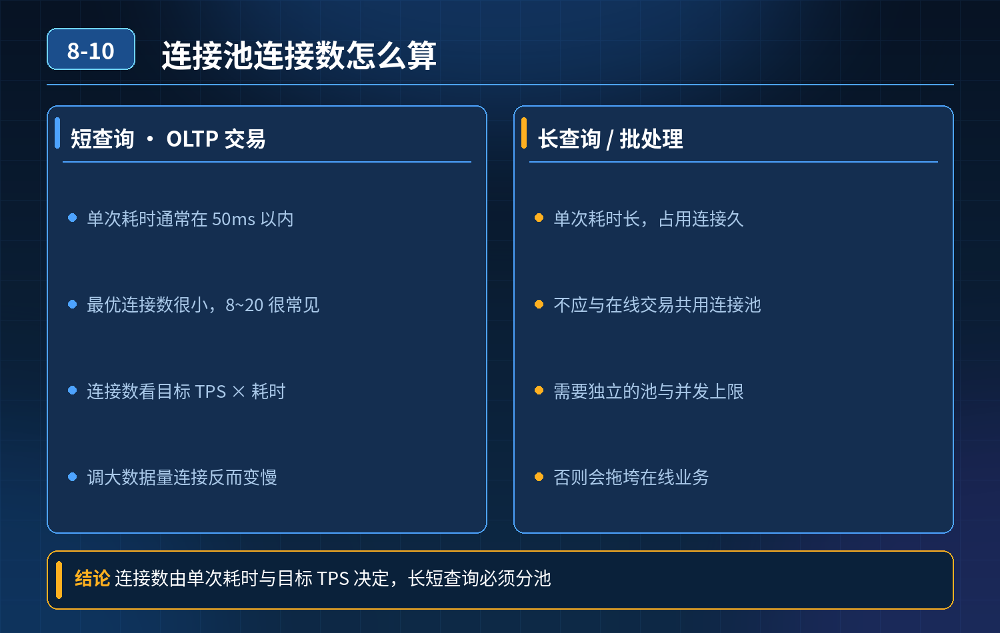 -->

## 第 11 题　连接池进阶面试题

题干几个连环问题汇总：

1. minimumIdle 设大，低峰占资源；设小，高峰频繁建连，平衡点怎么找？
2. 长短事务混跑，长事务占住连接，短事务拿不到连接超时，怎么解决？
3. 拆分多个连接池之后，DB 总连接有上限，怎么平衡？
4. DB 端主动断开连接，池子里残留死连接，怎么检测处理？
5. 拿不到连接报错，怎么快速区分：真并发不足 / 连接泄露？
6. 生产要监控连接池哪些核心指标？

### 一、空闲连接平衡点（minimumIdle 的取舍）

HikariCP 的 minimumIdle 不是固定一个值，没有万能数字，是根据流量形态选择模式 两种模式：

1. 固定池模式（大促、核心链路、流量持续稳定） minimumIdle =

- maximumPoolSize，idleTimeout = 0，关闭空闲回收。

优点：不会频繁创

- ❌建销毁连接，RT 稳定，没有建连尖刺； 缺点：低峰期连接一直占用 DB 连接资源； 适合：下单、支付核心写链路，流量持续高，业务稳定性优先，愿意付出连接资源成本。

2. 弹性伸缩模式（昼夜波动大、非核心查询服务） 设置合理 minimumIdle（偏小，

- 比如 5~10），开启 idleTimeout，低峰回收空闲连接。

优点：低峰释放

- ❌DB 连接，给别的服务； 缺点：流量突然抬升时，会临时新建连接，短暂抖动； 配套优化：搭配预热、限流削峰，避免突发流量瞬间打爆。

平衡点思路： 优先压测，拿到业务常态 QPS、99 分位连接持有时长，算出常态并发水位；minimumIdle >= 常态并发水位，预留少量缓冲； 突发尖刺靠 maxPoolSize 兜底，而不是靠 minimumIdle 撑尖刺；尖刺同时配合限流，不依赖连接池扩容扛洪峰。

### 二、长短事务混合，长事务霸占连接，短事务饥饿（高频高分点）

4. 不要单纯调大 maxPoolSize，治标不治本，还会把 DB 总连接上限吃掉，加剧锁竞争。 方案分层：

1. 【最优方案：资源隔离，按事务类型拆分连接池】 长事务、短事务分开两套连接池。短事务池子 max 可以小一点、获取连接超时短，优先保障短事务；长事务单独一个独立池，并且给这个池子设置严格的限流、事务超时，防止它无限抢占资源。

但是面试官追问来了：池子多了，DB 总连接会上涨，这里就要引出全局配额管控。

1. 【其次：业务治理，消灭不必要的长事务】 根源优先：把 RPC、外部调用移出事务；大事务拆小；长事务加单独告警、拦截，上线评审卡点。
2. 【补充：池内排队隔离，信号量隔离（备选方案，不想拆多个池的时候）】 同一个连接池之上，在业务层加业务维度信号量：长事务请求单独一个信号量配额，限制同时运行的长事务数量，避免长事务把全部连接吃光。短事务不被长事务排队挤压。

一句话：连接池是底层资源，它本身不区分请求优先级；要在业务层做配额隔离、优先级控制。Hikari/Druid 本身没有内置排队优先级。

### 三、多个连接池，数据库全局连接上限怎么平衡？

4. MySQL 的 max_connections 是全局硬上限，所有应用、所有实例、所有连接池加起来不能超限。 治理思路：全局配额分配 + 动态水位管控

1. 给 MySQL 实例做连接配额预算： 总可用连接 = max_connections - 预留运维连接（DBA、监控、后台，一般预留 20~50）； 然后按服务优先级分配配额：核心订单、支付分配高配额，报表、后台导出、统计任务给很低配额；

2. 每个服务、每个连接池设置自己 maxPoolSize，所有池 max 之和 ≤ 分配给它的配额；

3. 不同环境隔离：在线业务库和离线统计库分开，离线报表不要蹭主库连接；

4. 动态调整：配置中心支持热改 maxPoolSize，大促前把配额向核心链路倾斜，低峰期回收给离线任务；

5. 红线：禁止各个业务团队自己随便调大连接池，需要 DBA 侧全局审批。

### 四、数据库主动断开，连接池残留死连接（无效连接、僵死连接）

MySQL wait_timeout 超时之后，服务端单方面断开连接，但应用连接池不知道，池子里的连接变成死连接，拿出来执行 SQL 才抛异常。 Hikari 的方案（重点）：

1. maxLifetime：连接最大存活时间，必须小于 MySQL wait_timeout；MySQL默认 wait_timeout=8 小时，maxLifetime 一般设 30~60 分钟；Hikari 自带

2. 5% 随机偏移，防止批量同时过期；到期主动销毁重建，从源头避免僵死连接。

2. 测试连接：connectionTestQuery / validationTimeout Hikari 默认不需要配置 connectionTestQuery，它会用 JDBC4 的 isValid () 校验；

- validationTimeout：校验超时时间；
- 校验时机：拿连接出来使用前校验（很多人误以为是空闲时轮询心跳）；

<strong>注意：</strong>不要配 idleTest，空闲轮询心跳会增加 DB 压力，Hikari 设计理念是取出时校验。 Druid 才支持空闲心跳检测，二者设计思路不一样。

1. 兜底：捕获 SQL 异常，识别通讯异常，触发连接丢弃。

### 五、报错拿不到连接：快速区分【真并发不足】vs【连接泄露】

先看 Hikari 埋点指标：

- pending（等待队列长度）持续上涨；
- active 活跃连接： 真并发不足：
- QPS 上涨 → active 慢慢打满；QPS 回
- 落之后，active 跟着回落；流量降下来池子可以自动释放； 连接泄露：哪怕 QPS 降到 0，active 连接只涨不跌，不会回落； 配套手段：

1. 开启 leakDetectionThreshold，比如 2000ms，泄露会打印线程栈，直接定位代码；
2. 线程 dump：大量线程卡在 getConnection() 是排队；拿到连接之后卡住才是 SQL / 锁；
3. DB 侧 show processlist 辅助核对，看会话是不是还在活跃执行。

### 六、生产必须监控的连接池核心指标（面试背这个）

Hikari micrometer 指标：

1. hikaricp_connections_active：活跃占用连接数（核心）
2. hikaricp_connections_idle：空闲连接
3. hikaricp_connections_pending：等待获取连接的排队数量（最重要告警指标，优先告警这个，不要等 active 打满）
4. hikaricp_connections_creation：创建连接耗时、创建次数（识别频繁建连抖动）
5. hikaricp_connections_leak：连接泄露告警计数
6. 业务侧配套：事务耗时、SQL 耗时、锁等待、DB 连接总数、MySQLmax_connections 使用率

- 精简口述版本（面试直接讲）minimumIdle 没有万能值，看流量形态选择模式：稳定大促核心链路用固定池，minIdle 等于 max，关闭空闲回收，避免频繁建连抖动；昼夜波动大的非核心服务开启弹性伸缩，minIdle 设置常态并发水位，idleTimeout 自动回收空闲连接。

长短事务混跑造成短事务饥饿，优先治理长事务，把外部调用移出事务；其次做资源隔离，可以拆独立连接池，或者上层增加信号量限制长事务并发；但是拆分池会带来总连接上涨，所以我们要做 MySQL 全局连接配额，按业务优先级分配 max 上限，整体总和不能超过数据库 max_connections。

DB 侧主动断开产生死连接，Hikari 靠 maxLifetime，设置比 MySQLwait_timeout 小，主动轮换连接；取出连接的时候通过 isValid 校验有效性，不推荐空闲轮询心跳，避免给数据库增加压力。

当出现获取连接超时，我优先看 pending 排队指标和 active 连接曲线：流量降下来 active 随之回落是正常并发打满；流量归零活跃连接依然居高不下，大概率是连接泄露，打开 leak 检测打印栈定位。 监控上重点盯 pending 等待队列，提前告警，而不是等连接全部耗尽才发现问题，同时监控活跃、空闲、建连耗时、泄露指标。

### 高频追问

Q：Hikari 和 Druid 在僵死连接检测上有什么区别？ A：Hikari 是取出时校验，依靠 maxLifetime 轮换；Druid 支持空闲周期心跳检测，适合老版本 JDBC。 Q：信号量隔离和拆分连接池各自优缺点？ A：信号量不用消耗额外 DB 连接，但是同一个池内故障依然互相影响；拆分池隔离性更强，但是占用更多数据库连接配额，需要全局管控。 Q：maxLifetime 设置越小越好吗？ A：不是，太小会导致连接频繁销毁重建，产生大量建连开销和 RT 抖动，一般 30 分钟起步。

<!-- 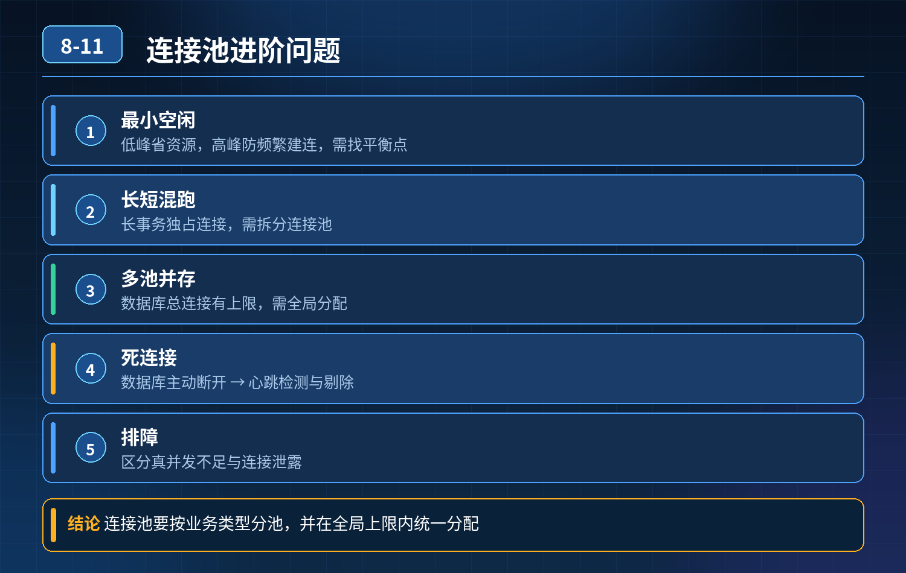 -->

## 第 12 题　秒杀 Redis 固定计数器限流，限流生效但服务打垮、合法请求被拦截、出现超卖

<strong>举例说明：</strong>计数器限流窗口为每秒 1000 次。第 0.99 秒放进 1000 次请求，第 1.01 秒又放进 1000 次，0.02 秒内实际涌入 2000 次请求，后端瞬间被打垮；换成令牌桶按固定速率放行，就不会出现这种临界突变。

### 问题 1：接口限流该怎么实现？

<strong>候选人浅层回答：</strong> Redis 做计数器 + 令牌桶，设置每秒请求数限制就可以限流。

### 连环追问

秒杀场景，Redis 计数器限制每秒 1000 请求；限流规则生效，但瞬间涌入流量后服务超时雪崩，大量正常用户被拦截，还出现超卖。

1. 问题根源在哪？
2. 怎么设计限流策略，既能挡恶意流量保护服务，又兼顾合法用户体验，避免限流引发故障？
3. 只靠计数器、固定阈值够用吗？

### 参考答案

事故根因拆解这个案例踩了限流非常典型的一堆坑：

1. 简单全局固定计数器，没有分布式集群分摊 多实例部署时，如果只做全局固定QPS，或者没做单机配额，很容易出现流量倾斜；如果是单机阈值，多机叠加后总流量远超预期容量。
2. 限流只做了 “拦截”，没有排队、削峰，流量还是瞬间冲击后端 计数器 / 令牌桶只是拒绝请求，不做缓冲；秒杀瞬间脉冲流量，Redis 判断放行的 1000 个请求同时打到业务服务、数据库，并发压垮下游。限流≠削峰。
3. 没有流量分级、用户分层，一刀切拦截 老用户、会员、普通用户、爬虫恶意请求同等对待，峰值来了合法优质用户和刷量请求一起被拦，体验极差。
4. 限流和库存扣减逻辑解耦，限流不代表不会超卖 限流只是控制进入接口的请求量；限流通过之后，库存扣减本身没有原子控制、没有预扣锁，依然会超卖。

限流是流量防护，不是库存防超卖方案，很多人混淆二者。

5. 限流触发后缺少柔性兜底 直接返回报错，大量请求失败，重试风暴又来了，二次冲击服务。

6. 阈值拍脑袋设置，没有基于单机压测容量计算 阈值不是看业务想放多少人，而是看服务、DB、Redis 链路最大稳定承载上限。

三层限流防御体系第一层：分层限流 + 多维度配额，拒绝一刀切限流要按位置、维度、优先级拆分，不是只在服务内做一层 Redis 限流

1. 分层位置（由外到内） 网关层粗粒度限流（第一道闸门）→ 应用层细粒度接口限流 → 资源层（Redis/DB）保护
2. 限流维度 全局总配额、单机配额、用户 ID、IP、渠道、用户等级；
3. 流量分级 高优先级（会员、老用户）预留配额；低优先级（匿名、高频刷请求）严格限制；恶意 IP 直接拉黑。

算法选型：

- 令牌桶：允许一定突发，适合秒杀这种允许短暂脉冲的场景；
- 漏桶：匀速流出，适合消息、对外接口，不适合秒杀；
- 固定窗口计数器：容易窗口临界点突刺（临界毛刺问题），秒杀不推荐；滑动窗口计数器更稳妥。

第二层：削峰排队，把脉冲流量摊平（秒杀重点）限流只是 “挡”，削峰才是保护后端的关键。 放行的请求依然是瞬时并发，数据库扛不住：

- 引入消息队列做削峰：请求先入 MQ，异步排队消费，后端按自身处理能力匀速拉取；前端返回排队中，而不是同步等待下单结果；
- 本地排队 + Redis 分布式排队结合，控制同时进入扣库存逻辑的并发；
- 注意：排队也要设置超时，防止队列无限堆积。

第三层：限流联动降级兜底 + 和库存机制配合

4. 柔性降级兜底 被限流不要直接返回 500，返回友好提示：“活动火爆，请稍后重试”，引导用户不要疯狂刷新重试，避免重试风暴；

5. 限流 ≠ 库存控制 限流负责控制进入接口的流量；防超卖靠Redis 预扣库存 +分布式锁 / 库存版本号，两者必须分开设计，不能混淆；

6. 动态阈值，而不是固定值 根据服务 CPU、线程池、Redis 耗时动态调整配额，系统负载高的时候自动收紧阈值，负载回落自动放开，比写死 1000 / 秒更健壮。

补充避坑点

1. 分布式限流要注意 Redis 的性能瓶颈，大量请求去 Redis 判断限流本身也会把Redis 打满；可以本地 Sentinel 令牌桶做本地初限，Redis 做全局总控，减少 Redis 压力；
2. 时钟问题：分布式节点时间不一致会影响滑动窗口；
3. 限流规则要支持热更新，大促期间可以动态调配额，不用重启服务。

<strong>追问：</strong>本题考察核心是什么？

<strong>参考答案：</strong>初级开发只会实现一个限流算法，把限流等同于 “设置 QPS 拦截请求”。高阶工程师明白：

1. 限流的目标不是拦住多少人，是保护下游资源稳定，同时尽量保障核心用户体验；
2. 分清限流、削峰、库存防超卖是三件独立事情，不能混为一谈；
3. 理解固定窗口计数器的临界毛刺缺陷，知道不同限流算法的适用场景；
4. 懂得多层防护：网关、本地、分布式全局、排队削峰、柔性兜底一套组合；
5. 阈值不是业务目标，是容量上限，必须基于压测得出。

<strong>核心思想：</strong>限流不是一个 Redis 计数器就能搞定的功能，是流量识别、配额隔离、削峰缓冲、柔性返回、动态调控组成的流量治理体系。

<!-- 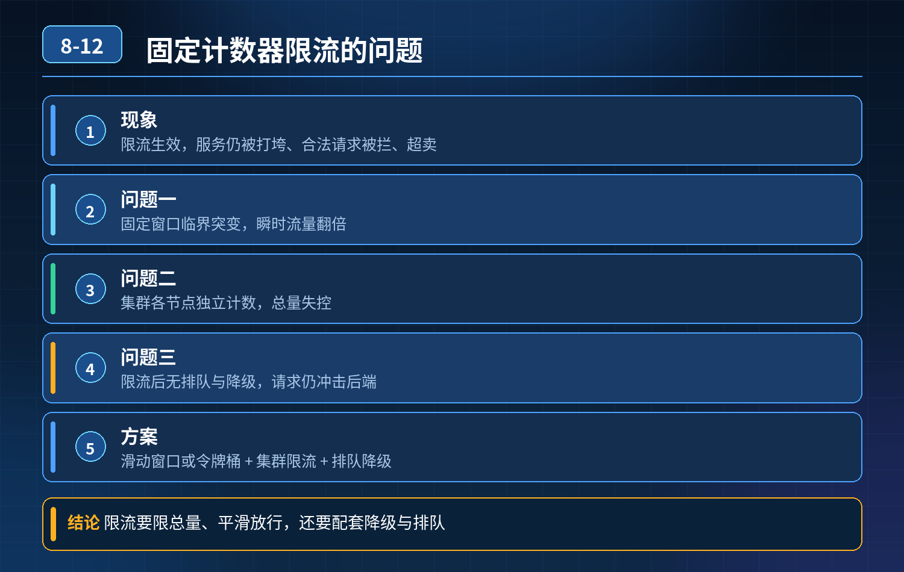 -->

## 第 13 题　集群限流不均衡问题

### 问题根源

他只配置了单机本地限流，每台机器独立计数、互不感知。 秒杀场景下，负载均衡策略如果是随机、轮询，加上热点用户、路由哈希倾斜，流量会分配不均。

例子：10 台机器，单机阈值 1000，总容量 1w；但流量偏到 3 台机器，这 3台很快打满触发限流，剩下 7 台很空闲。集群整体 QPS 才 5000，远远没到整体上限，正常用户被误杀，资源浪费。

核心痛点：单机限流是节点视角，没有集群全局视角，解决不了流量倾斜。

三层流量防御体系第一层：网关层全局限流（集群维度，优先做）网关统一入口，基于 Redis 令牌桶做分布式限流，统计整个集群的总配额。

比如集群总配额 5000QPS，网关统一分发令牌； 好处：从入口控制整体流量，天然感知全局，不会出现部分节点先被打满； 缺点：网关变成单点，需要网关集群；有少量 Redis 网络开销。 可以按 IP、账号、接口、用户维度限流。

第二层：服务层单机限流 + 自适应负载（兜底、削峰）业务服务内部用 Sentinel 本地限流作为二次防护，不是固定写死阈值； 配合负载均衡优化：

- 优先使用最小连接数、平滑权重 LB，而不是简单轮询、哈希；
- 开启服务健康探测，自动剔除慢节点；
- Sentinel 支持集群限流模式，Sentinel 集群限流中心统一分配配额，兼顾分布式视角。

这一层作用：防止网关放行后，单个实例被突刺流量打崩，作为实例级保护。

第三层：熔断、降级、隔离（故障容错，最后防线）就算限流做好，下游依赖（DB、Redis）出问题，依然会拖垮服务：

- 线程池 / 信号量隔离：不同接口、不同下游分开线程池，故障不扩散；
- 熔断：下游错误率、慢调用比例超标，直接熔断，快速失败；
- 降级：非核心链路直接返回兜底数据，保住秒杀这类核心接口。

关键选型区分（面试官最爱追问）

1. 单机本地限流：实现简单、性能高；缺点：流量倾斜，适合流量均匀、非核心接口。
2. 网关分布式限流（Redis）：全局配额，适合核心入口、秒杀；存在 Redis 抖动、网络开销。
3. Sentinel 集群限流：独立 Token Server 分配配额，介于两者之间，微服务内部很常用。

不是一刀切全部改成分布式限流：分布式限流有性能损耗；核心链路网关全局控总量，服务节点保留单机限流做兜底，是工程上最稳妥的组合方案。

- 30

秒口述标准答案（直接背诵）

问题根源是只用了单机限流，各个实例独立计数，负载不均导致部分机器提前触达阈值、误拦截用户，集群资源没有充分利用。我们三层流量防护：第一层在网关做 Redis 分布式全局限流，管控集群总流量；第二层服务内部配置 Sentinel 集群限流或者单机限流兜底，同时优化负载均衡策略，减少流量倾斜；第三层配合线程池隔离、熔断降级，防止下游故障连锁雪崩。不会全部接口都上分布式限流，兼顾性能和流量公平。

### 延伸追问

问：Sentinel 集群限流和 Redis 网关限流怎么选？ 答：网关限流适合在流量入口统一管控全集群总水位；Sentinel 集群限流适合微服务内部、按接口精细化管控，粒度更灵活。

问：为什么不全部都用分布式限流？ 答：分布式限流依赖Redis/TokenServer，有网络延迟和稳定性成本；流量均匀的普通接口，单机限流足够，性能更好。

<!-- 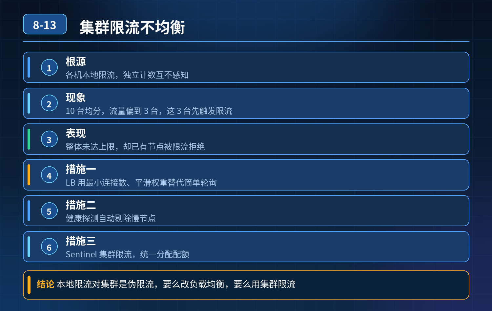 -->

## 第 14 题　大促分层限流体系设计，网关+多实例集群、流量尖峰、Redis 故障、差异化限流、漏桶/令牌桶对比、多层防护防雪崩

### 问题

大促流量暴涨，设计分层限流，防止下游雪崩；

### 面试官连环追问：

1. 多网关集群只用本地限流，阈值不准、总量失控怎么解决？
2. 瞬时流量尖峰，令牌桶来不及生成令牌，正常请求被误杀怎么办？
3. 只做网关限流，网关规则 bug，流量穿透打挂业务服务，如何多层防护？
4. 普通用户、VIP 付费用户差异化限流怎么实现？
5. 漏桶算法优缺点，和令牌桶对比？
6. Redis 故障，分布式限流失效，兜底方案？

### 参考答案

### 一、先梳理主流限流算法对比

- 令牌桶 Token Bucket：按固定速率放令牌，桶有最大容量。可以允许一定的流量突刺，适合大促秒杀这种突发流量场景；Gateway、Sentinel 分布式限流最常用。
- 漏桶 Leaky Bucket：请求先入桶排队，以固定速率流出。流量强制平滑，不允许突刺；适合对外第三方接口、消息消费，不适合秒杀活动，瞬间洪峰直接拒绝大量正常流量。

一句话区分：令牌桶是 “能扛一波尖峰”；漏桶是 “强制匀速，削峰不允许爆发”。

### 二、集群限流不准（多网关实例本地限流）问题

- 单机本地限流：每个实例独立计数，总 QPS = 实例数 * 单机阈值，流量负载不均时总量失控。
- 方案分两类：

1. 分布式限流（Redis + 令牌桶 / 滑动窗口）：全网关共享 Redis 计数，统计全集群总 QPS；适合按接口、按 IP、按用户维度做全局配额。 缺点：有 Redis 网络开销、Redis 故障风险、存在少量时间窗口内的超量（竞争）。
2. 本地限流 + 配额分摊（Sentinel 集群模式）：集群总阈值，由控制台动态分摊到每一台网关实例，实例本地计数，不需要频繁访问 Redis；兼顾性能和集群总量控制，生产用得很多。

注意：纯 Redis 分布式限流也不是绝对精准，存在时钟、网络延迟带来的误差，一般预留安全水位。

### 三、瞬时流量尖峰，令牌桶误杀正常请求

令牌桶的桶容量就是用来吸收突刺的，优化手段：

1. 合理设置桶容量（burst）：根据历史大促峰值，桶容量承载预期瞬时尖峰；生成速率是平稳持续流量上限。
2. 预热令牌桶：大促开始前，提前预填充令牌，避免活动刚开始桶是空的，第一波流量直接被打死。
3. 区分预热期、正式期两套阈值；活动开启瞬间临时放大 burst，后续回落。
4. 结合排队：短时间流量超过桶容量时，加入短时排队，而不是直接拒绝；排队设置最大等待超时，防止堆积。

漏桶在这里就不适合：没有 burst 能力，尖峰直接拒绝，用户体验差。

### 四、多层限流防护体系（从外到内，层层兜底，避免单点限流失效）

从外层到内层，逐级拦截，形成防护链，防止一层失效全量穿透：

1. 第一层：接入层（Nginx/CDN） 防护：IP 黑名单、CC 攻击防护、单 IP 单机限流、连接数限流；拦截爬虫、恶意刷量；这一层是第一道屏障，不做复杂业务维度。
2. 第二层：API 网关层（Spring Cloud Gateway / Kong / APISIX）【核心限流层】分布式 / 集群分摊限流：接口维度、用户 ID、IP、设备号；做差异化限流；大促主要在这里挡流量。
3. 第三层：业务应用层（Sentinel 本地限流）【兜底防线，重中之重】 哪怕网关限流 bug、规则配置错误、网关全部绕过，每个微服务实例自带本地限流 + 熔断降级；每个服务自己保护自己。 规则：按服务、接口设置最大承载水位，超过直接快速失败、返回降级页，不继续调用下游 DB / 其他 RPC。
4. 第四层：资源层（数据库、MQ） DB 连接池上限、MQ 消费者并发数限制，最底层资源锁死保护。

<strong>核心思想：</strong>每一层都有独立限流，上层挡大部分流量，下层是保命兜底，不把希望只放在网关。

### 五、VIP 和普通用户差异化限流

核心思路：流量打标签 + 分级配额，高优用户优先保障

1. 网关鉴权后，解析身份，打上标签：VIP / 普通 / 匿名游客；
2. 分桶限流：

- VIP 独立配额、更大 burst、更高权重，优先放行；
- 普通用户配额低；匿名游客配额最低，严格限制；

3. 令牌抢占优先级：令牌不足时，优先放行 VIP 请求，丢弃普通流量（队列优先级）；

4. 隔离：VIP 流量和普通流量尽量分开队列，避免普通用户洪峰挤占 VIP 资源。

注意：不要让 VIP 无上限，VIP 也要设置上限，防止少数 VIP把资源吃光。

### 六、Redis 故障，分布式限流失效的兜底方案

Redis 挂了，不能让限流直接消失：开关降级为本地限流

1. 熔断：Redis 超时 / 报错，分布式限流逻辑快速失败，自动切换到单机本地限流（Sentinel 本地计数）；
2. 本地限流阈值要保守，作为应急保命值，牺牲集群精准性，优先保证服务不雪崩；
3. 告警：Redis 异常立刻触发告警，运维介入；
4. 预案：核心链路可以关闭分布式规则，只保留应用层 Sentinel 本地限流、熔断降级。

### 七、配套：限流、熔断、降级联动（大促必备）

限流只是拒绝多余流量；熔断降级处理慢调用、异常：

- 限流：流量超过阈值 → 直接拒绝 / 排队；
- 熔断：下游接口错误率高、RT 飙升 → 断开调用，走降级；
- 降级：返回静态页面、缓存兜底数据、排队页，而不是报错； 三者配合：被限流的请求直接降级返回；没被限流的请求遇到下游故障触发熔断降级。

面试高分回答话术我会搭建一套从 CDN 接入层、网关、业务应用、底层资源的四层分层限流防护，层层兜底，不会只依赖网关一层。 首先是算法选型：大促秒杀优先令牌桶，它可以设置 burst 桶容量，吸收瞬时流量尖峰；漏桶强制匀速削峰，适合消息消费、第三方调用，不适合秒杀场景。针对活动开场瞬间容易误杀正常流量，要提前预热填充令牌桶，合理设置 burst 容量承载峰值。 集群多实例限流有两种方案：一种是 Redis 全局分布式限流，统计集群总 QPS；缺点是依赖 Redis，存在少量误差。另一种是 Sentinel 集群限流，控制台分摊总配额到各个实例，实例本地计数，性能更好。如果只用单机本地限流，多实例负载不均，整体阈值会失控。

差异化限流：网关鉴权后给用户打上 VIP、普通用户标签，分独立配额桶，VIP 拥有更高配额和抢占优先级，优先保障付费用户，同时 VIP 也设置上限，避免资源被少数用户占满。

重点是多层防护：外层 CDN/Nginx 拦截爬虫、CC 攻击；网关做业务维度的分布式限流，挡住绝大多数流量；每个微服务内部用 Sentinel 本地限流兜底，这是保命防线，就算网关规则 bug、流量穿透进来，应用自身也会拦住，防止雪崩；最后 DB、MQ 连接池做资源限制。

针对 Redis 故障的问题，要做故障自动切换：Redis 异常时，分布式限流熔断降级，自动切到保守的单机本地限流，同时触发告警。 限流还要和熔断、降级联动：被限流请求直接返回降级页面；正常流量遇到下游 RT 高、报错多，触发熔断，走缓存兜底，避免连锁故障。

### 考察核心

不再只是写 Redis 令牌桶；考察多层防御思想、故障兜底、流量优先级设计、集群分摊的取舍，明白任何一层限流组件都可能出问题，每一个服务都要具备自我保护能力。

<!-- 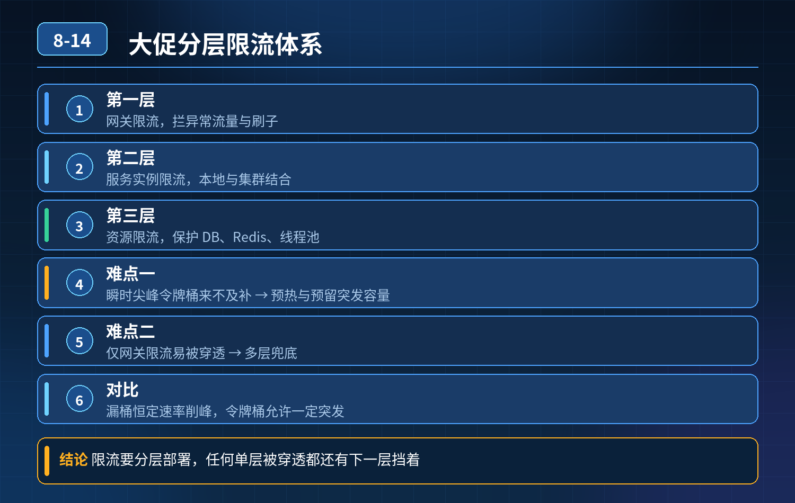 -->

## 第 15 题　网关+熔断+降级组合，大促流量暴涨后核心业务被限流、熔断无法恢复，页面大面积报错

### 问题 1：你做过微服务流量管控与服务防护吗？

<strong>候选人浅层回答：</strong> 网关统一拦截请求，熔断组件切断故障服务，搭配降级返回兜底数据，架构就能稳定运行。

### 连环追问

大促流量突增 4 倍，出现这些现象：网关转发瓶颈、请求排队；下游超时，熔断频繁触发且很难自动恢复；降级粗糙，核心、非核心业务一起被限制，核心功能不可用。

1. 网关如何实现流量分层、请求隔离？
2. 熔断怎么区分瞬时抖动和真正永久故障？
3. 降级策略怎么精准区分核心业务和非核心业务？
4. 故障恢复阶段，探活、恢复流量的渐进规则怎么设计？

### 参考答案

### 一、事故根因总结

简单的 “网关限流 + 熔断 + 降级” 是很容易踩坑的低配方案，这个故障本质是 4 个问题叠加：

1. 流量没有分层隔离：核心下单、支付流量和商品推荐、日志上报、后台查询等非核心流量混在一起；资源争抢，一压全部受限。
2. 网关自身没有做容量保护：网关本身也是服务，没有线程池隔离、排队超时、单机限流；网关队列堆积，请求在网关层就堵死，传导到下游。
3. 熔断策略只看失败率，不区分抖动和持续故障：瞬间流量冲击带来的少量超时就直接熔断；半开恢复机制不合理，探活流量、恢复节奏没有渐进控制，容易反复熔断（熔断震荡）。
4. 降级是全局一刀切：没有业务优先级，限流、降级规则不区分链路等级；资源紧张时优先牺牲的应该是非核心功能，而不是核心下单链路。

扩容加节点只是治标，流量峰值来临时，如果防护策略本身是错的，扩容只会让故障传导更广。

### 二、三层防御体系（网关层 → 服务调用层 → 业务降级层）

第一层：网关层：流量染色、分层隔离、网关自我保护网关是第一道闸门，同时网关本身要防被打挂：

1. 流量染色，按业务优先级分组 把请求划分等级：P0 核心链路（下单、支付、扣库存）、P1 重要链路（订单查询）、P2 非核心（推荐、统计、埋点、后台导出）。 独立线程池、独立限流配额；资源紧张时，优先丢弃、限制 P2 流量，保障 P0 流量配额。
2. 网关自身保护 设置网关连接数、排队队列上限、网关侧超时；队列满了直接拒绝低优先级流量，避免网关内部队列无限堆积。
3. 维度限流：按用户、渠道、接口、业务等级分开限流，而不是全局一个 QPS阈值。

第二层：服务间熔断：区分抖动 / 持续故障，渐进式半开探活熔断不能只简单统计失败率，要结合两个维度：慢调用比例 + 异常比例

1. 瞬时抖动（比如偶尔一个包超时）：短时间的少量失败，不触发熔断，依靠重试（有限次数、快速重试）消化；
2. 持续故障：连续一段时间失败 / 慢调用占比达到阈值，才进入熔断打开状态；
3. 半开恢复设计（重点解决无法自动恢复、反复熔断）： 熔断冷却期结束后，不是直接全量放开流量，只放一小部分试探流量；

- 探活成功：逐步放大流量，缓慢恢复，而不是一次性全开；
- 探活失败：立刻重回熔断状态，重置冷却时间； 同时配合超时、线程池 / 信号量隔离，避免单个慢依赖耗尽本服务线程。

第三层：业务降级：按优先级柔性兜底，禁止一刀切降级的核心原则：保核心，砍次要

4. 降级开关绑定业务等级：资源不足时，优先关闭 P2 非核心功能； 例：下单链路，下单、扣库存、支付是核心；商品推荐、积分通知、短信异步推送是可降级项。

5. 降级方式区分：

- 返回缓存兜底数据（商品详情）；
- 同步转异步：非强通知放到 MQ 后台处理；
- 直接静默丢弃埋点、统计流量；
- 友好提示，而不是统一 500 报错；

6. 拒绝 “一触发熔断，整个接口全部降级”，支持接口内部分段降级，保留核心逻辑。

### 三、补充配套机制

1. 超时分层：网关超时、Feign 调用超时、MQ 消费超时层层设置，上游超时 <下游超时，避免超时连锁嵌套；
2. 监控维度：不仅监控 QPS、异常率，还要监控排队长度、线程池使用率、半开状态、降级命中数；
3. 压测演练：压测时模拟流量突增、下游故障，验证熔断恢复、降级优先级是否符合预期；
4. 故障预案：支持动态调整优先级，紧急情况下可以一键关停全部非核心流量。

<strong>追问：</strong>本题考察核心是什么？

<strong>参考答案：</strong>普通开发只理解组件功能：网关限流、熔断、降级是三个独立功能。

高阶工程师理解故障是链式传导：

1. 网关本身存在瓶颈，网关也需要保护，网关不是无限转发的黑盒；
2. 熔断不是越快切断越好，要区分瞬时抖动和持续故障，防止雪崩震荡；
3. 降级的灵魂是业务优先级，防护的目标是保住核心链路可用；
4. 恢复比熔断更考验设计：流量恢复必须渐进、灰度试探，避免恢复瞬间再次打垮下游。

<strong>核心思想：</strong>流量防护不是简单加注解配规则，是一套分级隔离、优先保障核心、故障可切断、恢复可渐进的全链路风控体系。

<!-- 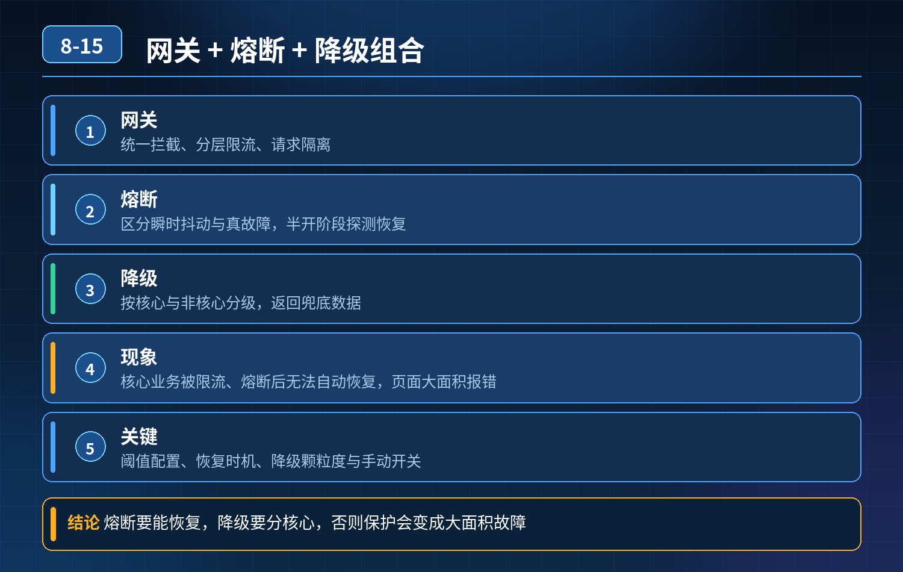 -->

## 第 16 题　微服务并发暴涨，服务雪崩、分布式数据不一致如何解决

### 问题 1：项目微服务化后并发量暴涨，出现服务雪崩、数据不一致，怎么解决？

<strong>候选人浅层回答：</strong> 用 Nacos 做注册中心，Seata 管理分布式事务，Sentinel加注解实现限流熔断。

### 连环追问

1. 限流阈值要怎么量化评估，凭感觉配置吗？
2. 熔断、降级策略怎么和业务逻辑联动，不是简单直接报错？
3. XA、TCC、SAGA、AT 模式的分布式事务分别适合什么场景，落地成本和风险是什么？
4. 全链路幂等怎么设计防止重复提交、重复回调？
5. 服务雪崩如何做多级兜底防护，只靠设置超时时间够不够？

### 参考答案

### 一、底层核心认知

微服务分布式环境下，网络不可靠、调用链变长、依赖变多。 超时、抖动、调用失败是常态；高可用不是消灭故障，而是故障发生时，控制爆炸范围、保障核心链路可用、保证数据最终一致。 只引入组件、加注解只是脚手架使用，没有理解背后的防护体系，很容易线上出重大故障。

### 二、三层核心体系：雪崩防护（限流 + 熔断 + 降级）、幂等防重、分布式事

务第一层：流量防护体系，防止雪崩（Sentinel 核心落地思路）

1. 限流：阈值量化，拒绝无效流量 阈值不能拍脑袋，基于压测结果、单机最大承载 QPS、机器数量、峰值预留水位来设置； 限流维度：接口维度、用户 ID、IP、来源渠道； 限流策略：直接拒绝、排队等待、漏桶 / 令牌桶； 区分核心接口和非核心接口：核心链路预留配额，非核心接口严格限流，不抢占资源。

2. 熔断：切断故障依赖，防止连锁阻塞 统计调用失败率、慢调用比例，超过阈值触发熔断；熔断后不再发起远程调用； 半开状态试探：熔断一段时间后放少量流量探测依赖是否恢复，恢复正常则关闭熔断。

3. 降级：业务友好兜底，不是一刀切报错 降级分多种方案，和业务绑定：

1. 静态兜底数据：商品详情、公告等返回缓存默认数据；

2. 关闭非强依赖的次要功能：比如下单时关闭推荐、积分通知；

3. 异步化：同步调用转为 MQ 异步处理，先给用户返回成功，后台慢慢消费；

4. 柔性提示：给用户友好提示，而不是 500 异常。

多级防护顺序：网关层粗限流 → 服务层细粒度限流熔断 → 内部降级兜底；超时时间只是最基础的底线，不能作为唯一手段。

配合线程池隔离、信号量隔离，避免一个慢依赖耗尽本服务线程资源。

5. 第二层：全链路幂等，解决重复调用问题分布式场景，重试、MQ 重复投递、前端重复提交、回调重复推送，都会造成重复扣库存、重复扣款；幂等是分布式一致性的基础。 常见实现方案：

1. 唯一业务单号（订单号、支付流水号）作为幂等 Key，数据库唯一索引；

2. 状态机控制：只允许状态正向流转，重复操作直接忽略；

3. 分布式幂等表 / Redis 记录处理标识；

4. MQ 消费端必须保证幂等。 原则：任何支持重试的接口，都必须做幂等。

第三层：分布式事务选型，解决数据一致性先记住选型核心：优先最终一致性，尽量不用强一致方案，业务能异步解耦就不用分布式事务。

- AT（Seata 默认）：无侵入，基于 undo_log；适合大多数 Java 业务；代价：全局锁，高并发场景容易锁等待，不适合超高并发扣减库存场景；
- TCC：Try-Confirm-Cancel，业务代码侵入强；性能高；适合资金、库存等高一致性要求的核心场景，开发成本高，需要处理空回滚、悬挂；
- SAGA：长事务、流程长的场景，比如订单履约、售后流程；本地事务 + 补偿，无全局锁；适合长链路业务；
- XA：数据库层面两阶段提交，强一致；性能差、数据库锁时间长，互联网业务极少使用。 落地建议： 简单业务优先 AT；资金库存核心场景 TCC；长履约流程 SAGA；能拆成 MQ 异步最终一致，优先 MQ。

### 三、整套链路的标准落地顺序

1. 网关：路由、全局限流、黑名单；
2. 服务间调用：Feign/Dubbo 配置合理超时、线程隔离、Sentinel 限流熔断；
3. 所有对外接口、MQ 消费者、回调接口：统一幂等；
4. 跨服务数据变更：评估一致性要求，选择对应的分布式事务方案；
5. 监控告警：QPS、失败率、慢调用、熔断状态、事务状态持续监控；
6. 预案：故障演练，验证降级、熔断、补偿脚本是否可用。

<strong>追问：</strong>本题考察核心是什么？

<strong>参考答案：</strong>初级开发只是会整合组件，知道 Sentinel、Seata 这些名字，只会复制注解。高阶后端要具备风险架构思维：

1. 分清各个组件解决什么问题、有什么代价、边界在哪里；
2. 限流阈值、熔断条件不是凭经验，要基于压测、容量水位量化；
3. 降级是业务层面的柔性设计，不是单纯抛出异常；
4. 理解不同分布式事务模型的取舍，明白强一致的性能代价，优先最终一致性；
5. 明白雪崩是链式传导，需要网关、服务、线程隔离、熔断降级多层防护；
6. 知道幂等是分布式一切重试机制的前提，没有幂等，重试就是灾难。

<strong>核心思想：</strong>微服务高可用，不是注册中心 + 分布式事务框架 + 限流组件的简单堆砌，而是一套流量管控、故障隔离、柔性降级、幂等保障、事务补偿的风险闭环体系。

<!-- 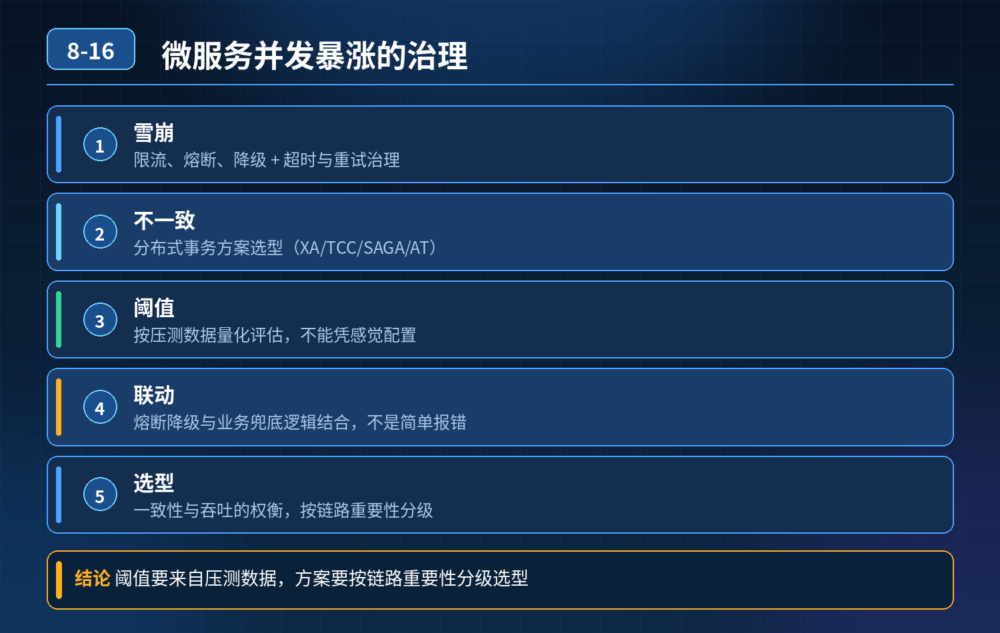 -->

## 第 17 题　A→B→C→D 链式调用，D 变慢导致 A、B、C 全部阻塞、集群雪崩，如何防范

### 问题 1：微服务调用链 A 调用 B，B 调用 C，C 调用 D；D 响应变慢，上游ABC 全部阻塞，集群崩溃，怎么避免雪崩？

<strong>候选人浅层回答：</strong> 使用 Hystrix 熔断器 + 服务降级就能防止雪崩。

### 连环追问

1. Hystrix 已经停止维护，现在主流方案是什么？
2. 线程池隔离和信号量隔离分别适合什么场景，怎么选择？
3. 熔断器参数如何合理配置？半开阶段如何安全恢复？
4. 只打开熔断器、使用默认配置，为什么线上依然会雪崩？

### 参考答案

事故根因链式同步调用是雪崩的高发场景：D 变慢 → C 的调用线程被持续占住、堆积耗尽 → B 调用 C 的线程耗尽 → A 调用 B 的线程耗尽。所有服务的工作线程被慢调用卡死，新请求进不来，整个链路瘫痪。 熔断只是其中一环，单纯配熔断、用默认参数，无法根治；核心是隔离，切断资源传染链路。 现在生产主流替代方案：Sentinel（阿里）、Resilience4j，Hystrix 早已停止维护，新项目不推荐。

四层防护体系（依赖治理、资源隔离、熔断降级、监控动态管控）第一层：依赖与调用链路治理（治本优先）

1. 尽量缩短同步长链路，同步改异步 A→B→C→D 这种串行长同步链路本身风险极高。非强实时场景，通过 MQ 异步解耦，打破同步等待链，从根源消除链式阻塞。
2. 依赖梳理，强弱依赖区分 区分强依赖（必须成功才能执行业务）、弱依赖（可降级，比如推荐、埋点、日志）。弱依赖直接做异步、优先降级，不要占用核心同步线程。
3. 合理设置逐级超时，上游超时 < 下游超时 超时是底线兜底。例如 D:200ms，C:300ms，B:400ms，A:500ms。防止上游等待时间比下游更长，请求层层堆积。

超时不能统一写一个很大的值。

第二层：资源隔离（雪崩最核心手段，区分线程池隔离 / 信号量隔离）隔离目标：一个慢依赖，只消耗它自己的配额，不侵占本服务其他接口、其他依赖的线程资源

- 线程池隔离（ThreadPool） 给每一个下游依赖分配独立线程池。调用 D 的请求走独立线程池，哪怕 D 拖慢、线程堆满，服务本身处理别的请求、别的依赖的线程不受影响。 适用：远程 HTTP/RPC 调用，IO 阻塞型调用；开销更大，有线程切换成本。
- 信号量隔离（Semaphore） 不新开线程，限制并发数量，复用服务本身线程；只控制并发上限。 适用：本地代码逻辑、内存计算、短耗时调用；Dubbo 默认常用信号量。

避坑：如果没有隔离，同一个服务所有接口共用一个线程池，只要一个下游变慢，整个服务直接堵死，熔断还没触发就已经挂了。

第三层：熔断、降级、重试策略精细化配置

4. 熔断统计维度：慢调用比例 + 异常比例，不只看报错；短时间少量超时抖动不轻易熔断。

5. 半开恢复机制（重点） 冷却结束进入半开，少量试探流量去访问 D：

- 探活成功：逐步放量，灰度恢复，不要一次性全开；
- 探活失败：立刻重回熔断，重置冷却窗口，防止反复震荡。

6. 重试管控：长链路禁止无限制重试；重试次数限制、间隔拉长，只对幂等接口重试；避免重试放大流量压垮 D。

7. 降级预案：熔断触发后返回兜底，而不是空等报错；弱依赖直接降级。

第四层：监控、动态规则、容量保护

1. 监控指标不只看报错：重点监控线程池队列堆积、等待时长、活跃并发、慢调用数量、半开状态；队列堆积是雪崩前置信号，早于熔断告警。
2. 规则动态推送：Sentinel 支持运行时动态调整限流、熔断阈值，故障时快速干预，不需要重启服务。
3. 全链路压测：模拟下游 D 缓慢、超时场景，验证隔离、熔断是否生效，检验默认参数是否扛得住峰值。

简单总结两者选型

- 外部远程调用、容易 IO 阻塞 → 优先线程池隔离，物理隔离资源，防护最强；
- 轻量本地逻辑、追求性能，能接受风险 → 信号量隔离。

<strong>追问：</strong>本题考察核心是什么？

<strong>参考答案：</strong>初级开发者只记住 “熔断器” 这个名词，把熔断当成雪崩的万能解药，不知道隔离才是第一道屏障，不懂隔离方案取舍，直接使用框架默认参数。高阶工程师理解：

1. 雪崩本质是资源耗尽、故障沿着调用链传染；熔断是止损，隔离是阻断传染；
2. 清楚 Hystrix 停更现状，了解业界主流组件；
3. 懂得线程池隔离、信号量隔离的适用边界、性能代价；
4. 理解半开恢复的灰度思想，知道恢复比熔断更容易二次踩坑；
5. 架构优先思路：优先缩短同步链路、异步解耦，防护组件只是兜底手段。

<strong>核心思想：</strong>防止链式雪崩，顺序是：缩短同步链路 → 资源隔离阻断传染 →合理超时 + 精细化熔断降级 → 监控动态应急，不是上来就加熔断器。

<!-- 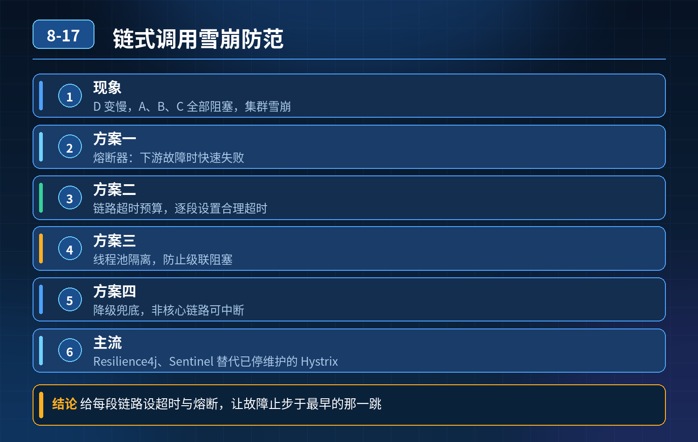 -->

