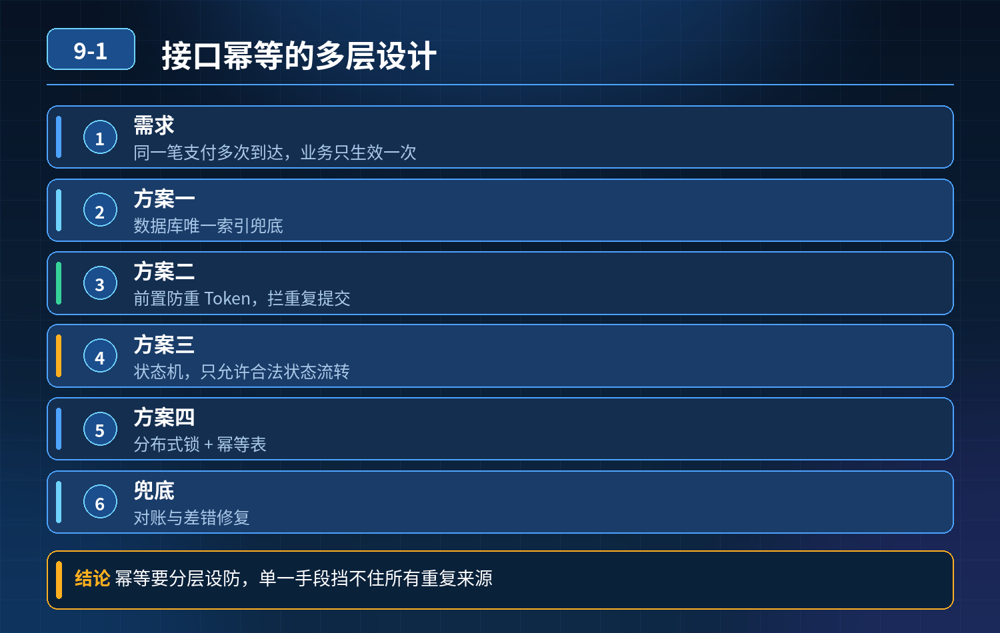

<div class="essay-image ">
    接口幂等性，支付场景防止重复扣款、重复下单
</div>

## 第 09-1 题　接口幂等性，支付场景防止重复扣款、重复下单

**候选人浅层回答：** 加唯一索引、用 token 过滤重复请求就够了。

## 核心拆解一句话结论

本题考察对底层原理和线上实战能力的综合理解，不能只停留在背结论。

## 连环追问

1. 前置防重 Token 方案，在分布式集群场景下有什么缺陷？如果 Token 校验成功后，业务执行中途服务宕机，前端重试会发生什么？
2. 数据库唯一索引做幂等，适合什么场景？有什么短板？
3. 基于状态机的幂等怎么落地，支付订单状态流转有哪些状态，如何防止状态被重复变更？
4. Redis 分布式锁做幂等，有什么坑？如何避免锁失效带来的重复执行？
5. MQ 消费重复消息（生产者重试、broker 重发），幂等该如何处理？
6. 支付这种资金场景，幂等需要哪些兜底校验和对账机制？

## 事故根源

简单的前置 token / 内存判断，只能拦截未进入业务的重复请求，无法保证「校验通过后，业务执行过程中断」的场景。

时序举例： ①第一次请求：校验 token 通过 → 开始执行扣款、生成流水；业务执行一半，服务宕机 / 网络返回超时；数据库订单状态更新成功，但响应没返回给前端。 ②前端看不到成功结果，重复提交相同请求。此时简单 token 可能已经失效，或者只做一次前置拦截，无法识别这笔已经执行成功的业务，再次执行扣款，产生多条流水，重复扣款。 本质：只做请求入口拦截，没有在业务写库这一层做幂等防护，无法覆盖执行中途异常重试场景。幂等的核心：同一个业务请求，无论调用多少次，业务结果只生效一次，不会产生多次数据变更。

三层幂等防御体系（支付 / 订单核心接口）第一层：前端 / 网关层，前置拦截（第一道防线，减轻后端压力，不能单独作为保障）

1\. 防重 Token 方案 下单前后端生成全局唯一 Token 返回前端；提交支付请求携带该 Token。后端收到请求，先删除 Redis 内这个 Token；删除成功才允许进入业务。

1\. 优点：在网关层拦截大部分重复点击，减少打到数据库的流量。

2\. 缺陷：Token 一旦删除，业务执行中途宕机，前端重试拿不到旧 Token，需要重新获取新 Token，会绕过拦截。所以 Token 只是前置防护，不能单独用来保障资金幂等。

2\. 前端按钮置灰，禁止重复点击；网关层基于请求指纹限流。

第二层：业务数据库层（核心防线，资金场景必须有）方案 A：业务流水号唯一索引（推荐支付场景）给业务唯一流水号（out_trade_no，我方生成的订单交易号）建立唯一索引。

- 每次支付请求，携带固定业务流水号；
- 插入交易流水表时，唯一索引冲突直接报错，不会新增多条流水；优势：数据库层面强约束，原子性，崩溃安全。 局限：只针对插入类幂等；更新场景不适用。

方案 B：订单状态机 + 乐观锁（订单状态流转首选）订单状态：待支付 → 支付中 → 已支付 → 已退款。 更新 SQL：

```sql
update order set status = 'PAID', version=version+1 where
order_no = #{orderNo} and status='WAIT_PAY' and version =
#{oldVersion};
```

- 只有状态为待支付的订单，才允许变更为已支付；
- 已经支付成功的订单，where 条件不命中，update 返回影响行数 0，不执行任何业务变更；
- version 版本号做乐观锁，防止并发同时更新。

重点：基于状态机的条件更新，是订单状态防重复变更最可靠手段，已经支付的订单，任何重复请求都不会再次执行扣款逻辑。

方案 C：分布式幂等表单独一张幂等记录表，主键是业务唯一流水号。 执行业务前，先尝试插入幂等记录；插入成功才执行业务；插入失败说明已处理，直接返回上次成功结果。

业务和幂等记录放在同一个数据库事务内，保证原子。

分布式锁（Redis）：可以用来做并发控制，但不能单独作为幂等最终保障。Redis 锁存在超时、主从切换丢锁风险，锁失效就会出现重复执行；锁只能控制并发，兜底必须依靠数据库约束。

第三层：异步、消息场景兜底 + 事后对账MQ 消费场景（生产者重试、Broker 自动重发会产生重复消息）：

- MQ 消息携带业务唯一流水号，消费前查幂等表，已处理直接跳过；
- 消费业务和幂等记录落库放在同一事务，保证 “业务执行 + 标记已处理” 原子。

资金场景兜底

1. 全链路日志：记录流水号、请求参数、时间、结果，方便排查；
2. 定时对账任务：我方交易流水和第三方支付平台流水定时对账，发现不一致自动告警，人工处理资损；
3. 补偿机制：出现异常状态，状态机驱动补偿 / 回滚，不依赖人工记忆。

不同方案选型

1. 新增流水类（支付交易记录）：唯一索引；
2. 订单状态变更：状态机 + 乐观锁条件更新；
3. MQ 消费、跨服务调用：幂等记录表 + 唯一业务号；
4. 前端防重复提交：Token（仅前置，不可单独兜底）。

## 面试高分话术

这个重复扣款事故根源是只做了入口层的前置防重拦截，没有在业务落库层建立幂等约束。当前一次支付请求业务执行成功、但是响应返回前端前服务宕机，前端重试提交，前置 Token 拦截失效，再次执行扣款，生成多条流水。前置 Token 只能减轻压力，不能单独保障资金类接口幂等。

核心接口幂等需要三层防御。第一层是网关和前端的前置防护，使用一次性 Token 拦截重复点击，减少无效请求打到业务层，但不能作为最终保障。 第二层是数据库层面的核心防护，也是资金场景必须落地的。支付流水使用业务交易号建立唯一索引，防止重复插入流水；订单状态流转使用状态机 + 乐观锁条件更新，只有待支付状态的订单才能变更为已支付，已经支付成功的订单，update 不会命中，不会重复执行扣款。也可以使用独立幂等表，业务执行和幂等标记放在同一个数据库事务内，保证原子性。

Redis 分布式锁可以做并发控制，但存在锁超时、主从切换丢锁风险，不能单独作为幂等兜底。

第三层是异步场景和事后兜底。MQ 消费重复消息，依靠业务唯一流水号 + 幂等表处理；支付场景还要定时和支付渠道对账，发现流水不一致及时告警，防止资损。

核心原则：幂等的最终保障必须落在数据库的原子约束上，任何内存、Redis 层面的方案，都只是辅助。

## 连环追问要点整理

1. 底层核心原理是什么？为什么这么设计？
2. 线上出现相关故障如何快速止损、定位根因？
3. 高并发场景下有哪些坑点，性能、一致性、可用性如何权衡？

## 代码示例

```sql
update order set status = 'PAID', version=version+1 where
order_no = #{orderNo} and status='WAIT_PAY' and version =
#{oldVersion};
```

## 面试回答完整话术

  - **一句话结论**：本题考察对底层原理和线上实战能力的综合理解，不能只停留在背结论。
  - **连环追问**：前置防重 Token 方案，在分布式集群场景下有什么缺陷？如果 Token 校验成功后，业务执行中途服务宕机，前端重试会发生什么？
  - **事故根源**：简单的前置 token / 内存判断，只能拦截未进入业务的重复请求，无法保证「校验通过后，业务执行过程中断」的场景。
  - **面试高分话术**：这个重复扣款事故根源是只做了入口层的前置防重拦截，没有在业务落库层建立幂等约束。当前一次支付请求业务执行成功、但是响应返回前端前服务宕机，前端重试提交，前置 Token 拦截失效，再次执行扣款，生成多
  - **收尾**：线上问题按「先止损保可用性 → 再定位根因 → 最后从架构规范层面根治」三段论闭环。

## 追问：本题考察核心是什么？

###  高级工程师要分清：

1. **不能只停留在背结论**：要能回答「为什么这样设计、不这样会怎样、线上踩坑怎么排查」；
2. **具备止损→定位→根治三段论**：先止血保业务，再定位根因，最后从架构与规范层面根治；
3. **给出工程取舍**：性能、一致性、可用性三者权衡，说清代价与适用场景。

  核心思想：这道题考察原理理解 + 线上实战 + 架构思维，真正的工程答案是「现象 → 根因 → 止损 → 定位 → 根治」五段式闭环。

<div class="img-wrap-left"></div>
