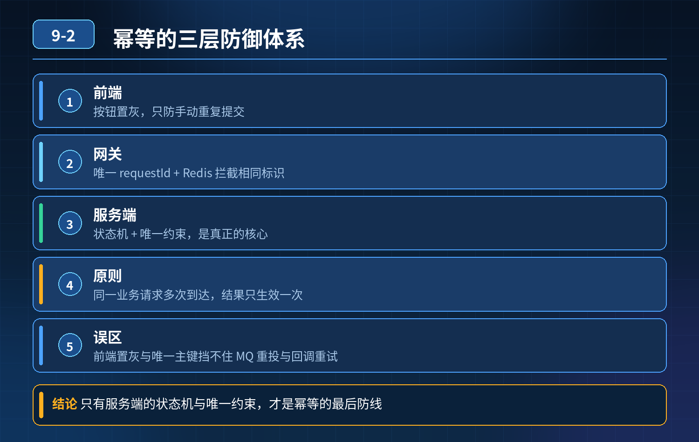

    接口幂等：前端置灰、唯一主键为什么挡不住 MQ 重复投递与回调重试？

## 第 09-2 题　接口幂等：前端置灰、唯一主键为什么挡不住 MQ 重复投递与回调重试？

**举例说明：**用户点击支付，前端置灰只挡住了重复点击；但支付渠道因为回调超时重试了三次，每次都新建一条交易流水，最终出现重复扣款。只有服务端用支付单号做唯一索引并配合状态机，才能真正拦住。

**候选人浅层回答：** 背诵表面结论，没有深入到原理和线上场景。

## 核心拆解一句话结论

本题考察对底层原理和线上实战能力的综合理解，不能只停留在背结论。

## 延伸追问

问：状态机和幂等表怎么选？ 答：订单这类有明确流转阶段的，优先状态机；没有状态、只是单纯不能重复新增记录的场景，用独立幂等表。

问：Redis 做幂等有什么坑？ 答：Redis 数据丢失、过期、主从切换丢标记，所以 Redis 只能做前置拦截，不能单独作为唯一幂等保障，数据库必须兜底。

## 连环追问要点整理

1. 底层核心原理是什么？为什么这么设计？
2. 线上出现相关故障如何快速止损、定位根因？
3. 高并发场景下有哪些坑点，性能、一致性、可用性如何权衡？

## 面试回答完整话术

  - **场景举例**：用户点击支付，前端置灰只挡住了重复点击；但支付渠道因为回调超时重试了三次，每次都新建一条交易流水，最终出现重复扣款。只有服务端用支付单号做唯一索引并配合状态机，才能真正拦住。
  - **一句话结论**：本题考察对底层原理和线上实战能力的综合理解，不能只停留在背结论。
  - **延伸追问**：问：状态机和幂等表怎么选？ 答：订单这类有明确流转阶段的，优先状态机；没有状态、只是单纯不能重复新增记录的场景，用独立幂等表。
  - **收尾**：线上问题按「先止损保可用性 → 再定位根因 → 最后从架构规范层面根治」三段论闭环。

## 追问：本题考察核心是什么？

###  高级工程师要分清：

1. **不能只停留在背结论**：要能回答「为什么这样设计、不这样会怎样、线上踩坑怎么排查」；
2. **具备止损→定位→根治三段论**：先止血保业务，再定位根因，最后从架构与规范层面根治；
3. **给出工程取舍**：性能、一致性、可用性三者权衡，说清代价与适用场景。

  核心思想：这道题考察原理理解 + 线上实战 + 架构思维，真正的工程答案是「现象 → 根因 → 止损 → 定位 → 根治」五段式闭环。

