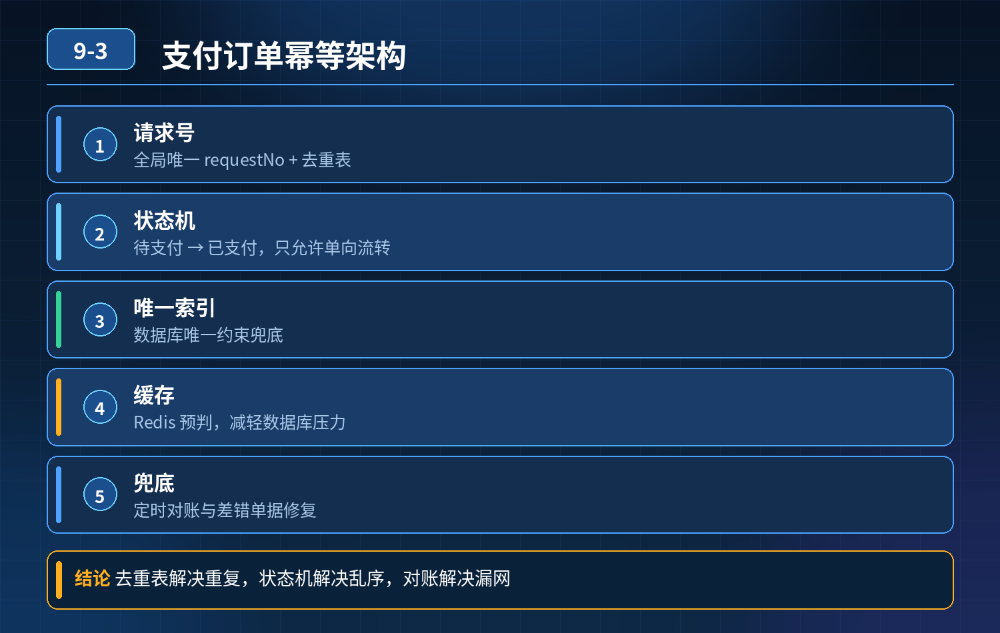

    支付订单幂等性架构设计

## 第 09-3 题　支付订单幂等性架构设计

**候选人浅层回答：** 背诵表面结论，没有深入到原理和线上场景。

## 核心拆解一句话结论

本题考察对底层原理和线上实战能力的综合理解，不能只停留在背结论。

## 场景复盘

重复来源：前端重复提交、接口超时重试、MQ 重复消费；候选人只知道单独建一张去重表 + 唯一索引，但是回答不了一系列硬核问题：高并发锁竞争、去重表数据膨胀清理、MQ 消费查库性能差、订单状态流转幂等、多方案取舍、故障兜底、网关层拦截。

核心认知：幂等不是只有「去重表唯一索引」一种；要分层、多方案组合，区分场景，同时做全链路防护，并且要有兜底补偿，不能单靠一张去重表扛所有流量。

## 三层高分逻辑

第一层：多种幂等方案选型，清楚各自适用场景与缺陷

1\. 唯一请求号 + 去重表（分布式 ID/requestNo） 适合大部分写接口。请求携带全局唯一请求号，先插入幂等记录；唯一索引保证只有一条成功。

1\. 缺点：高并发插入存在锁竞争；表会持续膨胀，需要按 TTL 定时归档清理历史数据；每次都要写库，MQ 大批量消费场景下性能压力大。

2\. 优化：前置 Redis（分布式锁 + 幂等标记）做热拦截，Redis 命中直接返回，减少 DB 访问；Redis 只存短期记录，过期自动淘汰。

2\. 状态机幂等（订单状态流转）【支付订单首选】 订单本身有状态：待支付→已支付→已发货。更新时带上状态条件：update order set status=已支付 where id=xxx and status=待支付。 天然幂等，不需要额外去重表；重复支付请求过来，订单已经不是待支付，更新行数为 0，直接返回成功。

1\. 局限：只适合有明确状态流转的业务，单纯无状态写操作不适用。

2\. 乐观锁（version 版本号） 更新携带版本号，版本不匹配更新失败；适合并发更新资源，防止覆盖，不是通用防重复。

3\. 前端防重 Token + 网关层拦截 前端提交前拿一次性 Token，网关校验 Token，消费后失效；只能挡用户手动重复点击，挡不住网络重传、下游重试、MQ 重复消息，只能作为前置辅助手段，不能当作唯一幂等方案。

第二层：分流量场景优化，解决性能痛点

1. MQ 消费场景：优先 Redis 做幂等标记（requestId 作为 key，设置过期时间），先查 Redis，命中直接跳过消费；Redis 兜底失败再落库去重表，大幅降低 DB 压力；
2. 高并发写：Redis 预拦截，减少 DB 唯一索引冲突报错；避免大量并发插入同一去重区间带来的行锁竞争；
3. 去重表治理：设置 TTL，定时归档、清理数月前的历史幂等记录，防止表越来越大，索引性能衰减；
4. 区分读 / 写接口：读接口天然幂等，不需要额外处理；有资金变更、下单这类副作用写接口强制幂等。

第三层：兜底与故障防护（幂等机制失效时的最后防线）

1. 对账补偿：定时对账任务，比对订单、支付流水，发现重复扣款、重复下单的数据，自动冲正或者人工告警；这是支付系统的底线；
2. 降级预案：如果 Redis、幂等去重表不可用，核心链路可以切换为状态机条件更新兜底（依托业务主表本身，不依赖独立去重表）；
3. 监控：监控唯一索引冲突数、重复请求量、MQ 重复消费告警，提前发现异常流量。

- 30

## 秒口述标准答案

幂等不能只依赖去重表唯一索引，要多方案搭配。第一层根据业务选型：有状态流转的订单支付优先使用状态机条件更新，自带幂等；通用接口使用唯一请求号，搭配 Redis 前置拦截减轻数据库压力；乐观锁适合防并发覆盖，前端 Token 和网关拦截只能辅助挡住用户重复点击，挡不住网络重传和 MQ 重复。

第二层做性能优化，MQ 消费优先走 Redis 短周期标记，去重表按 TTL 归档清理，控制锁竞争和数据膨胀。第三层兜底，依赖定时对账流水核对，就算幂等组件故障，也能及时发现脏数据、做资金冲正，保证支付订单不会重复扣钱。

## 高频延伸追问

Q：Redis 宕机，Redis 幂等标记丢了怎么办？ A：Redis 只是热拦截，最终的判定还是 DB 去重表或者订单状态；Redis 丢失会降级到查库，性能下降，但不会破坏正确性。 Q：状态机幂等和去重表幂等怎么选？ A：订单、支付这种自带状态流转的优先状态机，少一张表，性能更好；无状态、一次性的业务操作用 requestNo + 去重表。 Q：唯一索引冲突报错，直接抛异常给前端体验很差怎么处理？ A：捕获唯一索引异常，先查询这条 requestNo 对应的业务结果，查到已成功，直接返回上次成功结果，对外屏蔽报错。

## 连环追问要点整理

1. 底层核心原理是什么？为什么这么设计？
2. 线上出现相关故障如何快速止损、定位根因？
3. 高并发场景下有哪些坑点，性能、一致性、可用性如何权衡？

## 面试回答完整话术

  - **一句话结论**：本题考察对底层原理和线上实战能力的综合理解，不能只停留在背结论。
  - **场景复盘**：核心认知：幂等不是只有「去重表唯一索引」一种；要分层、多方案组合，区分场景，同时做全链路防护，并且要有兜底补偿，不能单靠一张去重表扛所有流量。
  - **三层高分逻辑**：第一层：多种幂等方案选型，清楚各自适用场景与缺陷
  - **秒口述标准答案**：幂等不能只依赖去重表唯一索引，要多方案搭配。第一层根据业务选型：有状态流转的订单支付优先使用状态机条件更新，自带幂等；通用接口使用唯一请求号，搭配 Redis 前置拦截减轻数据库压力；乐观锁适合防并发
  - **高频延伸追问**：Q：Redis 宕机，Redis 幂等标记丢了怎么办？ A：Redis 只是热拦截，最终的判定还是 DB 去重表或者订单状态；Redis 丢失会降级到查库，性能下降，但不会破坏正确性。 Q：状态机幂等
  - **收尾**：线上问题按「先止损保可用性 → 再定位根因 → 最后从架构规范层面根治」三段论闭环。

## 追问：本题考察核心是什么？

###  高级工程师要分清：

1. **不能只停留在背结论**：要能回答「为什么这样设计、不这样会怎样、线上踩坑怎么排查」；
2. **具备止损→定位→根治三段论**：先止血保业务，再定位根因，最后从架构与规范层面根治；
3. **给出工程取舍**：性能、一致性、可用性三者权衡，说清代价与适用场景。

  核心思想：这道题考察原理理解 + 线上实战 + 架构思维，真正的工程答案是「现象 → 根因 → 止损 → 定位 → 根治」五段式闭环。

