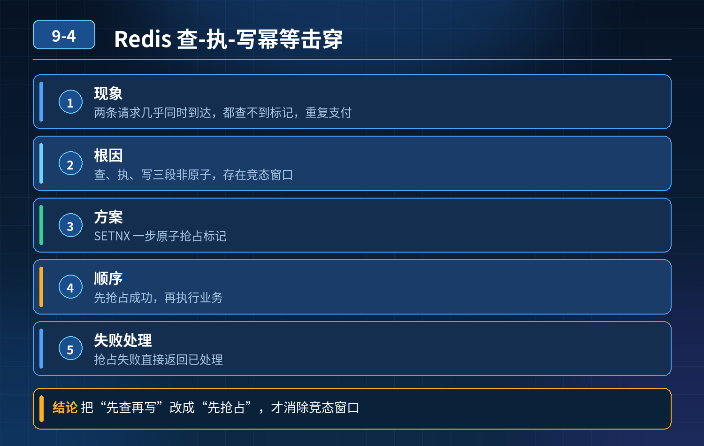

    Redis 查-执-写幂等击穿（并发重复支付事故）

## 第 09-4 题　Redis 查-执-写幂等击穿（并发重复支付事故）

**候选人浅层回答：** 背诵表面结论，没有深入到原理和线上场景。

## 核心拆解一句话结论

本题考察对底层原理和线上实战能力的综合理解，不能只停留在背结论。

## 场景复盘

实现方案：同一个支付流水号，先查 Redis，无标记则执行业务，执行完成再写入 Redis 过期标记。 现象：两条请求几乎同时到达（间隔 \< 10ms），Redis 集群正常，事后单独重试又可以正常拦截，但并发下两次支付逻辑全部执行成功，出现重复扣款。

根因本质：查 Redis、执行业务、写 Redis 是三段独立操作，没有原子性，存在竞态窗口（TOCTOU 问题：Check Then Operate）。两个并发线程几乎同时查询 Redis，都查到标记不存在，双双进入支付业务逻辑，之后各自写入 Redis 标记。标记最后确实存在，但业务逻辑已经跑了两遍。这就是最经典的幂等击穿。

三层高分防御体系第一层：把 Redis 的操作改成原子抢占，消灭竞态窗口不能分开 GET -\> 执行业务 -\> SET；要用 Redis 原子命令抢占锁 / 抢占标记：

1\. 推荐 SETNX（set if not exist） 或者 SET key value NX EXexpireTime。

1\. 逻辑：请求进来，一步原子抢占标记；抢占成功，才允许往下走支付逻辑；抢占失败直接返回已处理。

2\. 重点：先抢占成功，再执行业务；而不是先查再执后写，消除中间的时间间隙。

2\. 注意区分：这个 NX 只是前置拦截，Redis 依然不能作为唯一可信数据源，Redis 宕机、主从切换丢数据都会失效。

- ❌
- 错误时序：GET → 判断不存在 → 执行业务 → SET 正确时序：SET NX，成功才执行业务第二层：业务层的数据库刚性兜底（资金链路不可省略）Redis 只是高速前置拦截，绝对不能替代数据库的最终约束，两层防护：

1. 支付流水表，给支付流水号建立唯一索引；数据库是最终可信源。就算 Redis击穿、Redis 丢标记，数据库唯一索引会拦截第二条写入，抛出唯一冲突，阻止生成第二条支付流水，守住资损底线。
2. 更进一步，订单状态机约束：update order set status=已支付 whereorder_id=xx and status=待支付；利用状态条件做乐观约束，就算流水号被绕过，也不允许订单重复流转到已支付。

第三层：故障兜底、监控和补偿，应对 Redis 本身的风险

1. Redis 风险：主从异步复制、主从切换、网络分区、过期淘汰，都可能导致标记丢失。Redis 只做高性能前置拦截，降级后落到数据库校验；
2. 监控：监控 Redis NX 抢占失败量、数据库唯一索引冲突异常，并发击穿的时候会有尖峰，提前告警；
3. 定时对账补偿：支付、订单、账户流水定时对账，是资金系统最后一道防线；就算前面两层全部失效，对账也能发现重复扣款，执行退款冲正。

- 30

## 秒口述标准答案

这个事故是典型的 TOCTOU 检查后执行竞态问题：分开的查 Redis、执行业务、写 Redis 不是原子操作，两个并发请求同时查到无标记，双双执行业务，造成幂等击穿。修复分三层：第一层把 Redis 改成 SET NX 原子抢占，抢占成功才执行业务，消除并发窗口；第二层数据库支付流水号加唯一索引，搭配订单状态机条件更新，作为刚性兜底；第三层 Redis 只做前置高性能拦截，不能作为唯一数据源，配合冲突监控和定时对账，防止 Redis 主从切换、标记丢失带来资损。

## 高频延伸追问

Q：SET NX 成功之后，如果支付逻辑执行到一半服务宕机，Redis 标记已经打上，业务没成功，会不会导致这笔支付永远无法重试？ A：这是另外一个经典坑。两种方案： 方案 1：用分布式锁 + 看门狗续期，业务完成后主动删除 key； 方案 2：状态标记分阶段，Redis 标记区分【处理中 / 成功】，设置合理过期时间；业务失败时主动清理 Redis 标记，允许重试；数据库流水表记录业务最终状态，以 DB 为准。

Q：为什么压测没测出来？ A：压测很多是串行或者错开的请求；只有同一个流水号极短时间双发才会触发这个窗口，场景很难构造，大促流量随机并发才暴露。

Q：能不能用 Lua 脚本？ A：可以，Lua 脚本保证查询 + 标记设置在 Redis侧原子执行，也是可选方案；SET NX 更简单通用。

## 连环追问要点整理

1. 底层核心原理是什么？为什么这么设计？
2. 线上出现相关故障如何快速止损、定位根因？
3. 高并发场景下有哪些坑点，性能、一致性、可用性如何权衡？

## 面试回答完整话术

  - **一句话结论**：本题考察对底层原理和线上实战能力的综合理解，不能只停留在背结论。
  - **场景复盘**：实现方案：同一个支付流水号，先查 Redis，无标记则执行业务，执行完成再写入 Redis 过期标记。 现象：两条请求几乎同时到达（间隔 \< 10ms），Redis 集群正常，事后单独重试又可以正常
  - **秒口述标准答案**：这个事故是典型的 TOCTOU 检查后执行竞态问题：分开的查 Redis、执行业务、写 Redis 不是原子操作，两个并发请求同时查到无标记，双双执行业务，造成幂等击穿。修复分三层：第一层把 Redi
  - **高频延伸追问**：Q：SET NX 成功之后，如果支付逻辑执行到一半服务宕机，Redis 标记已经打上，业务没成功，会不会导致这笔支付永远无法重试？ A：这是另外一个经典坑。两种方案： 方案 1：用分布式锁 + 看门狗
  - **收尾**：线上问题按「先止损保可用性 → 再定位根因 → 最后从架构规范层面根治」三段论闭环。

## 追问：本题考察核心是什么？

###  高级工程师要分清：

1. **不能只停留在背结论**：要能回答「为什么这样设计、不这样会怎样、线上踩坑怎么排查」；
2. **具备止损→定位→根治三段论**：先止血保业务，再定位根因，最后从架构与规范层面根治；
3. **给出工程取舍**：性能、一致性、可用性三者权衡，说清代价与适用场景。

  核心思想：这道题考察原理理解 + 线上实战 + 架构思维，真正的工程答案是「现象 → 根因 → 止损 → 定位 → 根治」五段式闭环。

