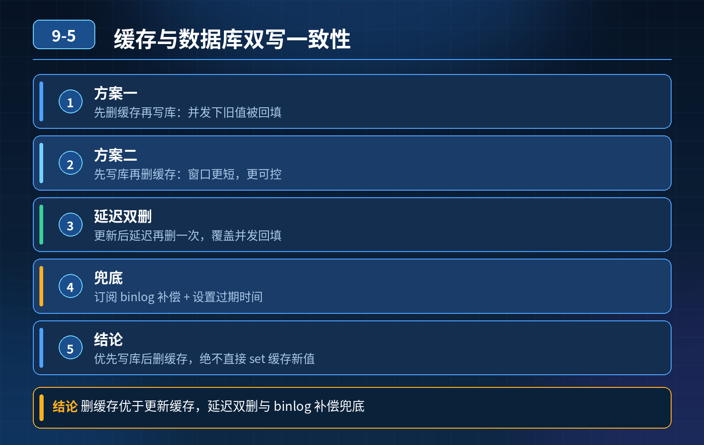

    Redis 和数据库双写怎么保证一致？

## 第 09-5 题　Redis 和数据库双写怎么保证一致？

**举例说明：**线程 A 先删缓存但还没写库，线程 B 此时查询读到旧库存并回填缓存，随后 A 才写库。结果数据库库存已是 0，缓存里仍是 10，用户看到有货、点进去却下不了单。

**候选人浅层回答：** 先删缓存再写数据库；或者先写数据库再删缓存。

## 核心拆解一句话结论

本题考察对底层原理和线上实战能力的综合理解，不能只停留在背结论。

## 连环追问

场景：商品库存缓存，线程 A 先删缓存，还没来得及写库；线程 B 查询，把旧的数据库数据加载回缓存；A 再写库。最终 DB 库存是 0，Redis 残留旧库存，引发超卖。

1. 先删缓存再写库为什么会出现这个不一致场景？
2. 那换成先写数据库，再删缓存还会有问题吗？
3. 怎么解决这个不一致？难道直接弃用缓存，所有请求直连数据库？

## 一、两种基础方案的缺陷

1. 方案 1：先删缓存 → 再写数据库（失效，就是题目里的事故场景） 时序：

- 线程 A：删除缓存 key
- 线程 B：查询，缓存 miss，读取 DB 旧数据，回写到 Redis
- 线程 A：写入新数据到 DB 结果：DB 是新值，Redis 是旧值，永久不一致，库存超卖。

这个并发漏洞是天然存在，大促高并发下极易触发。

2\. 方案 2：先写数据库 → 再删缓存（工业界主流基础方案，不是绝对完美，只是概率低很多） 正常时序：写 DB 成功 → 删除缓存；下次查询缓存 miss，从 DB 加载最新数据。 漏洞（极低概率）：

- 线程 A 查询，缓存刚好过期，准备从 DB 读数据
- 线程 B 更新，写 DB 成功，删除缓存
- 线程 A 拿到旧 DB 数据，写回 Redis 也会不一致，但发生条件苛刻：查询操作耗时 \> 更新事务耗时，业务场景出现概率很低。

结论：优先选「先写 DB，后删缓存」，而不是先删缓存。但这两个方案都只能做到最终一致性，无法做到强一致。

## 二、配套兜底方案（三层防御，生产必备）

1. 主流程：先更新数据库，再删除缓存 写操作优先落地数据库，再失效缓存。
2. 删除缓存失败兜底：消息队列重试 删除缓存如果网络异常失败，发送消息到MQ，异步重试删除；多次失败可以人工告警。
3. 定时全量校对（兜底修复脏数据） 定时任务，遍历核心商品，比对 DB 与Redis 数据，不一致则直接刷新缓存。解决前面极低概率的并发脏数据，也处理缓存删除丢失、Redis 宕机等异常。
4. 库存这类强约束场景：不能只依赖缓存做扣减 库存扣减的判断基准必须是数据库。Redis 库存仅作为流量前置拦截，最终扣减、扣减校验以数据库事务为准。

缓存脏了最多是多放行少量请求，数据库层一定要有库存大于 0 的锁校验，防止超卖。

这就是案例事故的核心根源：业务直接信任 Redis 缓存里的库存数值，拿缓存值作为扣减依据。

## 三、能不能做到强一致性？

8\. 分布式场景下，DB+Redis 两套独立存储，无法简单做到强一致性。 想要强一致，不能同时用两套存储做读写，只能：

- 方案 A：不用缓存，全部请求直连数据库（性能差，大促扛不住）
- 方案 B：使用分布式事务（代价极高，性能差，业务很少用）业务上绝大多数场景接受最终一致性，使用「先写 DB，后删缓存 + MQ 重试 + 定时校对」。

<strong>追问：</strong>本题考察核心是什么？

<strong>参考答案：</strong> 初级开发只会背两种顺序，不知道并发时序漏洞，分不清两种方案风险差异。 高级工程师要理解：

1. 明白「先删缓存再写 DB」高并发下极易出现脏读回填，不适合高并发场景；
2. 清楚「先写库后删缓存」依然存在理论上的漏洞，只是概率更低；
3. 区分：缓存架构一般追求最终一致性，强一致会牺牲巨大性能；
4. 核心认知：库存这类场景，数据库才是可信数据源，缓存只是前置优化，不能作为最终扣减判断依据；缓存脏了，数据库必须兜底防超卖。

<strong>核心思想：</strong>缓存更新策略不能只看正常流程，要思考并发时序异常；缓存只能加速查询，不能替代数据库作为数据真值。

## 连环追问要点整理

1. 底层核心原理是什么？为什么这么设计？
2. 线上出现相关故障如何快速止损、定位根因？
3. 高并发场景下有哪些坑点，性能、一致性、可用性如何权衡？

## 面试回答完整话术

  - **场景举例**：线程 A 先删缓存但还没写库，线程 B 此时查询读到旧库存并回填缓存，随后 A 才写库。结果数据库库存已是 0，缓存里仍是 10，用户看到有货、点进去却下不了单。
  - **一句话结论**：本题考察对底层原理和线上实战能力的综合理解，不能只停留在背结论。
  - **连环追问**：场景：商品库存缓存，线程 A 先删缓存，还没来得及写库；线程 B 查询，把旧的数据库数据加载回缓存；A 再写库。最终 DB 库存是 0，Redis 残留旧库存，引发超卖。
  - **一、两种基础方案的缺陷**：方案 1：先删缓存 → 再写数据库（失效，就是题目里的事故场景） 时序：
  - **二、配套兜底方案（三层防御，生产必备）**：主流程：先更新数据库，再删除缓存 写操作优先落地数据库，再失效缓存。
  - **三、能不能做到强一致性？**：8\. 分布式场景下，DB+Redis 两套独立存储，无法简单做到强一致性。 想要强一致，不能同时用两套存储做读写，只能：
  - **收尾**：线上问题按「先止损保可用性 → 再定位根因 → 最后从架构规范层面根治」三段论闭环。

## 追问：本题考察核心是什么？

###  高级工程师要分清：

1. **不能只停留在背结论**：要能回答「为什么这样设计、不这样会怎样、线上踩坑怎么排查」；
2. **具备止损→定位→根治三段论**：先止血保业务，再定位根因，最后从架构与规范层面根治；
3. **给出工程取舍**：性能、一致性、可用性三者权衡，说清代价与适用场景。

  核心思想：这道题考察原理理解 + 线上实战 + 架构思维，真正的工程答案是「现象 → 根因 → 止损 → 定位 → 根治」五段式闭环。

