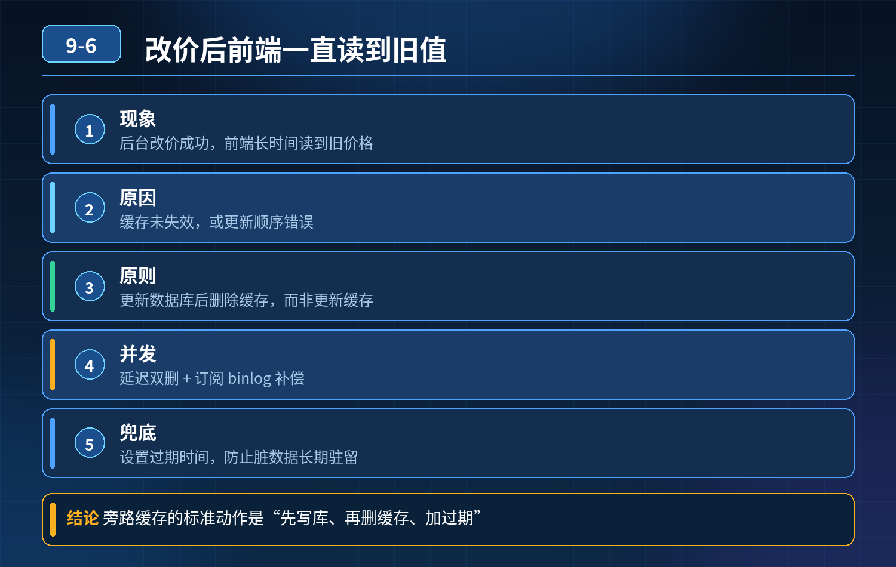

    Redis 缓存和数据库配合，常规流程：先查缓存，miss 查库，回写缓存。运营后台修改商品价格，数据库更新成功

## 第 09-6 题　Redis 缓存和数据库配合，常规流程：先查缓存，miss 查库，回写缓存。运营后台修改商品价格，数据库更新成功

**候选人浅层回答：** 更新缓存不及时，每次更新直接写新值进 Redis。

## 核心拆解一句话结论

本题考察对底层原理和线上实战能力的综合理解，不能只停留在背结论。

## 连环追问

1. 如果更新时直接主动 set 新值到缓存，会存在什么并发问题？
2. 优先选「更新数据库后删除缓存」而不是更新缓存，为什么？
3. 只靠主流程还存在极低概率不一致，配套兜底怎么做？

## 一、事故根因

采用更新数据库之后，没有处理缓存，旧的缓存 key 还留在 Redis，过期时间还没到。用户查询直接命中缓存，读取到 199 旧数据，不会访问数据库。

很多新手只实现了读流程（查缓存→miss 查库→回写缓存），写流程完全没设计缓存失效逻辑，更新数据库之后不去清理缓存，旧缓存一直存活。

## 二、两种写缓存方案对比

方案 A：更新数据库，同时直接更新缓存（主动 set 新值）不推荐作为首选。 并发问题： 线程 A 更新 DB 为 99，准备写缓存； 线程 B 更新 DB 为 89，写缓存； 网络时序颠倒，B 的缓存写入先完成，A 后写入。

数据库最终是 89，但缓存被 A 覆盖写成 99，永久脏数据。

并发更新场景，直接更新缓存容易发生写覆盖。

方案 B：先更新数据库，成功之后删除缓存 key（失效缓存）（工业界主流）原理：不主动把新数据塞缓存，直接删掉旧缓存。下一次用户查询缓存 miss，自动从数据库加载最新数据写回缓存。

- 规避多线程并发更新导致的缓存覆盖问题；
- 缺点：存在极低概率不一致场景：查询线程刚好在缓存过期瞬间读到旧 DB 数据，回写缓存，但是发生条件苛刻，业务大多可接受。
- ❌ 不要用：先删缓存，再写数据库，高并发极易出现前面讲的脏读回填。

## 三、三层防护完整方案

1. 主流程：写操作【先更新数据库，成功再删除缓存】 数据库事务提交成功之后，执行删除缓存。如果删除缓存失败（网络抖动、Redis 短暂不可达），进入重试机制。
2. 失败兜底：MQ 异步重试删除 删除缓存失败时，发送消息到 MQ，异步重试删除缓存；设置重试次数上限，超过阈值触发告警人工介入。解决瞬时网络异常导致缓存删不掉的情况。
3. 兜底校对：定时任务校对数据 针对商品价格这类敏感数据，定时任务批量比对数据库和缓存，发现不一致直接刷新缓存。用于修复极低概率并发脏数据，也能处理 MQ 消息丢失等极端情况。

## 四、特殊场景区分

1\. 普通商品详情（最终一致性，可短暂容忍延迟）：采用上面这套「先写库，后

2\. 删缓存 + MQ 重试 + 定时校对」。

2\. 价格、库存这类强敏感业务： 不建议完全依赖缓存展示作为最终判断依据；下单扣减、价格校验以数据库为准，缓存只做页面展示加速，就算缓存短暂脏，核心交易逻辑以数据库真值为准。

3\. 如果业务完全不能容忍任何短暂不一致： 不能使用这套缓存方案，要么不使用缓存全部直连 DB；或者使用分布式事务，代价很高，性能差，一般业务不会选用。

<strong>追问：</strong>本题考察核心是什么？

<strong>参考答案：</strong> 初级开发只会写读缓存逻辑，忽略写流程，以为缓存只是查询加速。

高级工程师要理解：

1. 缓存架构是读 + 写双流程，只做读流程，更新数据后不清理缓存，一定会读到旧数据；
2. 区分「更新缓存」和「删除缓存」两种方案，明白直接更新缓存存在写覆盖的并发缺陷；
3. 懂得主流程 + 异步重试 + 定时校对的多层兜底，理解缓存只能做到最终一致性；
4. 业务层面分清：页面展示可以接受短暂最终一致，核心交易逻辑必须以数据库为准，不能信任缓存。

<strong>核心思想：</strong>缓存更新不要去更新 value，优先失效 key；缓存是查询加速层，数据真值永远保存在数据库，同时要有多层兜底机制处理各种异常。

## 连环追问要点整理

1. 底层核心原理是什么？为什么这么设计？
2. 线上出现相关故障如何快速止损、定位根因？
3. 高并发场景下有哪些坑点，性能、一致性、可用性如何权衡？

## 面试回答完整话术

  - **一句话结论**：本题考察对底层原理和线上实战能力的综合理解，不能只停留在背结论。
  - **连环追问**：如果更新时直接主动 set 新值到缓存，会存在什么并发问题？
  - **一、事故根因**：采用更新数据库之后，没有处理缓存，旧的缓存 key 还留在 Redis，过期时间还没到。用户查询直接命中缓存，读取到 199 旧数据，不会访问数据库。
  - **二、两种写缓存方案对比**：方案 A：更新数据库，同时直接更新缓存（主动 set 新值）不推荐作为首选。 并发问题： 线程 A 更新 DB 为 99，准备写缓存； 线程 B 更新 DB 为 89，写缓存； 网络时序颠倒，B 的缓
  - **三、三层防护完整方案**：主流程：写操作【先更新数据库，成功再删除缓存】 数据库事务提交成功之后，执行删除缓存。如果删除缓存失败（网络抖动、Redis 短暂不可达），进入重试机制。
  - **四、特殊场景区分**：1\. 普通商品详情（最终一致性，可短暂容忍延迟）：采用上面这套「先写库，后
  - **收尾**：线上问题按「先止损保可用性 → 再定位根因 → 最后从架构规范层面根治」三段论闭环。

## 追问：本题考察核心是什么？

###  高级工程师要分清：

1. **不能只停留在背结论**：要能回答「为什么这样设计、不这样会怎样、线上踩坑怎么排查」；
2. **具备止损→定位→根治三段论**：先止血保业务，再定位根因，最后从架构与规范层面根治；
3. **给出工程取舍**：性能、一致性、可用性三者权衡，说清代价与适用场景。

  核心思想：这道题考察原理理解 + 线上实战 + 架构思维，真正的工程答案是「现象 → 根因 → 止损 → 定位 → 根治」五段式闭环。

