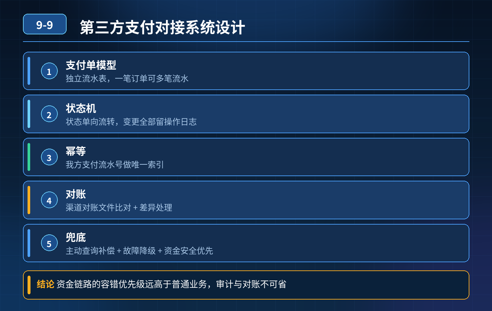

    第三方支付对接系统设计（P7 面试题）

## 第 09-9 题　第三方支付对接系统设计（P7 面试题）

**候选人浅层回答：** 背诵表面结论，没有深入到原理和线上场景。

## 核心拆解一句话结论

支付单模型 & 状态机（根基）不能直接拿订单去对接支付，独立支付流水表（payment_record），一笔订单可以有多笔支付流水（多次支付、补付）。

## 高频追问

Q：回调接口为什么一定要快速返回？ A：渠道有超时，超时会无限重试；我们业务逻辑（改订单、发消息）放到 MQ 异步，回调接口只做验签、幂等判断、入库，快速返回成功。 Q：支付成功消息丢了怎么办？ A：轮询会发现状态成功但下游未处理，对账环节也会识别单边账，人工或者补偿任务修复。 Q：金额校验为什么很重要？ A：防止攻击者篡改回调参数，把 100 元改成 0.01 元，必须比对回调里的金额和本地支付流水预存金额。 Q：支付超时关闭，是渠道关还是我方关？ A：两边配合，我方设置有效期，到期主动关单；同时轮询确认渠道真实状态，避免单方面关单和渠道不一致。

## 连环追问要点整理

1. 底层核心原理是什么？为什么这么设计？
2. 线上出现相关故障如何快速止损、定位根因？
3. 高并发场景下有哪些坑点，性能、一致性、可用性如何权衡？

## 面试回答完整话术

  - **一句话结论**：支付单模型 & 状态机（根基）不能直接拿订单去对接支付，独立支付流水表（payment_record），一笔订单可以有多笔支付流水（多次支付、补付）。
  - **高频追问**：Q：回调接口为什么一定要快速返回？ A：渠道有超时，超时会无限重试；我们业务逻辑（改订单、发消息）放到 MQ 异步，回调接口只做验签、幂等判断、入库，快速返回成功。 Q：支付成功消息丢了怎么办？ A：
  - **收尾**：线上问题按「先止损保可用性 → 再定位根因 → 最后从架构规范层面根治」三段论闭环。

## 追问：本题考察核心是什么？

###  高级工程师要分清：

1. **不能只停留在背结论**：要能回答「为什么这样设计、不这样会怎样、线上踩坑怎么排查」；
2. **具备止损→定位→根治三段论**：先止血保业务，再定位根因，最后从架构与规范层面根治；
3. **给出工程取舍**：性能、一致性、可用性三者权衡，说清代价与适用场景。

  核心思想：这道题考察原理理解 + 线上实战 + 架构思维，真正的工程答案是「现象 → 根因 → 止损 → 定位 → 根治」五段式闭环。

