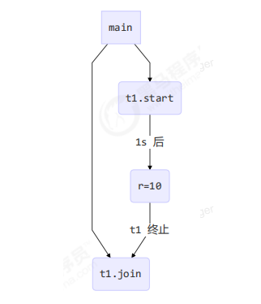
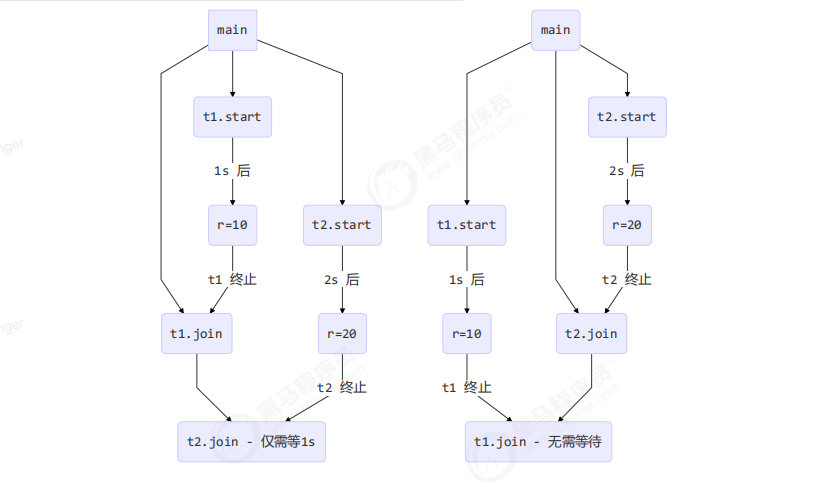
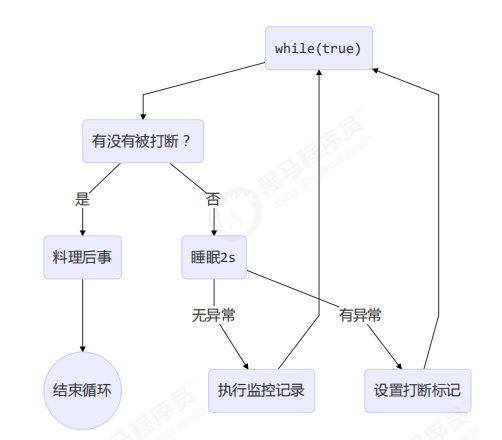
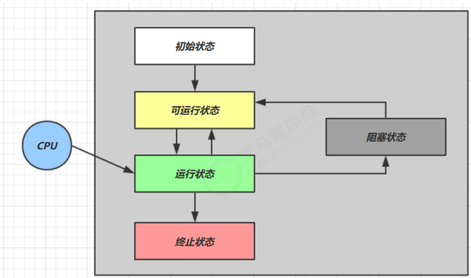
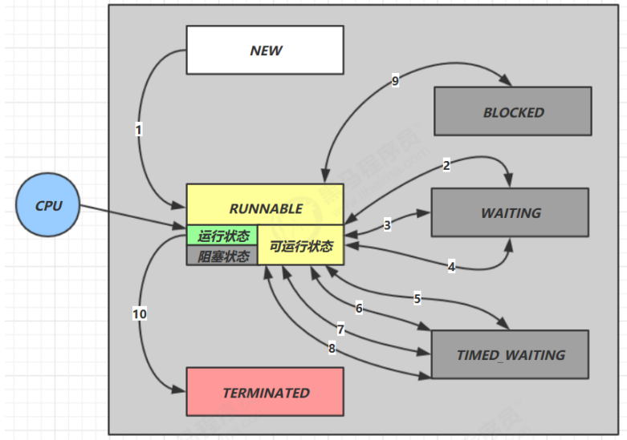
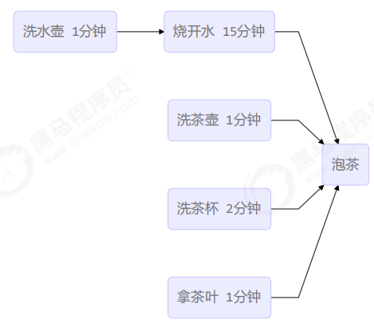
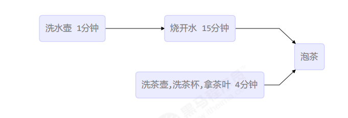

<div class="essay-banner">
    Java线程基础
</div>
# Java线程基础

## 本章内容

- 创建和运行线程

- 查看线程

- 线程 API

- 线程状态

# 2.1 创建和运行线程

## 方法一，直接使用 Thread

```java
// 创建线程对象
Thread t = new Thread() {
    public void run() {
        // 要执行的任务
    }
};
// 启动线程
t.start();
```

**示例**

```java
// 构造方法的参数是给线程指定名字，推荐
Thread t1 = new Thread("t1") {
    @Override
    // run 方法内实现了要执行的任务
    public void run() {
        log.debug("hello");
    }
};
t1.start();
```

**输出**

```plain
19:19:00 [t1] c.ThreadStarter - hello
```

## 方法二，使用 Runnable 配合 Thread

把【线程】和【任务】（要执行的代码）分开

- Thread 代表线程

- Runnable 可运行的任务（线程要执行的代码）

```java
Runnable runnable = new Runnable() {
    public void run(){
        // 要执行的任务
    }
};
// 创建线程对象
Thread t = new Thread( runnable );
// 启动线程
t.start();
```

**示例**

```java
// 创建任务对象
Runnable task2 = new Runnable() {
    @Override
    public void run() {
        log.debug("hello");
    }
};

// 参数1 是任务对象; 参数2 是线程名字，推荐
Thread t2 = new Thread(task2, "t2");
t2.start();
```

**输出**

```plain
19:19:00 [t2] c.ThreadStarter - hello
```

Java 8 以后可以使用 lambda 精简代码

```java
// 创建任务对象
Runnable task2 = () -> log.debug("hello");

// 参数1 是任务对象; 参数2 是线程名字，推荐
Thread t2 = new Thread(task2, "t2");
t2.start();
```

### * 原理之 Thread 与 Runnable 的关系

分析 Thread 的源码，理清它与 Runnable 的关系

```java
private Runnable target;

@Override
public void run() {
    if (target != null) {
        target.run();
    }
}
```

#### 小结

- 方法1 是把线程和任务合并在了一起，方法2 是把线程和任务分开了

- 用 Runnable 更容易与线程池等高级 API 配合

- 用 Runnable 让任务类脱离了 Thread 继承体系，更灵活

## 方法三，FutureTask 配合 Thread

FutureTask 能够接收 Callable 类型的参数，用来处理有返回结果的情况

```java
// 创建任务对象
FutureTask<Integer> task3 = new FutureTask<>(() -> {
    log.debug("hello");
    return 100;
});

// 参数1 是任务对象; 参数2 是线程名字，推荐
new Thread(task3, "t3").start();

// 主线程阻塞，同步等待 task 执行完毕的结果
Integer result = task3.get();
log.debug("结果是:{}", result);
```

**输出**

```plain
19:22:27 [t3] c.ThreadStarter - hello
19:22:27 [main] c.ThreadStarter - 结果是:100
```

# 2.2 观察多个线程同时运行

主要是理解

- 交替执行

- 谁先谁后，不由程序控制，由操作系统调度决定

# 2.3 查看进程线程的方法

> windows下出现异常\(例如jps看不到,jconsole也没有可用pid\),尝试管理员身份运行cmd
> 
> cmd 默认路径：C:\\Users\\\{用户名\}\\AppData\\Roaming\\Microsoft\\Windows\\Start Menu\\Programs\\System Tools
> 
> 

## Windows

- 任务管理器可以查看进程和线程数，也可以用来杀死进程

- `tasklist` 查看所有进程

- `taskkill` 杀死指定进程

## Linux

- `ps -fe` 查看所有进程

- `ps -fT -p <PID>` 查看某个进程（PID）的所有线程

- `kill` 杀死进程

- `top` 按大写 H 切换是否显示线程

- `top -H -p <PID>` 查看某个进程（PID）的所有线程

## Java

- `jps` 命令查看所有 Java 进程

- `jstack <PID>` 查看某个 Java 进程（PID）的所有线程状态

- `jconsole`图形化工具，查看 Java 进程中线程的运行情况

### jconsole 远程监控配置

需要以如下方式运行你的 java 类

```plain
java -Djava.rmi.server.hostname=`ip地址` -Dcom.sun.management.jmxremote -
Dcom.sun.management.jmxremote.port=`连接端口` -Dcom.sun.management.jmxremote.ssl=是否安全连接 -
Dcom.sun.management.jmxremote.authenticate=是否认证 java类
```

修改 /etc/hosts 文件将 127\.0\.0\.1 映射至主机名

如果要认证访问，还需要做如下步骤

- 复制 jmxremote\.password 文件

- 修改 jmxremote\.password 和 jmxremote\.access 文件的权限为 600（仅文件所有者可读写）

- 连接时填入 controlRole（用户名），R\&D（密码）

# 2.4 * 原理之线程运行

## 栈与栈帧

Java Virtual Machine Stacks（Java 虚拟机栈）

JVM 内存由堆、栈、方法区组成，其中栈内存是**线程私有**，每个线程启动后，虚拟机都会为其分配独立的栈内存。

- 每个栈由多个栈帧（Frame）组成，对应每次方法调用所占用的内存

- 每个线程同一时刻只能有一个活动栈帧，对应当前正在执行的方法

## 线程上下文切换（Thread Context Switch）

以下场景会导致 CPU 暂停执行当前线程，切换执行其他线程：

- 线程的 CPU 时间片用完

- JVM 垃圾回收

- 有更高优先级的线程需要运行

- 线程调用了 sleep、yield、wait、join、park、synchronized、lock 等阻塞方法

上下文切换时，操作系统会保存当前线程状态，恢复目标线程状态。Java 中**程序计数器（线程私有）**用于记录下一条 JVM 指令执行地址。

- 线程状态包含：程序计数器、虚拟机栈所有栈帧信息（局部变量、操作数栈、返回地址等）

- 频繁上下文切换会严重消耗系统性能

# 2.5 常见线程API

## 核心线程方法汇总

|方法名|静态|功能说明|注意事项|
|---|---|---|---|
|start\(\)|否|启动新线程，在线程中执行run方法|仅让线程进入就绪状态，不保证立即执行；每个线程仅能调用一次，多次调用抛出IllegalStateException|
|run\(\)|否|线程启动后执行的核心方法|构造线程时传入Runnable则执行其run方法，否则默认无操作；可被子类重写|
|join\(\)|否|等待目标线程运行结束|会阻塞当前调用线程|
|join\(long n\)|否|等待线程结束，最长等待n毫秒|超时则不再等待，当前线程自动恢复执行|
|getId\(\)|否|获取线程唯一长整型ID|线程ID全局唯一|
|getName\(\)|否|获取线程名称|\-|
|setName\(String\)|否|修改线程名称|\-|
|getPriority\(\)|否|获取线程优先级|\-|
|setPriority\(int\)|否|修改线程优先级|优先级范围1\-10，仅为CPU调度提示，不保证强制生效|
|getState\(\)|否|获取线程当前状态|Java定义6种线程状态：NEW、RUNNABLE、BLOCKED、WAITING、TIMED\_WAITING、TERMINATED|
|isInterrupted\(\)|否|判断线程是否被打断|不会清除打断标记|
|isAlive\(\)|否|判断线程是否存活（未执行完毕）|\-|
|interrupt\(\)|否|打断线程|阻塞线程（sleep/wait/join）被打断会抛异常并清除标记；运行中/park线程被打断仅设置标记|
|interrupted\(\)|是|判断当前线程是否被打断|会清除打断标记|
|currentThread\(\)|是|获取当前正在执行的线程对象|静态方法，全局通用|
|sleep\(long n\)|是|当前线程休眠n毫秒，让出CPU时间片|进入TIMED\_WAITING状态，可被interrupt打断|
|yield\(\)|是|提示调度器让出CPU使用权|仅为调度提示，依赖系统实现，多用于测试调试|

## 废弃不推荐方法

|方法名|功能说明|废弃原因|
|---|---|---|
|stop\(\)|强制停止线程运行|直接杀死线程，无法释放锁资源，易导致死锁、数据不一致|
|suspend\(\)|挂起（暂停）线程运行|易引发死锁，线程挂起时持有锁不释放|
|resume\(\)|恢复挂起的线程运行|与suspend搭配使用，存在线程安全隐患|

# 2.6 start 与 run

## 直接调用 run\(\)

```java
public static void main(String[] args) {
    Thread t1 = new Thread("t1") {
        @Override
        public void run() {
            log.debug(Thread.currentThread().getName());
            FileReader.read(Constants.MP4_FULL_PATH);
        }
    };
    
    t1.run();
    log.debug("do other things ...");
}
```

**输出**

```plain
19:39:14 [main] c.TestStart - main
19:39:14 [main] c.FileReader - read [1.mp4] start ...
19:39:18 [main] c.FileReader - read [1.mp4] end ... cost: 4227 ms
19:39:18 [main] c.TestStart - do other things ...
```

程序仍在 **main 线程**运行，方法调用是**同步阻塞**的，没有创建新线程。

## 调用 start\(\)

将 `t1.run();` 改为 `t1.start();`

**输出**

```plain
19:41:30 [main] c.TestStart - do other things ...
19:41:30 [t1] c.TestStart - t1
19:41:30 [t1] c.FileReader - read [1.mp4] start ...
19:41:35 [t1] c.FileReader - read [1.mp4] end ... cost: 4542 ms
```

程序在 **t1 新线程**运行，方法调用是**异步非阻塞**的。

## 小结

- 直接调用 run\(\)：仅为普通方法调用，在当前线程执行，不创建新线程

- 调用 start\(\)：创建并启动新线程，由新线程间接执行 run\(\) 方法

# 2.7 sleep 与 yield

## sleep

- 调用 sleep\(long n\) 会让当前线程从 Running 进入 Timed Waiting 阻塞状态

- 阻塞期间可被 interrupt\(\) 打断，抛出 InterruptedException，同时清除打断标记

- 睡眠时间结束后，线程进入就绪状态，未必会立刻获取CPU执行

- 推荐使用 `TimeUnit.XXX.sleep()` 替代 Thread\.sleep\(\)，可读性更高

## yield

- 调用 yield\(\) 会让当前线程从 Running 进入 Runnable 就绪状态，让出CPU时间片

- 仅为操作系统调度提示，具体实现依赖系统调度器，不保证一定让出CPU

## 线程优先级

- 优先级取值 1\~10（MIN\_PRIORITY\~MAX\_PRIORITY），默认5

- 优先级仅为调度提示，CPU繁忙时，高优先级线程大概率获取更多时间片；CPU空闲时优先级无效

### 应用：限制CPU空转消耗

避免 while\(true\) 空转浪费CPU资源，通过 sleep/yield 让出CPU

#### sleep 实现（无锁场景）

```java
while(true) {
    try {
        Thread.sleep(50);
    } catch (InterruptedException e) {
        e.printStackTrace();
    }
}
```

#### wait 实现（需加锁同步场景）

```java
synchronized(锁对象) {
    while(条件不满足) {
        try {
            锁对象.wait();
        } catch(InterruptedException e) {
            e.printStackTrace();
        }
    }
    // 执行后续操作
}
```

#### 条件变量实现（JUC锁场景）

```java
lock.lock();
try {
    while(条件不满足) {
        try {
            条件变量.await();
        } catch (InterruptedException e) {
            e.printStackTrace();
        }
    }
    // 执行后续操作
} finally {
    lock.unlock();
}
```

# 2.8 join方法详解

## 为什么需要 join

多线程并行执行时，主线程无法预知子线程执行完毕时间，导致获取不到子线程计算结果

```java
static int r = 0;
public static void main(String[] args) throws InterruptedException {
    test1();
}

private static void test1() throws InterruptedException {
    log.debug("开始");
    Thread t1 = new Thread(() -> {
        log.debug("开始");
        sleep(1);
        log.debug("结束");
        r = 10;
    });
    t1.start();
    log.debug("结果为:{}", r);
    log.debug("结束");
}
```

**分析**

- 主线程与t1线程并行执行，t1需要1秒完成赋值 r=10

- 主线程启动t1后立即打印结果，最终输出 r=0

**解决方案**：在 `t1.start()` 后调用 `t1.join()`，让主线程等待子线程执行完毕

## 应用之同步

- **同步**：调用方需要等待线程执行完毕、获取结果后，再继续运行

- **异步**：调用方无需等待，启动线程后直接继续运行
<div class="img-wrap-left">
  
</div>

## 等待多个线程结果

```java
static int r1 = 0;
static int r2 = 0;
public static void main(String[] args) throws InterruptedException {
    test2();
}
private static void test2() throws InterruptedException {
    Thread t1 = new Thread(() -> {
        sleep(1);
        r1 = 10;
    });
    Thread t2 = new Thread(() -> {
        sleep(2);
        r2 = 20;
    });
    long start = System.currentTimeMillis();
    t1.start();
    t2.start();
    t1.join();
    t2.join();
    long end = System.currentTimeMillis();
    log.debug("r1: {} r2: {} cost: {}", r1, r2, end - start);
}
```

**分析**

- 等待t1时，t2同步并行运行，不会阻塞

- 1秒后t1执行完毕，主线程等待t2剩余1秒

- 总耗时约2秒，颠倒join顺序结果一致

**输出**

```plain
20:45:43.239 [main] c.TestJoin - r1: 10 r2: 20 cost: 2005
```
<div class="img-wrap-left">
  
</div>

## 有时效的join

### 等够时间（线程提前执行完毕）

```java
static int r1 = 0;
static int r2 = 0;
public static void main(String[] args) throws InterruptedException {
    test3();
}
public static void test3() throws InterruptedException {
    Thread t1 = new Thread(() -> {
        sleep(1);
        r1 = 10;
    });
    long start = System.currentTimeMillis();
    t1.start();
    // 最长等待1500毫秒
    t1.join(1500);
    long end = System.currentTimeMillis();
    log.debug("r1: {} r2: {} cost: {}", r1, r2, end - start);
}
```

**输出**

```plain
20:48:01.320 [main] c.TestJoin - r1: 10 r2: 0 cost: 1010
```

### 没等够时间（线程超时未执行完毕）

```java
static int r1 = 0;
static int r2 = 0;
public static void main(String[] args) throws InterruptedException {
    test3();
}
public static void test3() throws InterruptedException {
    Thread t1 = new Thread(() -> {
        sleep(2);
        r1 = 10;
    });
    long start = System.currentTimeMillis();
    t1.start();
    // 最长等待1500毫秒
    t1.join(1500);
    long end = System.currentTimeMillis();
    log.debug("r1: {} r2: {} cost: {}", r1, r2, end - start);
}
```

**输出**

```plain
20:52:15.623 [main] c.TestJoin - r1: 0 r2: 0 cost: 1502
```

# 2.9 interrupt 方法详解

## 打断阻塞线程（sleep、wait、join）

被打断的阻塞线程会抛出 `InterruptedException`，**自动清除打断标记**（标记置为false）

```java
private static void test1() throws InterruptedException {
    Thread t1 = new Thread(()->{
        sleep(1);
    }, "t1");
    t1.start();
    sleep(0.5);
    t1.interrupt();
    log.debug(" 打断状态: {}", t1.isInterrupted());
}
```

**输出**

```plain
java.lang.InterruptedException: sleep interrupted
     at java.lang.Thread.sleep(Native Method)
     at java.lang.Thread.sleep(Thread.java:340)
     ...
21:18:10.374 [main] c.TestInterrupt - 打断状态: false
```

## 打断正常运行的线程

打断运行中的线程，**不会清除打断标记**（标记保持true），可通过代码自行处理终止逻辑

```java
private static void test2() throws InterruptedException {
    Thread t2 = new Thread(()->{
        while(true) {
            Thread current = Thread.currentThread();
            boolean interrupted = current.isInterrupted();
            if(interrupted) {
                log.debug(" 打断状态: {}", interrupted);
                break;
            }
        }
    }, "t2");
    t2.start();
    sleep(0.5);
    t2.interrupt();
}
```

**输出**

```plain
20:57:37.964 [t2] c.TestInterrupt - 打断状态: true 
```

## 终止模式之两阶段终止（优雅终止线程）

核心思想：给线程预留收尾、料理后事的时间，避免强制终止导致数据异常、资源未释放

### 错误终止思路

- **stop()方法**：强制杀死线程，若线程持有锁，会导致锁无法释放，引发死锁

- **System.exit()**：终止整个程序，无法仅终止单个线程


<div class="img-wrap-left">
  
</div>

### 方案一：基于 isInterrupted 实现

```java
class TPTInterrupt {
    private Thread thread;
    public void start(){
        thread = new Thread(() -> {
            while(true) {
                Thread current = Thread.currentThread();
                if(current.isInterrupted()) {
                    log.debug("料理后事");
                    break;
                }
                try {
                    Thread.sleep(1000);
                    log.debug("将结果保存");
                } catch (InterruptedException e) {
                    // 捕获异常后重新设置打断标记
                    current.interrupt();
                }
                // 执行监控业务
            }
        },"监控线程");
        thread.start();
    }
    public void stop() {
        thread.interrupt();
    }
}
```

**调用测试**

```java
TPTInterrupt t = new TPTInterrupt();
t.start();

Thread.sleep(3500);
log.debug("stop");
t.stop();
```

**输出**

```plain
11:49:42.915 c.TwoPhaseTermination [监控线程] - 将结果保存
11:49:43.919 c.TwoPhaseTermination [监控线程] - 将结果保存
11:49:44.919 c.TwoPhaseTermination [监控线程] - 将结果保存
11:49:45.413 c.TestTwoPhaseTermination [main] - stop 
11:49:45.413 c.TwoPhaseTermination [监控线程] - 料理后事
```

### 方案二：基于 volatile 停止标记实现

```java
class TPTVolatile {
    private Thread thread;
    // volatile 保证多线程可见性
    private volatile boolean stop = false;
    
    public void start(){
        thread = new Thread(() -> {
            while(true) {
                if(stop) {
                    log.debug("料理后事");
                    break;
                }
                try {
                    Thread.sleep(1000);
                    log.debug("将结果保存");
                } catch (InterruptedException e) {

                }
                // 执行监控业务
            }
        },"监控线程");
        thread.start();
    }
    
    public void stop() {
        stop = true;
        thread.interrupt();
    }
}
```

## 打断 park 线程

park 线程被打断后，**保留打断标记**，不会自动清除

```java
private static void test3() throws InterruptedException {
    Thread t1 = new Thread(() -> {
        log.debug("park...");
        LockSupport.park();
        log.debug("unpark...");
        log.debug("打断状态：{}", Thread.currentThread().isInterrupted());
    }, "t1");
    t1.start();
    sleep(0.5);
    t1.interrupt();
}
```

**输出**

```plain
21:11:52.795 [t1] c.TestInterrupt - park... 
21:11:53.295 [t1] c.TestInterrupt - unpark... 
21:11:53.295 [t1] c.TestInterrupt - 打断状态：true
```

> **注意**：若线程打断标记为true，park会直接失效，无法阻塞线程
> 
> 可使用 `Thread.interrupted()`主动清除打断标记
> 
> 

# 2.10 主线程与守护线程

默认情况下，Java 进程需要等待**所有非守护线程**执行完毕才会退出。

**守护线程**：依附于非守护线程，所有非守护线程结束后，即使守护线程未执行完毕，也会被强制终止。

```java
log.debug("开始运行...");
Thread t1 = new Thread(() -> {
	log.debug("开始运行...");
	sleep(2);
	log.debug("运行结束...");
}, "daemon");
// 设置为守护线程
t1.setDaemon(true);
t1.start();

sleep(1);
log.debug("运行结束...");
```

**输出**

```plain
08:26:38.123 [main] c.TestDaemon - 开始运行... 
08:26:38.213 [daemon] c.TestDaemon - 开始运行... 
08:26:39.215 [main] c.TestDaemon - 运行结束...
```

> **常见守护线程**
> 
> - JVM 垃圾回收线程
> 
> - Tomcat 的 Acceptor、Poller 线程（接收shutdown命令后强制终止）
> 
> 

# 2.11 线程状态

## 一、操作系统层面：五种线程状态

- **初始状态**：仅创建线程对象，未与操作系统内核线程绑定

- **可运行状态（就绪）**：线程已初始化完成，等待CPU调度执行

- **运行状态**：获取CPU时间片，正在执行线程代码

- **阻塞状态**：调用阻塞API（BIO、锁等待等），放弃CPU，不参与调度，等待唤醒

- **终止状态**：线程代码执行完毕，生命周期结束
<div class="img-wrap-left">
  
</div>

## 二、Java API层面：六种线程状态（Thread\.State枚举）

- **NEW**：线程创建完成，未调用 start\(\) 方法

- **RUNNABLE**：调用start\(\)后进入，涵盖操作系统的就绪、运行、BIO阻塞三种状态（Java无法区分BIO阻塞）

- **BLOCKED**：等待获取synchronized锁，未获取到锁时的阻塞状态

- **WAITING**：无时限等待（wait\(\)、join\(\)、park\(\)），需主动唤醒

- **TIMED\_WAITING**：有时限等待（sleep\(\)、wait\(long\)、join\(long\)），超时自动唤醒

- **TERMINATED**：线程代码执行完毕，终止运行
<div class="img-wrap-left">
  
</div>

# 2.12 习题：烧水泡茶多线程统筹案例

## 需求背景
附：华罗庚《统筹方法》

统筹方法，是一种安排工作进程的数学方法。它的实用范围极广泛，在企业管理和基本建设中，以及关系复 杂的科研项目的组织与管理中，都可以应用。 

怎样应用呢？主要是把工序安排好。
比如，想泡壶茶喝。当时的情况是：开水没有；水壶要洗，茶壶、茶杯要洗；火已生了，茶叶也有了。怎么办？ 
● 办法甲：洗好水壶，灌上凉水，放在火上；在等待水开的时间里，洗茶壶、洗茶杯、拿茶叶；等水开 
了，泡茶喝。 
● 办法乙：先做好一些准备工作，洗水壶，洗茶壶茶杯，拿茶叶；一切就绪，灌水烧水；坐待水开了，泡茶喝。 
● 办法丙：洗净水壶，灌上凉水，放在火上，坐待水开；水开了之后，急急忙忙找茶叶，洗茶壶茶杯，泡茶喝。 
哪一种办法省时间？我们能一眼看出，第一种办法好，后两种办法都窝了工。

这是小事，但这是引子，可以引出生产管理等方面有用的方法来。 

水壶不洗，不能烧开水，因而洗水壶是烧开水的前提。没开水、没茶叶、不洗茶壶茶杯，就不能泡茶，因而这些又是泡茶的前提。它们的相互关系，可以用下边的箭头图来表示：

<div class="img-wrap-left">
  
</div>

从这个图上可以一眼看出，办法甲总共要16分钟（而办法乙、丙需要20分钟）。如果要缩短工时、提高工作效率，应当主要抓烧开水这个环节，而不是抓拿茶叶等环节。同时，洗茶壶茶杯、拿茶叶总共不过4分钟，大可利用“等水开”的时间来做。 

是的，这好像是废话，卑之无甚高论。有如走路要用两条腿走，吃饭要一口一口吃，这些道理谁都懂得。但稍有变化，临事而迷的情况，常常是存在的。在近代工业的错综复杂的工艺过程中，往往就不是像泡茶喝这么简单了。任务多了，几百几千，甚至有好几万个任务。关系多了，错综复杂，千头万绪，往往出现“万事俱备，只欠东风”的情况。由于一两个零件没完成，耽误了一台复杂机器的出厂时间。或往往因为抓的不是关键，连夜三班，急急忙忙，完成这一环节之后，还得等待旁的环节才能装配。 

洗茶壶，洗茶杯，拿茶叶，或先或后，关系不大，而且同是一个人的活儿，因而可以合并成为：

<div class="img-wrap-left">
  
</div>

看来这是“小题大做”，但在工作环节太多的时候，这样做就非常必要了。 

这里讲的主要是时间方面的事，但在具体生产实践中，还有其他方面的许多事。这种方法虽然不一定能直接解决所有问题，但是，我们利用这种方法来考虑问题，也是不无裨益的。


* 应用之统筹（烧水泡茶）
### 解法一：join 线程等待

```java
Thread t1 = new Thread(() -> {
    log.debug("洗水壶");
    sleep(1);
    log.debug("烧开水");
    sleep(15);
}, "老王");

Thread t2 = new Thread(() -> {
    log.debug("洗茶壶");
    sleep(1);
    log.debug("洗茶杯");
    sleep(2);
    log.debug("拿茶叶");
    sleep(1);
    try {
        // 等待水烧开
        t1.join();
    } catch (InterruptedException e) {
        e.printStackTrace();
    }
    log.debug("泡茶");
}, "小王");

t1.start();
t2.start();
```

### 解法二：wait/notify 双向等待

```java
class S2 {
    static String kettle = "冷水";
    static String tea = null;
    static final Object lock = new Object();
    static boolean maked = false;
    
    public static void makeTea() {
        
        new Thread(() -> {
            log.debug("洗水壶");
            sleep(1);
            log.debug("烧开水");
            sleep(5);
            synchronized (lock) {
                kettle = "开水";
                lock.notifyAll();
                while (tea == null) {
                    try {
                        lock.wait();
                    } catch (InterruptedException e) {
                        e.printStackTrace();
                    }
                }
                if (!maked) {
                    log.debug("拿({})泡({})", kettle, tea);
                    maked = true;
                }
            }
        }, "老王").start();
        
        new Thread(() -> {
            log.debug("洗茶壶");
            sleep(1);
            log.debug("洗茶杯");
            sleep(2);
            log.debug("拿茶叶");
            sleep(1);
            synchronized (lock) {
                tea = "花茶";
                lock.notifyAll();
                while (kettle.equals("冷水")) {
                    try {
                        lock.wait();
                    } catch (InterruptedException e) {
                        e.printStackTrace();
                    }
                }
                if (!maked) {
                    log.debug("拿({})泡({})", kettle, tea);
                    maked = true;
                }
            }
        }, "小王").start();
        
    }
}
```

### 解法三：第三者协调（最优解）

```java
class S3 {
    
    static String kettle = "冷水";
    static String tea = null;
    static final Object lock = new Object();
    
    public static void makeTea() {
        
        new Thread(() -> {
            log.debug("洗水壶");
            sleep(1);
            log.debug("烧开水");
            sleep(5);
            synchronized (lock) {
                kettle = "开水";
                lock.notifyAll();
            }
        }, "老王").start();
        
        new Thread(() -> {
            log.debug("洗茶壶");
            sleep(1);
            log.debug("洗茶杯");
            sleep(2);
            log.debug("拿茶叶");
            sleep(1);
            synchronized (lock) {
                tea = "花茶";
                lock.notifyAll();
            }
        }, "小王").start();
        
        // 第三方线程统一协调泡茶
        new Thread(() -> {
            synchronized (lock) {
                while (kettle.equals("冷水") || tea == null) {
                    try {
                        lock.wait();
                    } catch (InterruptedException e) {
                        e.printStackTrace();
                    }
                }
                log.debug("拿({})泡({})", kettle, tea);
            }
        }, "王夫人").start();
        
    }
}
```

# 本章小结

## 1. 核心基础

- 三种线程创建方式：Thread子类、Runnable任务、FutureTask带返回值任务

- start\(\)创建新线程，run\(\)仅为普通方法调用，无新线程

## 2. 核心API

- sleep/yield：线程休眠、让出CPU，调控线程执行节奏

- join：线程同步等待，解决多线程结果依赖问题

- interrupt：线程打断，区分阻塞/运行/ park线程的不同打断逻辑

## 3. 线程状态

- 操作系统5种状态：初始、就绪、运行、阻塞、终止

- Java6种枚举状态：NEW、RUNNABLE、BLOCKED、WAITING、TIMED\_WAITING、TERMINATED

## 4. 核心应用与模式

- 异步/同步调用：提升程序执行效率，解决任务依赖

- 两阶段终止模式：优雅终止线程，保障资源释放、数据收尾

- 多线程统筹：并行执行无依赖任务，最大化缩短执行耗时

## 5. 底层原理

- 线程私有栈、栈帧机制，对应方法调用内存模型

- 上下文切换原理及性能损耗问题
