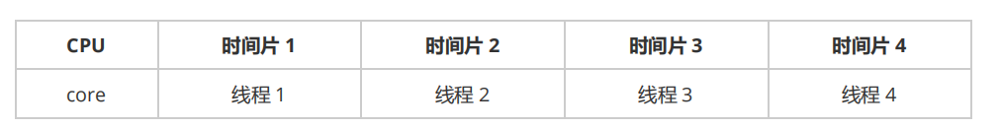
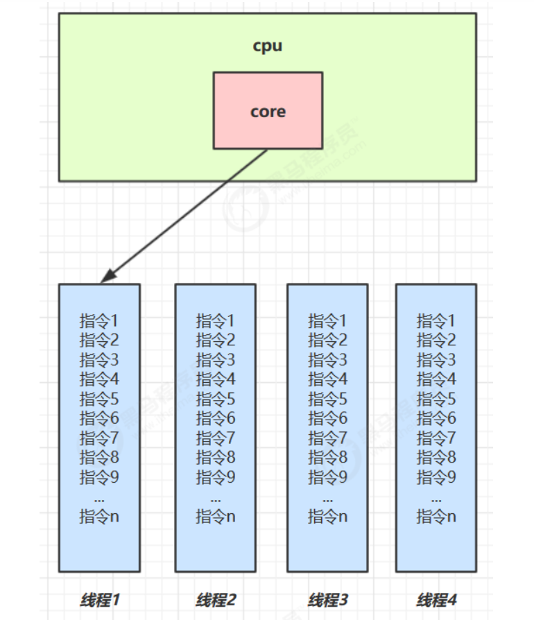
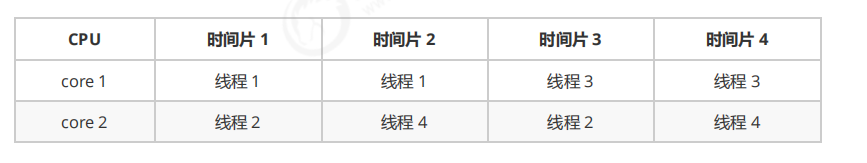
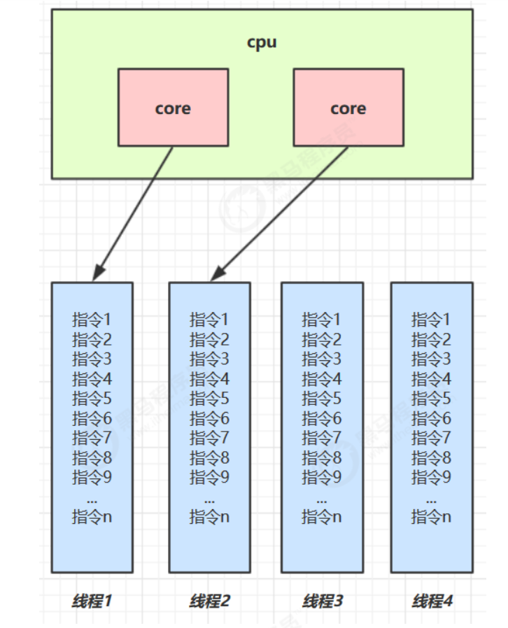

<div class="essay-banner">
    进程与线程
</div>

# 本章内容 进程与线程


- 进程和线程的概念

- 并行和并发的概念

- 线程基本应用

## 1.1 进程与线程

### 进程：

- 程序由指令和数据组成，若要运行指令、读写数据，需将指令加载至CPU、数据加载至内存，指令运行过程中还会用到磁盘、网络等设备。**进程的核心作用就是加载指令、管理内存、管理IO资源**。

- 当程序从磁盘加载代码到内存中运行时，一个进程就随之开启。

- 进程可看作程序的运行实例。多数程序支持多实例进程同时运行，如记事本、画图工具、浏览器等；部分程序仅支持单实例进程运行，如网易云音乐、360安全卫士等。

### 线程：

- 一个进程内部可以包含一个或多个线程，线程是进程的组成单元。

- 线程本质是一条指令流，能够按照既定顺序将逐条指令提交给CPU执行。

- **Java中，线程是CPU最小调度单位，进程是系统资源分配的最小单位；Windows系统中进程无实际运行能力，仅作为线程的容器存在**。

### 进程与线程二者对比：

- 独立性：进程之间基本相互独立；线程隶属于对应进程，是进程的子集，无法独立存在。

- 资源共享：进程拥有独立的内存空间等系统资源，其内部所有线程可共享该进程的全部资源。

- 通信难度：进程间通信复杂。同一计算机内的进程通信称为IPC（进程间通信）；不同计算机的进程通信需要依托网络，遵循HTTP等网络协议。

- **线程通信简单便捷，由于共享进程内存空间，多个线程可直接访问同一个共享变量实现数据交互**。

- 运行开销：线程属于轻量级运行单元，线程的上下文切换成本远低于进程上下文切换成本，运行效率更高。

## 1.2 并行与并发

单核CPU环境下，线程本质为**串行执行**。操作系统的任务调度器会将CPU的时间片（Windows系统下最小时间片约15毫秒）分配给不同线程。由于CPU在线程间的切换速度极快，宏观上会给人多线程同时运行的错觉，核心特点可总结为：**微观串行，宏观并行**。
一般会将这种 线程轮流使用 CPU 的做法称为并发， concurrent

<div class="img-wrap-left">
  
</div>
<div class="img-wrap-left">
  
</div>
**并发（concurrent）：指线程轮流抢占、使用CPU时间片的运行模式，同一时刻仅执行一个线程，通过快速切换实现多任务交替执行**。

多核CPU环境下，每一个CPU核心都可以独立调度并运行线程，多个核心可同时执行多个线程，这种真正意义上的同时执行就是并行。
<div class="img-wrap-left">
  
</div>
<div class="img-wrap-left">
  
</div>
### 通俗案例区分

- 并发：一名家庭主妇独自轮流完成做饭、打扫卫生、喂奶多项工作，同一时间只做一件事，交替处理多任务。

- 并发+并行：家庭主妇雇佣一名保姆，两人同时处理家务，部分任务可并行完成，但受锅、工具等资源限制，部分任务需要排队等待，存在并发竞争。

- 并行：雇佣三名保姆，分别专职负责做饭、打扫卫生、喂奶，三项任务互不干扰、同时执行。

### Rob Pike 权威定义（Golang语言创造者）

- 并发（concurrent）：同一时间具备应对、处理多件事情的能力（侧重任务管理）。

- 并行（parallel）：同一时间可以动手执行多件事情的能力（侧重任务执行）。

## 1.3 线程核心应用

### 应用一：实现异步调用

从调用方执行逻辑区分同步与异步：

- **同步**：调用方法后，必须等待方法执行完毕、返回结果，才能继续执行后续代码。

- **异步**：调用方法后，无需等待结果返回，可直接继续执行后续代码，不阻塞当前执行流程。

#### 设计思路

借助多线程可将同步阻塞的方法改造为异步执行。例如磁盘文件读取耗时5秒，若无多线程机制，当前线程会全程阻塞，CPU闲置、其他代码暂停执行；开启独立子线程处理IO耗时操作，可避免主线程阻塞。

#### 实际应用场景

- 项目开发中，视频格式转换、文件解析等耗时操作，单独开启子线程处理，保障主线程正常运行。

- Tomcat异步Servlet，将耗时业务交由独立线程处理，避免阻塞核心工作线程，提升服务吞吐量。

- UI界面程序，所有耗时计算、网络请求均在子线程执行，防止阻塞UI线程，保证界面流畅可操作。

### 应用二：提升程序运行效率

多线程可充分发挥多核CPU的硬件优势，通过任务拆分、并行执行缩短整体运行耗时，以下为具体案例对比：

任务场景：执行3项独立计算，最终汇总结果，各任务耗时如下：
```
计算1：10ms、计算2：11ms、计算3：9ms、结果汇总：1ms
```

- 串行执行：总耗时 = 10 \+ 11 \+ 9 \+ 1 = 31ms

- 多核并行执行：四核CPU可分别开启线程并行执行3项计算，整体耗时取决于最长任务（11ms），叠加汇总耗时，总耗时仅12ms，大幅提升效率。

> **注意**：多线程提升效率的前提是**多核CPU环境**，单核CPU仅能实现线程交替执行，无法真正提升运算效率。

#### 核心结论

1. 单核CPU下，多线程无法提升程序运行效率，其核心作用是实现任务轮换，避免单一线程长期占用CPU，导致其他任务阻塞卡死，保障多任务正常调度。

2. 多核CPU可实现线程并行执行，但并非所有场景都能提效：
        

    - 可拆分的独立计算型任务，通过多线程并行能够显著缩短耗时、提升效率（受阿姆达尔定律约束）；

    - 无法拆分、强依赖执行顺序的任务，多线程无提效意义。

3. 常规阻塞式IO操作不占用CPU资源，但线程会持续等待IO完成，造成线程资源浪费，因此衍生出非阻塞IO、异步IO等优化方案，进一步提升资源利用率。
