<div class="essay-banner">
    多线程共享变量与线程安全  
</div>

# 多线程共享变量与线程安全

**本章核心目标**：解决多线程访问共享变量的线程安全问题，保证临界区代码执行的**原子性**，掌握synchronized、Lock锁、线程状态、活跃性问题、线程安全分析等核心知识点。

**本章知识体系**：共享问题 → synchronized解决方案 → 线程安全分析 → Monitor与wait/notify → 线程状态转换 → 线程活跃性问题 → ReentrantLock锁

# 3.1 多线程共享带来的安全问题

# 共享带来的问题之故事篇

● 老王（操作系统）有一个功能强大的算盘（CPU），现在想把它租出去，赚一点外快
<div class="img-wrap-left">
  
</div>
● 小南、小女（线程）来使用这个算盘来进行一些计算，并按照时间给老王支付费用 
● 但小南不能一天24小时使用算盘，他经常要小憩一会（sleep），又或是去吃饭上厕所（阻塞 io 操作），有时还需要一根烟，没烟时思路全无（wait）这些情况统称为（阻塞）
<div class="img-wrap-left">
  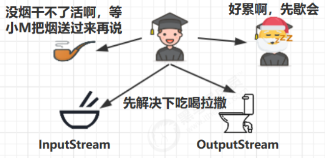
</div>
● 在这些时候，算盘没利用起来（不能收钱了），老王觉得有点不划算 
● 另外，小女也想用用算盘，如果总是小南占着算盘，让小女觉得不公平 
● 于是，老王灵机一动，想了个办法 [ 让他们每人用一会，轮流使用算盘 ] 
● 这样，当小南阻塞的时候，算盘可以分给小女使用，不会浪费，反之亦然 
● 最近执行的计算比较复杂，需要存储一些中间结果，而学生们的脑容量（工作内存）不够，所以老王申请了一个笔记本（主存），把一些中间结果先记在本上 
● 计算流程是这样的
<div class="img-wrap-left">
  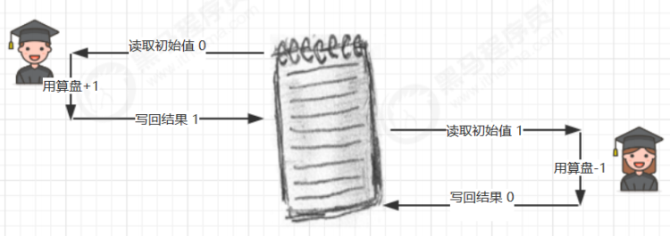
</div>
● 但是由于分时系统，有一天还是发生了事故 
● 小南刚读取了初始值 0 做了个 +1 运算，还没来得及写回结果 
● 老王说 [ 小南，你的时间到了，该别人了，记住结果走吧 ]，于是小南念叨着 [ 结果是1，结果是1...] 不甘心地到一边待着去了（上下文切换） 
● 老王说 [ 小女，该你了 ]，小女看到了笔记本上还写着 0 做了一个 -1 运算，将结果 -1 写入笔记本 
● 这时小女的时间也用完了，老王又叫醒了小南：[小南，把你上次的题目算完吧]，小南将他脑海中的结果 1 写入了笔记本 
<div class="img-wrap-left">
  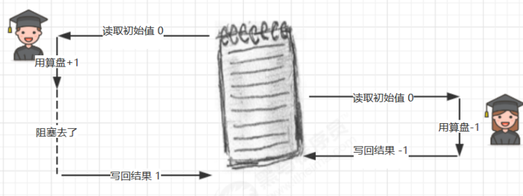
</div>
● 小南和小女都觉得自己没做错，但笔记本里的结果是 1 而不是 0


## 3.1.1 通俗场景理解

操作系统（老王）的CPU（算盘）支持多线程分时复用，多个线程（小南、小女）轮流占用CPU执行任务。线程执行中会出现阻塞（sleep、IO、wait），此时CPU切换给其他线程，提升资源利用率。

为存储计算中间结果，线程会读写主存中的共享变量，**分时切换\+共享读写**会引发数据错乱问题：

典型场景：小南读取变量0、执行\+1未写回时，时间片用完发生上下文切换；小女读取变量0、执行\-1并写回\-1；后续小南恢复执行，将内存覆盖写为1，最终结果不符合预期。

## 3.1.2 Java代码复现问题

两个线程分别对静态变量自增、自减5000次，最终结果大概率不为0：

```java
static int counter = 0;
public static void main(String[] args) throws InterruptedException {
    Thread t1 = new Thread(() -> {
        for (int i = 0; i < 5000; i++) {
            counter++;
        }
    }, "t1");
    
    Thread t2 = new Thread(() -> {
        for (int i = 0; i < 5000; i++) {
            counter--;
        }
    }, "t2");
    
    t1.start();
    t2.start();
    t1.join();
    t2.join();
    
    log.debug("{}",counter);
}
```

## 3.1.3 问题根源：非原子操作

Java中静态变量的自增、自减并非单条指令，而是由多条JVM字节码组成，多线程下指令会交错执行，破坏原子性。

**i\+\+ 字节码指令**：

```java
getstatic i    // 读取主存变量值
iconst_1       // 加载常量1
iadd           // 执行自增运算
putstatic i    // 写回主存
```

**i\-\- 字节码指令**：将iadd替换为isub（减法），流程一致。

单线程下指令顺序执行无问题；多线程下8条指令随机交错，最终结果出现正数、负数、零三种情况。

而 Java 的内存模型如下，完成静态变量的自增，自减需要在主存和工作内存中进行数据交换：
<div class="img-wrap-left">
  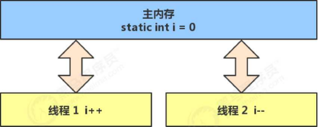
</div>

如果是单线程以上 8 行代码是顺序执行（不会交错）没有问题：
<div class="img-wrap-left">
  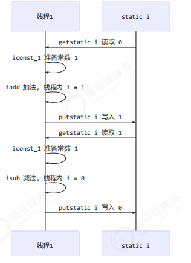
</div>

但多线程下这 8 行代码可能交错运行： 
出现负数的情况：
<div class="img-wrap-left">
  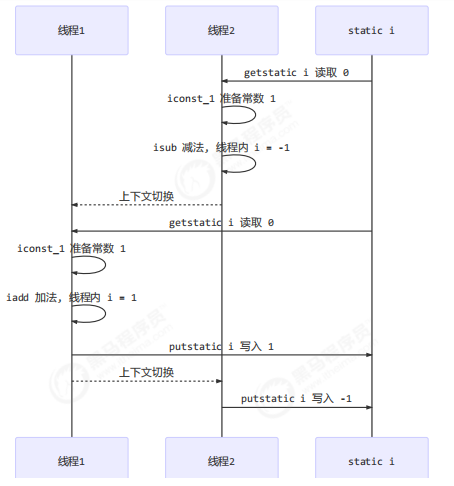
</div>

出现正数的情况：
<div class="img-wrap-left">
  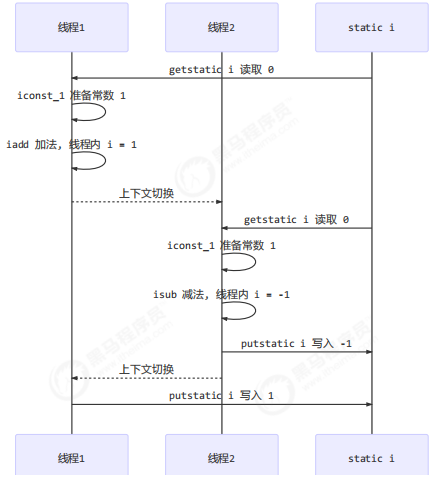
</div>

## 3.1.4 核心概念定义

### 1. 临界区（Critical Section）

存在**多线程对共享变量读写操作**的代码块。仅多线程读共享资源无安全问题，读写共存才会触发风险。

示例临界区代码：

```java
static int counter = 0;
// 临界区：存在共享变量读写
static void increment(){ counter++; }
static void decrement(){ counter--; }
```

### 2. 竞态条件（Race Condition）

多个线程在临界区执行，因线程执行序列随机交错，导致最终结果不可预测的现象，是线程安全问题的核心诱因。

# 3.2 synchronized 互斥解决方案

## 3.2.1 锁解决方案分类

- **阻塞式方案**：synchronized（内置锁）、Lock（显式锁），通过互斥阻塞保证原子性

- **非阻塞式方案**：原子变量（CAS实现，无阻塞）

## 3.2.2 synchronized 核心原理

俗称**对象锁**，JVM内置互斥锁机制：同一时刻仅一个线程持有锁执行临界区代码，其他线程获取锁失败则阻塞，彻底避免指令交错，保证临界区代码原子性。

**互斥与同步区别**：

- 互斥：保证临界区同一时刻单线程执行，解决竞态条件

- 同步：控制线程执行顺序，让线程等待其他线程执行到指定节点

## 3.2.3 基础语法与修复案例

**语法格式**：

```java
synchronized(锁对象){
    // 临界区代码
}
```

**修复共享变量错乱问题**：

```java
static int counter = 0;
static final Object room = new Object(); // 唯一共享锁对象

public static void main(String[] args) throws InterruptedException {
    Thread t1 = new Thread(() -> {
        for (int i = 0; i < 5000; i++) {
            synchronized (room) {
                counter++;
            }
        }
    }, "t1");
    
    Thread t2 = new Thread(() -> {
        for (int i = 0; i < 5000; i++) {
            synchronized (room) {
                counter--;
            }
        }
    }, "t2");
    
    t1.start();
    t2.start();
    t1.join();
    t2.join();
    log.debug("{}",counter); // 最终结果固定为0
}
```
<div class="img-wrap-left">
  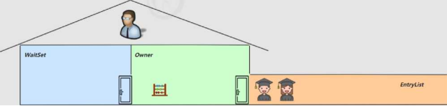
</div>
你可以做这样的类比： 
● synchronized(对象) 中的对象，可以想象为一个房间（room），有唯一入口（门）房间只能一次进入一人进行计算，线程 t1，t2 想象成两个人 
● 当线程 t1 执行到 synchronized(room) 时就好比 t1 进入了这个房间，并锁住了门拿走了钥匙，在门内执行count++ 代码 
● 这时候如果 t2 也运行到了 synchronized(room) 时，它发现门被锁住了，只能在门外等待，发生了上下文切换，阻塞住了 
● 这中间即使 t1 的 cpu 时间片不幸用完，被踢出了门外（不要错误理解为锁住了对象就能一直执行下去哦），这时门还是锁住的，t1 仍拿着钥匙，t2 线程还在阻塞状态进不来，只有下次轮到 t1 自己再次获得时间片时才能开门进入 
● 当 t1 执行完 synchronized{} 块内的代码，这时候才会从 obj 房间出来并解开门上的锁，唤醒 t2 线程把钥匙给他。t2 线程这时才可以进入 obj 房间，锁住了门拿上钥匙，执行它的 count-- 代码.
用图表示
<div class="img-wrap-left">
  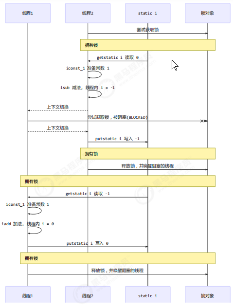
</div>

思考 
synchronized 实际是用对象锁保证了临界区内代码的原子性，临界区内的代码对外是不可分割的，不会被线程切换所打断。 

为了加深理解，请思考下面的问题
● 如果把 synchronized(obj) 放在 for 循环的外面，如何理解？-- 原子性 
● 如果 t1 synchronized(obj1) 而 t2 synchronized(obj2) 会怎样运作？-- 锁对象 
● 如果 t1 synchronized(obj) 而 t2 没有加会怎么样？如何理解？-- 锁对象

面向对象改进 
把需要保护的共享变量放入一个类

```
class Room {
    int value = 0;
    public void increment() {
        synchronized (this) {
            value++;
        }
    }
    public void decrement() {
        synchronized (this) {
            value--;
        }
    }
    public int get() {
        synchronized (this) {
            return value;
        }
    }
}

@Slf4j
public class Test1 {

    public static void main(String[] args) throws InterruptedException {
        Room room = new Room();
        Thread t1 = new Thread(() -> {
            for (int j = 0; j < 5000; j++) {
                room.increment();
            }
        }, "t1");
        
        Thread t2 = new Thread(() -> {
            for (int j = 0; j < 5000; j++) {
                room.decrement();
            }
        }, "t2");
        
        t1.start();
        t2.start();
        t1.join();
        t2.join();
        
        log.debug("count: {}" , room.get());
    }
}
```

## 3.2.4 锁机制通俗类比

锁对象=唯一房间，线程=使用者：

1. 线程获取锁=进入房间、锁门拿钥匙，执行临界区代码

2. 其他线程尝试获取同一锁=门外阻塞等待

3. 线程时间片用完，**锁不会释放**，下次获取时间片继续执行

4. 临界区代码执行完毕，自动释放锁，唤醒阻塞线程竞争锁

## 3.2.5 进阶思考问题

1. synchronized放for循环外：将5000次循环整体作为原子操作，并发度更低，安全性更高

2. 两个线程使用不同锁对象：锁互不干扰，无法实现互斥，依然存在竞态条件

3. 单线程加锁、另一线程不加锁：无互斥效果，未加锁线程可随意执行临界区，线程安全失效

## 3.2.6 面向对象优化写法

将共享变量和锁封装到工具类，通过this作为锁对象，封装性更强：

```java
class Room {
    int value = 0;
    // 实例方法锁this对象
    public void increment() {
        synchronized (this) { value++; }
    }
    public void decrement() {
        synchronized (this) { value--; }
    }
    public int get() {
        synchronized (this) { return value; }
    }
}
```

# 3.3 方法上的synchronized（线程八锁）

## 3.3.1 方法锁等价关系

- **普通同步方法**：默认锁 **this（当前实例对象）**

- **静态同步方法**：默认锁 **类\.class（类对象）**

```java
// 普通同步方法等价代码
public synchronized void test() {}
等价于
public void test() { synchronized(this) {} }

// 静态同步方法等价代码
public static synchronized void test() {}
等价于
public static void test() { synchronized(Test.class) {} }
```
## 不加 synchronized 的方法 
不加 synchronzied 的方法就好比不遵守规则的人，不去老实排队（好比翻窗户进去的）

## 3.3.2 线程八锁核心案例（核心考点）
	其实就是考察 synchronized 锁住的是哪个对象 

核心判断逻辑：**锁对象是否相同，相同则互斥阻塞，不同则并发执行**

1. **情况1：同一实例两个普通同步方法**：锁同一this，执行顺序12或21
```
@Slf4j(topic = "c.Number")
class Number{
	public synchronized void a() {
		log.debug("1");
	}
	public synchronized void b() {
		log.debug("2");
	}
}

public static void main(String[] args) {
	Number n1 = new Number();
	new Thread(()->{ n1.a(); }).start();
	new Thread(()->{ n1.b(); }).start();
}
```

2. **情况2：普通同步方法加延时**：一个线程睡眠1秒，另一个线程等待，结果1s后12 / 2 1s后1
```
@Slf4j(topic = "c.Number")
class Number{
    public synchronized void a() {
        sleep(1);
        log.debug("1");
    }
    public synchronized void b() {
        log.debug("2");
    }
}

public static void main(String[] args) {
    Number n1 = new Number();
    new Thread(()->{ n1.a(); }).start();
    new Thread(()->{ n1.b(); }).start();
}
```


3. **情况3：同步方法\+普通方法**：普通方法无锁，可并发执行，输出3优先，再执行12

```
@Slf4j(topic = "c.Number")
class Number{
    public synchronized void a() {
        sleep(1);
        log.debug("1");
    }
    public synchronized void b() {
        log.debug("2");
    }
    public void c() {
        log.debug("3");
    }
}

public static void main(String[] args) {
    Number n1 = new Number();
    new Thread(()->{ n1.a(); }).start();
    new Thread(()->{ n1.b(); }).start();
    new Thread(()->{ n1.c(); }).start();
}
```

4. **情况4：不同实例普通同步方法**：锁不同this，互不阻塞，2优先，1s后输出1

```
@Slf4j(topic = "c.Number")
class Number{
    public synchronized void a() {
        sleep(1);
        log.debug("1");
    }
    public synchronized void b() {
        log.debug("2");
    }
}

public static void main(String[] args) {
    Number n1 = new Number();
    Number n2 = new Number();
    new Thread(()->{ n1.a(); }).start();
    new Thread(()->{ n2.b(); }).start();
}
```

5. **情况5：静态同步方法\+普通同步方法（同一实例）**：锁分别为类对象、实例对象，互不阻塞，2优先，1s后输出1

```
@Slf4j(topic = "c.Number")
class Number{
    public static synchronized void a() {
        sleep(1);
        log.debug("1");
    }
    public synchronized void b() {
        log.debug("2");
    }
}

public static void main(String[] args) {
    Number n1 = new Number();
    new Thread(()->{ n1.a(); }).start();
    new Thread(()->{ n1.b(); }).start();
}
```

6. **情况6：同一实例两个静态同步方法**：锁同一类对象，互斥阻塞，1s后12或2 1s后1

```
@Slf4j(topic = "c.Number")
class Number{
    public static synchronized void a() {
        sleep(1);
        log.debug("1");
    }
    public static synchronized void b() {
        log.debug("2");
    }
}

public static void main(String[] args) {
    Number n1 = new Number();
    new Thread(()->{ n1.a(); }).start();
    new Thread(()->{ n1.b(); }).start();
}
```

7. **情况7：不同实例静态\+普通同步方法**：锁不同，互不阻塞，2优先，1s后输出1

```
@Slf4j(topic = "c.Number")
class Number{
    public static synchronized void a() {
        sleep(1);
        log.debug("1");
    }
    public synchronized void b() {
        log.debug("2");
    }
}

public static void main(String[] args) {
    Number n1 = new Number();
    Number n2 = new Number();
    new Thread(()->{ n1.a(); }).start();
    new Thread(()->{ n2.b(); }).start();
}
```

8. **情况8：不同实例两个静态同步方法**：锁同一类对象，互斥阻塞，1s后12或2 1s后1

```
@Slf4j(topic = "c.Number")
class Number{
    public static synchronized void a() {
        sleep(1);
        log.debug("1");
    }
    public static synchronized void b() {
        log.debug("2");
    }
}

public static void main(String[] args) {
    Number n1 = new Number();
    Number n2 = new Number();
    new Thread(()->{ n1.a(); }).start();
    new Thread(()->{ n2.b(); }).start();
}
```

# 3.4 变量线程安全深度分析

## 3.4.1 成员变量/静态变量线程安全

成员变量和静态变量是否线程安全？ 
- 如果它们没有共享，则线程安全 
- 如果它们被共享了，根据它们的状态是否能够改变，又分两种情况 
  - 如果只有读操作，则线程安全 
  -  如果有读写操作，则这段代码是临界区，需要考虑线程安全 

局部变量是否线程安全？ 
-  局部变量是线程安全的 
-  但局部变量引用的对象则未必 
  -  如果该对象没有逃离方法的作用访问，它是线程安全的 
 -  如果该对象逃离方法的作用范围，需要考虑线程安全

#### 小结：
- 无共享：线程安全
- 共享且**仅读**：线程安全
- 共享且**读写共存**：存在临界区，线程不安全
## 3.4.2 局部变量线程安全分析
```
public static void test1() {
    int i = 10;
    i++; 
}
```

每个线程调用 test1() 方法时局部变量 i，会在每个线程的栈帧内存中被创建多份，因此不存在共享
```
public static void test1();
    descriptor: ()V
    flags: ACC_PUBLIC, ACC_STATIC
    Code:
        stack=1, locals=1, args_size=0
        0: bipush            10
        2: istore_0
        3: iinc               0, 1
        6: return
    LineNumberTable:
        line 10: 0
        line 11: 3
        line 12: 6
    LocalVariableTable:
        Start Length Slot Name Signature
            3      4     0    i   I
```

如图
<div class="img-wrap-left">
  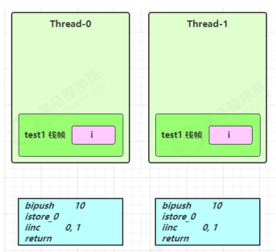
</div>

局部变量的引用稍有不同 
先看一个成员变量的例子：
```
class ThreadUnsafe {
    ArrayList<String> list = new ArrayList<>();
    public void method1(int loopNumber) {
        for (int i = 0; i < loopNumber; i++) {
            // { 临界区, 会产生竞态条件
            method2();
            method3();
            // } 临界区
        }
    }
    private void method2() {
        list.add("1");
    }
    private void method3() {
        list.remove(0);
    }
}
```
执行

```
static final int THREAD_NUMBER = 2;
static final int LOOP_NUMBER = 200;
public static void main(String[] args) {
    ThreadUnsafe test = new ThreadUnsafe();
    for (int i = 0; i < THREAD_NUMBER; i++) {
        new Thread(() -> {
            test.method1(LOOP_NUMBER);
        }, "Thread" + i).start();
    }
}
```

分析： 
● 无论哪个线程中的 method2 引用的都是同一个对象中的 list 成员变量 
● method3 与 method2 分析相同
<div class="img-wrap-left">
  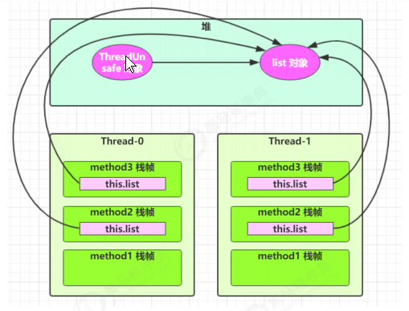
</div>

将 list 修改为局部变量

```
class ThreadSafe {
    public final void method1(int loopNumber) {
        ArrayList<String> list = new ArrayList<>();
        for (int i = 0; i < loopNumber; i++) {
            method2(list);
            method3(list);
        }
    }
    private void method2(ArrayList<String> list) {
        list.add("1");
    }
    private void method3(ArrayList<String> list) {
        list.remove(0);
    }
}
```
那么就不会有上述问题了
分析： 
● list 是局部变量，每个线程调用时会创建其不同实例，没有共享 
● 而 method2 的参数是从 method1 中传递过来的，与 method1 中引用同一个对象 
● method3 的参数分析与 method2 相同

<div class="img-wrap-left">
  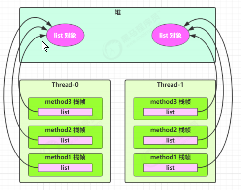
</div>

方法访问修饰符带来的思考，如果把 method2 和 method3 的方法修改为 public 会不会出现线程安全问题？ 
● 情况1：有其它线程调用 method2 和 method3 
● 情况2：在 情况1 的基础上，为 ThreadSafe 类添加子类，子类覆盖 method2 或 method3 方法，即
```
class ThreadSafe {
    public final void method1(int loopNumber) {
        ArrayList<String> list = new ArrayList<>();
        for (int i = 0; i < loopNumber; i++) {
            method2(list);
            method3(list);
        }
    }
    private void method2(ArrayList<String> list) {
        list.add("1");
    }
    private void method3(ArrayList<String> list) {
        list.remove(0);
    }
}

class ThreadSafeSubClass extends ThreadSafe{
    @Override
    public void method3(ArrayList<String> list) {
        new Thread(() -> {
            list.remove(0);
        }).start();
    }
}
```


## 3.4.3 典型案例：集合线程安全问题

**不安全写法（成员变量集合）**：多线程共享同一个ArrayList，add/remove交替执行，大概率报索引越界异常

**安全写法（局部变量集合）**：每个线程创建独立ArrayList实例，无共享，彻底规避安全问题

从这个例子可以看出 private 或 final 提供【安全】的意义所在，请体会开闭原则中的【闭】

**拓展**：private、final修饰方法/变量，可防止子类重写、外部篡改，提升线程安全性（开闭原则之闭）

#### 小结：
- 基本数据类型局部变量：线程安全，每个线程栈帧独立创建，无共享
- 引用类型局部变量：
    - 未逃离方法作用域：线程安全
    - 逃离方法作用域（返回、赋值给全局变量、开启新线程操作）：线程不安全

## 3.4.4 常见线程安全类

String、Integer等不可变类、StringBuffer、Vector、Hashtable、JUC包下所有类

这里说它们是线程安全的是指，多个线程调用它们同一个实例的某个方法时，是线程安全的。也可以理解为

```
Hashtable table = new Hashtable();

new Thread(()->{
    table.put("key", "value1");
}).start();

new Thread(()->{
    table.put("key", "value2");
}).start();
```
- 它们的每个方法是原子的 
- 但注意它们多个方法的组合不是原子的，见后面分析

**核心注意点**：线程安全类的**单一方法是原子的，但多个方法组合操作非原子**，依然存在竞态条件

示例：Hashtable先判断null再put，两步操作不原子，存在并发风险

```
Hashtable table = new Hashtable();
// 线程1，线程2
if( table.get("key") == null) {
    table.put("key", value);
}
```
<div class="img-wrap-left">
  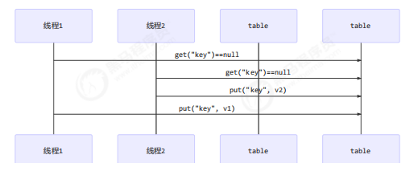
</div>


## 3.4.5 不可变类线程安全原理

String、Integer等类内部状态不可修改，所有修改操作都会返回新对象，原对象数据永久不变，天然线程安全。

## 3.4.6 实战场景线程安全分析

覆盖Servlet、切面、DAO层等常见业务场景，核心结论：**全局共享可变变量不安全，局部变量、无状态对象安全**，典型风险点：

- Servlet全局可变成员变量：不安全

- 切面全局计时变量：多线程共享篡改，不安全

- DAO层全局Connection连接：共享争抢，不安全

- 方法内临时创建的连接、集合：线程安全

- 外星方法（抽象方法交由子类实现）：行为不可控，易引发线程安全问题

实例分析
例1：
```
public class MyServlet extends HttpServlet {
    // 是否安全？  不安全
    Map<String,Object> map = new HashMap<>();
    // 是否安全？  安全
    String S1 = "...";
    // 是否安全？  安全
    final String S2 = "...";
    // 是否安全？  不安全
    Date D1 = new Date();
    // 是否安全？  不安全
    final Date D2 = new Date();

    public void doGet(HttpServletRequest request, HttpServletResponse response) {
        // 使用上述变量
    }
}
```
例2：
```
public class MyServlet extends HttpServlet {
    // 是否安全？  不安全
    private UserService userService = new UserServiceImpl();

    public void doGet(HttpServletRequest request, HttpServletResponse response) {
        userService.update(...);
    }
}

public class UserServiceImpl implements UserService {
    // 记录调用次数
    private int count = 0;

    public void update() {
        // ...
        count++;
    }
}
```
例3：
```
@Aspect
@Component
public class MyAspect {
    // 是否安全？ 不安全
    private long start = 0L;

    @Before("execution(* *(..))")
    public void before() {
        start = System.nanoTime();
    }

    @After("execution(* *(..))")
    public void after() {
        long end = System.nanoTime();
        System.out.println("cost time:" + (end-start));
    }
}
```
例4：
```
public class MyServlet extends HttpServlet {
    // 是否安全  安全
    private UserService userService = new UserServiceImpl();

    public void doGet(HttpServletRequest request, HttpServletResponse response) {
        userService.update(...);
    }
}

public class UserServiceImpl implements UserService {
    // 是否安全 安全
    private UserDao userDao = new UserDaoImpl();

    public void update() {
        userDao.update();
    }
}

public class UserDaoImpl implements UserDao {
    public void update() {
        String sql = "update user set password = ? where username = ?";
        // 是否安全 安全
        try (Connection conn = DriverManager.getConnection("","","")){
            // ...
        } catch (Exception e) {
            // ...
        }
    }
}
```
例5：
```
public class MyServlet extends HttpServlet {
    // 是否安全
    private UserService userService = new UserServiceImpl();

    public void doGet(HttpServletRequest request, HttpServletResponse response) {
        userService.update(...);
    }
}

public class UserServiceImpl implements UserService {
    // 是否安全
    private UserDao userDao = new UserDaoImpl();

    public void update() {
        userDao.update();
    }
}

public class UserDaoImpl implements UserDao {
    // 是否安全 
    private Connection conn = null;
    public void update() throws SQLException {
        String sql = "update user set password = ? where username = ?";
        conn = DriverManager.getConnection("","","");
        // ...
        conn.close();
    }
}
```
例6：
```
public class MyServlet extends HttpServlet {
    // 是否安全
    private UserService userService = new UserServiceImpl();

    public void doGet(HttpServletRequest request, HttpServletResponse response) {
        userService.update(...);
    }
}

public class UserServiceImpl implements UserService {
    public void update() {
        UserDao userDao = new UserDaoImpl();
        userDao.update();
    }
}

public class UserDaoImpl implements UserDao {
    // 是否安全
    private Connection = null;
    public void update() throws SQLException {
        String sql = "update user set password = ? where username = ?";
        conn = DriverManager.getConnection("","","");
        // ...
        conn.close();
    }
}
```
例7：
```
public abstract class Test {

    public void bar() {
        // 是否安全
        SimpleDateFormat sdf = new SimpleDateFormat("yyyy-MM-dd HH:mm:ss");
        foo(sdf);
    }

    public abstract foo(SimpleDateFormat sdf);


    public static void main(String[] args) {
        new Test().bar();
    }
    
}
```
其中 foo 的行为是不确定的，可能导致不安全的发生，被称之为外星方法
```
public void foo(SimpleDateFormat sdf) {
    String dateStr = "1999-10-11 00:00:00";
    for (int i = 0; i < 20; i++) {
        new Thread(() -> {
            try {
                sdf.parse(dateStr);
            } catch (ParseException e) {
                e.printStackTrace();
            }
        }).start();
    }
}
```
请比较 JDK 中 String 类的实现

例8：
```
private static Integer i = 0;
public static void main(String[] args) throws InterruptedException {
    List<Thread> list = new ArrayList<>();
    for (int j = 0; j < 2; j++) {
        Thread thread = new Thread(() -> {
            for (int k = 0; k < 5000; k++) {
                synchronized (i) {
                    i++;
                }
            }
        }, "" + j);
        list.add(thread);
    }
    list.stream().forEach(t -> t.start());
    list.stream().forEach(t -> {
        try {
            t.join();
        } catch (InterruptedException e) {
            e.printStackTrace();
        }
    });
    log.debug("{}", i);
}
```

# 3.5 经典习题：卖票问题
卖票练习 
测试下面代码是否存在线程安全问题，并尝试改正
```
public class ExerciseSell {
    public static void main(String[] args) {
        TicketWindow ticketWindow = new TicketWindow(2000);
        List<Thread> list = new ArrayList<>();
        // 用来存储买出去多少张票
        List<Integer> sellCount = new Vector<>();
        for (int i = 0; i < 2000; i++) {
            Thread t = new Thread(() -> {
                // 分析这里的竞态条件
                int count = ticketWindow.sell(randomAmount());
                sellCount.add(count);
            });
            list.add(t);
            t.start();
        }
        list.forEach((t) -> {
            try {
                t.join();
            } catch (InterruptedException e) {
                e.printStackTrace();
            }
        });
        // 卖出去的票求和
        log.debug("selled count:{}",sellCount.stream().mapToInt(c -> c).sum());
        // 剩余票数
        log.debug("remainder count:{}", ticketWindow.getCount());
    }
    // Random 为线程安全
    static Random random = new Random();
    // 随机 1~5
    public static int randomAmount() {
        return random.nextInt(5) + 1;
    }
}

class TicketWindow {
    private int count;
    public TicketWindow(int count) {
        this.count = count;
    }
    public int getCount() {
        return count;
    }
    public int sell(int amount) {
        if (this.count >= amount) {
            this.count -= amount;
            return amount;
        } else {
            return 0;
        }
    }
}
```

另外，用下面的代码行不行，为什么？
```
List<Integer> sellCount = new ArrayList<>();
```
测试脚本
```
for /L %n in (1,1,10) do java -cp ".;C:\Users\manyh\.m2\repository\ch\qos\logback\logback-classic\1.2.3\logback-classic-1.2.3.jar;C:\Users\manyh\.m2\repository\ch\qos\logback\logback-core\1.2.3\logback-core-1.2.3.jar;C:\Users\manyh\.m2\repository\org\slf4j\slf4j-api\1.7.25\slf4j-api-1.7.25.jar" cn.itcast.n4.exercise.ExerciseSell
```
转账练习
测试下面代码是否存在线程安全问题，并尝试改正
```
public class ExerciseTransfer {
    public static void main(String[] args) throws InterruptedException {
        Account a = new Account(1000);
        Account b = new Account(1000);
        Thread t1 = new Thread(() -> {
            for (int i = 0; i < 1000; i++) {
                a.transfer(b, randomAmount());
            }
        }, "t1");
        Thread t2 = new Thread(() -> {
            for (int i = 0; i < 1000; i++) {
                b.transfer(a, randomAmount());
            }
        }, "t2");
        t1.start();
        t2.start();
        t1.join();
        t2.join();
        // 查看转账2000次后的总金额
        log.debug("total:{}",(a.getMoney() + b.getMoney()));
    }
    // Random 为线程安全
    static Random random = new Random();
    // 随机 1~100
    public static int randomAmount() {
        return random.nextInt(100) +1;
    }
}

class Account {
    private int money;
    public Account(int money) {
        this.money = money;
    }
    public int getMoney() {
        return money;
    }
    public void setMoney(int money) {
        this.money = money;
    }
    public void transfer(Account target, int amount) {
        if (this.money > amount) {
            this.setMoney(this.getMoney() - amount);
            target.setMoney(target.getMoney() + amount);
        }
    }
}
```
这样改正行不行，为什么？  不行,锁要用同一个共用锁,而这里的account是不同对象

```
public synchronized void transfer(Account target, int amount) {
    if (this.money > amount) {
        this.setMoney(this.getMoney() - amount);
        target.setMoney(target.getMoney() + amount);
    }
}
```
## 3.5.1 问题现象

多线程并发卖票，sell方法存在**判断余量-扣减票数**两步非原子操作，出现超卖、票数总和不一致问题。

## 3.5.2 问题根源

多个线程同时判断票数充足，全部进入扣减逻辑，超出剩余票数。

## 3.5.3 优化方案

给sell方法加synchronized锁，保证判断\+扣减原子执行；同时sellCount需使用Vector（线程安全），不可用ArrayList（线程不安全）。

