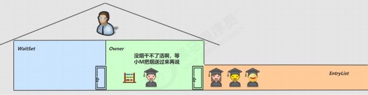
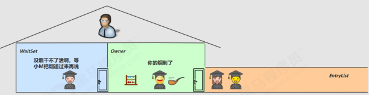
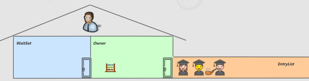
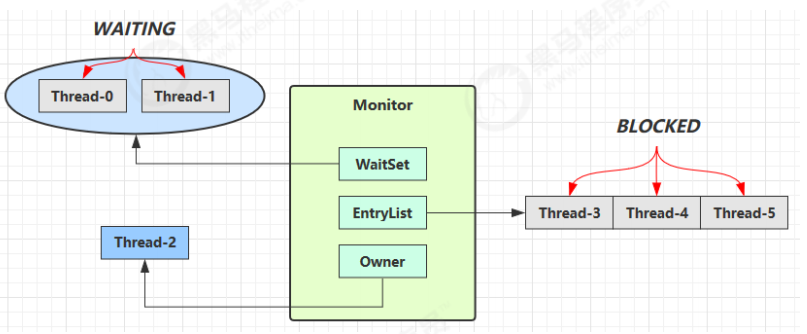

    Wait  Notify   

# **Wait/Notify** 线程等待唤醒机制

Wait/notify 是 synchronized 内置的线程协作机制，依托 Monitor 的 WaitSet 等待队列实现，
核心作用是**实现线程间通信、控制线程执行顺序、优化并发效率**，解决线程条件不满足时的无效阻塞问题，是多线程同步的核心基础机制。

## 5.1 通俗小故事：为什么需要 wait 等待机制

我们可以结合生活化场景，彻底理解 wait/notify 的设计初衷，解决线程持有锁空等的低效问题：
● 由于条件不满足，小南不能继续进行计算 
● 但小南如果一直占用着锁，其它人就得一直阻塞，效率太低

    

● 于是老王单开了一间休息室（调用 wait 方法），让小南到休息室（WaitSet）等着去了，但这时锁释放开，其它人可以由老王随机安排进屋 
● 直到小M将烟送来，大叫一声 [ 你的烟到了 ] （调用 notify 方法）

    

● 小南于是可以离开休息室，重新进入竞争锁的队列

    

> ● 线程小南获取到对象锁（占用房间）后，发现自身执行条件不满足（没有烟无法干活），无法继续执行业务代码；
> ● 如果小南一直持有锁空等，其他所有线程都会被阻塞在EntryList，无法执行任何操作，系统并发效率极低；
> ● 为解决该问题，Monitor 提供了专属休息室 WaitSet：小南调用 wait() 主动释放锁，进入 WaitSet 休眠等待，此时锁空闲，其他线程可以正常竞争锁、执行业务；
> ● 当外部条件满足（小M把烟送达），其他线程调用 notify() 发出唤醒通知；
> ● 休眠的小南被唤醒，离开 WaitSet 休息室，重新进入 EntryList 竞争锁资源，获取锁成功后继续执行剩余代码。

## 5.2 wait/notify 底层原理（Monitor 机制）

    

**Wait/Notify:**  所有操作都依托对象的 Monitor 监视器实现，核心涉及 Monitor 的 Owner、EntryList、WaitSet 三大核心模块，线程状态流转清晰明确：

**等待流程**：持有锁的Owner线程，判断执行条件不满足，调用 wait() 方法，主动释放Monitor锁，线程状态从运行态转为 **WAITING**，进入 WaitSet 等待队列休眠；

**阻塞与等待核心区别**：BLOCKED（阻塞）、WAITING（等待）状态的线程均不占用CPU时间片，无CPU消耗；BLOCKED线程仅在锁释放时被唤醒，WAITING线程必须主动被 notify/notifyAll 唤醒；

**唤醒流程**：其他线程获取锁后，调用 notify()/notifyAll()，唤醒 WaitSet 中的等待线程；

**唤醒后续操作**：WAITING线程被唤醒后不会立即执行，必须转入 EntryList 重新参与锁竞争，成功获取锁后，从 wait() 断点处继续执行代码。

## 5.3 核心API详解与使用前提

wait()、notify()、notifyAll() 是 Object 类的原生方法，所有Java对象都具备该能力，专门配合 synchronized 锁实现线程协作，
**核心强制前提**：必须在同步代码块/同步方法内调用，必须持有当前对象的Monitor锁，否则直接抛出 `IllegalMonitorStateException` 非法监视器异常。

**obj.wait()**：当前线程释放对象锁，进入该对象的WaitSet无限等待，直到被其他线程唤醒；

**obj.wait(long n)**：限时等待，线程释放锁进入等待，n毫秒后自动结束等待，或提前被notify唤醒；

**obj.notify()**：随机唤醒 WaitSet 中**一个**等待线程，唤醒后线程重新竞争锁；

**obj.notifyAll()**：唤醒 WaitSet 中**所有**等待线程，所有线程统一进入锁竞争队列。

## 5.4 完整代码实战案例

通过双线程等待、主线程延时唤醒的案例，直观展示 notify 和 notifyAll 的执行效果差异：

<pre>
final static Object obj = new Object();

public static void main(String[] args) {
    // 线程0：等待唤醒
    new Thread(() -> {
        synchronized (obj) {
            log.debug("Thread-0 执行，进入等待状态....");
            try {
                obj.wait(); // 释放锁，无限等待
            } catch (InterruptedException e) {
                e.printStackTrace();
            }
            log.debug("Thread-0 被唤醒，执行后续代码....");
        }
    }).start();

    // 线程1：等待唤醒
    new Thread(() -> {
        synchronized (obj) {
            log.debug("Thread-1 执行，进入等待状态....");
            try {
                obj.wait(); // 释放锁，无限等待
            } catch (InterruptedException e) {
                e.printStackTrace();
            }
            log.debug("Thread-1 被唤醒，执行后续代码....");
        }
    }).start();

    // 主线程延时2秒后执行唤醒操作
    Sleeper.sleep(2);
    log.debug("主线程开始唤醒等待线程");
    synchronized (obj) {
        obj.notify(); // 仅唤醒WaitSet中一个线程
        // obj.notifyAll(); // 唤醒WaitSet中所有等待线程
    }
}
</pre>

### 1. notify() 执行结果（单线程唤醒）

随机唤醒一个等待线程，另一个线程继续休眠等待：

<pre>
20:00:53.096 [Thread-0] c.TestWaitNotify - Thread-0 执行，进入等待状态.... 
20:00:53.099 [Thread-1] c.TestWaitNotify - Thread-1 执行，进入等待状态.... 
20:00:55.096 [main] c.TestWaitNotify - 主线程开始唤醒等待线程
20:00:55.096 [Thread-0] c.TestWaitNotify - Thread-0 被唤醒，执行后续代码....
</pre>

### 2. notifyAll() 执行结果（全线程唤醒）

一次性唤醒所有等待线程，所有线程重新竞争锁执行后续逻辑：

<pre>
19:58:15.457 [Thread-0] c.TestWaitNotify - Thread-0 执行，进入等待状态.... 
19:58:15.460 [Thread-1] c.TestWaitNotify - Thread-1 执行，进入等待状态.... 
19:58:17.456 [main] c.TestWaitNotify - 主线程开始唤醒等待线程
19:58:17.456 [Thread-1] c.TestWaitNotify - Thread-1 被唤醒，执行后续代码.... 
19:58:17.456 [Thread-0] c.TestWaitNotify - Thread-0 被唤醒，执行后续代码....
</pre>

## 5.5 wait/notify 核心特性与关键注意点

wait()、notify()、notifyAll() 均为 Object 原生方法，必须在**同步代码块/同步方法内调用**（必须持有对象Monitor锁），否则抛出 IllegalMonitorStateException。同时结合锁机制有两个核心特性、两个高频问题：

- **锁释放特性**：调用 wait() 会**主动释放当前持有的锁**，让其他线程有机会竞争锁执行业务，彻底避免线程空占锁导致的并发阻塞问题；notify/notifyAll 唤醒线程时，不会立即释放锁，需当前同步代码块执行完毕后才会自动释放。

- **锁升级特性**：偏向锁、轻量级锁不支持 wait/notify 机制，线程调用该方法后，JVM 会直接将锁**升级为重量级锁**，依托Monitor实现等待唤醒逻辑。

- **虚假唤醒问题**：线程可能在无notify唤醒的情况下自动从wait状态苏醒，因此业务中**必须使用while循环校验等待条件**，禁止使用if判断，苏醒后重新校验条件，不满足则继续等待。

- **唤醒差异**：notify随机唤醒单一线程，效率高但可能导致部分线程长期饥饿；notifyAll唤醒全部线程，无饥饿问题，但锁竞争开销更大。

## 5.6 sleep 与 wait 核心区别

很多新手容易混淆 `Thread.sleep(long n)` 和 `Object.wait(long n)`，二者均可让线程进入 **TIMED_WAITING** 超时等待状态，但底层机制、使用场景差异极大，核心区别如下：

- **方法归属不同**：sleep 是 Thread 线程类静态方法；wait 是 Object 顶级对象方法，所有对象均可调用

- **锁依赖不同**：sleep 无需配合同步锁，任意场景可直接调用；wait 必须在 synchronized 同步代码块/方法内调用，需持有对象监视器锁

- **锁释放特性不同**：sleep 睡眠期间**不释放任何锁**，持续占用锁资源；wait 等待时**主动释放对象锁**，其他线程可正常竞争锁执行业务

- **唤醒机制不同**：sleep 仅能超时自动唤醒；wait 可超时自动唤醒，也可被 notify/notifyAll 主动唤醒

## 5.7 wait/notify 正确使用姿势（避坑实战）

通过四组递进式案例，从错误示范到最终最优写法，彻底掌握 wait/notify 规范用法，解决锁占用、虚假唤醒、唤醒错乱等核心问题。

### 案例1：sleep 写法的致命缺陷

在线程条件不满足时，使用 sleep 休眠，会持续占用锁，阻塞所有其他线程，并发效率极低。

<pre>
static final Object room = new Object();
static boolean hasCigarette = false;
static boolean hasTakeout = false;

public static void main(String[] args) {
    // 干活线程：没烟就sleep休眠
    new Thread(() -> {
        synchronized (room) {
            log.debug("有烟没？[{}]", hasCigarette);
            if (!hasCigarette) {
                log.debug("没烟，先歇会！");
                Sleeper.sleep(2); // 占用锁休眠，不释放锁
            }
            log.debug("有烟没？[{}]", hasCigarette);
            if (hasCigarette) {
                log.debug("可以开始干活了");
            }
        }
    }, "小南").start();

    // 5个普通工作线程
    for (int i = 0; i < 5; i++) {
        new Thread(() -> {
            synchronized (room) {
                log.debug("可以开始干活了");
            }
        }, "其它人").start();
    }

    // 送烟线程（未加锁，可直接修改变量）
    Sleeper.sleep(1);
    new Thread(() -> {
        hasCigarette = true;
        log.debug("烟到了噢！");
    }, "送烟的").start();
}
</pre>

**问题总结**：

- 小南线程休眠2秒期间，持续占用room锁，5个其他线程全部阻塞等待，无法执行业务

- 即使1秒后烟提前送达，小南必须睡满2秒才能唤醒，无法及时响应条件变化

- 核心症结：**sleep 不释放锁，造成线程资源阻塞浪费**

### 案例2：基础 wait 优化（解决锁阻塞问题）

用 wait 替代 sleep，等待时主动释放锁，让其他线程正常执行，解决并发阻塞问题。

<pre>
// 核心代码改造
new Thread(() -> {
    synchronized (room) {
        log.debug("有烟没？[{}]", hasCigarette);
        if (!hasCigarette) {
            log.debug("没烟，先歇会！");
            try {
                room.wait(2000); // 等待并释放锁
            } catch (InterruptedException e) {
                e.printStackTrace();
            }
        }
        log.debug("有烟没？[{}]", hasCigarette);
        if (hasCigarette) {
            log.debug("可以开始干活了");
        }
    }
}, "小南").start();

// 送烟线程加锁、主动唤醒
Sleeper.sleep(1);
new Thread(() -> {
    synchronized (room) {
        hasCigarette = true;
        log.debug("烟到了噢！");
        room.notify(); // 唤醒等待线程
    }
}, "送烟的").start();
</pre>

**优化效果**：小南等待时释放锁，5个普通线程可正常执行，并发效率大幅提升；**遗留问题**：多线程多条件等待时，会出现唤醒错乱、虚假唤醒问题。

### 案例3：虚假唤醒问题（if+wait 坑点）

多个线程基于同一锁、不同条件等待时，notify 会随机唤醒线程，导致线程被唤醒后条件依旧不满足，出现**虚假唤醒**。

<pre>
public static void main(String[] args) {
    // 等待烟的线程
    new Thread(() -> {
        synchronized (room) {
            log.debug("有烟没？[{}]", hasCigarette);
            if (!hasCigarette) { // if单次判断，存在漏洞
                log.debug("没烟，先歇会！");
                try {
                    room.wait();
                } catch (InterruptedException e) {
                    e.printStackTrace();
                }
            }
            // 被唤醒后直接执行，不再校验条件
            if (hasCigarette) {
                log.debug("小南：可以开始干活了");
            } else {
                log.debug("小南：没干成活...");
            }
        }
    }, "小南").start();

    // 等待外卖的线程
    new Thread(() -> {
        synchronized (room) {
            log.debug("外卖送到没？[{}]", hasTakeout);
            if (!hasTakeout) {
                log.debug("没外卖，先歇会！");
                try {
                    room.wait();
                } catch (InterruptedException e) {
                    e.printStackTrace();
                }
            }
            if (hasTakeout) {
                log.debug("小女：可以开始干活了");
            } else {
                log.debug("小女：没干成活...");
            }
        }
    }, "小女").start();

    // 仅送达外卖、唤醒随机线程
    Sleeper.sleep(1);
    new Thread(() -> {
        synchronized (room) {
            hasTakeout = true;
            log.debug("外卖到了噢！");
            room.notify();
        }
    }, "送外卖的").start();
}
</pre>

**问题根源**：notify 随机唤醒 WaitSet 中的线程，本例中唤醒了等待烟的小南线程，此时香烟条件仍不满足，但 if 仅判断一次，线程直接执行后续代码，任务失败。

### 案例4：notifyAll 优化（解决唤醒不全问题）

将 notify 改为 notifyAll，唤醒所有等待线程，解决线程唤醒遗漏问题，但 if 判断的单次校验漏洞依旧存在。

### 案例5：最终最优写法（while+wait+notifyAll）

**核心规范**：必须使用 **while 循环 + wait** 做条件重试判断，搭配 notifyAll 全局唤醒，彻底杜绝虚假唤醒。

<pre>
// 最优条件判断写法
synchronized (room) {
    // while 循环：唤醒后重新校验条件，不满足继续等待
    while (!hasCigarette) {
        log.debug("没烟，先歇会！");
        try {
            room.wait();
        } catch (InterruptedException e) {
            e.printStackTrace();
        }
    }
    // 条件满足，执行业务
    log.debug("小南：可以开始干活了");
}

// 唤醒线程统一使用 notifyAll
synchronized (room) {
    hasTakeout = true;
    room.notifyAll(); // 唤醒所有等待线程，各自重新校验条件
}
</pre>

**终极使用公式**：

- 等待方：`synchronized(锁) { while(条件不满足) { 锁.wait(); } 执行业务; }`

- 唤醒方：`synchronized(锁) { 变更条件; 锁.notifyAll(); }`

## 5.8 同步模式一：保护性暂停（Guarded Suspension）

### 1. 核心要点
1. **定义:** 经典线程同步设计模式，核心场景：**一个线程等待另一个线程的执行结果，线程一对一结果传递**，JDK 中 `join()`、`Future` 底层均基于该模式实现。
即 Guarded Suspension，用在一个线程等待另一个线程的执行结果.
**要点:**
● 有一个结果需要从一个线程传递到另一个线程，让他们关联同一个 GuardedObject 
● 如果有结果不断从一个线程到另一个线程那么可以使用消息队列（见生产者/消费者） 
● JDK 中，join 的实现、Future 的实现，采用的就是此模式 
● 因为要等待另一方的结果，因此归类到同步模式 

### 2. 基础版实现（无超时）

<pre>
class GuardedObject {
    private Object response; // 存储线程执行结果
    private final Object lock = new Object();

    // 等待获取结果
    public Object get() {
        synchronized (lock) {
            // while循环杜绝虚假唤醒
            while (response == null) {
                try {
                    lock.wait();
                } catch (InterruptedException e) {
                    e.printStackTrace();
                }
            }
            return response;
        }
    }

    // 生产结果、唤醒等待线程
    public void complete(Object response) {
        synchronized (lock) {
            this.response = response;
            lock.notifyAll();
        }
    }
}
</pre>

### 3. 超时版实现（防止永久阻塞）

优化后支持自定义等待时长，提前唤醒后会重新计算剩余等待时间，精准控制超时逻辑。

<pre>
class GuardedObjectV2 {
    private Object response;
    private final Object lock = new Object();

    public Object get(long millis) {
        synchronized (lock) {
            long begin = System.currentTimeMillis();
            long timePassed = 0;
            while (response == null) {
                // 计算剩余等待时间
                long waitTime = millis - timePassed;
                if (waitTime <= 0) {
                    break; // 超时退出
                }
                try {
                    lock.wait(waitTime);
                } catch (InterruptedException e) {
                    e.printStackTrace();
                }
                // 统计已等待时长
                timePassed = System.currentTimeMillis() - begin;
            }
            return response;
        }
    }

    public void complete(Object response) {
        synchronized (lock) {
            this.response = response;
            lock.notifyAll();
        }
    }
}
</pre>

### 3. 多任务版实现（解耦多线程任务）

通过唯一ID标识不同任务，结合信箱容器解耦生产者与消费者，支持多线程同时等待、多线程批量生产结果。

<pre>
// 带唯一任务ID的守护者对象
class GuardedObject {
    private int id;
    private Object response;

    public GuardedObject(int id) {
        this.id = id;
    }

    public int getId() {
        return id;
    }

    public Object get(long timeout) {
        synchronized (this) {
            long begin = System.currentTimeMillis();
            long passedTime = 0;
            while (response == null) {
                long waitTime = timeout - passedTime;
                if (waitTime <= 0) break;
                try {
                    this.wait(waitTime);
                } catch (InterruptedException e) {
                    e.printStackTrace();
                }
                passedTime = System.currentTimeMillis() - begin;
            }
            return response;
        }
    }

    public void complete(Object response) {
        synchronized (this) {
            this.response = response;
            this.notifyAll();
        }
    }
}

// 信箱解耦工具类
class Mailboxes {
    private static final Map<Integer, GuardedObject> boxes = new Hashtable<>();
    private static int id = 1;

    // 生成唯一任务ID
    private static synchronized int generateId() {
        return id++;
    }

    // 创建守护者对象
    public static GuardedObject createGuardedObject() {
        GuardedObject go = new GuardedObject(generateId());
        boxes.put(go.getId(), go);
        return go;
    }

    // 获取对应任务守护者
    public static GuardedObject getGuardedObject(int id) {
        return boxes.remove(id);
    }

    // 获取所有任务ID
    public static Set<Integer> getIds() {
        return boxes.keySet();
    }
}
</pre>

### 5. JDK底层原理：join方法实现

线程 `join()` 方法底层完全基于保护性暂停模式实现，通过 while+wait 循环等待目标线程执行完毕：

<pre>
public final synchronized void join(long millis) throws InterruptedException {
    long base = System.currentTimeMillis();
    long now = 0;
    if (millis < 0) throw new IllegalArgumentException("timeout value is negative");
    if (millis == 0) {
        // 永久等待：目标线程存活则持续等待
        while (isAlive()) {
            wait(0);
        }
    } else {
        // 限时等待
        while (isAlive()) {
            long delay = millis - now;
            if (delay <= 0) break;
            wait(delay);
            now = System.currentTimeMillis() - base;
        }
    }
}
</pre>

## 5.9 异步模式二：生产者消费者模式

多线程核心异步协作模式，**彻底解耦生产线程与消费线程**，通过阻塞队列平衡生产、消费速率，JDK 所有阻塞队列（ArrayBlockingQueue、LinkedBlockingQueue）均基于该模式实现。

### 1. 核心特点

- 无需线程一对一匹配，多生产者、多消费者可并行工作

- 通过带容量的阻塞队列缓冲数据，平衡生产消费速度

- 队列空：消费者阻塞等待；队列满：生产者阻塞等待

- 生产者只负责生产数据，消费者只负责处理数据，职责解耦

### 2. 完整代码实现

<pre>
// 消息实体类
class Message {
    private int id;
    private Object message;

    public Message(int id, Object message) {
        this.id = id;
        this.message = message;
    }

    public int getId() {
        return id;
    }

    public Object getMessage() {
        return message;
    }
}

// 阻塞消息队列
class MessageQueue {
    private final LinkedList<Message> queue;
    private final int capacity; // 队列最大容量

    public MessageQueue(int capacity) {
        this.capacity = capacity;
        queue = new LinkedList<>();
    }

    // 消费者获取消息
    public Message take() {
        synchronized (queue) {
            // 队列空，消费者等待
            while (queue.isEmpty()) {
                log.debug("队列无数据，消费者等待...");
                try {
                    queue.wait();
                } catch (InterruptedException e) {
                    e.printStackTrace();
                }
            }
            Message message = queue.removeFirst();
            queue.notifyAll(); // 唤醒生产者（队列有空位）
            return message;
        }
    }

    // 生产者存入消息
    public void put(Message message) {
        synchronized (queue) {
            // 队列满，生产者等待
            while (queue.size() == capacity) {
                log.debug("队列已满，生产者等待...");
                try {
                    queue.wait();
                } catch (InterruptedException e) {
                    e.printStackTrace();
                }
            }
            queue.addLast(message);
            queue.notifyAll(); // 唤醒消费者（队列有数据）
        }
    }
}
</pre>

### 3. 业务场景测试

<pre>
public static void main(String[] args) {
    // 创建容量为2的消息队列
    MessageQueue messageQueue = new MessageQueue(2);

    // 4个生产者线程生产任务
    for (int i = 0; i < 4; i++) {
        int id = i;
        new Thread(() -> {
            log.debug("生产者{}：开始下载任务", id);
            List<String> response = download(); // 模拟业务下载
            log.debug("生产者{}：任务完成，存入队列", id);
            messageQueue.put(new Message(id, response));
        }, "生产者" + i).start();
    }

    // 1个消费者线程持续处理任务
    new Thread(() -> {
        while (true) {
            Message message = messageQueue.take();
            List<String> data = (List<String>) message.getMessage();
            log.debug("消费者：处理任务{}，数据量：{}", message.getId(), data.size());
        }
    }, "消费者").start();
}
</pre>

## 5.10 章节核心总结

**核心区别**：sleep 不释放锁、无锁依赖；wait 释放锁、必须配合 synchronized

**wait/notify 黄金规范**：while循环判条件 + notifyAll唤醒，彻底解决虚假唤醒

**保护性暂停**：一对一线程结果同步，适合等待单次任务结果，join/Future底层实现

**生产者消费者**：多线程异步协作，队列缓冲解耦，平衡生产消费速率，适配批量任务处理