

    Monitor  

# Monitor与锁升级深度原理

## 4.1 Java 对象头结构

Java 锁的核心原理依托于**对象头**实现，以32位虚拟机为基础，普通对象、数组对象的对象头结构不同，核心包含 Mark Word、Klass Word 两部分。

### 4.1.1 普通对象头结构（32位JVM）
普通对象头占用8字节（64bit），由两部分组成：
    **Mark Word（4字节）**：存储对象运行时核心数据，包含哈希码、GC分代年龄、锁状态、偏向线程ID等，是锁实现的核心载体。
    **Klass Word（4字节）**：类型指针，指向对象对应的Class模板对象。

  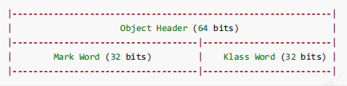

### 4.1.2 数组对象头结构（32位JVM）
数组对象相较于普通对象，额外新增**数组长度（4字节）**字段，用于记录数组元素个数，整体对象头占用12字节。

  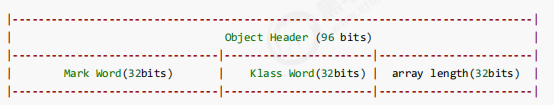

### 4.1.3 Mark Word 核心结构

>Mark Word 是动态可变结构，会根据对象**锁状态、生命周期**切换存储内容，32位与64位虚拟机结构略有差异，
>核心存储信息包含：哈希值、GC年龄、偏向线程ID、时间戳、锁状态标记位。
>对象的无锁、偏向锁、轻量级锁、重量级锁状态，全部通过 Mark Word 的标记位区分，JVM 通过识别该字段完成锁的判定与升级。

32位虚拟机 Mark Word：

  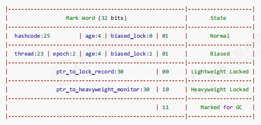

64位虚拟机 Mark Word：

  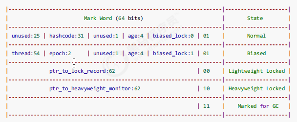

参考资料: 
https://stackoverflow.com/questions/26357186/what-is-in-java-object-header

## 4.2 Monitor之原理

>Monitor 翻译为**监视器/管程**，是 synchronized 重量级锁的底层实现，
>**每个Java对象都可关联一个Monitor对象**。当对象被synchronized加重量级锁时，对象头的Mark Word会存储指向Monitor的指针.

### 4.2.1 Monitor 核心结构与工作机制
Monitor 核心结构: 包含 Owner、EntryList、WaitSet 三大核心模块，工作流程如下：
**Owner（持有者）**：初始为null，同一时刻仅允许一个线程成为Owner，持有锁执行临界区代码。
**EntryList（阻塞队列）**：未获取到锁的线程进入该队列，状态为BLOCKED，等待锁释放后竞争资源。
**WaitSet（等待队列）**：持有锁后因条件不满足，调用wait()的线程进入该队列，状态为WAITING，需被notify/notifyAll唤醒后重新进入锁竞争。

  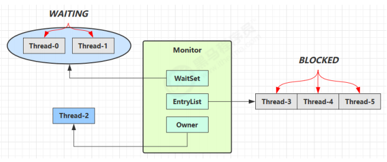

 
> 注意：synchronized 必须是进入同一个对象的 monitor 才有上述的效果 ,不加 synchronized 的对象不会关联监视器，不遵从以上规则

### 4.2.2 核心执行流程
> 线程执行 synchronized(obj)，若obj无锁，将Monitor的Owner设为当前线程;
> 其他线程竞争同一锁，全部进入EntryList阻塞;
> 持有锁的线程执行完临界区代码，释放锁（Owner置空），唤醒EntryList中线程竞争锁（默认非公平）;
> 持有锁的线程调用wait()，释放锁并进入WaitSet等待，等待唤醒后重新参与锁竞争。
**核心注意点**：只有获取**同一个对象的Monitor**才能实现互斥效果，未加synchronized的对象不会关联Monitor，无互斥特性.
## 4.2.3 synchronized 字节码原理
**示例：**

<pre>
static final Object lock = new Object();
static int counter = 0;
public static void main(String[] args) {
    synchronized (lock) {
        counter++;
    }
}
</pre>

**对应的字节码为：**

  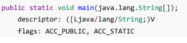

  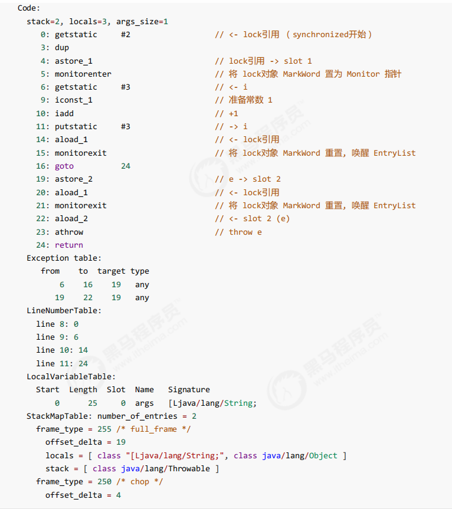

代码块级别的 synchronized 会在编译后生成专属字节码指令，方法级别的 synchronized 无显式字节码标记，由JVM底层判定。

### 同步代码块字节码核心指令

核心依赖两条指令实现锁逻辑：

**monitorenter**：进入同步代码块，尝试获取对象Monitor锁；

**monitorexit**：退出同步代码块，释放Monitor锁。

为保证异常场景下锁一定释放，编译器会生成**两个monitorexit指令**：正常执行结束释放、异常终止执行释放。

### 方法锁字节码特性

方法级别 synchronized 不会生成 monitorenter/monitorexit 字节码，JVM 通过方法访问标记位判定是否为同步方法，自动完成加锁解锁逻辑。

##  锁升级之通俗故事

故事角色 
>- 老王 - JVM 
>- 小南 - 线程 
>- 小女 - 线程 
>- 房间 - 对象 
>- 房间门上 - 防盗锁 - Monitor 
>- 房间门上 - 小南书包 - 轻量级锁 
>- 房间门上 - 刻上小南大名 - 偏向锁 
>- 批量重刻名 - 一个类的偏向锁撤销到达 20 阈值 
>- 不能刻名字 - 批量撤销该类对象的偏向锁，设置该类不可偏向 

>小南要使用房间保证计算不被其它人干扰（原子性），最初，他用的是**防盗锁**，当上下文切换时，锁住门。这样即使他离开了，别人也进不了门，他的工作就是安全的。 
>
>
>但是，很多情况下没人跟他来竞争房间的使用权。小女是要用房间，但使用的时间上是错开的，小南白天用，小女晚上用。每次上锁太麻烦了，有没有更简单的办法呢？ 
>
>
>小南和小女商量了一下，约定不锁门了，而是谁用房间，谁把自己的书包挂在门口，但他们的书包样式都一样，因此每次进门前得翻翻书包，看课本是谁的，如果是自己的，那么就可以进门，>这样省的上锁解锁了。万一书包不是自己的，那么就在门外等，并通知对方下次用锁门的方式。 
>
>
>后来，小女回老家了，很长一段时间都不会用这个房间。小南每次还是挂书包，翻书包，虽然比锁门省事了，但仍然觉得麻烦。 
>于是，小南干脆在门上刻上了自己的名字：【小南专属房间，其它人勿用】，下次来用房间时，只要名字还在，那么说明没人打扰，还是可以安全地使用房间。如果这期间有其它人要用这个房>间，那么由使用者将小南刻的名字擦掉，升级为挂书包的方式。 
>
>
>同学们都放假回老家了，小南就膨胀了，在 20 个房间刻上了自己的名字，想进哪个进哪个。后来他自己放假回老家了，这时小女回来了（她也要用这些房间），结果就是得一个个地擦掉小>南刻的名字，升级为挂书包的方式。老王觉得这成本有点高，提出了一种批量重刻名的方法，他让小女不用挂书包了，可以直接在门上刻上自己的名字 
>后来，刻名的现象越来越频繁，老王受不了了：算了，这些房间都不能刻名了，只能挂书包

为方便理解锁的四种状态：**（无锁→偏向锁→轻量级锁→重量级锁）**，通过生活化场景类比：
JVM=老王，线程=小南/小女，Java对象=房间
**轻量级锁**=门口挂书包，无竞争时简化加锁流程；
**偏向锁**=门上刻专属名字，单线程无竞争时无需重复加锁校验
**Monitor**=防盗锁（重量级锁）；
批量重刻名=批量重偏向，批量擦除名字=批量撤销偏向锁。
核心逻辑：JVM 会根据**竞争激烈程度**自动升级锁，从最轻量的偏向锁逐步升级为重量级锁，兼顾无竞争性能与有竞争安全性。

## 4.3 锁升级完整流程详解

synchronized 锁共有四种状态，优先级：**无锁 > 偏向锁 > 轻量级锁 > 重量级锁**，锁只能升级、不能降级，是JVM的自适应优化机制。

### 4.3.1  (不涉及Monitor的)轻量级锁
轻量级锁的**使用场景**：如果一个对象虽然有多线程要加锁，但加锁的时间是错开的（也就是没有竞争），那么可以使用轻量级锁来优化. **（低竞争、错开竞争场景）**
轻量级锁：**对使用者是透明的**，即语法仍然是 synchronized 

**核心原理**：
1、线程栈帧创建**锁记录（Lock Record）**，存储对象原始Mark Word；
2、 通过CAS将对象Mark Word替换为锁记录地址，标记锁状态为00（轻量级锁）；
3、 锁重入时，新增空锁记录计数，无需重复CAS；
4、 解锁时，CAS将原始Mark Word恢复到对象头，解锁成功.

**示例：** 假设有两个方法同步块，利用同一个对象加锁

<pre>
static final Object obj = new Object();
public static void method1() {
    synchronized( obj ) {
        // 同步块 A
        method2();
    }
}
public static void method2() {
    synchronized( obj ) {
        // 同步块 B
    }
}
</pre>

- 创建 **锁记录（Lock Record）对象**，每个线程的栈帧都会包含一个锁记录的结构，内部可以存储锁定对象的Mark Word.
	

	  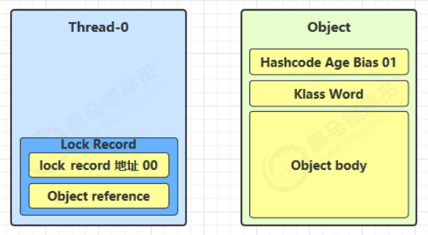
	

- 让锁记录中 Object reference 指向锁对象，并尝试用 cas 替换 Object 的 Mark Word，将 Mark Word 的值存入锁记录.

	

	  
	

- 如果 cas 替换成功，对象头中存储了 **锁记录地址和状态 00**，表示由该线程给对象加锁，这时图示如下.
	

	  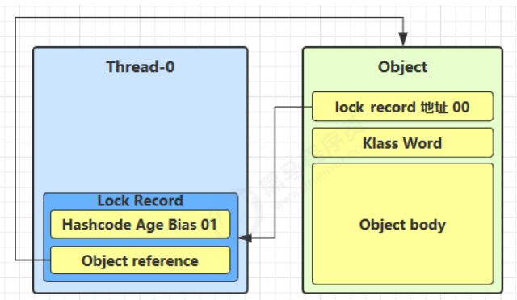
	

- 如果 cas 失败，有**两种情况**: 
    1、如果是其它线程已经持有了该 Object 的轻量级锁，这时表明有竞争，进入锁膨胀过程. 
    2、如果是自己执行了 synchronized 锁重入，那么再添加一条 Lock Record 作为重入的计数.
  
	

		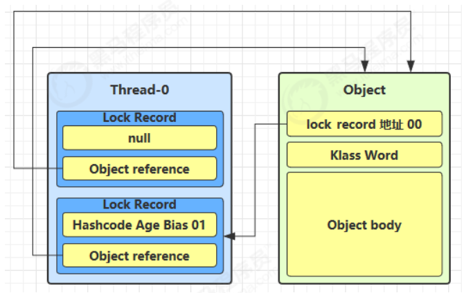
	

- 当退出 synchronized 代码块（解锁时）如果有取值为 null 的锁记录，表示有重入，这时重置锁记录，表示重入计数减一	.
	

		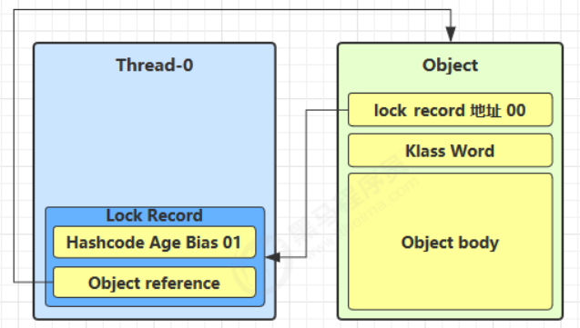
	
	
- 当退出 synchronized 代码块（解锁时）锁记录的值不为 null，这时使用 cas 将 Mark Word 的值恢复给对象头 
  1、成功，则解锁成功 
  2、失败，说明轻量级锁进行了锁膨胀或已经升级为重量级锁，进入重量级锁解锁流程

### 4.3.2 锁膨胀（轻量级→重量级）

**定义：** 如果在尝试加轻量级锁的过程中，CAS 操作无法成功，这时一种情况就是有其它线程为此对象加上了轻量级锁（有竞争），这时需要进行锁膨胀，将轻量级锁变为重量级锁。

**触发条件**：CAS加轻量级锁失败，存在**同一时刻多线程并发竞争**。

**膨胀流程**：

1. JVM为对象申请Monitor重量级锁；

2. 对象Mark Word指向Monitor地址，锁状态标记为10（重量级锁）；

3. 竞争失败的线程进入Monitor的EntryList阻塞；

4. 持有轻量级锁的线程解锁时，CAS恢复Mark Word失败，切换为重量级锁解锁逻辑，唤醒阻塞线程。

**示例：**

<pre>
static Object obj = new Object();
public static void method1() {
    synchronized( obj ) {
        // 同步块
    }
}
</pre>

- 当 Thread-1 进行轻量级加锁时，Thread-0 已经对该对象加了轻量级锁.
	

		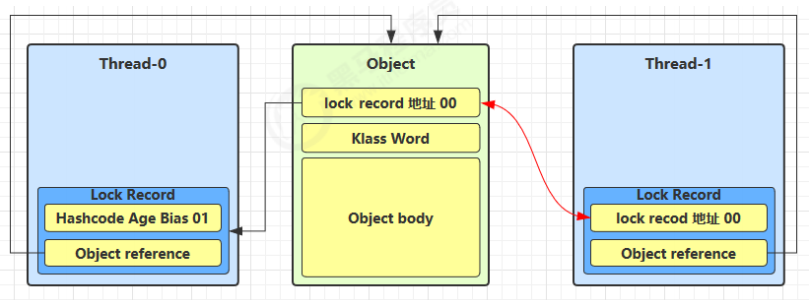
	
	
- 这时 Thread-1 加轻量级锁失败，进入锁膨胀流程 
  ○ 即为 Object 对象申请 Monitor 锁，让 Object 指向重量级锁地址 
  ○ 然后自己进入 Monitor 的 EntryList BLOCKED
  	

		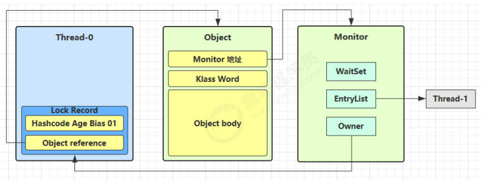
	
	

- 当 Thread-0 退出同步块解锁时，使用 cas 将 Mark Word 的值恢复给对象头，失败。这时会进入重量级解锁流程，即按照 Monitor 地址找到 Monitor 对象，设置 Owner 为 null，唤醒 EntryList 中 BLOCKED 线程

### 4.3.3 自旋优化（重量级锁辅助优化）
- 重量级锁竞争的时候，还可以使用自旋(循环尝试获取重量级锁)来进行优化，如果当前线程自旋成功（即这时候持锁线程已经退出了同步块，释放了锁），这时当前线程就可以避免阻塞。 (进入阻塞再恢复,会发生上下文切换,比较耗费性能).

 

**1、自旋重试成功的情况**
  	

		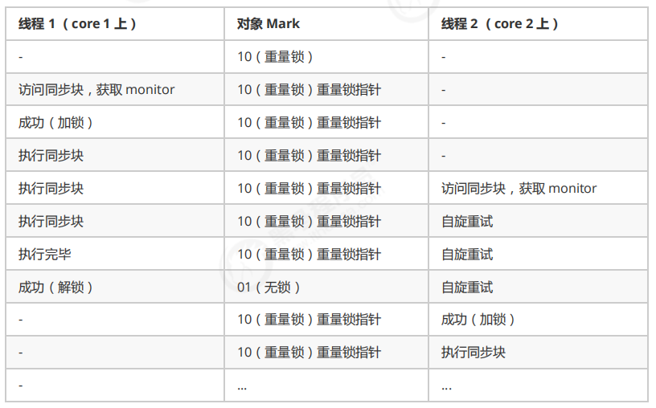
	
	

**2、自旋重试失败的情况**
  	

		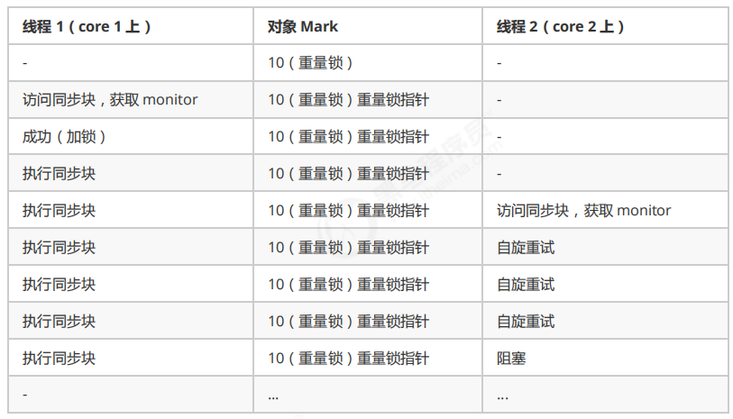
	
	

**小结：**
**自旋成功**：持锁线程快速释放锁，自旋线程直接获取锁，无需阻塞；
**自旋失败**：自旋次数耗尽仍未获取锁，进入阻塞状态；
**特性**：多核CPU生效，单核CPU自旋无意义；Java7后自旋功能不可手动关闭。
Java6+ 自适应自旋，针对重量级锁竞争场景：线程获取锁失败时，不立即阻塞，**循环自旋尝试获取锁**，避免上下文切换开销。

### 4.3.4 偏向锁（最轻量级，无竞争场景）

**适用场景**：单个线程反复获取同一锁，无其他线程竞争，规避轻量级锁每次重入的CAS开销。

**核心原理**：对象首次加锁时，通过CAS将当前线程ID写入对象Mark Word，后续该线程再次加锁，只需比对线程ID，无需CAS操作，零开销重入。

**默认特性**：Java6+默认开启，存在**4秒延迟生效**，可通过VM参数 `-XX:BiasedLockingStartupDelay=0` 关闭延迟。

例如： 

<pre>
static final Object obj = new Object();
public static void m1() {
    synchronized( obj ) {
        // 同步块 A
        m2();
    }
}
public static void m2() {
    synchronized( obj ) {
        // 同步块 B
        m3();
    }
}
public static void m3() {
    synchronized( obj ) {
        // 同步块 C
    }
}
</pre>

 

**轻量级锁示意图:**

  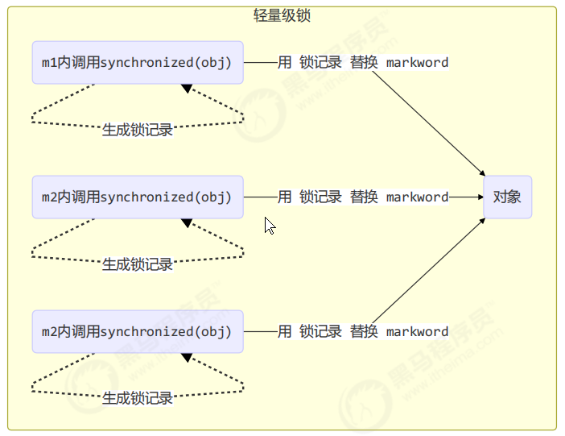

**偏向锁示意图:**

  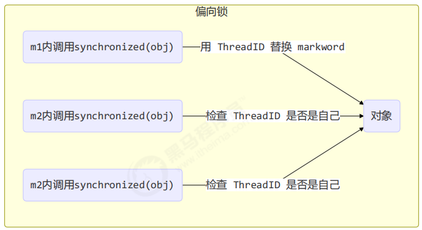

**偏向状态** 回忆一下对象头格式

  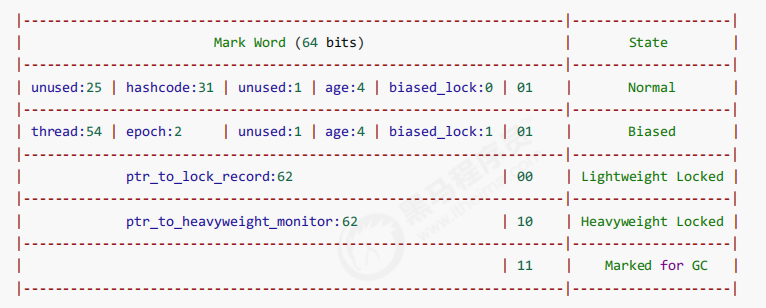

 

一个对象创建时： 
    1、 如果开启了偏向锁（默认开启），那么对象创建后，markword 值为 0x05 即最后 3 位为 101，这时它的 thread、epoch、age 都为 0 
    2、 偏向锁是默认是延迟的，不会在程序启动时立即生效，如果想避免延迟，可以加 VM 参数 -XX:BiasedLockingStartupDelay=0 来禁用延迟 
    3、如果没有开启偏向锁，那么对象创建后，markword 值为 0x01 即最后 3 位为 001，这时它的 hashcode、age 都为 0，第一次用到 hashcode 时才会赋值

 

### 1） 测试延迟特性 
偏向锁是默认是延迟的，不会在程序启动时立即生效，如果想避免延迟，可以加 VM 参数 -XX:BiasedLockingStartupDelay=0 来禁用延迟 

 

### 2） 测试偏向锁
class Dog {}
利用 jol 第三方工具来查看对象头信息（注意这里up主扩展了 jol 让它输出更为简洁）这里视频里引入的依赖貌似是他自己做的jar包,

<pre>
示例代码：

public static void main(String[] args) throws IOException {
    Dog d = new Dog();
    ClassLayout classLayout = ClassLayout.parseInstance(d);
    
    new Thread(() -> {
        log.debug("synchronized 前");
        System.out.println(classLayout.toPrintableSimple(true));
        synchronized (d) {
            log.debug("synchronized 中");
            System.out.println(classLayout.toPrintableSimple(true));
        }
        log.debug("synchronized 后");
        System.out.println(classLayout.toPrintableSimple(true));
    }, "t1").start();
}

输出
11:08:58.117 c.TestBiased [t1] - synchronized 前
00000000 00000000 00000000 00000000 00000000 00000000 00000000 00000101 
11:08:58.121 c.TestBiased [t1] - synchronized 中
00000000 00000000 00000000 00000000 00011111 11101011 11010000 00000101 
11:08:58.121 c.TestBiased [t1] - synchronized 后
00000000 00000000 00000000 00000000 00011111 11101011 11010000 00000101
</pre>

>注意 :**处于偏向锁的对象解锁后，线程 id 仍存储于对象头中**

 

### 3）测试禁用 
在上面测试代码运行时在添加 VM **参数 -XX:-UseBiasedLocking 禁用偏向锁** 

<pre>
输出：
    11:13:10.018 c.TestBiased [t1] - synchronized 前
    00000000 00000000 00000000 00000000 00000000 00000000 00000000 00000001 
    11:13:10.021 c.TestBiased [t1] - synchronized 中
    00000000 00000000 00000000 00000000 00100000 00010100 11110011 10001000 
    11:13:10.021 c.TestBiased [t1] - synchronized 后
    00000000 00000000 00000000 00000000 00000000 00000000 00000000 00000001
</pre>

 

### 4) 测试 hashCode 
在Dog d = new Dog();后加上一句 d.hashCode();

- 正常状态对象一开始是没有 hashCode 的，第一次调用才生成
- 调用了 hashCode() 后会撤销该对象的偏向锁
	
### 5.1) 撤销(偏向) - 调用对象 hashCode 
调用了对象的 hashCode，但偏向锁的对象 MarkWord 中存储的是线程 id，如果调用 hashCode 会导致偏向锁被撤销 
- 轻量级锁会在锁记录中记录 hashCode 
- 重量级锁会在 Monitor 中记录 hashCode 

记得去掉 -XX:-UseBiasedLocking,在调用 hashCode 后使用偏向锁，输出:	

<pre>
    11:22:10.386 c.TestBiased [main] - 调用 hashCode:1778535015 
    11:22:10.391 c.TestBiased [t1] - synchronized 前
    00000000 00000000 00000000 01101010 00000010 01001010 01100111 00000001 
    11:22:10.393 c.TestBiased [t1] - synchronized 中
    00000000 00000000 00000000 00000000 00100000 11000011 11110011 01101000 
    11:22:10.393 c.TestBiased [t1] - synchronized 后
    00000000 00000000 00000000 01101010 00000010 01001010 01100111 00000001
</pre>

### 5.2)撤销(偏向) - 其它线程(错开)使用对象 

当有其它线程使用偏向锁对象时，会将偏向锁升级为轻量级锁

<pre>
private static void test2() throws InterruptedException {
    
    Dog d = new Dog();
    
    Thread t1 = new Thread(() -> {
        
        log.debug(ClassLayout.parseInstance(d).toPrintableSimple(true));
        synchronized (d) {
            log.debug(ClassLayout.parseInstance(d).toPrintableSimple(true));
        }
        log.debug(ClassLayout.parseInstance(d).toPrintableSimple(true));
        
        synchronized (TestBiased.class) {
            TestBiased.class.notify();
        }
        // 如果不用 wait/notify 使用 join 必须打开下面的注释
        // 因为：t1 线程不能结束，否则底层线程可能被 jvm 重用作为 t2 线程，底层线程 id 是一样的
        /*try {
            System.in.read();
        } catch (IOException e) {
            e.printStackTrace();
        }*/
    }, "t1");
    t1.start();
    
    Thread t2 = new Thread(() -> {
        synchronized (TestBiased.class) {
            try {
                TestBiased.class.wait();
            } catch (InterruptedException e) {
                e.printStackTrace();
            }
        }
        
        log.debug(ClassLayout.parseInstance(d).toPrintableSimple(true));
        synchronized (d) {
            log.debug(ClassLayout.parseInstance(d).toPrintableSimple(true));
        }
        log.debug(ClassLayout.parseInstance(d).toPrintableSimple(true));
        
    }, "t2");
    t2.start();
}
</pre>

输出:

  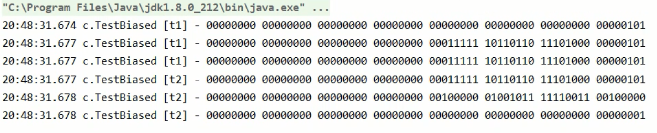

 

### 5.3)撤销(偏向) - 调用 wait/notify
重量级锁才支持 wait/notify

<pre>
public static void main(String[] args) throws InterruptedException {
    Dog d = new Dog();
    
    Thread t1 = new Thread(() -> {
        log.debug(ClassLayout.parseInstance(d).toPrintableSimple(true));
        synchronized (d) {
            log.debug(ClassLayout.parseInstance(d).toPrintableSimple(true));
            try {
                d.wait();
            } catch (InterruptedException e) {
                e.printStackTrace();
            }
            log.debug(ClassLayout.parseInstance(d).toPrintableSimple(true));
        }
    }, "t1");
    t1.start();
    
    new Thread(() -> {
        try {
            Thread.sleep(6000);
        } catch (InterruptedException e) {
            e.printStackTrace();
        }
        synchronized (d) {
            log.debug("notify");
            d.notify();
        }
    }, "t2").start();
}

	

	  
	

	
输出:
[t1] - 00000000 00000000 00000000 00000000 00000000 00000000 00000000 00000101 
[t1] - 00000000 00000000 00000000 00000000 00011111 10110011 11111000 00000101 
[t2] - notify 
[t1] - 00000000 00000000 00000000 00000000 00011100 11010100 00001101 11001010
</pre>

### 6) 批量重偏向 

如果对象虽然被多个线程访问，但没有竞争，这时偏向了线程 T1 的对象仍有机会重新偏向 T2，重偏向会重置对象的 Thread ID 

当(某类型对象)撤销偏向锁阈值超过 20 次后，jvm 会这样觉得，我是不是偏向错了呢，于是会在给(所有这种类型的状态为偏向锁的)对象加锁时重新偏向至新的加锁线程

这里略有些不好用文字说明,看例子吧(注意t2-19处的变化: 发生了批量重偏向)

<pre>
private static void test3() throws InterruptedException {
    
    Vector<Dog> list = new Vector<>();
    
    Thread t1 = new Thread(() -> {
        for (int i = 0; i < 30; i++) {
            Dog d = new Dog();
            list.add(d);
            synchronized (d) {
                log.debug(i + "\t" + ClassLayout.parseInstance(d).toPrintableSimple(true));
            }
        }
        synchronized (list) {
            list.notify();
        }
    }, "t1");
    t1.start();

    Thread t2 = new Thread(() -> {
        synchronized (list) {
            try {
                list.wait();
            } catch (InterruptedException e) {
                e.printStackTrace();
            }
        }
        log.debug("===============> ");
        for (int i = 0; i < 30; i++) {
            Dog d = list.get(i);
            log.debug(i + "\t" + ClassLayout.parseInstance(d).toPrintableSimple(true));
            synchronized (d) {
                log.debug(i + "\t" + ClassLayout.parseInstance(d).toPrintableSimple(true));
            }
            log.debug(i + "\t" + ClassLayout.parseInstance(d).toPrintableSimple(true));
        }
    }, "t2");
    t2.start();
}

输出:
[t1] - 0 00000000 00000000 00000000 00000000 00011111 11110011 11100000 00000101 
[t1] - 1 00000000 00000000 00000000 00000000 00011111 11110011 11100000 00000101 
[t1] - 2 00000000 00000000 00000000 00000000 00011111 11110011 11100000 00000101 
[t1] - 3 00000000 00000000 00000000 00000000 00011111 11110011 11100000 00000101 
[t2] - ===============> 
[t2] - 0 00000000 00000000 00000000 00000000 00011111 11110011 11100000 00000101 
[t2] - 0 00000000 00000000 00000000 00000000 00100000 01011000 11110111 00000000 
[t2] - 0 00000000 00000000 00000000 00000000 00000000 00000000 00000000 00000001 
[t2] - 1 00000000 00000000 00000000 00000000 00011111 11110011 11100000 00000101 
[t2] - 1 00000000 00000000 00000000 00000000 00100000 01011000 11110111 00000000 
[t2] - 1 00000000 00000000 00000000 00000000 00000000 00000000 00000000 00000001 
此次省略1万字.......
</pre>

### 7)批量撤销(偏向) 
当撤销偏向锁阈值超过 40 次后，jvm 会这样觉得，自己确实偏向错了，根本就不该偏向。于是整个类的所有对象都会变为不可偏向的，新建的该类型对象也是不可偏向的 

<pre>
static Thread t1,t2,t3;
private static void test4() throws InterruptedException {
    Vector<Dog> list = new Vector<>();
    
    int loopNumber = 39;
    t1 = new Thread(() -> {
        for (int i = 0; i < loopNumber; i++) {
            Dog d = new Dog();
            list.add(d);
            synchronized (d) {
                log.debug(i + "\t" + ClassLayout.parseInstance(d).toPrintableSimple(true));
            }
        }
        LockSupport.unpark(t2);
    }, "t1");
    t1.start();
    
    t2 = new Thread(() -> {
        LockSupport.park();
        log.debug("===============> ");
        for (int i = 0; i < loopNumber; i++) {
            Dog d = list.get(i);
            log.debug(i + "\t" + ClassLayout.parseInstance(d).toPrintableSimple(true));
            synchronized (d) {
                log.debug(i + "\t" + ClassLayout.parseInstance(d).toPrintableSimple(true));
            }
            log.debug(i + "\t" + ClassLayout.parseInstance(d).toPrintableSimple(true));
        }
        LockSupport.unpark(t3);
    }, "t2");
    t2.start();
    
    t3 = new Thread(() -> {
        LockSupport.park();
        log.debug("===============> ");
        for (int i = 0; i < loopNumber; i++) {
            Dog d = list.get(i);
            log.debug(i + "\t" + ClassLayout.parseInstance(d).toPrintableSimple(true));
            synchronized (d) {
                log.debug(i + "\t" + ClassLayout.parseInstance(d).toPrintableSimple(true));
            }
            log.debug(i + "\t" + ClassLayout.parseInstance(d).toPrintableSimple(true));
        }
    }, "t3");
    t3.start();
    
    t3.join();
    log.debug(ClassLayout.parseInstance(new Dog()).toPrintableSimple(true));
}
</pre>

参考资料 
https://github.com/farmerjohngit/myblog/issues/12

https://www.cnblogs.com/LemonFive/p/11246086.html

https://www.cnblogs.com/LemonFive/p/11248248.html

偏向锁论文:  https://www.oracle.com/technetwork/java/biasedlocking-oopsla2006-wp-149958.pdf

### 4.3.5 锁消除

### 4.3.5.1 JIT 锁优化（锁消除、锁粗化）
JIT即时编译器的热点代码优化机制：若检测到锁对象为**局部私有对象、无共享可能**，直接消除锁逻辑，规避无意义的加锁解锁开销。

可通过VM参数 `-XX:-EliminateLocks` 手动禁用锁消除，对比性能差异。

**示例：**

<pre>
@Fork(1)
@BenchmarkMode(Mode.AverageTime)
@Warmup(iterations=3)
@Measurement(iterations=5)
@OutputTimeUnit(TimeUnit.NANOSECONDS)
public class MyBenchmark {
    static int x = 0;
    @Benchmark
    public void a() throws Exception {
        x++;
    }
    @Benchmark
    public void b() throws Exception {
        //这里的o是局部变量,不会被共享,JIT做热点代码优化时会做锁消除
        Object o = new Object();
        synchronized (o) {
            x++;
        }
    }
}
</pre>

**运行脚本：** java -jar benchmarks.jar,发现两部分的差别并不大,甚至b加了锁比a没加锁还快

	

		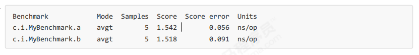
	
	
**XX:-EliminateLocks**: 是否使用锁消除
java -XX:-EliminateLocks -jar benchmarks.jar

**结论：** 使用 -XX:-EliminateLocks禁用锁消除后就会发现 b性能比a差劲多了

    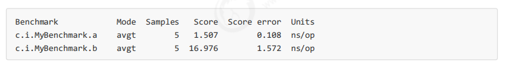

	

### 4.3.5.2 锁粗化
若代码中对**同一对象频繁多次加锁解锁**，JIT会将多次细粒度锁合并为一次全局锁，减少锁竞争次数，提升执行效率，与锁粒度细化优化互补。