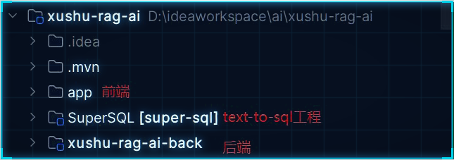
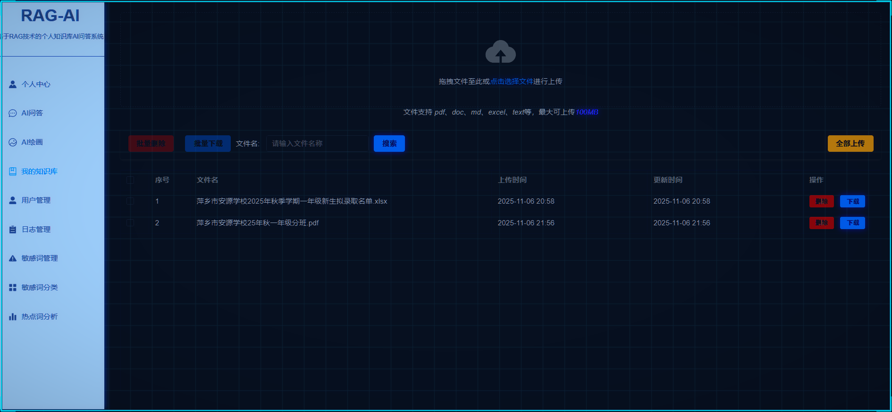
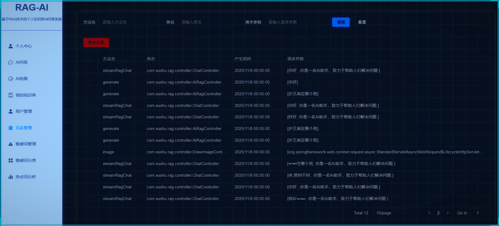
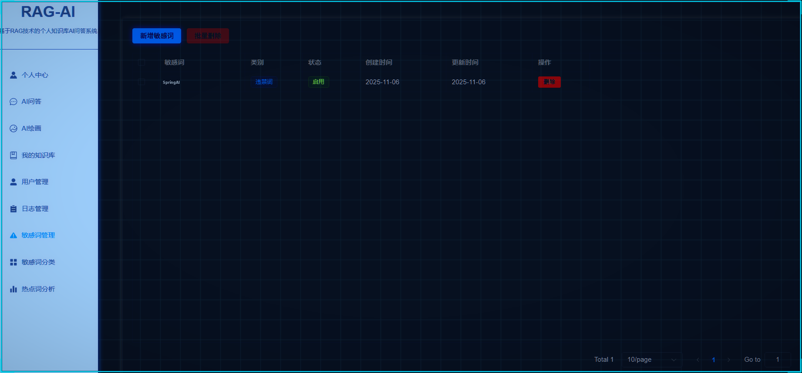
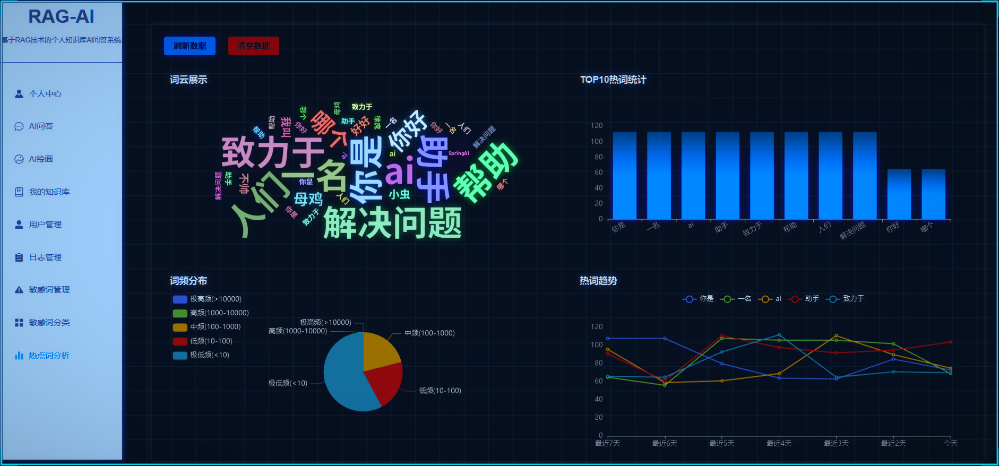

   <!-- Knowledge Base QA (RAG) -->

### V1.0

1. 基本功能+核心功能
2. 前端和后端分开2个文件夹

### V2.0

1. 前端和后端在一个文件夹， 方便vibe coding
2. 加入supersql实现text-tosql
3. 实现跨向量聚合问题
4. 实现来源追溯
5. 实现文档更新
6. 继续更新...

链接:  
可参考： https://gitee.com/hongpo/rag-ai  

## 核心功能

上传资料

AI对话

## 其他功能

对话记录

敏感词管理

热词统计

前端（提供）：  Vue 3 + TypeScript + Vite

后端：

+ Spring Boot: 3.4.2
+ JDK: 17
+ spring-ai: 1.0.0 GA
+ spring-ai-alibaba: 1.0.0.2
+ maven: 3.9.6
+ Mysql 5.7
+ Milvus(向量存储)
+ LLM使用的通义千问
+ 对象存储使用阿里云OSS (上传RAG资料）
