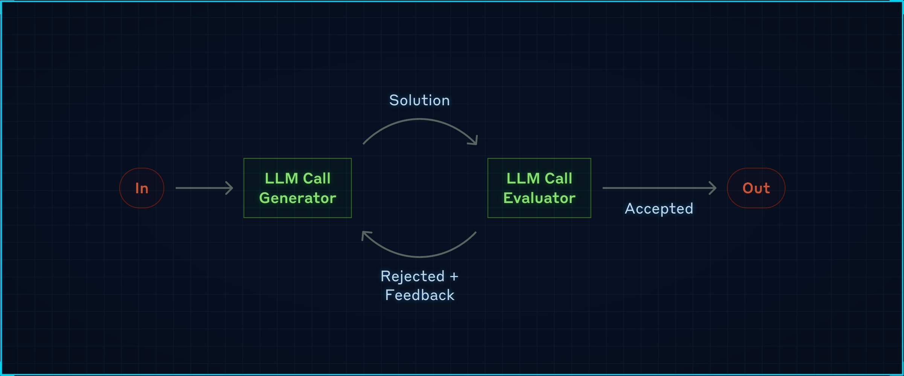
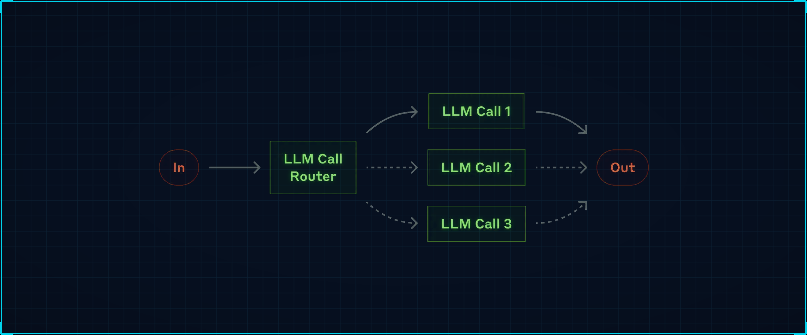
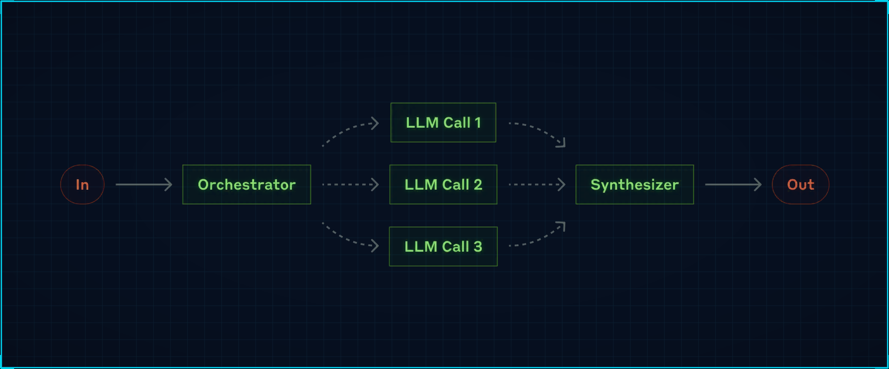
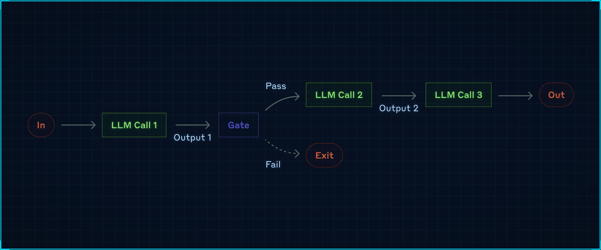
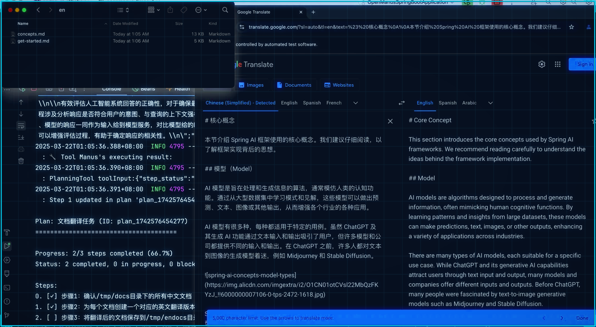
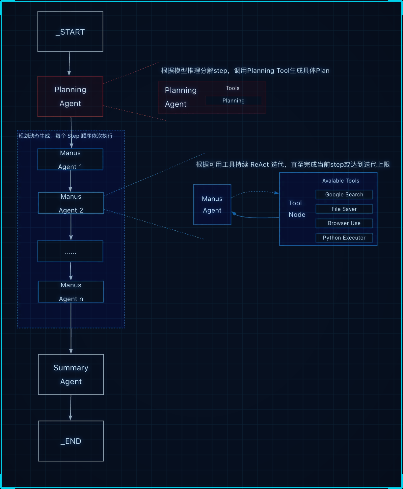

<div class="essay-banner essay-image11">
   <!-- 十五、Agent5种模式详细应用 -->
</div>

## 什么是 Ai agent:

你给个任务，它自己拆分、规划、调用资源、执行链路，直到返回结果。你给个任务，它自己规划（根据你指定的规划方式）、拆分（根据你指定的拆分方式）、调用资源（根据你提供的资源）、（自动）执行链路，直到返回结果。

## 1. 评估优化器模式(evaluator-optimizer)

<div class="img-wrap-left"></div>

根据任务 --> 生成信息 --> 通过评估器不断完善 --> 最终输出结果。

Evaluator-Optimizer 模式实现了双 LLM 过程，其中一个模型生成响应，另一个模型在迭代循环中提供评估和反馈：

1. 生成器 LLM 为给定任务产生初始解决方案
2. 评估器 LLM 根据质量标准评估解决方案
3. 如果解决方案通过评估，则作为最终结果返回
4. 如果需要改进，反馈被纳入新的生成周期
5. 重复该过程直到达到满意的解决方案

示例代码：

```java
@SpringBootApplication
public class Application {

    public static void main(String[] args) {
        SpringApplication.run(Application.class, args);
    }

    @Bean
    public CommandLineRunner commandLineRunner(DashScopeChatModel dashScopeChatModel) {
        var chatClient = ChatClient.create(dashScopeChatModel);
        return args -> {
            new SimpleEvaluatorOptimizer(chatClient).loop("""
                    <user input>
                      面试被问： 怎么高效的将100行list<User>数据，转化成map<id，user>，不是用stream.
                    </user input>
                    """);
        };
    }
}
```

核心实现 SimpleEvaluatorOptimizer：

```java
public class SimpleEvaluatorOptimizer {

    private final ChatClient chatClient;

    // 中文生成器提示词
    private static final String GENERATOR_PROMPT = """
            你是一个Java代码生成助手。请根据任务要求生成高质量的Java代码。
            重要提醒：
            - 第一次生成时，创建一个基础但完整的实现
            - 如果收到反馈，请仔细分析每一条建议并逐一改进
            - 每次迭代都要在前一版本基础上显著提升代码质量
            - 不要一次性实现所有功能，而是逐步完善

            必须以JSON格式回复：
            {"thoughts":"详细说明本轮的改进思路","response":"改进后的Java代码"}
                """;

    // 中文评估器提示词
    private static final String EVALUATOR_PROMPT = """
            你是一个非常严格的面试官。请从以下维度严格评估代码：

                1. 代码是否高效：从底层分析每一个类型以满足最佳性能！

            评估标准：
            - 只有当代码满足要求达到优秀水平时才返回PASS
            - 如果任何一个维度有改进空间，必须返回NEEDS_IMPROVEMENT
            - 提供具体、详细的改进建议

            必须以JSON格式回复：
            {"evaluation":"PASS或NEEDS_IMPROVEMENT或FAIL","feedback":"详细的分维度反馈"}

            记住：宁可严格也不要放松标准！
            """;

    public SimpleEvaluatorOptimizer(ChatClient chatClient) {
        this.chatClient = chatClient;
    }

    int iteration = 0;
    String context = "";

    public RefinedResponse loop(String task) {
        System.out.println("=== 第" + (iteration + 1) + "轮迭代 ===");

        // 生成代码
        Generation generation = generate(task, context);

        // 评估代码
        EvaluationResponse evaluation = evaluate(generation.response(), task);
        System.out.println("生成结果: " + generation.response());
        System.out.println("评估结果: " + evaluation.evaluation());
        System.out.println("反馈: " + evaluation.feedback());

        if (evaluation.evaluation() == EvaluationResponse.Evaluation.PASS) {
            System.out.println("代码通过评估！");
            return new RefinedResponse(generation.response());
        } else {
            // 准备下一轮的上下文
            context = String.format("之前的尝试:\n%s\n\n评估反馈:\n%s\n\n请根据反馈改进代码。",
                    generation.response(), evaluation.feedback());
            iteration++;
            return loop(task);
        }
    }

    private Generation generate(String task, String context) {
        return chatClient.prompt()
            .user(u -> u.text("{prompt}\n{context}\n任务: {task}")
                .param("prompt", GENERATOR_PROMPT)
                .param("context", context)
                .param("task", task))
            .call()
            .entity(Generation.class);
    }

    private EvaluationResponse evaluate(String content, String task) {
        return chatClient.prompt()
            .user(u -> u.text("{prompt}\n\n任务: {task}\n\n代码:\n{content}")
                .param("prompt", EVALUATOR_PROMPT)
                .param("task", task)
                .param("content", content))
            .call()
            .entity(EvaluationResponse.class);
    }

    // 使用原始的记录类
    public static record Generation(String thoughts, String response) {}

    public static record EvaluationResponse(Evaluation evaluation, String feedback) {
        public enum Evaluation { PASS, NEEDS_IMPROVEMENT, FAIL }
    }

    public static record RefinedResponse(String solution) {}
}
```

1. 一个模型作为由浅入深的代码生成器
2. 另一个模型作为性能分析员
3. 一直优化直到最佳

## 2. 路由模式(routing-workflow)

<div class="img-wrap-left"></div>

路由模式能够根据用户请求和上下文的分类，将输入智能路由到专门的处理程序。这个工作流特别适用于复杂任务，其中：

- **路由器LLM**：通过设置提示词进行路由规则设定，由 usermessage 决定路由的分支。
- 分类可以通过 LLM 或业务代码进行处理
- 不同类型的输入需要不同的专门处理或专业知识

## 3. 编排工作者(orchestrator-workers)

<div class="img-wrap-left"></div>

这种模式是一种灵活的方法，用于处理需要动态任务分解和专门处理的复杂任务，manus 就是这个模式。

该模式包含三个主要组件：

- **编排器（Orchestrator）**：分析任务并确定所需子任务的 LLM
- **工作者（Workers）**：执行特定子任务的专门 LLM
- **合成器（Synthesizer）**：将工作者输出合并为最终结果的组件

代码：

```java
public class SimpleOrchestratorWorkers {

    private final ChatClient chatClient;

    // 中文编排器提示词
    private static final String ORCHESTRATOR_PROMPT = """
                你是一个项目管理专家，需要将复杂任务分解为可并行执行的专业子任务。

                任务: {task}

                请分析任务的复杂性和专业领域需求，将其分解为2-4个需要不同专业技能的子任务。

                每个子任务应该：
                1. 有明确的专业领域（如：前端开发、后端API、数据库设计、测试等）
                2. 可以独立执行
                3. 有具体的交付物

                请以JSON格式回复：
                {
                    "analysis": "任务复杂度分析和分解策略",
                    "tasks": [
                        {
                            "type": "后端API开发",
                            "description": "设计并实现RESTful API接口，包括数据验证和错误处理"
                        },
                        {
                            "type": "前端界面开发",
                            "description": "创建响应式用户界面，实现与后端API的交互"
                        },
                        {
                            "type": "数据库设计",
                            "description": "设计数据表结构，编写SQL脚本和索引优化"
                        }
                    ]
                }
        """;

    // 中文工作者提示词
    private static final String WORKER_PROMPT = """
            你是一个{task_type}领域的资深专家，请完成以下专业任务：

            项目背景: {original_task}

            专业领域: {task_type}

            具体任务: {task_description}

            请按照行业最佳实践完成任务，包括：
            1. 技术选型和架构考虑
            2. 具体实现方案
            3. 潜在风险和解决方案
            4. 质量保证措施

            请提供专业、详细的解决方案。
            """;

    public SimpleOrchestratorWorkers(ChatClient chatClient) {
        this.chatClient = chatClient;
    }

    public void process(String taskDescription) {
        System.out.println("=== 开始处理任务 ===");

        // 步骤1: 编排器分析任务
        OrchestratorResponse orchestratorResponse = chatClient.prompt()
            .system(p -> p.param("task", taskDescription))
            .user(ORCHESTRATOR_PROMPT)
            .call()
            .entity(OrchestratorResponse.class);

        System.out.println("编排器分析: " + orchestratorResponse.analysis());
        System.out.println("子任务列表: " + orchestratorResponse.tasks());

        // 步骤2: 工作者处理各个子任务
        orchestratorResponse.tasks().stream()
            .map(task -> {
                System.out.println("-----------------------------------处理子任务: " + task.type() + "--------------------------------");
                String content = chatClient.prompt()
                        .user(u -> u.text(WORKER_PROMPT)
                                .param("original_task", taskDescription)
                                .param("task_type", task.type())
                                .param("task_description", task.description()))
                        .call()
                        .content();
                System.out.println(content);
                return task;
            }).toList();

        System.out.println("=== 所有工作者完成任务 ===");
    }

    // 数据记录类
    public record Task(String type, String description) {}
    public record OrchestratorResponse(String analysis, List<Task> tasks) {}
    public record FinalResponse(String analysis, List<String> workerResponses) {}
}
```

测试：

```java
@SpringBootApplication
public class Application {

    public static void main(String[] args) {
        SpringApplication.run(Application.class, args);
    }

    @Bean
    public CommandLineRunner commandLineRunner(DashScopeChatModel dashScopeChatModel) {
        var chatClient = ChatClient.create(dashScopeChatModel);
        return args -> {
            new SimpleOrchestratorWorkers(chatClient)
                .process("设计一个企业级的员工考勤系统，支持多种打卡方式和报表生成");
        };
    }
}
```

## 4. 链接（chain-workflow）

<div class="img-wrap-left"></div>

该模式将复杂的任务分解为一系列步骤，其中每个 LLM 调用都会处理前一个调用的输出。

这种模式特别适用于：

- 具有清晰顺序步骤的任务
- 当您愿意用延迟换取更高准确性时
- 每个步骤都建立在前一步输出基础上的场景

**使用场景**

常见应用包括：

- 数据转换管道
- 多步骤文本处理
- 结构化步骤的文档生成

> 与 `orchestrator-workers` 或 `evaluator-optimizer` 模式不同，链式工作流不是基于多个独立的 LLM 角色协作，而是通过单一的处理链条，每个步骤都建立在前一步的输出基础上。

**代码**

```java
public class DocumentGenerationChainWorkflow {

    private final ChatClient chatClient;

    public DocumentGenerationChainWorkflow(ChatClient chatClient) {
        this.chatClient = chatClient;
    }

    public DocumentResult processDocumentGeneration(String requirements) {
        List<String> steps = new ArrayList<>();
        String currentOutput = requirements;

        System.out.println("=== 开始文档生成链式流程 ===");

        // 门控：需求验证
        if (!validateRequirements(currentOutput)) {
            return new DocumentResult("需求验证失败，流程终止", steps, false);
        }
        steps.add("需求验证: 通过");

        // 步骤1: 生成大纲 - 基于原始需求
        currentOutput = generateOutline(currentOutput);
        steps.add("大纲生成: 完成");

        // 步骤2: 扩展内容 - 基于大纲
        currentOutput = expandContent(currentOutput);
        steps.add("内容扩展: 完成");

        // 步骤3: 优化语言 - 基于扩展后的内容
        currentOutput = optimizeLanguage(currentOutput);
        steps.add("语言优化: 完成");

        // 步骤4: 格式化 - 基于优化后的内容
        currentOutput = formatDocument(currentOutput);
        steps.add("文档格式化: 完成");

        System.out.println("=== 文档生成流程完成 ===");

        return new DocumentResult(currentOutput, steps, true);
    }

    private boolean validateRequirements(String requirements) {
        String validationPrompt = """
            请验证以下文档需求是否清晰完整：

            需求: {requirements}

            如果需求清晰完整，请回复"PASS"，否则回复"FAIL"。
            """;

        String result = chatClient.prompt()
            .user(u -> u.text(validationPrompt).param("requirements", requirements))
            .call()
            .content();

        return result.trim().toUpperCase().contains("PASS");
    }

    private String generateOutline(String requirements) {
        String outlinePrompt = """
            基于以下需求，生成详细的文档大纲：

            需求: {input}

            请生成包含主要章节和子章节的结构化大纲。
            """;

        return executeStep(outlinePrompt, requirements);
    }

    private String expandContent(String outline) {
        String contentPrompt = """
            基于以下大纲，为每个章节生成详细内容：

            大纲: {input}

            请为每个章节编写具体内容，保持逻辑连贯。
            """;

        return executeStep(contentPrompt, outline);
    }

    private String optimizeLanguage(String content) {
        String optimizePrompt = """
            优化以下文档内容的语言表达：

            原始内容: {input}

            请改进语言表达，使其更加专业、清晰、易读。
            """;

        return executeStep(optimizePrompt, content);
    }

    private String formatDocument(String content) {
        String formatPrompt = """
            将以下内容格式化为专业文档：

            内容: {input}

            请添加适当的标题层级、列表、表格等格式，生成最终的markdown文档。
            """;

        return executeStep(formatPrompt, content);
    }

    private String executeStep(String prompt, String input) {
        return chatClient.prompt()
            .user(u -> u.text(prompt).param("input", input))
            .call()
            .content();
    }

    public record DocumentResult(String finalDocument, List<String> steps, boolean success) {}
}
```

测试：

```java
@Bean
public CommandLineRunner commandLineRunner(DashScopeChatModel dashScopeChatModel) {
    var chatClient = ChatClient.create(dashScopeChatModel);
    return args -> {

        String requirements = """
                需要编写一份关于微服务架构设计的技术文档，包括：
                1. 架构概述
                2. 服务拆分策略
                3. 数据一致性方案
                4. 监控和运维
                目标读者：技术团队和架构师
                """;

        DocumentGenerationChainWorkflow.DocumentResult result = new DocumentGenerationChainWorkflow(chatClient)
            .processDocumentGeneration(requirements);

        System.out.println("生成结果: " + (result.success() ? "成功" : "失败"));
        System.out.println("最终文档:" + result.finalDocument());
        System.out.println("处理步骤: " + result.steps());
    };
}
```

## 5. 并行化（parallelization-workflow）

该模式对于需要并行执行 LLM 调用并自动进行输出聚合的情况很有用。

deepseek   MoE 多专家  多路并行

并行化工作流模式通过并发处理多个 LLM 操作来提高效率，主要有两种变体：

**使用场景**

该模式特别适用于：

- 处理大量相似但独立的项目
- 需要多个独立视角的任务
- 处理时间关键且任务可并行化的场景

## agent实战《手写manus》

略.....

### 效果展示

话不多说，先看运行效果，以下是我们通过几个实际问答记录展示的 Spring AI Alibaba OpenManus 实际使用效果。

<div class="img-wrap-left"></div>

### 总体架构与原理

Spring AI Alibaba Openmanus 与 Python 版本 OpenManus 设计理念相似，其总体架构如下图所示。

<div class="img-wrap-left"></div>

分析上图架构，我们可以把它看作是一款多 Agent 智能自动协作实现，其中：

- Planning Agent 负责任务的分解与规划，将用户问题拆解成几个可顺序执行的 step。planning agent 调用 planning tool 动态生成一个串行的 Manus Agent 子工作流。
- 多个 Manus Agent 组成一个链式、可顺序依次执行的子工作流。子工作流中的每个 agent 对应上述规划的一个 step，每个 agent 都是一个 ReAct 架构设计，即通过多轮 Tool 调用完成具体子任务。
- Summary Agent 用来做最后的任务总结
