# 编程在路上
<!-- >
 2006年的那个夏天，高中毕业了，未来一片迷茫.
>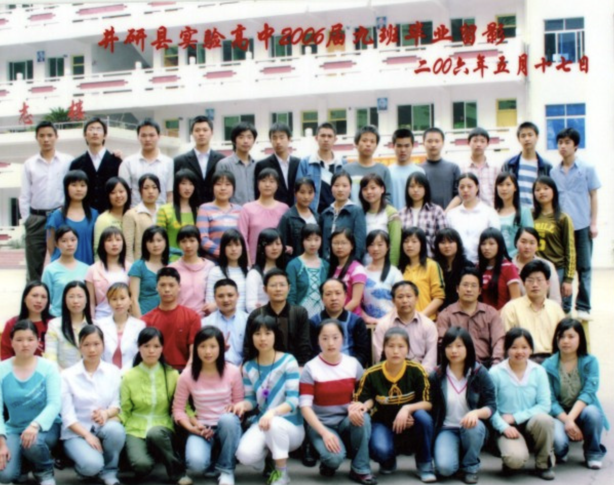 
 -->
### 网瘾少年

  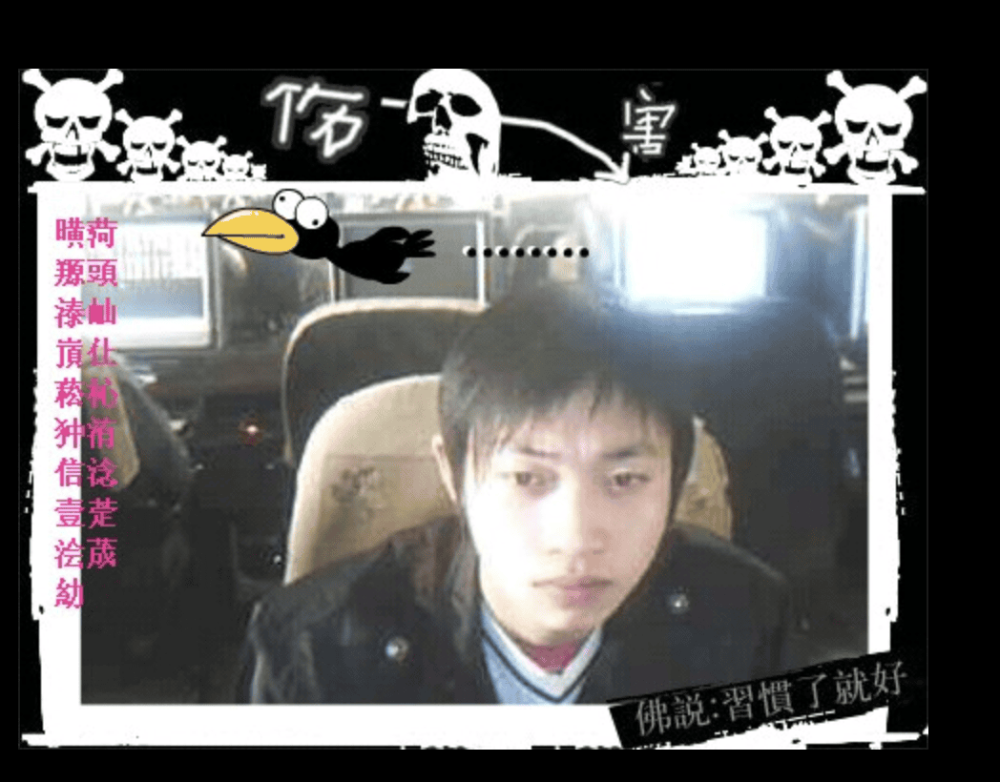

### 打工牛马
<!-- 

  

 
-->

  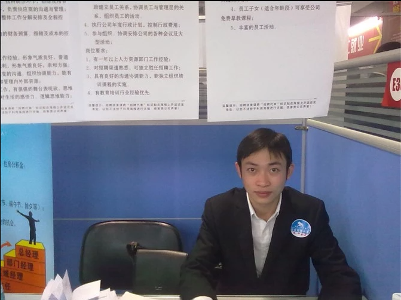

### 编程求学

  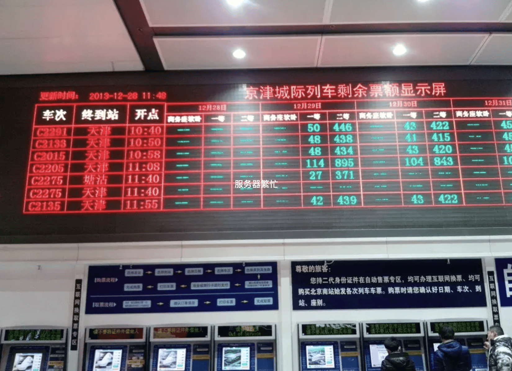

  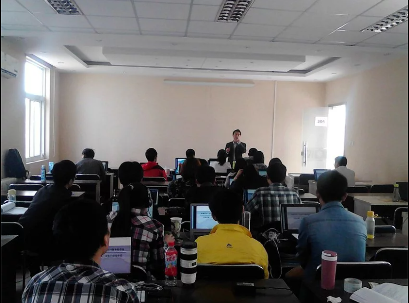

### 码农人生

  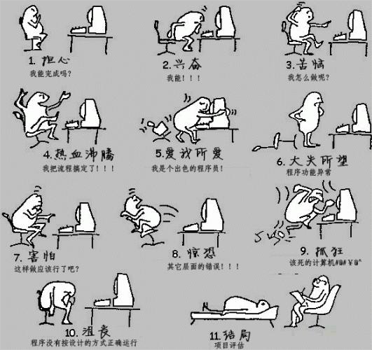

### 辗转深圳

  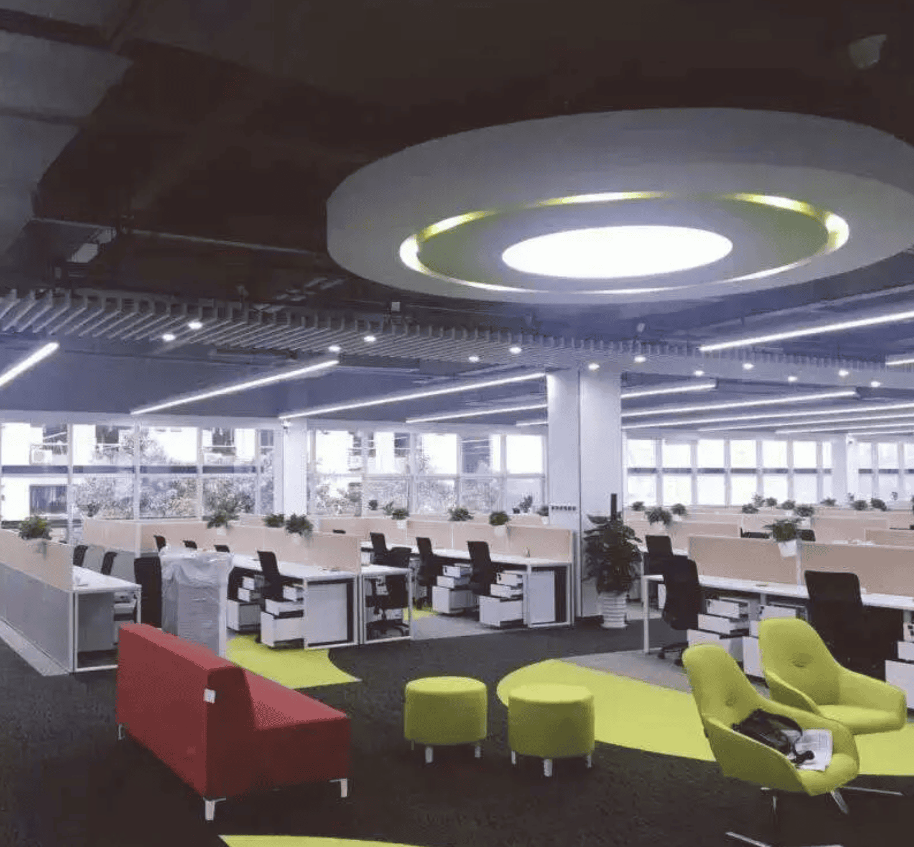

<!-- 

  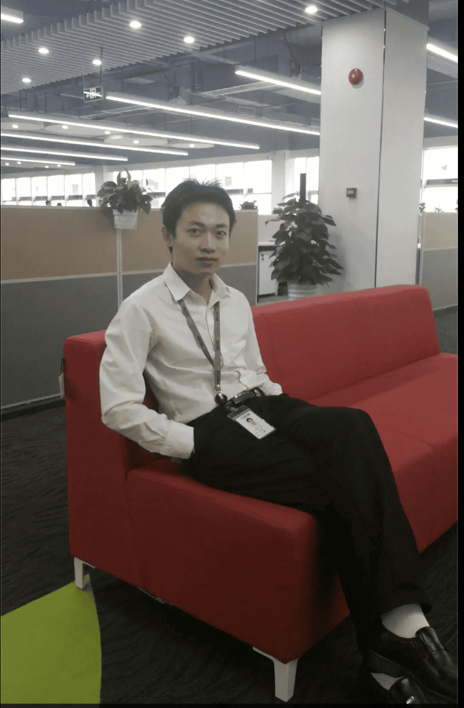

 -->

### 魔都之旅
<!-- 

  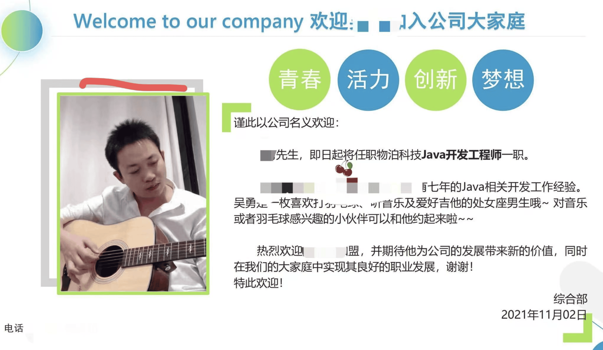

  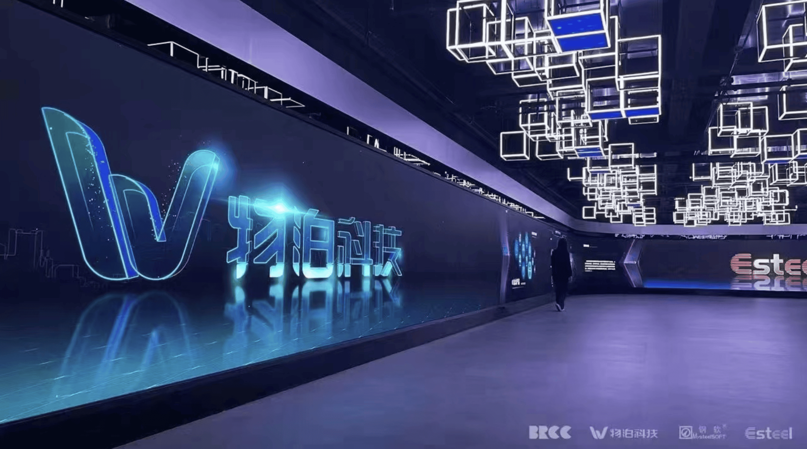

 -->

  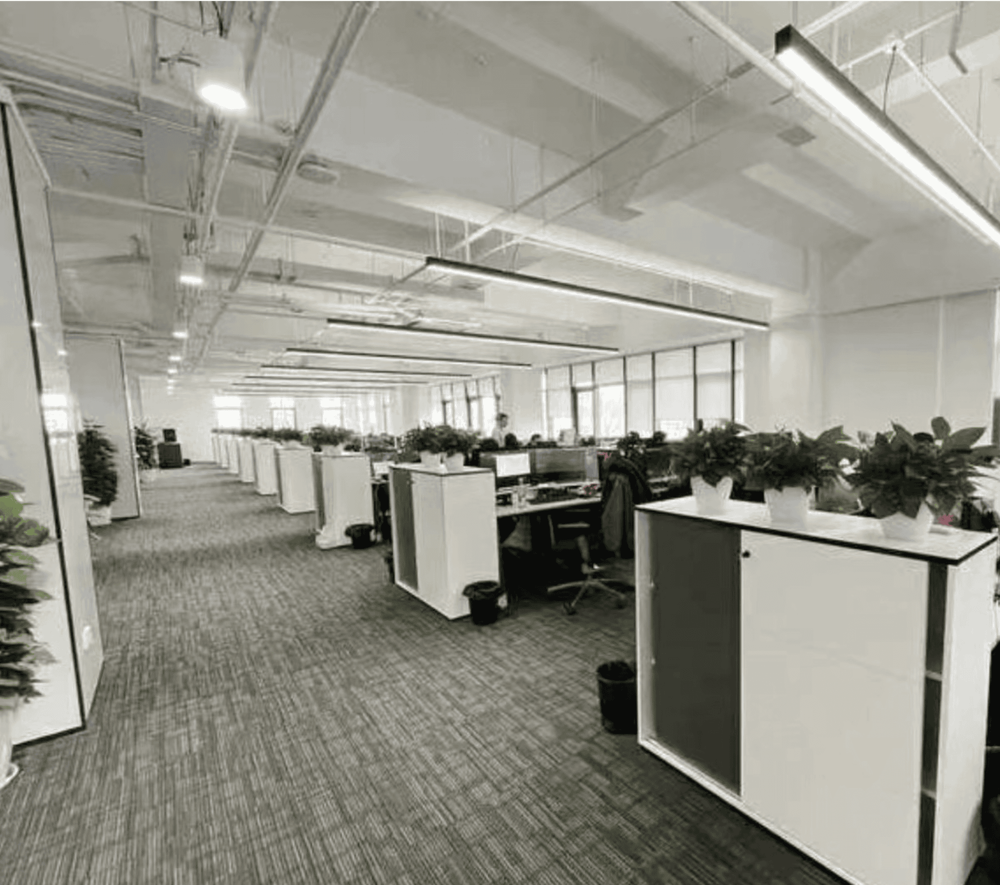

### 生活并不会那么一帆风顺，过去不值得留恋!

  

### 学而不思则亡，思而不学则怠，学习永无止境！

  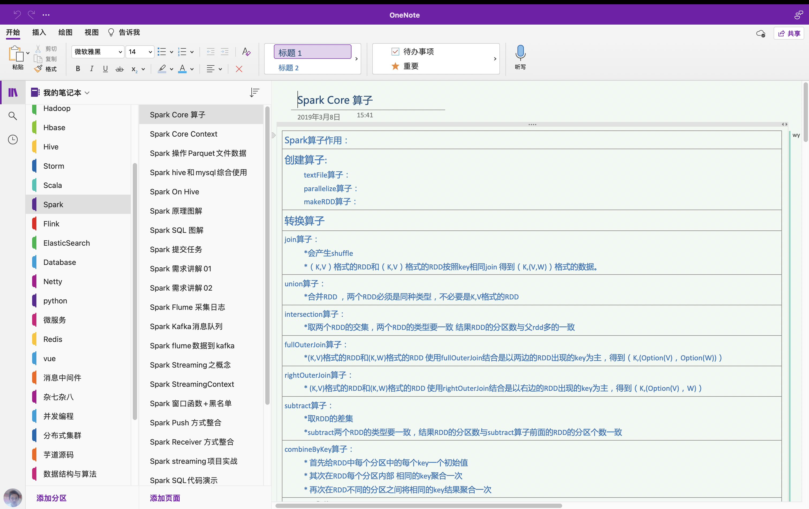

### 只要出发就能到达，梦想从来不曾遥远.......

  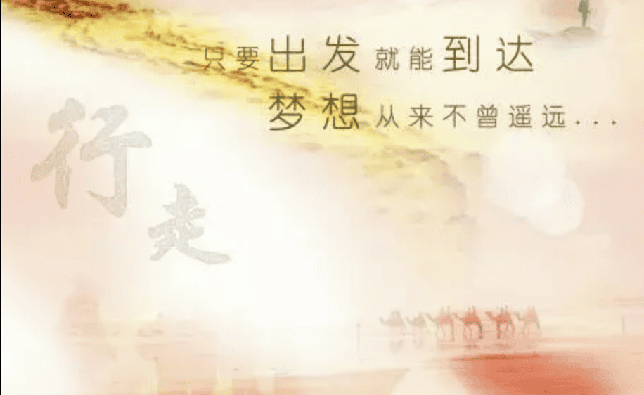

### 未来还在继续，下一站等你

  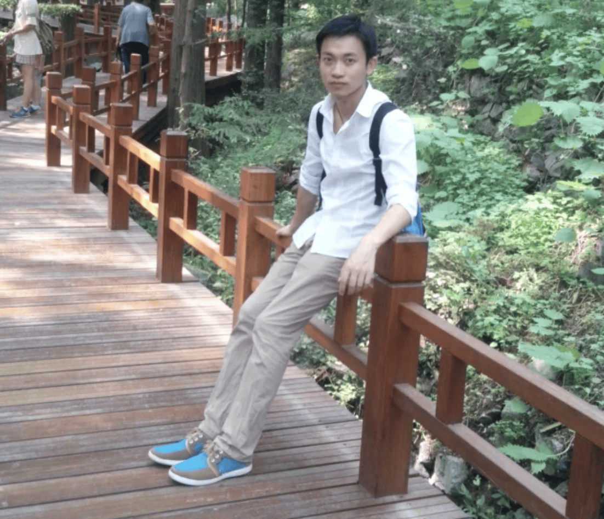

# **`人生感慨`**
>少年时代，我的全世界只有网吧闪烁的屏幕。整日沉溺虚拟厮杀，虚度大好光阴，看不到前路，也从没想过未来该去往何方，浑浑噩噩耗掉一整个青春。

>走出年少虚妄后，生活立刻给了我沉重一击。一边被繁杂生活喘不过气，一边挤时间四处打工谋生，成了被现实裹挟不停奔波的牛马。日复一日的疲惫与迷茫裹着我，无数个深夜都在暗自不甘，不甘心一辈子困在底层，困在碌碌无为的循环里。

>我咬碎牙决定重启人生，孤身奔赴北京，一头扎进枯燥的代码世界。熬过无数个点灯刷题的深夜，耐住孤独、扛住挫败，一点点打碎从前懒散颓废的自己，重新塑造底气与本领。

>今指尖敲下代码的时刻，心底翻涌着无数对未来的期许。我总在幻想，有朝一日能凭一身技术站稳脚跟，弥补年少虚度的所有时光；靠自己的能力撑起想要的生活，去见更辽阔的世界，彻底告别当年沉沦迷惘的自己，永远做奔赴前路、追逐梦的少年。