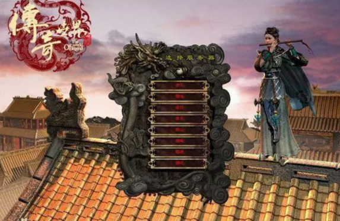
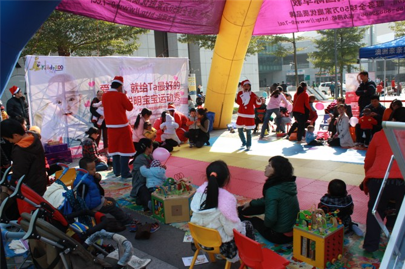

    <!--编程在路上 -->

# 故事在续写

### 网瘾游戏少年

### 早教机构-市场专员

### 编程求学

### 码农人生

### 辗转深圳

### 魔都之旅

<!-- ### 生活并不会那么一帆风顺，过去不值得留恋! -->
<!-- ### 学而不思则亡，思而不学则怠，学习永无止境！

无图片
 -->

### 只要出发就能到达，梦想从来不曾遥远.......

### 未来还在继续，下一站等你

# **`人生感慨`**
>少年时代，我的全世界只有网吧闪烁的屏幕。整日沉溺虚拟厮杀，虚度大好光阴，看不到前路，也从没想过未来该去往何方，浑浑噩噩耗掉一整个青春。

>走出年少虚妄后，生活立刻给了我沉重一击。一边被繁杂生活喘不过气，一边挤时间四处打工谋生，成了被现实裹挟不停奔波的牛马。日复一日的疲惫与迷茫裹着我，
>无数个深夜都在暗自不甘，不甘心一辈子困在底层，困在碌碌无为的循环里。

>我咬碎牙决定重启人生，孤身奔赴北京，一头扎进枯燥的代码世界。熬过无数个点灯刷题的深夜，耐住孤独、扛住挫败，一点点打碎从前懒散颓废的自己，重新塑造底气与本领。

>今指尖敲下代码的时刻，心底翻涌着无数对未来的期许。我总在幻想，有朝一日能凭一身技术站稳脚跟，弥补年少虚度的所有时光；
>靠自己的能力撑起想要的生活，去见更辽阔的世界，彻底告别当年沉沦迷惘的自己，永远做奔赴前路、追逐梦的少年。
